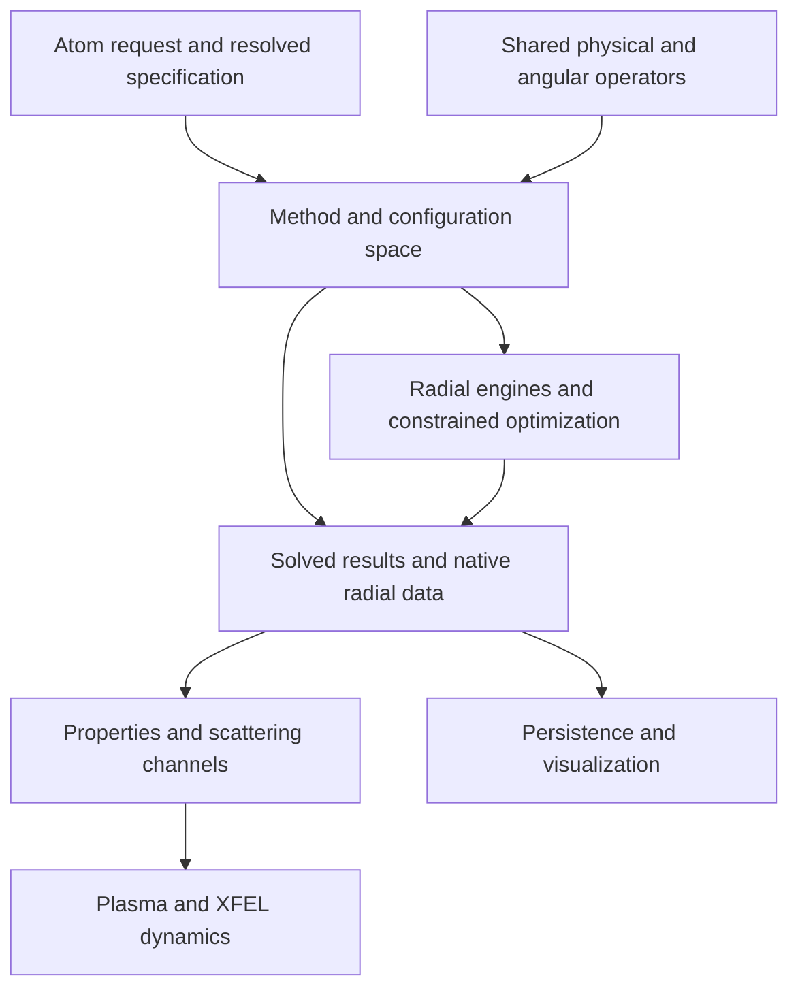

# atomx

High-performance atomic structure calculations, from Schrödinger and Dirac models
to Breit and QED corrections.

## Overview

atomx is a Python library for computing atomic energy levels, wavefunctions,
transition rates, hyperfine structure, and other atomic properties. Its theory
ladder spans hydrogenic models, Hartree–Fock–Slater and Dirac–Fock, multi-configuration
Dirac–Hartree–Fock (MCDHF), and correlation methods. B-spline and ODE shooting
engines share physical operators and JIT-compiled numerical kernels.

[Installation](#installation) · [Quick start](#quick-start) ·
[Architecture](#architecture) · [Verification](#verification-against-fac) ·
[Documentation](#documentation) · [Development](#development)

## Features

- **Theory ladder** — Hydrogenic, Hartree–Fock–Slater, Breit–Pauli, Dirac–Fock,
  Dirac–Fock with Breit/QED corrections, MCDHF/CI, MBPT(2), and all-order
  particle-particle ladder correlation.
- **Radial engine and exchange model** — B-spline Galerkin or Salvat ODE
  shooting numerics; nonlocal HF, local Slater exchange with configurable
  α, and Gu's FAC-style empirical exchange model. Supported combinations
  depend on the method; the MCDHF/CI configuration-list path uses B-splines.
- **Atomic properties** — Energy levels, radial orbitals, E1/M1/E2/M2
  transitions, hyperfine A/B constants, isotope shifts, Zeeman effects,
  g-factors, polarizability, EDM, and PNC.
- **Scattering** — Distorted-wave collisional excitation and electron-impact
  ionization, excitation-autoionization, Auger decay, dielectronic and
  radiative recombination, resonant excitation, photoionization, charge
  exchange, and R-matrix calculations.
- **Plasma modeling** — Debye and ion-sphere screening, collisional-radiative
  models, average-atom models, and cascades.
- **XFEL dynamics** — Native atomic rate tables, pulse-driven population
  equations and Monte Carlo cascades, magnetic-state coherent CI dynamics,
  and transient scattering observables, with explicit model applicability gates.
- **Spectrum synthesis** — Lines, free-free bremsstrahlung, free-bound
  recombination continua, and unresolved transition arrays (UTA).
- **QED corrections** — Vacuum polarization and self-energy models, including
  Mohr, Welton, Indelicato, Shabaev-local, and Flambaum–Ginges backends,
  with a composable `CorrectionStack`.
- **Electronic-structure providers** — Native and optional PySCF adapters,
  molecular core-hole states, and cluster/point-charge embedding.
- **Visualization** — Matplotlib, Plotly, and Manim backends for energy levels,
  radial orbitals, Grotrian diagrams, spectra, cross sections, and
  recombination resonances.

The [capabilities and limits](docs/ARCHITECTURE_CAPABILITIES.md) describe
supported result types, model approximations, and remaining gaps. For example,
Breit–Pauli currently uses hydrogenic perturbative shifts, and PNC/EDM entry
points require B-spline payloads.

Lower-level correlation interfaces now include complete declared NR-SD CI,
finite DC/DCB P/Q elimination and a bounded nonlinear CCSD solver. The
[implementation and numerical anchors](docs/yb_sd_breit_completion_2026_10_09/README.md)
state their resource and model limits. A separate [integral-driven CCSD/FS-CCSDT
backend](docs/ATOMIC_FSCC.md) supports optional on-demand native integrals and
bounded export, and solves native signed-integral tensor equations
without determinant enumeration. Complete virtual energy bands and explicit
core partitions are supported; angular-reduced scaling and automatic CC dispatch
through `Atom.solve()` remain outside this interface.
The separate [native scalar linearized SD interface](docs/ATOMIC_LINEARIZED_SD.md)
provides exact angular resource planning and a bounded closed-core DC/DCB
equation anchor. A direct reduced DC core-SD path now uses source-bound pCI
diagrams with the native cell integrator and full noncanonical Fock terms;
complete retained Ne virtual bands have been solved. A separate fixed-energy
valence SD interface now supplies signed Sigma1 rows and implicit energy
response on the same solved core. Complete directed two-valence Sigma2 and
joint response are also available with finite full-vector validation; their
CI energy/metric consumption and spectroscopic convergence remain unfinished.

The [NIST reference-data interfaces](docs/NIST_SPECTRUM_ATLAS.md) parse
caller-supplied levels, lines, classifications, and citations.
[Theory comparison](docs/THEORY_NIST_COMPARISON.md) provides state matching and
configuration-centroid conventions. The historical atlas builder and
interactive viewer were retired; the retained APIs do not download a complete
archive or provide a website launch command.

## Installation

Requires **Python 3.10 or later**. From the repository root:

```bash
python -m venv .venv
source .venv/bin/activate
python -m pip install -e .
```

On Windows PowerShell, activate with `.\.venv\Scripts\Activate.ps1`.
Reuse an existing environment if you already have one.

### Optional extras

Install extras from the same checkout, for example:

```bash
python -m pip install -e ".[viz,units]"
```

| Extra | Adds |
|---|---|
| `pyscf` | PySCF electronic-structure providers and embedding |
| `units` | Pint unit handling |
| `notebook` | Jupyter kernel, IPython, and notebook support |
| `viz` | Plotly visualization |
| `viz-manim` | Manim animations |
| `viz-all` | Plotly and Manim |
| `dev` | Test, lint, and development tools, including Pint and PySCF |
| `all` | Visualization, notebook, and units extras |

Matplotlib is a base dependency. The `all` extra excludes PySCF and development
tools; add `pyscf` or `dev` explicitly when needed. Dependency definitions live
in [pyproject.toml](pyproject.toml).

## Quick start

### Neutral neon

```python
from atomx import Atom

ne = Atom(10)
ne.solve()

if not ne.converged:
    raise RuntimeError("SCF did not converge")

print(ne.total_energy)       # Total energy in Hartree
print(ne.orbital_energies)   # Orbital energies in Hartree, keyed by subshell
print(ne.resolved_inputs)    # Resolved engine, model, and numerical controls
```

The default is nonlocal HF exchange on the shooting engine with a finite Fermi
nucleus, Hamiltonian-derived single-configuration averaging, and post-SCF
Breit/QED corrections enabled. Use `corrections="none"` for a Dirac–Coulomb
reference calculation. The first call may take longer while Numba compiles
numerical kernels.

### Multi-configuration CI

A list of configurations selects the common-orbital B-spline MCDHF/CI path.
Same-symmetry single and double replacements can couple through the Hamiltonian:

```python
from atomx import Atom, Basis

# Helium: the J=0, even states from these configurations can mix.
he = Atom(2, config=["1s2", "1s1 2s1"], corrections="none")
he.solve()
print(he.converged, he.state_energies)

# Beryllium: include the 2s² / 2p² double-replacement pair.
be = Atom(
    4,
    config=["1s2 2s2", "1s2 2p2"],
    corrections="none",
    basis=Basis(ns=45),
)
be.solve()
print(be.converged, be.total_energy)
print(be.result.mixing_coefficients[:, 0])
```

These small spaces illustrate CI coupling; check radial and correlation-space
refinement for your observable. Configurations define an expansion space,
while energy levels are its mixed eigenstates. Optimization weights and
physical initial populations have separate meanings. See the
[state and optimization contracts](#states-and-orbital-optimization) below and
the [atomic-state design](docs/ATOMIC_STATE_DESIGN.md) for implementation details
and proposals that remain unfinished.

### Choose the engine and exchange model

```python
from atomx import Atom, Exchange

# Local Slater exchange with the shooting engine for Ne-like Fe XVII.
ion = Atom(
    26,
    charge=16,
    config="1s2 2s2 2p6",
    engine="shooting",
    exchange=Exchange(model="slater", alpha_x=2 / 3),
    corrections="none",
)
ion.solve()
print(ion.converged, ion.total_energy)
print(ion.provenance)
```

For FAC-style local exchange, select `exchange="gu"`; both shooting and
B-spline engines support it. `Exchange` carries controls specific to its
model, such as `alpha_x` for Slater exchange.

### The ten constructor arguments

`Atom` accepts ten primary arguments. Detailed controls use frozen input
objects exported from `atomx`:

| Argument | Plain form | Detailed form or meaning |
|---|---|---|
| `Z` | `10` | Nuclear charge; required |
| `config` | `"1s2 2s2 2p6"` | A list selects explicit configurations for CI |
| `charge` | `0` | Net ion charge; electron count is `Z - charge` |
| `nuclear` | `"fermi"`, `"point"`, `"uniform"` | Nuclear charge distribution; uniform requires B-splines |
| `exchange` | `"hf"`, `"slater"`, `"gu"` | `Exchange(model=..., alpha_x=..., slater_method=...)` |
| `corrections` | `"none"`, `"breit"`, `"qed"`, `"breit+qed"` | `Corrections(breit=..., qed=..., qed_backend=..., stack=...)` |
| `correlation` | `"s"`, `"sd"` | `Correlation(expansion=..., averaging=..., radial_optimization=..., state_average=...)` |
| `engine` | `"bspline"`, `"shooting"` | Radial numerical engine |
| `basis` | — | `Basis(ns=..., ks=..., r_max=..., sampling=...)` |
| `environment` | — | `Environment(plasma_ne=..., plasma_Te=..., screening=...)` |

`ns` is the B-spline count, `ks` the spline order, and `r_max` the box radius
in Bohr. Inspect `help(Atom)` and the input classes for complete controls and
supported combinations. Removed flat keywords raise errors naming their
replacements; see the [migration guide](docs/MIGRATION.md).

### Plasma-screened ions

This Ne²⁺ example spells out all ten inputs. Its configuration contains the
eight electrons required by `Z - charge`:

```python
from atomx import Atom, Basis, Corrections, Correlation, Environment

ion = Atom(
    10,
    config="1s2 2s2 2p4",
    charge=2,
    nuclear="fermi",
    exchange="hf",
    corrections=Corrections(breit=True, qed=True, qed_backend="auto"),
    correlation=Correlation(averaging="hamiltonian"),
    engine="bspline",
    basis=Basis(ns=80, ks=9, r_max=75.0),
    environment=Environment(
        plasma_ne=1e22,       # Electron density in cm^-3
        plasma_Te=100.0,      # Electron temperature in eV
        screening="debye",
    ),
)
ion.solve()
print(ion.converged, ion.resolved_inputs)
```

Screening enters the SCF potential and changes the orbitals. The resulting
energy shifts depend on the screening model and orbital relaxation; inputs
that produce unbound subshells are rejected. `resolved_inputs` reports the
engine, model, corrections, grid, and environment actually used.

### Theory ladder

Climb the method ladder and display each energy increment:

```python
from atomx import Atom, Sampling
from atomx.methods import DiracFock

atom = Atom(2)
run = atom.climb(
    through=DiracFock(breit=True, qed=True),
    sampling=Sampling.quick,
)
run.show(unit="eV")
```

`Sampling.quick` is an exploratory preset. Ladder outcomes record individual
rung errors, so inspect `run.outcomes` when using the results programmatically.

### Compare methods

Solve each method first, then pass the resulting objects to `compare`:

```python
from atomx import Atom, compare
from atomx.methods import BreitPauli, DiracFock, HartreeFockSlater

methods = [
    HartreeFockSlater(),
    BreitPauli(),
    DiracFock(),
    DiracFock(breit=True, qed=True),
]
results = [Atom(2, corrections="none").solve(method) for method in methods]
compare(*results)
```

The nonrelativistic rung here uses local Slater exchange. Method comparisons
must account for that model change as well as relativistic corrections.

## External electronic-structure providers

The [provider contract](docs/adr/ADR-0001-electronic-structure-provider.md)
lets external electronic structures feed Atomx's Auger/CSF kernels. Install
PySCF support with `python -m pip install -e ".[pyscf]"`.

- `atomx.providers.pyscf_adapter.PySCFProvider` and `from_scf(mf)` convert
  converged mean fields into validated `ElectronicStructurePayload` objects.
- `build_core_hole_delta_scf_payload` constructs MOM-tracked molecular
  core-hole ΔSCF states.
- `atomx.providers.pyscf_embedding` provides rock-salt and point-charge
  embedding, core-orbital identity tracking, embedded binding energies,
  and cluster convergence studies.

The [MgO embedding benchmark](benchmarks/bench_pyscf_embedding_convergence.py)
demonstrates a Mg 1s convergence study. Provider availability does not imply
that every proposed adapter in the design record is implemented.

## Architecture

Methods define the Hamiltonian and configuration space; numerical engines
solve the selected problem. B-spline Galerkin and ODE shooting are numerical
representations, selected separately from exchange and correction models.
Single-configuration HF defaults to Hamiltonian-derived intermediate coupling;
an explicit configuration list or correlation expansion selects MCDHF/CI.



`Atom` validates the request and records the resolved calculation identity in
`CalculationSpec`, `resolved_inputs`, and provenance. Shared physical modules
own operators and density contractions; methods assemble states and optimization
objectives, and numerical modules own quadrature, eigensolvers, and constrained
iteration. Numerical modules do not import method or application policy.
Results retain the native radial representation and metric; properties and
scattering consume those solved states. Rendering and optional provider imports
are lazy.

### States and orbital optimization

Five choices have independent physical meanings:

| Choice | Current contract |
|---|---|
| Expansion space | `config=[...]` or `Correlation(expansion=...)` defines the retained configurations and CSFs |
| Orbital objective | The default ground-state target, `CIStateAverage`, or `CIChargeStateAverage` selects energies to optimize |
| Observable state | Solved results expose the ground state by default; supported transition and channel APIs resolve CI levels |
| Dynamical preparation | `CILevel`, `CILevelPopulation`, or an explicit magnetic-state density selects the initial state in supported coherent drivers |
| Energy reference | Common sector energies and explicit photon ladders determine thresholds and rotating-frame energies |

`CILevel(J2, parity, root)` identifies a zero-based energy root within a
`(2J, parity)` block. It does not track configuration character across changing
bases. `CILevelPopulation` supplies total, unpolarized level populations;
optimization weights are specified separately through
`Correlation(state_average=...)`. `CIStateAverage()` weights all resolved levels
equally; `statistical=True` additionally weights their magnetic degeneracies.
Changing the dynamical preparation does not repeat SCF or change its operators.

`CIChargeStateAverage` jointly optimizes declared electron-number sectors in
common orthonormal orbitals on the B-spline Dirac–Coulomb MCDHF path
(`corrections="none"`). Sharing orbitals with residual ions does not by itself
mean those ions were jointly optimized. Lower-level orbital functionals can
explicitly bind `CIBasisTracking` to a frozen reference and reject ambiguous
subspace identity. A unified `atom.state(...)` view, independently relaxed
initial/final orbital transformations, and dynamic orbital relaxation remain
unfinished. [Atomic-state design](docs/ATOMIC_STATE_DESIGN.md) gives the scope.

### Processes and dynamics

Properties and scattering reuse the shared radial and angular operators.
The common-orbital CI photoionization/Auger channel providers construct complete
residual Fock sectors over the retained orbitals. Their continuum approximation
is an energy-normalized Dirac distorted wave in the frozen final-ion direct
Hartree field, projected out of the retained bound space. Auger amplitudes keep
the full signed one- and two-body Hamiltonian contributions. This path does not
supply nonlocal continuum exchange or coupled Fano channels.

XFEL workflows consume prepared rate tables or magnetic-state operators:
`PopulationDynamics` and the cascade APIs evolve populations, while coherent
drivers retain phases and resolve radiative/electron reservoirs explicitly.
`MCDHFCoherentModel` requires `bound_only=True`; `TwoElectronCoherentModel`
and `MultiElectronCoherentModel` add finite-space CI ionization channels.
Prepared common-orbital channels reuse daughter spectra and continuum caches.
These models have separate pulse, space, and reservoir applicability gates;
their availability does not establish arbitrary-pulse or experimental accuracy.
See the [XFEL design and limits](docs/XFEL_GAP_ANALYSIS.md).

Complex-scaled Dirac/CI representations and target-spectrum solvers are also
available in lower-level modules. They use the c-product and require independent
pole/space convergence checks; they are not an automatic width extraction mode
of `Atom.solve()`. [Capabilities](docs/ARCHITECTURE_CAPABILITIES.md) links the
relevant verification contracts.

### Module ownership

```text
src/atomx/
  atom.py             # High-level Atom API
  atom_inputs.py      # Exchange, Corrections, Correlation, Basis, Environment
  calculation_spec.py # Resolved calculation identity
  types.py            # Theory, coupling, gauge, and unit enums
  results.py          # Results and convergence evidence
  constants.py        # Physical constants
  methods/            # Physical methods, CI assembly, correlated objectives
  numerics/           # B-splines, shooting, eigensolvers, optimization
  physics/            # Shared operators, CI state contracts, densities, snapshots
  angular/            # Wigner symbols, recoupling, angular Hamiltonian tables
  config/             # Configurations, subshells, CSFs
  corrections/        # Breit/QED models and operator inclusion accounting
  potentials/         # Nuclear and statistical potentials
  properties/         # Transitions, hyperfine, isotope shifts, other observables
  scattering/         # Continuum and collision processes
  providers/          # Native and external electronic-structure adapters
  plasma/             # Screening, CRM, average atom, cascades
  xfel/               # Pulse, rate, and coherent dynamics workflows
  spectrum/           # Spectral synthesis
  reference_data/     # Reference parsers and matching
  workflows/          # Calculation/reference comparison services
  io/                 # Result persistence
  viz/                # Matplotlib, Plotly, Manim rendering
```

Use the high-level `Atom` API for common calculations, method objects for
physical-model selection, or numerical and angular modules directly.
The [architecture guide](docs/ARCHITECTURE_DESIGN.md) describes ownership,
dependency direction, state identity, and remaining design work.

## Verification against FAC

Scattering and spectroscopy comparisons use matched physics flags,
normalizations, nuclear models, and energy grids. The
[verification guide](docs/VERIFICATION.md) distinguishes independent external
references, Atomx regression snapshots, live checks, and historical evidence.

| Quantity | Verification scope | Relevant gate |
|---|---|---|
| Continuum waves | Stored FAC radial dumps with matched potentials and energy normalization | [Continuum comparison](tests/test_continuum_vs_fac.py) |
| Collisional excitation Ω | He-like Z=10/26/54 panel with matched thresholds and energy grids | [Live DW comparisons](tests/test_fac_dw_benchmarks.py) |
| Electron-impact ionization | K-shell panel with matched exact-mode FAC references | [Live DW comparisons](tests/test_fac_dw_benchmarks.py) |
| Dielectronic recombination | Fe XVII clean-room resonance widths and temperature-dependent rates | [DR comparison](tests/test_dr_vs_fac.py), [manifold calculation](tests/test_dr_manifold_e2e.py) |
| Auger widths | **KNOWN GAP:** the strict 10% Fe XVII KLL agreement gate remains an expected failure | [Auger panel](tests/test_auger_fac_panel.py) |
| Atomic structure | Total-energy snapshots and external FAC comparisons; absolute differences also matter | [Structure snapshots](tests/test_fac_structure_snapshot.py) |

Measured values and source-specific results live in the verification guide
and linked reports. A small relative error in a total energy does not establish
accurate transition energies or widths. SCF convergence, radial refinement,
correlation-space convergence, and experimental agreement require separate checks.

FAC reference regeneration requires a configured `sfac` executable
(`FAC_SFAC_PATH`). The [benchmark report](benchmarks/REPORT.md) and
[external verification](benchmarks/EXTERNAL_VERIFICATION.md) document reference
provenance and model differences. Inspect each CRM/plasma benchmark's source:
historical synthetic panels do not provide independent validation.

## Performance

The numerical implementation uses Numba JIT compilation, batched radial
integrals, matrix-based Slater tables, reusable angular structures, and
caches tied to their physical inputs. Shooting with local exchange provides
a different cost/accuracy tradeoff from nonlocal HF or correlated CI.

First-call compilation and warm-cache timings differ. Runtime also depends on
the nucleus, radial grid, configuration space, continuum channels, thread
settings, and machine load. The [benchmark report](benchmarks/REPORT.md)
contains measured workload results; historical kernel or stage speedups do not
establish current end-to-end performance. Use matched models and convergence
criteria when comparing engines or optimizations.

## Documentation

- [Zenodo deposit preparation](docs/ZENODO_RELEASE.md) — Source archive, citation metadata, and upload page.
- [Documentation index](docs/README.md) — Current guides and historical evidence.
- [Architecture](docs/ARCHITECTURE_DESIGN.md) and
  [capabilities](docs/ARCHITECTURE_CAPABILITIES.md) — Module ownership and limits.
- [Atomic-state design](docs/ATOMIC_STATE_DESIGN.md) and
  [XFEL workflows](docs/XFEL_GAP_ANALYSIS.md) — Optimization, preparation, channels, and dynamics.
- [Migration](docs/MIGRATION.md) — API changes and saved-data compatibility.
- [Gallery](docs/gallery/) — Example scripts for inputs, orbitals, levels, and spectra.
- [Verification](docs/VERIFICATION.md) and [testing](docs/TESTING.md) —
  Scientific evidence and test organization.
- [Benchmark report](benchmarks/REPORT.md) — FAC methodology and recorded results.

## Development

Install development dependencies in your environment:

```bash
python -m pip install -e ".[dev]"
```

Run fast checks that directly exercise the affected contract. For the public
inputs and state-selection behavior described here:

```bash
export OPENBLAS_NUM_THREADS=1
export OMP_NUM_THREADS=1
python -m pytest -q tests/test_atom_input_surface.py tests/test_ci_level_selection.py
```

These tests check constructor validation, engine routing, level identity, and
population handling with small fixtures. For other changes, choose the relevant
tests from the [testing guide](docs/TESTING.md). Heavy scientific campaigns
have their own documented workflows and are separate from this routine check.

## Contributing checks

```bash
python -m ruff check --no-cache src tests scripts benchmarks
pre-commit install
```

CI runs the essential suite on Python 3.10 and 3.13, including two fresh-process
determinism repeats, with a target of about three minutes. Plain `pytest -q`
uses the same reviewed selection in `pyproject.toml`. The
[test](.github/workflows/test.yml) and [lint](.github/workflows/lint.yml) workflows
define the gates; long campaigns and their nightly schedule have been removed.
See the [testing guide](docs/TESTING.md) for coverage and focused checks.

Include reproducible inputs and relevant validation with a contribution.
For numerical issues, report `resolved_inputs`, convergence status, and the
reference or expected behavior. Update affected documentation with the code;
[AGENTS.md](AGENTS.md) contains lasting working principles in English.
Task-specific scientific contracts and records live in the
[agent reference guide](docs/AGENT_REFERENCE.md); the
[knowledge workflow](docs/AGENT_KNOWLEDGE_WORKFLOW.md) defines how to record
evidence and distill it into reusable guidance.

## License

atomx is licensed under the **GNU General Public License, version 3**
(`GPL-3.0`). See [LICENSE](LICENSE) for the full terms.

<!--
Current guide. Dependencies: Atom/input exports, CalculationSpec, CSF solver and
functionals, shared CI state/continuum modules, XFEL exports, pyproject and CI.
Maintenance, earlier evidence, and validation: docs/AGENT_KNOWLEDGE_WORKFLOW.md section 9.
-->
