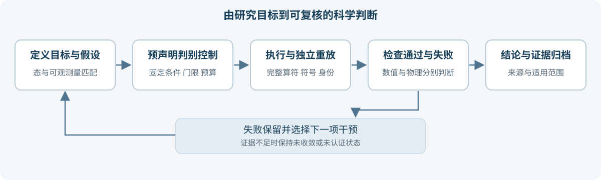
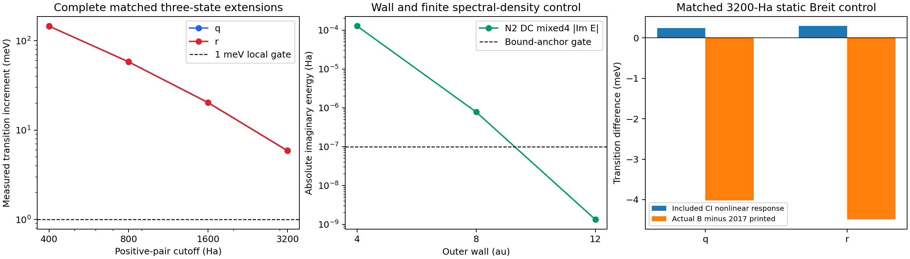

# Atomx 面向北京光源与未来产业的可验证谱学科学智能体

项目主题：北京光源与未来产业  
项目方向：Agentic Science、第一性原理谱学、科学计算复现与误差诊断  
版本日期：2026 年 10 月 6 日  
成果状态：已完成 Ne 三电子体系的有限模型判别实验与独立重放；材料谱学应用进入方案设计阶段。

## 项目摘要

先进光源能够提供高质量实验数据，但从一条谱线或一组吸收谱到可靠的科学结论，还需要回答三个问题：计算中的物理因素是否完整，模拟与实验是否采用相同的可观测量，以及出现偏差后应当先检验什么。Atomx 将这些问题组织成科学智能体可以执行、评审可以复核的研究流程：建立竞争假设，预先声明判别计算及验收门限，调用物理求解器，独立验证原算符与态身份，保存失败证据，再更新结论与下一步实验。

项目已有可核验案例。针对 Li-like Ne 的 q/r 两条芯激发谱线，完整扩展高能双激发相关空间后，最新一步使两条跃迁分别上移 5.914650 和 5.874690 meV；仅增加同批单激发的响应约为 0.0146 meV。这直接定位了本次主要共同位移的来源。固定 CI 空间中的 Breit 和 QED 已包含重对角化响应，因而不能再以“少迭代一次”为由重复加入相同修正。复尺度分支虽然出现角度稳定的共振候选，相关扩展仍使谱位移动 31–32 meV，系统因此保留物理极点尚未认证的结论。最新实空间谱位相对各自实验仍偏低 8.896190 和 13.881082 meV，完整物理收敛没有完成。

面向北京光源，项目将这套方法扩展为谱学研究服务：追踪数据与计算来源，区分物理模型误差、能量零点、归一化、仪器展宽与样品差异，并选择最有判别力的后续计算。首个拟议应用是新能源材料的 XANES 谱域映射与偏差诊断，随后评估催化材料和半导体材料。Ne 案例承担可控物理基准的作用；材料环境、固体屏蔽和实际线站数据需要独立验证。

竞赛展示的核心贡献是可复核的科学判断：既给出哪些因素已被直接测量，也明确哪些结论尚不成立。现有数值证据、原始失败与来源索引随文档提供；完整物理源码与矩阵保存在独立封存记录中。

## 北京光源的研究场景

### 光源能力与产业问题

北京怀柔的高能同步辐射光源 HEPS 采用 6 GeV 储存环，首期建设 14 条公共线站。6 GeV 是储存环电子能量，并非单个实验的入射光子能量。高能所的谱学线站资料列出了核共振散射、X 射线拉曼散射和共振非弹性散射等方法，面向芯能级与价电子激发研究。[HEPS 装置介绍](https://www.ihep.cas.cn/dkxzz/HEPS/zzjs/)、[高能量分辨谱学线站介绍](https://heps.ihep.ac.cn/xwdt/2022/202211/t20221101_6542537.html)

北京市投资促进服务局 2026 年 7 月公布的材料，将 HEPS 与新能源新材料、芯片半导体、商业航天、生物医药的产业对接联系起来，并介绍了智慧光源的数据、算力和应用验证建设方向。本项目据此选择能源材料谱学作为首个应用场景；企业合作和线站接入需在后续试点中落实。[怀柔科学城科技与产业融合活动](https://invest.beijing.gov.cn/tcgz/tzhd/202607/t20260701_4742101.html)

企业和研究人员面对的实际问题往往不是“能否计算一条曲线”，而是“这条曲线能否支持下一步决策”。例如，电极材料的谱形变化可能与局域电子态有关，也可能来自归一化、能量对齐、展宽或样品混合。没有能够区分这些解释的对照，曲线接近实验并不足以确立机理。

项目拟提供的服务是：把每个解释转化为明确干预，列出该干预应当改变的量，计算后检查变化是否符合预测，并将支持程度与适用范围一同交付。线站人员负责实验条件和数据质量，领域研究人员负责材料问题与物理解释，智能体负责计算组织、对照设计和证据维护。

### 原子基准与材料应用的关系

当前 Ne 基准的光子能量约为 908 eV，属于软 X 射线能区。它验证的是少电子原子体系中的差分相关、相对论算符和开放共振诊断，不能直接证明 HEPS 硬 X 射线材料谱学的计算精度，也不能作为已验证的线站能量校准标准。

可迁移的是研究方法与证据结构：同条件对照、完整物理空间控制、表示约定核验、失败保留以及结论的范围限制。迁移到真实材料时，需要增加局域结构、固体环境、屏蔽、温度和实验响应模型，并重新建立验收标准。

平台公开 XAS 题面出现“北京光源”数据来源名称，但该名称本身不能确定数据来自 HEPS 还是北京同步辐射装置 BSRF。实际使用前须依据数据元信息确认设施、线站和测量模式。[XAS-Sim2Real 公开题面](https://play.bohrium.com/api/challenges/xas-sim2real-bidirectional-52f0be51)

## 科学问题与第一性原理

### 研究对象与可观测量

首个验证对象为 Z=10 的 Li-like Ne 三电子体系，基态主组态为 1s²2s，上态主组态为 1s2s2p。对自电离上态，目标跃迁能量为：

```text
Eγ = Re(Eres) − Eg
Eres = Er − iΓ/2
δEγ = δEu − δEg
```

这里的 Γ 为所采用电子 Hamiltonian 描述的自电离宽度。完整自然线宽还可能需要辐射衰变等贡献，实验拟合宽度还包含仪器和样品响应。实空间有限 CI 给出的能量差与经过认证的共振极点能量差是不同完成阶段。

生产模型采用有限核、冻结 Dirac–Fock 轨道和正能电子投影，Hamiltonian 包含 Dirac–Coulomb、完整静态 Breit、模型 QED、正常质量反冲和特殊质量反冲。项目检验的是该模型内的结果与控制，模型 QED 和 no-pair 近似本身也有适用范围。[实空间模型与协议](evidence/protocol.json)

研究同时保留两类可观测量：单线谱位反映上下态的能量差，q−r 劈裂中共同基态能量严格抵消。因此，只改变基态无法修复劈裂偏差。两条单线的共同运动和两条线之间的相对运动必须分别分析。

### 相关空间为何改变谱位

将保留组态记为 P，新增组态记为 Q，在 Hermitian 模型中消去 Q 可得：

```text
Heff(E) = HPP + HPQ (E − HQQ)⁻¹ HQP
t = HQP u₀
Σ(E₀) = t† (E₀ − HQQ)⁻¹ t
```

若独立验证 Q 的最低本征值高于旧态能量 E₀，这个固定旧态的反馈为负，表示新增闭通道降低态能量。跃迁能量的方向由上态与基态降低量之差决定。基态和上态拥有不同电子对与径向分布，不能假设相关误差相同，也不能将某一态的降低量直接视为跃迁修正。

项目采用完整新增组态和完整耦合 Q 求解，并将反馈预测与实际重对角化比较。电子对坐标分区来自同一个耦合解；这些分区用于定位响应，不能作为彼此独立、任意相加的修正。

### 自洽响应需要区分三个层次

固定轨道与投影时，先在 H₀ 的态上计算一阶期望，再求 H₀+V 的本征值：

```text
一阶响应 = ⟨ψ₀|V|ψ₀⟩
完整开关响应 = E(H₀+V) − E(H₀)
非线性 CI 响应 = 完整开关响应 − 一阶响应
```

如果生产 Hamiltonian 已含 V 并完成对角化，这个 CI 系数响应已经包含。将它再次加到最终能量会重复计数。重新优化轨道是另一个干预；改变正能投影又是另一个干预，需要分别固定条件和比较上下态。

在同一一电子投影内，完整 FCI 对轨道的酉旋转具有表示不变性；截断 CI 通常不具有相同闭合性。因此，轨道优化可能改变有限空间的结果，但不能预先将这种变化视作独立于遗漏相关的额外物理项。当前大空间轨道及投影自洽响应尚未独立测量。

### 物理极点为何需要多重控制

复尺度能够将共振问题转化为复能量求解，但负虚部或局部角度平台不足以认证物理极点。求解残差、态身份、束缚锚、开放通道阈值、尺度参数、径向表示及相关空间分别检验不同问题。组态空间变化后，原有认证必须重新检查。[复尺度原始方法](https://arxiv.org/pdf/1909.11487)

## 科学智能体的工作方式

### 人与智能体的职责

当前成果由研究人员持续提出科学目标、指定检查方向，Codex agent 组织文献核对、计算控制、脚本执行、独立验证和证据归档。它体现了人指导下的多步骤科学研究能力。全自动无人干预的成功率、成本优势及跨任务泛化能力还需要专门评测。

| 参与角色 | 当前职责 | 必须留下的记录 |
|---|---|---|
| 研究人员 | 定义物理目标、决定研究范围与优先方向 | 用户目标、约束、方向调整 |
| 科学智能体 | 提出竞争假设、设计干预、调用工具、检查证据、更新结论 | 假设、测前协议、调用结果、失败与后续决定 |
| 物理求解器 | 装配 Hamiltonian，完成实空间与复空间求解 | 模型、基底、矩阵、能量、向量、残差 |
| 独立验证程序 | 重放原算符、检查完整键和符号、计算反馈与账本 | 独立控制结果、输入及源码哈希 |
| 领域评审 | 判断模型与结论是否适用于实验问题 | 适用条件、接受或保留的理由 |

### 从偏差到判别计算

每次研究迭代按以下顺序执行：

1. **定义目标。** 固定要比较的态、可观测量、单位、核模型、投影和实验估计量。
2. **提出解释。** 例如相关尾部不足、Breit 约定不一致、遗漏响应或复空间表示异常。
3. **选择干预。** 优先执行能够区分解释的最小完整控制，而不是同时改变多个因素。
4. **预声明。** 保存固定条件、候选空间规模、资源上限、通过条件、失败条件和停止规则。
5. **计算和验证。** 保存生产结果，并独立检查原算符残差、态身份、符号及各态响应。
6. **更新证据。** 区分测量、条件估算、支持的解释和仍未确定的归因。
7. **决定下一步。** 通过门限后才扩大结论；失败则保留原件，并声明新的判别实验。



这一流程允许智能体给出“计算求解准确，但物理空间未收敛”的结论。失败不是需要隐藏的输出，而是下一次实验设计的输入。

### 假设选择与停止规则

拟议任务调度优先考虑三个条件：该计算能否区分当前解释，是否保持模型与可观测量匹配，以及是否在资源预算内可完整执行。不能仅按可能接近实验的程度选择计算。

遇到态身份丢失、算符范围不支持、残差失败或资源不足时，停止对应结论。扩大资源须保留原尝试；改变模型须启动新的协议。未经计算的空间只标记为未完成，不能用外推值填入最终谱位。

## 已完成的科学验证

### 高能双激发相关产生主要共同位移

以下截止是**正能虚轨道的电子能量截止**，单位为 Hartree；不是光源入射光子能量。

| 完整截止扩展 | q 跃迁增量 meV | r 跃迁增量 meV |
|---|---:|---:|
| 200 → 400 Ha | 145.986276 | 145.295300 |
| 400 → 800 Ha | 58.311005 | 57.955575 |
| 800 → 1600 Ha | 20.432577 | 20.298738 |
| 1600 → 3200 Ha | 5.914650 | 5.874690 |

序列的增量持续减小，但最新一步仍超过预先声明的 1 meV 局部增量门。[截止序列与预测检验](evidence/tail_model.json)

| 最新 1600 → 3200 Ha 的同模型响应 | g | q 上态 | r 上态 |
|---|---:|---:|---:|
| 实际态能量增量 meV | −6.631082 | −0.716432 | −0.756392 |
| 固定旧态的完整 Q 反馈 meV | −6.630787 | −0.716340 | −0.756300 |
| 完整 Q 正谱隙 Ha | 1640.391826 | 1577.167255 | 1575.785668 |
| 原算符绝对残差 Ha | 2.489×10⁻¹¹ | 7.432×10⁻¹¹ | 2.380×10⁻¹¹ |

各态新增 Q 的正谱隙和负反馈已独立核验。基态能量下降更多，因而两条跃迁上移。反馈预测与实际跃迁增量之差约为 −0.000203 meV，支持本次有限空间干预的差分相关解释。[三态结果](evidence/e3200/analysis.json)、[独立验证](evidence/validation.json)

| 同批新增组态对照 | q 跃迁增量 meV | r 跃迁增量 meV |
|---|---:|---:|
| 仅补入全部新单激发 | 0.014556 | 0.014465 |
| 在该空间继续补入全部新双激发 | 5.900094 | 5.860225 |

双激发贡献了本次主要响应。有限 Q 的基态与上态耦合强度平方比约为 9.0–9.5，而有效分母比约为 1.026；这进一步表明本次差分响应主要由耦合强度差异支配。该判断仅适用于已计算的 Q。[单激发对照](evidence/e3200/singles_analysis.json)、[反馈尺度分解](evidence/feedback_scale_analysis.json)

### 当前谱位与实验比较

| 单独匹配的谱线 | 本次全修正实空间结果 eV | 2024 实验值 eV | 计算减实验 meV |
|---|---:|---:|---:|
| q | 908.193003810 | 908.2019(55) | −8.896190 |
| r | 908.065718918 | 908.0796(57) | −13.881082 |

实验论文另报联合拟合劈裂 122.2(5.3) meV，本次 q−r 为 127.284892 meV，差为 5.084892 meV。印刷单线值的代数差、联合劈裂和另报中心可能属于不同估计量，比较时必须保留各自定义。项目没有据此构造未验证的协方差或显著性结论。[2024 原始论文](https://harvest.aps.org/v2/journals/articles/10.1103/PhysRevA.110.L030802/fulltext)、[实验名义值核对](evidence/experimental_nominals.json)

此前约 0.30 eV 的偏差属于较小的历史空间；当前结果已发生显著改变。不同阶段的空间和算符条件必须随数值报告，不能将历史偏差视为当前结果，也不能把全部历史改善唯一归给基态。

### Breit 与 QED 的响应已经进入计算

| 固定完整 3200 Ha 空间的 Breit 控制 | q meV | r meV |
|---|---:|---:|
| DCB 减 DC 的实际跃迁响应 | −293.412028 | −297.556786 |
| DC 态的一阶 Breit 期望差 | −293.653337 | −297.847927 |
| 已包含的非线性 CI 响应 | 0.241308 | 0.291141 |
| 实际开关响应减 2017 印刷分项 | −4.018936 | −4.490156 |

完整对角化已包含约 0.24–0.29 meV 的非线性响应。前期完整 1600 Ha 的 QED 单独开关控制测得约 0.0395/0.0393 meV 的非线性 CI 响应，同样已经进入相应谱位。它们不能当作遗漏修正再加一次，也不能用于约束尚未测量的轨道或投影自洽。[完整 Breit 路径](evidence/breit_path_3200.json)、[QED 同空间控制记录](../xfel_uv_tail_continuation_2026_10_06/README.md)

2017 论文采用 DCB 求解，但印刷 DC/Breit 分项的具体取值态与拆分处方尚未完全匹配。本项目同时检查能量开关差与最终态算符期望，保留定义差异。约 4–5 meV 的跨模型 Breit 分项差是定位线索；它不是独立遗漏物理项的误差预算。[2017 原始论文](https://arxiv.org/html/1712.09383)

在参考组态有限频率处方内，完整 3200 Ha 态的一阶跃迁响应为 0.045086/0.046889 meV，指定有限空间算符的有序本征值跃迁界为 0.071999/0.070425 meV。该处方内的频率项不足以补足上述分项差；此界不能推广为完整频率依赖 QED、轨道响应或极点误差界。[参考组态频率控制](evidence/frequency_reference_projection.json)

算符及有限频率相关回归共 68 项通过，包含有符号矩阵元、零频极限和表示约定控制。它们验证对应实现和测试范围，不替代完整 Ne 大空间的独立跨代码复现。[静态及复算符回归](evidence/operator_tests.json)、[有限频率回归](evidence/frequency_tests.json)

### 复尺度候选通过局部门限但尚未认证

复空间控制采用点核、核 Dirac 正能投影和较小 s/p 空间，区别于实空间生产模型。

| N2 束缚锚控制 | 虚部绝对值 Ha | 原门限 10⁻⁷ Ha |
|---|---:|---|
| R4 关闭 Breit 后的完整 mixed4 空间 | 1.270325×10⁻⁴ | 未通过 |
| R8 的同类完整空间 | 7.803523×10⁻⁷ | 未通过 |
| R12 的同类完整空间 | 1.340341×10⁻⁹ | 通过 |

关闭 Breit 后异常仍存在，排除了 Breit 是该异常必要原因的解释。扩大外盒恢复束缚锚门，但同时改变了域和有限谱密度，不能唯一归为纯墙面效应。[关闭 Breit 控制](evidence/complex_breit_off.json)、[外盒与有限谱控制](evidence/wall_control.json)

在 R12 静态 DCB 模型中，q/r 候选具备正确开放阈值和出射号，独立完整谱重放通过；有限 θ 邻域的复能跨度约为 0.000101/0.000104 meV。然而 rank1 到完整 mixed4 双激发空间使跃迁变化 −31.498997/−32.137585 meV，相关空间仍未收敛。[完整谱对照](evidence/wall_center_comparison.json)、[角度控制](evidence/wall_angle_analysis.json)

因此，项目保存共振候选与形式宽度，保留物理极点未认证状态。点核分支的位移没有拼接到 Fermi 核生产谱位。



图中左侧显示局部截止增量，不能读取为剩余误差界；中间同时改变外盒和有限谱密度；右侧论文分项比较跨模型。

## 失败记录与科学判断

### 测前尾部预测没有通过

测量前采用条件幂律 p=1.5 预测最新一步的 q/r 增量为 7.224007/7.176688 meV，实际为 5.914650/5.874690 meV，误差为 1.309356/1.301998 meV。两条线均未通过原 1 meV 预测门，最新局部增量也未通过 1 meV 门。

项目保留原预测和失败结果。条件幂律可以帮助安排计算，但没有成为已认证的剩余误差界，也没有用来补齐最终能量。[测前预测与实际结果](evidence/tail_model.json)

### 账本精度失败修正了诊断算术

原验证已通过三态残差、谱隙和身份门，最后的跃迁增量账本闭合却超过 10⁻⁸ meV 门限。失败量级约为 2.30×10⁻⁸ 和 1.66×10⁻⁸ meV。该严格账本门是内部算术一致性检查，与实验精度或物理收敛标准不同。

原日志、协议和输入哈希先行保存。随后保持 Hamiltonian、波函数和生产能量逐字节相同，采用更高精度的增量收缩，显式检查归一化。重试闭合差为 8.68×10⁻⁹ 和 −7.49×10⁻⁹ meV，通过原门限；未改动的完整原验证随后重新通过。这个修复没有添加物理修正。[原失败索引](evidence/failed_validation_ledger_closure/manifest.json)、[测前重试协议](evidence/ledger_precision_retry_protocol.json)、[实际重试结果](evidence/energy_balance_precise_retry.json)

### 表示变化必须同步变换参考

复空间最初的裸 LS 参考未带入径向本征向量的任意符号，导致 q 参考指标无法通过原身份门。独立解析轨道确认号规后，仅修复参考的协变变换，Hamiltonian、根、能量和阈值保持。完整坐标翻转控制验证了该修复范围。[完整号规与协变性证据](../xfel_tail_breit_pole_2026_10_06/README.md)

这三个案例显示智能体需要识别失败发生在哪一层：外推假设、数值诊断算术或基底表示。不同层的修复不能混为物理机制发现。

## 复现条件与证据交付

### 实空间生产条件

| 条件 | 实际配置 |
|---|---|
| 元素与同位素 | Z=10，²⁰Ne |
| 核模型 | Fermi 核，rms 3.0055 fm，skin 2.30 fm |
| 轨道与投影 | 冻结 1s² Dirac–Fock 轨道，电子正能支 |
| Hamiltonian | DC 加完整静态 Breit、QEDMOD、NMS、SMS |
| 径向表示 | NS160，B 样条阶数 9，R40，γ=1，Gauss21 |
| 分波与相关 | s/p/d；束缚 n≤6 完整 rank2，n≤4 rank3；新增正能完整 rank1/rank2 |
| 最新轨道数 | 291，旧 271 轨道逐字节保留 |
| g/q/r CSF 数 | 78791 / 114698 / 78790 |
| g/q/r 原始候选数 | 338687 / 299935 / 349724 |
| 数值门 | 选态原算符绝对残差小于 10⁻¹⁰ Ha；固定有符号身份门 |
| 计算资源策略 | 大空间上限 130000 CSF、400000 raw；104 GiB 预算、24 工人、BLAS 单线程 |

所有物理计算绑定 332 个源码文件的快照，避免将后来工作树的变更混入旧结果。机器有其他负载，当前没有受控端到端加速比、模型调用费用或无人干预成功率结论。

### 两层复核

第一层是文档证据复核：本包保留 21 个逐字节复制的数值、协议、封存证明和图像文件，提供哈希索引与标准库验证脚本。它可以检查交付材料的来源、核心数值与完成状态。

第二层是物理重放：完整源码、轨道、矩阵和失败原件保存在独立科学档案中，档案含 50834 个文件，最终逐文件复核通过。完整重放应复制档案到可写的新运行目录，并使用原环境和协议；不能在封存目录内直接运行会写缓存的物理入口。文档证据包不替代完整物理运行环境。[封存证明](evidence/seal_check.json)、[证据索引](evidence_index.json)

封存清单 SHA-256：

```text
bbe79f26b9c354f371c749a2002a607a79f9af6ab0e25dff1ad996eb4b2b15e2
```

当前完成标志为：有限模型数值控制通过；完整相关收敛为 False；物理极点认证为 False。这个状态随交付材料保留。

## Agentic Science 平台对应方式

### 项目评审与官方赛题提交

The Playground 将科学工作组织为挑战、尝试、轨迹和可调用的复现包，强调研究结果与执行过程的对应。Atomx 的假设、协议、计算、独立检查和失败归档可以映射到这一结构。[平台入门](https://play.bohrium.com/api/docs/getting-started)、[轨迹说明](https://play.bohrium.com/api/docs/reading-a-trace)

本项目主题由用户指定。2026 年 10 月 6 日读取的公开 hackathon 列表中，未发现同名“北京光源与未来产业”题目。官网 XAS-Sim2Real 可作为谱学方法的具体衔接案例，但其公开轮次结束时间为北京时间 2026 年 8 月 29 日 20:30。正式参赛需对应当期目标场次、题目和允许提交形式。

该 XAS 题目要求模拟谱与实验谱双向映射，规定输入输出、数据隔离和运行预算。题面描述数值评分，而当前 API 的评分字段显示通用 ARM 策略，两者存在需要主办方确认的差异。不能把本项目的原子谱学成绩转换成该题分数，也不能凭文档推断正式成绩。[题目及当前评分字段](https://play.bohrium.com/api/challenges/xas-sim2real-bidirectional-52f0be51)

### 参赛材料组织

| 交付内容 | 目前可提供 | 正式可执行提交需要补充 |
|---|---|---|
| 科学结论 | 同条件测量、判别表、适用边界 | 对应目标赛题的最终交付物 |
| 数值结果 | JSON、谱位、响应、验证状态 | 新任务的合法输出与重复运行结果 |
| 研究轨迹 | 原协议、日志索引、失败与重试证据 | 平台要求的真实原始 agent 轨迹格式 |
| 执行环境 | 物理源码快照和原环境记录 | 可分发依赖锁、容器与可执行入口 |
| 结果特征 | 已知偏差、未完成空间、失败条件 | 按当前平台协议建立 characterization |

平台 ARM 文档提供了执行、结果特征和轨迹等交付约定。正式上传前应使用当前协议进行本地格式校验，并确认题目需要的文件路径；平台结构校验通过与物理结果可信属于两个独立检查。[ARM 交付说明](https://play.bohrium.com/api/docs/arm-bundles)

## 面向未来产业的实施方案

### 首个场景为能源材料谱学

拟议试点选择一类具有公开标准样或可合法共享实验谱的电极或催化材料，首先解决“模拟谱和实验谱为何不同”，再评估材料问题。数据必须附带吸收元素与边、设施和线站、测量模式、能量轴、归一化方法、实验响应、样品状态和使用许可。

谱学映射在材料环境、仪器和计算模型之间可能出现域差异。拟议工作流采用以下明确对照：

| 待判别因素 | 固定条件与干预 | 观察量 | 可以支持的结论 |
|---|---|---|---|
| 能量零点 | 固定谱形，按预声明规则改变对齐方式 | 峰位误差、导数误差、残差随能量变化 | 对齐差异是否解释主要偏移 |
| 仪器展宽 | 固定材料模型，采用已知或独立测量的响应卷积 | 峰宽与谱形残差 | 响应模型是否解释展宽差异 |
| 归一化与模式 | 保留原谱和处理记录，比较合法的一致处理 | 强度比例与基线残差 | 处理或模式差异是否显著 |
| 计算模型 | 固定结构、数据和展宽，替换明确的模型假设 | 预定义数值指标与区域残差 | 某模型在该数据范围是否更合适 |
| 样品与结构 | 固定测量条件，用独立结构信息建立竞争样品模型 | 未用于拟合的谱段或独立观测 | 某解释是否获得额外支持 |

模型选择只使用训练与验证数据；测试集和目标谱保持隔离。评分题若预先规定了归一化和能量网格，工作流须遵守该题契约，不能额外改变数据以提高分数。

试点交付四项结果：双向谱域映射基线、按材料分组的验证报告、因素干预与残差说明，以及可复核的数据和执行来源。谱到谱预测不自动构成结构反演或物相唯一识别，机理结论需要独立证据。

### 后续产业场景

| 场景 | 拟解决的问题 | 所需新增验证 | 面向用户的交付 |
|---|---|---|---|
| 电池与催化材料 | 区分谱形变化与处理、仪器、局域环境因素 | 标准样、条件匹配、独立局域结构信息 | 偏差诊断、适用范围、后续测量建议 |
| 半导体与功能材料 | 判断模型是否支持电子态或界面差异解释 | 材料环境、芯空穴与响应模型、对照样品 | 有证据支撑的竞争解释与计算记录 |
| 量子与先进材料 | 评估 RIXS 等谱学模型及其参数敏感性 | 对应多体模型、动量与偏振契约、实验分辨 | 可重复的模型比较与敏感性结果 |

这些场景属于拟议扩展。当前 Atomx 少电子原子结果没有完成上述材料应用验证，项目也未建立已签约企业、实际节省机时或工业生产指标。

## 验收指标与对照评测

### 三类指标分别验收

| 指标类别 | 当前实测或计划指标 | 验收解释 |
|---|---|---|
| 数值正确性 | 残差、完整键、符号、输入及源码一致性、独立重放 | 证明所声明有限问题被正确求解 |
| 物理可信度 | 相关、径向、高分波、算符、投影、极点控制 | 判断是否可扩大到目标物理结论 |
| 智能体研究能力 | 假设覆盖、干预有效性、错误认证、人工介入、计算和模型调用成本 | 判断研究组织是否可靠及是否节省资源 |

当前第一类控制已完成相应范围；第二类仍有明确缺口；第三类尚无受控对照结果。文件数量和测试数量不能直接当作智能体科学能力的评分。

### 智能体对照实验

后续评测拟设置三个可比较条件：研究人员按固定脚本执行，agent 执行固定计算流程，agent 自行选择下一项判别控制。三组使用相同任务、源码、初始证据与预算，评审在不知道执行组别的条件下核对结论。任务集包含相关尾部不足、表示符号异常、算符范围不支持和局部极点平台等不同失败类型；已披露案例用于开发，另留独立案例用于测试。

主要指标为正确识别解释的比例和错误宣称通过的比例，同时记录完整计算开销、实际模型调用、失败重试、人工介入次数及最终证据完整性。比较耗时与费用时，须控制机器负载、冷暖缓存和任务范围。具体样本数在预实验后预声明，未达到样本量前只报告逐案例结果。

拟议任务级停止条件为：预算耗尽、无法保持模型匹配、必要控制失败或证据不足。正确拒绝扩大结论可计入研究质量；不得以必须得到成功结果为任务终点。

### 原子物理的下一阶段验收

优先补齐高 κ QED 与真空极化接口覆盖，再在共同径向与截止约定下执行完整高分波双激发。随后继续正能截止、径向密度、束缚 n 和 rank3 控制。局部增量标准是收敛诊断，严格剩余误差界仍须额外推导或独立验证。

复空间先扩大 R12 的完整 rank2 池，每一步同步检验两束缚锚、q/r 身份、阈值及参数稳定性；最终在与生产一致的 Fermi 核、冻结 DF 投影和算符范围内提取共振。只有这些控制完成后，才可更新物理极点认证状态。

Breit 剩余分项差需要同轨道、同投影、同完整组态的独立大矩阵参照。轨道与投影自洽分别设置对照，避免与相关尾部或已经包含的 CI 响应重复计数。

## 六周实施与资源计划

### 里程碑

以下为自项目启动日起计算的建议周期，资源与数据具备后执行。六周交付重点是可运行研究流程和首个材料诊断基线；完整原子相关收敛与极点认证按照实际控制结果推进。

| 周期 | 主要工作 | 可审阅交付 | 进入下一阶段的条件 |
|---|---|---|---|
| 第 1 周 | 固定目标赛题或试点范围，确认数据来源，整理可执行包 | 任务契约、来源索引、依赖锁与小规模重放 | 格式合法，输入输出明确，原证据可复核 |
| 第 2 周 | 建立假设及协议记录，执行低成本因素对照 | 真实执行轨迹、控制矩阵、资源记录 | 每项结论可追溯到实际干预 |
| 第 3 周 | 执行原子高分波和 Breit 同表示控制 | 更新谱位与通过状态，保留失败 | 完整模型覆盖且原数值门通过 |
| 第 4 周 | 扩展复空间并建立材料谱域基线 | 极点控制报告、材料验证基线 | 物理和数据契约分别满足 |
| 第 5 周 | 进行独立任务与方法对照评测 | 盲评结果、误认证率、成本与人工介入记录 | 评价方法预声明，测试数据隔离 |
| 第 6 周 | 整理竞赛交付、答辩与试点需求 | 可执行材料、完整报告、演示、未完成清单 | 当前平台格式校验与科学审阅通过 |

### 人员与计算

建议由三类职责配合：原子或材料谱学研究、智能体与工程实现、实验数据与独立验证。它们是实施所需角色，不代表已组建对应人数的团队。试点线站和企业由项目负责人实际确认。

现有大空间控制使用约 104 GiB 预算和最多 24 个工人。后续同等规模任务拟配置具有内存余量的 CPU 节点；更高分波和更大完整空间先估算 CSF、raw 候选、矩阵及装配成本，再决定节点配置。材料学习模型是否需要 GPU 由基线测量确定。

计划以 2000 CPU 核时作为首轮工程与计算预留，并额外预留 20% 失败重试容量；这些是排期假设，不是已测总耗时或完整物理收敛保证。模型调用预算在预实验后依据实际输入输出量确定，不填入未经计量的历史费用。

```text
总预算 = CPU 核时 × 实际核时单价
       + GPU 小时 × 实际小时单价
       + 模型调用实际用量 × 对应单价
       + 存储、数据服务与人工验证费用
```

资源单价按执行时的服务报价和协议填入。达到预算上限即保存已有结果并重新评估范围，不能通过删弱通道或放宽科学门限维持“完成”状态。

## 创新点与主要风险

### 可展示的贡献

第一，研究目标从绝对能量转到可观测量的差分响应。智能体同步跟踪基态和上态，以共同位移和劈裂区分解释，避免把单态改善等同于谱学改善。

第二，将修正开关、最终态期望、CI 响应、轨道优化和投影改变分别定义。它减少了“再加一项修正”造成的重复计数，也使跨论文约定成为可检查对象。

第三，把独立原算符重放、态身份和物理空间控制嵌入研究过程。局部参数稳定而相关空间失败的共振案例，直接展示了这些检查的科学价值。

第四，将失败保留、精度重试和来源绑定纳入交付。评审可以看到结论为何改变，并检查新结论是否仍满足原门限。

这些是本项目已展示或拟扩展的方法贡献。方法的新颖性范围需通过更系统的相关工作比较评估，当前没有宣称首次实现完全自主科学发现。

### 风险与处理条件

| 风险 | 对结论的影响 | 处理方式 |
|---|---|---|
| 高分波或相关尾部成本超出预计 | 无法给出完整收敛结论 | 先做完整规模预估，分阶段执行，保留未完成状态 |
| 轨道或投影变化混入对照 | 因素无法独立归因 | 使用独立协议，固定其余条件，同步测量上下态 |
| 复尺度局部平台造成误认证 | 把表示伪根当作物理极点 | 保留束缚锚、阈值、空间及参数联合控制 |
| 材料数据来源或处理不一致 | 映射结果受到域差异误导 | 保留原谱、设施元信息、处理记录和分组验证 |
| 测试目标泄漏或经验反复拟合 | 分数无法代表泛化能力 | 固定开发和测试划分，限制可读取资源 |
| 重建摘要代替真实轨迹 | 无法证明 agent 的实际行为 | 分开提供真实执行记录与人工整理的评审摘要 |
| 平台规则或评分配置变化 | 提交形式与成绩预期失配 | 以目标场次当前协议为准，记录配置版本 |

## 演示与答辩安排

### 八分钟演示

| 时间 | 展示内容 | 评审可核对的对象 |
|---|---|---|
| 0 至 1 分钟 | 北京光源谱学中的可靠解释问题与项目目标 | 光源和应用范围，原子基准定位 |
| 1 至 3 分钟 | 从偏差建立竞争假设，展示三态相关响应 | 完整截止与单激发对照、反馈预测 |
| 3 至 4 分钟 | 展示 Breit 与 QED 已包含响应 | 一阶与完整开关定义、重复计数边界 |
| 4 至 5 分钟 | 展示复尺度局部稳定但相关控制失败 | 束缚锚、空间变化、未认证状态 |
| 5 至 6 分钟 | 展示一次原失败与同矩阵精度重试 | 协议、哈希与原门限保持 |
| 6 至 7 分钟 | 演示证据包核验与真实轨迹入口 | 标准库验证结果、来源索引 |
| 7 至 8 分钟 | 说明材料试点、验收与六周交付 | 具体因素对照、基线和未完成任务 |

现场以读取已有数值和执行轻量证据核验为主；完整大矩阵计算作为有日志的离线成果展示。材料谱学演示在基线完成后加入，不能用展示图代替实际运行结果。

### 关键答辩判断

**已经定位什么？** 最新有限空间中，高能双激发相关支配两条线的共同位移；基态响应更大。它是直接干预结果，尚不能唯一解释全部历史误差。

**QED 加入后是否需要再迭代？** 固定 CI 的系数响应已经包含。轨道及投影自洽需要单独检验；当前没有用固定 CI 响应给它们提供数值上界。

**是否找到了物理共振极点？** 已找到同模型下通过多项控制的候选，相关空间仍有 31–32 meV 的谱位移动，物理认证状态保留为 False。

**是否已经用于北京光源企业样品？** 已有原子物理验证和材料应用方案。线站数据、材料环境与企业问题须在试点中独立验证。

**科学智能体的价值如何衡量？** 当前案例证明它能够组织多步骤判别、识别不同层的失败并维护证据。是否节省成本、提高任务成功率，按照预声明的受控对照评测回答。

## 交付索引

| 文件 | 用途 |
|---|---|
| 参赛项目书.md | 完整可编辑正文 |
| 参赛项目书.pdf | 阅读和答辩使用的排版版本 |
| 参赛项目书.docx | 常用办公格式的可编辑版本 |
| 参赛项目书.html | 本地阅读与打印版本 |
| 评审摘要.md | 一页概览与项目核心判断 |
| evidence_index.json | 逐字节证据子集与完整档案来源 |
| evidence/ | 核心数值、测前协议、失败与验证证明 |
| sources/index.json | 官网与题面读取记录及哈希 |
| verify_evidence.py | 无物理导入的证据与核心数值核验 |
| verification.json | 本次文档交付的实际检查结果 |

源码与矩阵完整复现入口见[科学档案](../xfel_tail_breit_pole_2026_10_06/README.md)。正文属于项目说明与技术评审材料；对应官方赛题的容器、输出和原始轨迹按正式提交契约补充。

## 参考资料

1. [The Playground 入门与挑战评分说明](https://play.bohrium.com/api/docs/getting-started)。
2. [The Playground 研究轨迹说明](https://play.bohrium.com/api/docs/reading-a-trace)。
3. [ARM 复现交付协议说明](https://play.bohrium.com/api/docs/arm-bundles)。
4. [XAS-Sim2Real 公开题面与当前 API 评分字段](https://play.bohrium.com/api/challenges/xas-sim2real-bidirectional-52f0be51)。
5. [高能所 HEPS 装置介绍](https://www.ihep.cas.cn/dkxzz/HEPS/zzjs/)。
6. [高能所高能量分辨谱学线站资料](https://heps.ihep.ac.cn/xwdt/2022/202211/t20221101_6542537.html)。
7. [北京市投资促进服务局 2026 年 7 月产业对接资料](https://invest.beijing.gov.cn/tcgz/tzhd/202607/t20260701_4742101.html)。
8. [2017 年 Li-like 离子芯激发理论原始论文](https://arxiv.org/html/1712.09383)。
9. [2012 年芯激发谱学与有限频率作用处方](https://arxiv.org/pdf/1209.6520)。
10. [2019 年相对论复尺度原始方法](https://arxiv.org/pdf/1909.11487)。
11. [2024 年 Li-like Ne 芯激发精密谱学原始论文](https://harvest.aps.org/v2/journals/articles/10.1103/PhysRevA.110.L030802/fulltext)。
12. [Atomx 完整 3200 Ha 相关尾部 Breit 与极点判别档案](../xfel_tail_breit_pole_2026_10_06/README.md)。
