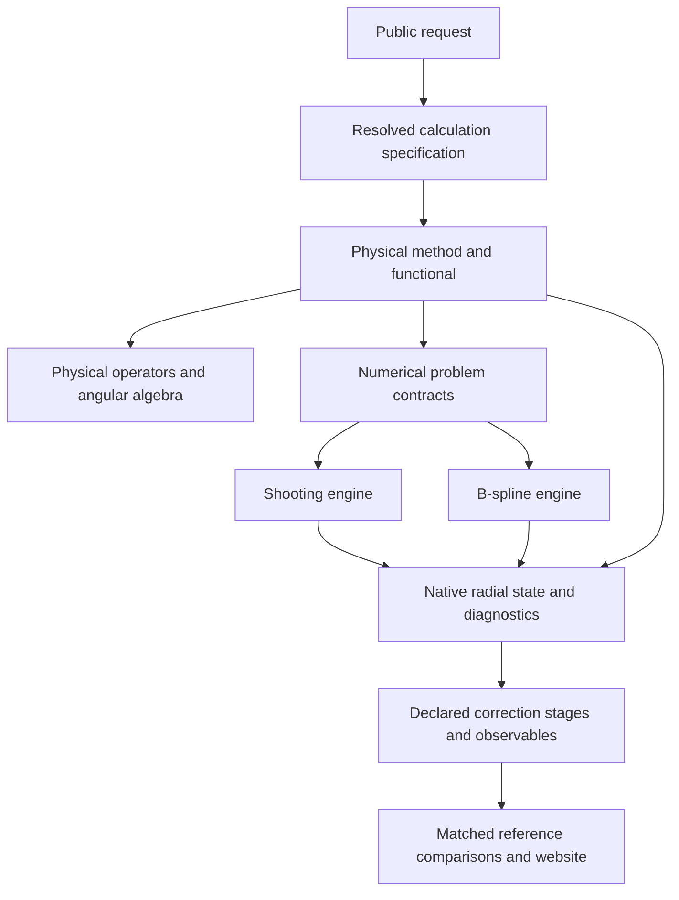

# Atomx architecture design

> Historical snapshot, retained as evidence. Current usage is documented in
> [the main documentation](../../README.md). Retired commands are not supported.

Status: target design with staged implementation; transition policy updated 2026-09-29.
Date: 2026-09-28.

This is the target design. Existing modules do not yet satisfy every boundary.
It supersedes the earlier recommendation in `NUMERICAL_ARCHITECTURE_REVIEW.md`
to place shooting implementations in `methods`.

The subsequent [full codebase review](CODEBASE_STRUCTURE_REVIEW_2026-09-28.md)
records concrete defects and extends this proposal with versioned persistence,
integration of existing provider contracts, explicit fallback policy, and
packaged NIST/workflow services. Its implementation priorities take precedence
over relocation-only cleanup.

## 1. Central decision

**Methods define the physical variational problem. Numerics solves that problem.**

Shooting belongs in `numerics/shooting`; B-splines belong in
`numerics/bspline`. Neither is a physical theory. DHF and MCDHF should select
either supported engine without changing the Hamiltonian, exchange model,
state objective, or no-pair projector.

Do not move a mixed module wholesale and declare the boundary fixed. Extract
physical functional construction from numerical iteration, then relocate each
part to its owner.

### Change and transition policy

Change a boundary when its ownership or behavior is demonstrably wrong. Keep
coherent modules intact regardless of size. Prefer explicit data and direct
calls; introduce an abstraction only when actual consumers require it.

For a necessary migration, update repository callers, tests and current usage
documentation together, then remove the obsolete entry point. Avoid permanent
forwarding modules or two public homes for the same implementation. Document
breaking imports and preserve versioned scientific archives independently of
Python import paths. An existing compatibility alias outside the migrated area
is not a reason for an unrelated rename.

This policy supersedes the temporary-alias recommendations below when completing
a migration. The [numerical boundary migration](NUMERICAL_BOUNDARY_MIGRATION_2026-09-29.md)
records the removed paths and their replacements.

## 2. Ownership and dependencies

| Layer | Owns | Boundary |
|---|---|---|
| Public API (`atom.py`, inputs) | User requests, validation, dispatch | Resolves defaults once; no radial algorithms |
| Calculation specification | Hamiltonian, state, projector, engine, numerical controls, inclusion stages | Immutable resolved input, separately recorded from outcomes |
| `physics/`, `angular/` | Nuclear, Coulomb, Breit, recoil and QED operators; angular algebra | No solver dispatch, SCF loop, or UI knowledge |
| `methods/` | HF/DFS/DHF/MCDHF/CI/Breit–Pauli definitions, density contractions, energy functional and derivatives, state averaging | Supplies numerical problems; no ODE integration or basis eigensolver implementation |
| `numerics/` | Radial representations, integration, operator assembly, boundary solves, constrained optimization and convergence algorithms | Accepts explicit arrays/operators/callback contracts; no imports from `methods`, correction policy, or `Atom` |
| `corrections/` | Capability checks and application of physical terms at declared stages | Uses operator implementations and explicit state data; prevents duplicate inclusion |
| Results and observables | States, native radial metric, energy contributions, transitions and convergence evidence | Does not reconstruct physics from engine names or private solver fields |
| Data and comparison | NIST source records, state matching, theory comparisons and visualization | Cannot change the Hamiltonian or silently relabel unmatched states |

Dependency direction:



Low-level numerical kernels consume supplied potentials and sources. They do
not decide which nucleus, exchange approximation, CSFs, or QED model to use.
Operator formulas live in physics; their representation-specific quadrature,
matrix assembly and fast contractions live in numerics. Shared contracts must
not import concrete solvers, preventing circular dependencies.

## 3. Proposed module structure

```text
atomx/
  atom.py                         public orchestration
  atom_inputs.py                  user-facing options and legacy translation
  calculation_spec.py             resolved model and execution specification
  physics/                        physical operator definitions
  angular/                        angular coefficients and coupling algebra
  methods/
    hartree_fock.py                nonrelativistic nonlocal HF method
    hartree_fock_slater.py         explicitly local Slater exchange method
    dirac_fock.py                  DHF method and functional
    dirac_fock_slater.py           relativistic local exchange method
    breit_pauli.py                 perturbative Breit–Pauli method
    mcdhf/
      solver.py                   state objective, CI/orbital alternation
      grid_functional.py          CI-density energy and exact discrete derivative
      radial_density.py           correlated density contractions
      ...                         CSFs, CI, physical interaction contractions
  numerics/
    contracts.py                  radial problem and functional interfaces
    radial_metric.py              native quadrature and inner products
    scf/                          mixing, iteration and stopping algorithms
    optimization/                 constrained orbital optimization
    shooting/
      problem.py                  owned grid/potential/boundary context
      local_scf.py                numerical local-field SCF driver
      nonlocal_scf.py             numerical sourced-orbital SCF driver
      electron_space.py           bound/box roots and fixed-space projection
      preconditioner.py           radial Green preconditioning
      dirac_orbital.py            constrained orbital boundary solve
      dirac_response.py           constrained response inverse
      dirac_green.py              scaled homogeneous and Green kernels
      ...                         integrators, starters, root search, quadrature
    bspline/                      basis assembly and generalized eigensolves
  radial_state.py                 native state payload and transitional adapters
  results.py                      physical results and convergence records
  corrections/                    staged application and support checking
```

Paths above are proposed destinations, not claims that files already exist.
Existing B-spline code needs the same boundary audit as shooting. Avoid a
parallel architecture in which only the new engine obeys these rules.

### Completed shooting split (2026-09-29)

- Shooting SCF drivers live in `numerics/shooting/local.py` and
  `numerics/shooting/hartree_fock.py`. The old shooting-named method modules
  are removed.
- Physical Slater and HF field/energy expressions live in `physics/slater.py`
  and `physics/hartree_fock.py`. The HF operator specifies allowed rotations
  and core-hole saddle policy; the numerical engine performs the search.
- Electron-space construction, Green preconditioning and orbital optimization
  live in `numerics/shooting`. The CI/state assembly remains in
  `methods/mcdhf/grid_solver.py` and `grid_functional.py`.
- `ShootingSpace` belongs to numerical configuration; `ShootingResult` belongs
  to shared results. Numerical modules have no upward import exceptions.
- Physical operators may use representation-specific integration kernels.
  They do not launch SCF solves. Method orchestration calls numerical drivers;
  drivers do not import method implementations.

Remaining B-spline functional/driver separation and shared request resolution
require their own behavior-driven migrations. See the
[migration record](NUMERICAL_BOUNDARY_MIGRATION_2026-09-29.md) for import changes
and verification.

## 4. Names must describe the implemented physics

- Use the standard spelling **Breit–Pauli**, Python `breit_pauli` / `BreitPauli`.
- Distinguish nonlocal HF exchange from local Slater exchange in both names and
  result metadata. The current `HartreeFock` wrapper uses Slater exchange;
  preserve compatibility without presenting it as nonlocal HF.
- The current Breit–Pauli wrapper uses hydrogenic shift formulas with
  `Z_eff = Z` on a local-exchange base. Renaming it does not make it a complete
  Breit–Pauli calculation. Record that model explicitly; implementation of
  orbital matrix elements and missing operators is a separate physics change.
- Distinguish Dirac–Coulomb, Gaunt, static Breit including retardation, and
  frequency-dependent transverse interaction. Do not use a single ambiguous
  “retardation enabled” label for different operators.
- Distinguish orbital energies, total energies, term/level energies and
  transition energies in field and function names.
- Use descriptive numerical verbs such as `integrate_outward`,
  `solve_bound_orbital`, `solve_constrained_response`, and
  `optimize_orbitals`. Preserve established legacy names through thin aliases
  where callers depend on them; avoid a wholesale rename without benefit.
- Distinguish a numerical Newton corrector from a physical energy correction.

## 5. Contracts between methods and engines

Use small typed interfaces and native array payloads, not one universal dense
matrix abstraction. No Python object dispatch inside hot compiled loops.

**Resolved input:** nucleus/isotope and mass convention; equation and rest-energy
convention; explicit interaction operators and inclusion stages; occupations or
CSFs and state weights; no-pair reference; radial engine and controls. Reject
unsupported combinations before expensive work. The existing `CalculationSpec`
is currently a result-side snapshot; migrate it into the single pre-solve
resolution boundary rather than claiming that centralization is already done.

**Functional:** evaluate the actual energy, produce the orbital derivative and
required density data, and state the derivative's metric convention. CI details
remain inside the method. The optimizer sees an energy/gradient contract, not a
concrete MCDHF solver object.

**Radial problem:** owned geometry, quadrature, operator coefficients/nonlocal
action, boundary conditions, constraints and reference-space provenance.
Physical Hamiltonian potential and projector-generating potential are separate
inputs. Unsupported nonlocal projectors must fail explicitly.

**Engine output:** native spinors or coefficients, metric, orbital multipliers,
root identity diagnostics and residuals. Conversion for plotting is an explicit
sampling operation; it must not replace native integration weights.

**Physical result:** base energy, state labels and mixing, each applied operator
and its stage, unresolved requests, immutable model provenance and convergence
evidence. A source fingerprint identifies data; it is not a substitute for
archiving inputs needed to reproduce the calculation.

## 6. Accuracy and performance rules

1. Check stationarity separately from radial grid, box, continuum cutoff and
   correlation-space convergence. A successful SCF flag proves none of the latter.
2. Preserve full nonlocal exchange sources and scaled full-box Green propagation;
   do not reinstate homogeneous-tail truncation during relocation.
3. Use the same constrained inverse for an orbital and its energy derivative.
   Use metric-consistent adjoints and normalization throughout.
4. Cache geometry and potential interpolation per radial context; homogeneous
   solutions per energy/operator/boundary; angular data per state space.
   Invalidate by actual dependencies, not merely element or orbital label.
5. Preserve B-spline sparsity/band structure, batched contractions and compiled
   shooting loops. Share equations and contracts without forcing identical algorithms.
6. Report timings by integral construction, propagation, response, CI and orbital
   optimization. Accept speedups only with matched physical/residual controls.
7. Record Breit, QED and recoil participation in orbital optimization, CI or
   post-processing separately. Reject duplicate operator inclusion. “Enabled”
   alone is insufficient provenance.

## 7. Reference data and interactive comparisons

Keep immutable NIST records and source/version provenance separate from computed
records. Preserve uncertainties, configurations, term/J/parity labels, ground
states, ionization limits, levels and observed/Ritz line distinctions. Missing
data remain missing, with coverage shown explicitly.

Match charge stage, isotope when available, energy reference and state identity
before calculating an error. Configuration averages must not be scored as
individual resolved levels. Distinguish NIST Ritz wavelengths derived from
levels from independent theoretical predictions. Unmatched or ambiguous states
are visible, not forced into nearest-energy matches.

The periodic-table overview should separate data coverage, numerical readiness
and experiment–theory discrepancy. Each comparison should open the matching
decision, units, uncertainty and full calculation specification. Uncertainty
scores must respect known correlations or disclose when covariance is unavailable.

## 8. Migration order and acceptance

1. Freeze representative numerical/physical controls and import compatibility.
2. Establish input/problem/result contracts and capability validation.
3. Split shooting physics from numerics; relocate kernels and update internal
   imports to canonical paths. Add dependency tests forbidding upward imports.
4. Rename Breit–Pauli and clarify local/nonlocal exchange naming without silently
   changing existing calculations. Track physical improvements separately.
5. Wire both radial engines through the same physical method contracts and
   resolve all public constructors through the common specification.
6. Migrate correction/observable consumers to explicit state payloads; retain
   legacy layout detection only in a bounded compatibility adapter.
7. Rerun matched DHF and correlated controls, then publish fresh source-tagged
   benchmark artifacts and document remaining unsupported capabilities.

Acceptance includes legacy import identity, no numerical imports of methods,
unchanged matched-model energies within established numerical tolerances,
native-metric expectations, discrete-gradient checks, open-shell constraints,
long-range exchange tails, correction-stage accounting, and explicit cutoff
convergence reporting. Wall time is assessed alongside those checks.

Architecture completion and agreement with experiment are separate milestones.
No full-table production campaign follows merely from a successful refactor.

## 9. Complete package boundary and lifecycle

The numerical migration must fit the rest of the package. Retain existing
subsystems when their ownership is sound; the following additions are proposed,
not implemented directories:

```text
atomx/
  config/             configurations, subshell identity, state-space requests
  potentials/         nucleus and environment potentials (existing owner)
  physics/            equations and physical operator definitions
  angular/            pure coupling algebra
  methods/            physical objectives, densities and state optimization policy
  numerics/           representations, operator assembly and numerical algorithms
  radial_state.py     native representation and metric contract
  results.py          physical state/results; no solver implementation imports
  corrections/        operator application stages, support and accounting
  properties/         observables evaluated from explicit states
  scattering/         continuum processes and cross sections
  plasma/             rates, populations and plasma models
  spectrum/           synthesis from states, transitions and populations
  lineshapes/         normalized profile kernels
  uta/                statistical transition-array physics
  fitting/            explicitly fitted parameters and their reference records
  providers/          external/native payload translation and capabilities
  io/                 versioned serialization of supported results
  reference_data/     NIST ingestion, source schemas and state matching
  workflows/          job planning, execution, comparison and audit services
  viz/                plots consuming prepared scientific results
  web/                HTTP adapters and packaged website assets
```

`reference_data`, `workflows` and `web` are extractions from existing scripts,
not new parallel implementations. CLI scripts call these services. The website
reads prepared queries/comparisons; a plotting or HTTP function cannot select
a different Hamiltonian. Benchmarks exercise the installed services so a source
checkout is not an undeclared runtime dependency.

### Request and result lifecycle

1. Translate a public request or legacy method object into one resolved
   specification. Define precedence for method, Atom and sampling options;
   reject conflicting or unused options instead of silently dropping them.
2. Validate method, engine, operator stage and observable capabilities using
   the existing provider/correction contracts where applicable. A shared
   vocabulary does not require one registry to know every application detail.
3. Construct the physical functional and the engine's radial problem. Keep
   mutable iteration arrays local to the engine; shared geometry is owned and
   read-only. Pass nuclear potentials directly, without instantiating HF to
   construct a potential for MCDHF.
4. Return numerical diagnostics and a physical result, apply declared
   corrections, then finalize. A new corrected result records its parent and
   operator contributions; compatibility mutation must invalidate cached state.
5. Persist finalized inputs, native state and diagnostics with a versioned
   schema. Readers identify missing legacy provenance and unsupported versions.
   Large external inputs require archived content or resolvable content-addressed
   references; a hash alone cannot recreate them.
6. Evaluate observables from explicit states. A workflow may calculate missing
   states, but must record the requested and actual model and any permitted
   fallback. Serialization, coercion and plotting must not trigger a solve.
7. Match reference records by state identity and observable definition, retain
   ambiguous/unmatched cases, and pass matching evidence into the visualization.

### Concrete migration batches

| Batch | Deliverable | Acceptance |
|---|---|---|
| Scientific API | Explicit transition fallback; correct HF–Slater/Breit–Pauli names and option forwarding | Requested/actual models agree, unsupported requests fail explicitly, legacy aliases preserve identity |
| Shared contracts | Subshell identity, finalized results, resolved controls and native radial contract | No solver dependency for basic state identity; supported archive round trips preserve physics |
| Numerical ownership | Split shooting and B-spline drivers from physical functionals | Whole-package dependency gate; matched-model energies, residuals, exchange and metric controls preserved |
| Application services | Package archive, matching, jobs and web assets | Installed-package smoke check without scripts/benchmarks on `sys.path`; source/matching provenance retained |
| Performance and cleanup | Dependency-based caches, allocation review and measured kernel optimization | Equivalent physics and convergence controls; timings and peak memory reported for representative cases |

The persistence/provider part of the scientific API repair already exists in
the reviewed working tree. Other batches remain proposed. Keep relocation,
physical changes and numerical algorithm changes independently reviewable.

## 10. Contracts that make the boundaries enforceable

The following are proposed responsibilities, not claims of implemented APIs.
Evolve the existing records and protocols to satisfy them; avoid a second set
of overlapping representations.

| Contract | Required content | Owner |
|---|---|---|
| Resolved request | Species/isotope, nuclear profile and mass, state objective, exchange/correlation, projector, operator stages, engine and tolerances | Public input resolution and `calculation_spec.py` |
| Physical functional | Energy, gradient/Fock action, density contractions, symmetry and state constraints | `methods/`, using `physics/`, `potentials/` and `angular/` |
| Radial problem | Representation, metric, boundaries, supplied operator/source actions and numerical constraints | `numerics/` |
| Numerical outcome | Orbitals, multipliers, residuals, orthogonality, iteration status and branch-tracking diagnostics | Numerical engine |
| Final atomic state | Resolved request, native radial state, physical level/configuration identity, CI amplitudes where present, energy contributions and diagnostics | Shared results |
| Observable | Endpoint state IDs, operator/gauge, value, units and calculation provenance | `properties/` or process-specific `scattering/` |
| Reference match | Source record/version, observed versus Ritz/evaluated status, isotope, level identities, uncertainty, matching reason and score eligibility | `reference_data/` and comparison workflows |

### State selection is part of the physical request

Ground-state minimization, a core-hole stationary state, and a weighted MCDHF
state objective are different requests. Methods must declare the objective and
which state or subspace is to be followed. Numerics implements minimization or
stationarity searches and returns evidence that the constraints were respected.
For example, the current shooting `_rotate_occupied` mixes core-hole detection
with a trigonometric stationary-root algorithm. Extract the algorithm into
numerics and pass the method's state-following policy explicitly.

A small energy change cannot alone certify convergence. Separate energy change,
orbital/equation residual, orthogonality, orbital stationarity, state tracking,
and discretization refinement. A workflow decides acceptance against an explicit
policy. Preserve failed and unverified attempts as inspectable records.

### Method names and implementation names

- `methods/breit_pauli.py` becomes the canonical home of `BreitPauli`.
  Keep `methods/relativistic_hf.py` only as a temporary compatibility import.
  The present implementation uses local Slater exchange and hydrogenic shifts;
  its capability record must retain those limitations after renaming.
- Give local Slater-exchange methods explicit HF–Slater/Dirac–Slater names.
  Reserve HF/DHF nonlocal-exchange claims for implementations that supply that
  operator. Preserve legacy behavior through documented aliases and metadata.
- Shooting, B-splines, quadrature, response inversion, eigensolvers and orbital
  optimization algorithms belong in `numerics`. DHF and MCDHF orchestration
  remains in `methods` when it expresses the physical objective.
- Use `ground_state`, `configuration_average`, and `level` deliberately in APIs.
  A configuration label alone cannot identify a resolved physical level.
- Keep approximation identifiers explicit: static Breit versus frequency-dependent
  terms, named self-energy models, recoil order and application stage. A method
  named “exact” must state the finite space and operator content it is exact in.

### Independent acceptance gates

1. **Ownership:** scan all source imports, including relative and local imports.
   Allow only named temporary compatibility edges; no new upward numerical edges.
2. **Request fidelity:** test option precedence and forwarding; unsupported
   combinations fail before solving; a fallback requires explicit policy and
   records its reason and actual model.
3. **Representation equivalence:** compare engines with identical Hamiltonian,
   isotope, exchange, state objective and correction stages, refining each
   representation independently. Equal grid sizes are not equivalent accuracy.
4. **State fidelity:** verify the intended branch and stationarity for core-hole
   and open-shell controls, as well as ground states. Include correlated cases
   with explicit projector and active-space convergence.
5. **Persistence and deployment:** round-trip each supported result flavor and
   run installed-package workflows without repository scripts on `sys.path`.
6. **Experimental comparison:** keep coverage, numerical convergence, state
   matching and residual statistics separate. Do not score unresolved
   configuration averages as individually resolved NIST lines.

These gates support staged migration. They do not promise experimental accuracy
from architecture alone; each physical model still needs independent validation.
