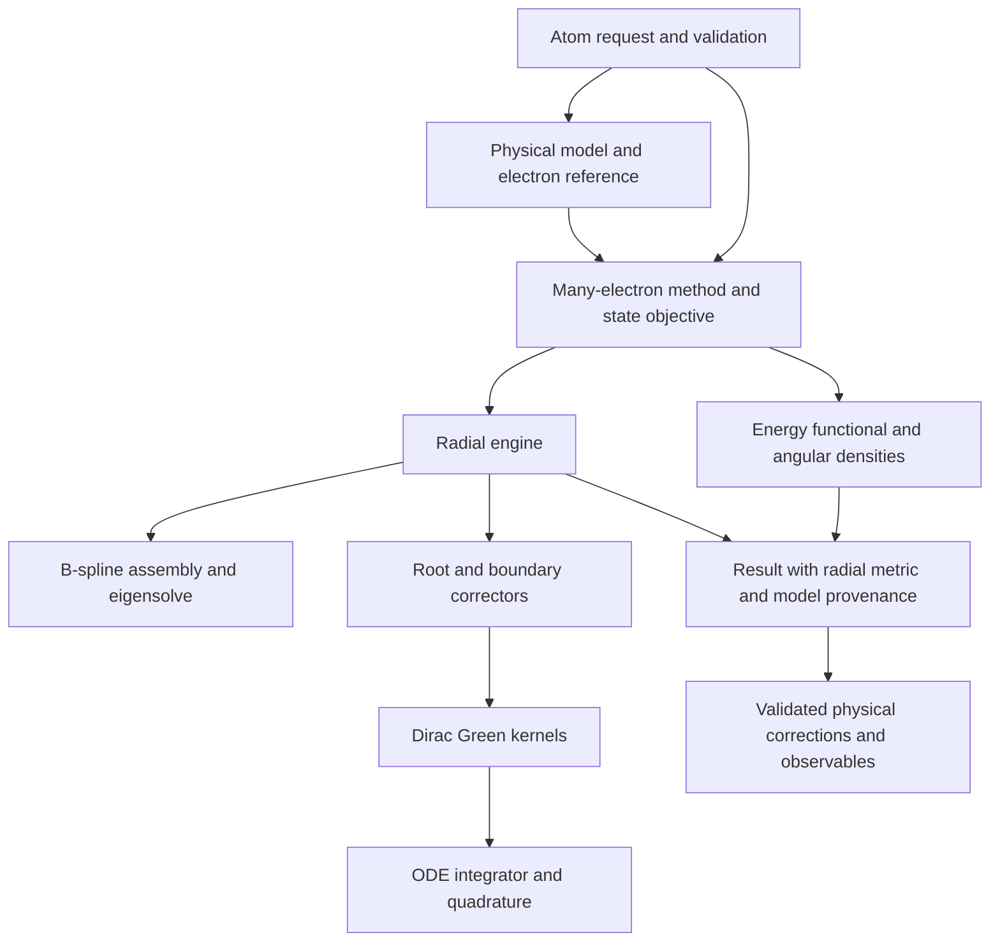

# Coherent physics and numerical architecture

> Historical report. Commands, paths, counts and status describe the recorded
> source snapshot; some campaign tools have since been retired. See the
> [current documentation](../../README.md) for supported usage.

> Historical review and progress notes. Module-placement decisions and status
> statements below reflect earlier migration stages. See
> [the current design](../../ARCHITECTURE_DESIGN.md) and
> [the full codebase review](CODEBASE_STRUCTURE_REVIEW_2026-09-28.md)
> for the current proposal, verified defects, and implementation priorities.

## Design decision

Keep six independent choices explicit:

| Choice | Owns | Must not imply |
|---|---|---|
| Physical model | equation, isotope/nuclear potential, mass, interaction terms | grid, integration rule or SCF convergence |
| Many-electron method | DHF/DFS/CI/MCDHF functional, angular density, state objective | a particular radial representation |
| Electron reference | no-pair projector and its generating operator | the physical one-body potential |
| Radial engine | B-spline representation or shooting boundary problem | a different exchange or correlation model |
| Numerical algorithm | integration, linear response, root correction, mixing, line search | a new physical approximation |
| Physical correction stage | Breit/RCI, QED, recoil, inclusion status and provenance | an ODE/Newton numerical corrector |

Changing the engine should preserve the first three choices. Comparing two
calculations requires matching them, not just matching Z and an engine name.
The recent uranium projector discrepancy is a direct example.



This is an ownership map, not a requirement for one inheritance hierarchy.
B-spline generalized eigenproblems and shooting boundary problems should
retain their own data structures and algorithms.

## Review findings

| Priority | Finding and evidence | Disposition |
|---|---|---|
| High | `DiracResponse` imported homogeneous solutions and Green assembly from `hf_shooting.py`; low-level boundary solvers therefore depended on SCF implementation. | Fixed: kernels live in `numerics/shooting/dirac_green.py`. |
| High | The bracketed normalization Newton corrector and root-node guard were embedded in the HF class module. | Fixed: `dirac_orbital.py` owns the supplied-potential/source boundary solve; HF builds the source and performs SCF updates. |
| High | Response arrays could alias caller data while fundamental solutions were already cached. Mutating the caller's grid or Jacobian could invalidate the numerical problem. Box and response constructors duplicated validation. | Fixed: shared owned `ShootingRadialProblem`; mutation regression tests. |
| High | Correction names keyed a dictionary without collision checks; duplicate names could discard a contribution. Unsupported requested terms were always skipped. | Fixed: duplicate/reserved names rejected; strict preflight available; invalid/nonfinite output rejected before final energy mutation. |
| High | Final correction provenance required re-evaluating the stack to retrieve skipped reasons. | Fixed: finalization retains actual `_correction_results`, including skip reasons. This is a compatibility storage seam, not the final public result schema. |
| High | The nuclear Hamiltonian potential and the electron-projector potential could be treated as interchangeable. | Earlier fix retained: explicit labelled reference potential and fingerprint in `grid_shooting.py`; matched 1s² regression. |
| High | Correction adapters inspect `_pa`, `_qa`, `_difr`, `_bsp_data`, `orbitals_raw` and correlated density methods. `AtomicResult` does not carry a sufficient common radial payload. | Implemented: owned `RadialState` snapshots and a single legacy-layout boundary; correction consumers use native workspaces. Correlated density contractions remain explicit. |
| High | `OrbitalWavefunction.expectation_r` uses trapezoidal integration although solver energies use SLAG6 or B-spline Gauss quadrature. | Implemented: `RadialMetric` travels with solver-generated waves; standalone user waves retain the documented trapezoid fallback. |
| High | `MCDHFSolver(engine='shooting')`, public multi-configuration engine validation, and the experimental full-grid optimizer expose different capabilities. | Open: distinguish occupation-averaged HF+CI, full correlated orbital optimization, and frozen-orbital CI explicitly. Do not advertise these as one interchangeable solver capability. |
| Medium | `numerics/analytic/hydrogenic_dirac.py` launches `DFSolver`; this is a numerical reference adapter in a misleading analytic namespace. | Implemented: `methods/hydrogenic_reference.py`, with compatibility exports in the old location. |
| Medium | Constructor/model policy is distributed through `atom_inputs.py`, `atom.py`, and method constructors. `Exchange` exists as both constructor value object and legacy method enum. | Open: normalize once at the public boundary into an immutable calculation specification; retain legacy translation only at that boundary. |
| Medium | SCF methods still live under `numerics/shooting/solver.py` and `hf_shooting.py`. | Implemented: `methods/shooting_local.py` and `methods/shooting_hf.py`; pure Coulomb integrals remain in numerics, with old import paths retained. |

The table distinguishes implemented changes from remaining work. The
repository is not yet fully migrated to the target architecture.

## Implemented numerical contract

`ShootingRadialProblem` owns:

- radial nodes `r`, uniform-index Jacobian `dr/ds`, and sampled `r*V`;
- the actual SLAG6 metric, validated and read-only;
- one lazily constructed, cached potential spline and interval indices;
- a fingerprint covering geometry, Jacobian and potential.

The context does not decide what its potential means physically. A
Hamiltonian context and a reference-operator context may have different
potentials on the same grid. The method must choose and label the role.

Both old array interfaces and context-based construction work:

```python
problem = ShootingRadialProblem(r, dr_ds, r_times_reference_potential)
response = DiracResponse(energy, kappa, problem, boundary="box")
continuum = BoxDiracContinuum(problem)
```

The MCDHF response setup creates one context for all active orbitals.
Different energies still need different fundamental solutions; their
potential spline, metric and input arrays are shared. The hot integration
kernels continue to receive arrays, avoiding Python objects in Numba loops.

`dirac_green.py` owns regular/inward solutions, finite-box solutions and
particular Green assembly. `dirac_orbital.py` owns normalization Newton
updates, the energy bracket and root checks. `hf_shooting.py` owns angular
coefficients, local/nonlocal source construction, orbital occupations and
SCF mixing. Compatibility aliases preserve existing private diagnostic
imports. The extracted arithmetic and legacy HF tail convention are unchanged.

Dependency tests prohibit the radial kernels from importing SCF, method,
or correction policy. This guard is deliberately scoped to the migrated
modules; it does not pretend the entire legacy tree already follows it.

## Implemented correction contract

`CorrectionStack(strict=True)` checks support for **all** requested terms
before evaluating any. `apply(..., strict=False)` can explicitly override
that policy for exploratory comparisons. Existing default behavior remains
compatible, with unsupported terms recorded under `_skipped`.

Duplicate and reserved names cannot overwrite dictionary entries. Each
evaluated term must return a matching `CorrectionResult` and finite total
and per-orbital shifts. Finalization only changes the energy after the
whole stack has evaluated successfully. Applied objects and skipped
reasons are retained on the result.

Strict support checking is not a proof of convergence, physical adequacy,
or absence of overlap between differently named model terms. The next
result schema must record inclusion by operator and stage: orbital
optimization, CI/RCI, perturbative energy, or observable-only. This is
needed to prevent double counting when, for example, Breit already enters
the CI Hamiltonian.

## Remaining migration sequence and acceptance criteria

1. **Radial results and integration.** Add immutable sampled-spinor and
   B-spline-coefficient views with their native metrics and provenance.
   Build them once in result adapters. Migrate corrections and observables
   away from private-field detection. Require unchanged energies and
   converged norm/expectation controls for both engines.
2. **Calculation specification.** Resolve equation, nucleus/isotope, mass,
   exchange, correlation space, no-pair reference and correction stages
   once. Keep engine/algorithm settings separate. Preserve current public
   validation and reject unsupported combinations before solving.
3. **Method capabilities and convergence.** Record energy change, SCF
   residual, orbital-gradient residual, root identity, basis truncation and
   iteration termination separately. A single `converged` flag must not
   imply radial-space or experimental convergence. Expose engine capability
   checks without silently replacing MCDHF with averaged HF+CI.
4. **Correction inclusion and reporting.** Use a typed application record
   for requested/applied/unsupported/already-included terms. Preserve the
   base electronic energy and each correction stage independently. Move
   existing compatibility dictionaries behind that record.
5. **Module cleanup.** Relocate SCF orchestration and the numerical
   hydrogenic reference provider only after their consumers use the stable
   contracts. Remove compatibility aliases in a deliberate API migration.

## Physics and performance invariants

- Energy units and rest-energy convention are explicit; no-pair reference
  choice is not inferred from an engine string.
- Nuclear model, isotope and recoil convention are shared by SCF, CI,
  corrections and comparisons. Labels such as “QED enabled” do not imply
  complete QED or finite-nucleus support for every term.
- Discrete derivatives must differentiate the implemented quadrature.
  Continuum symmetry cannot replace a required discrete adjoint.
- Caches include their grid, metric, potential and boundary dependencies.
  Cache keys cannot rely on mutable potential objects or only a Z label.
- Preserve band structure, BLAS products and Numba integration loops;
  factor/reuse numerical work at the correct lifetime. Avoid a universal
  dense-matrix interface that destroys shooting's linear-cost kernels.
- Cross-engine comparisons match Hamiltonian, projector, state and nuclear
  model before interpreting a numerical or experimental discrepancy.

## Validation

**95 distinct targeted tests passed across the regression suites.** Tests
cover numerical-context ownership and sharing, invalid geometry,
kernel dependency direction, strict correction preflight, duplicate names,
invalid-output atomicity, stored skip reasons, and the existing shooting,
matched-projector and B-spline correction controls. The five-ion matched
reference benchmark was rerun after the refactor: all ten model runs
converged, and matched HF differences remain below 4.96e-10 Ha. Its source
hashes identify the earlier refactor revision; the artifact is
`output/correlation_benchmark/shooting_reference_design_refactor.json`.
That initial refactor did not switch a physical model or production engine. The subsequent open-shell constraint update is described below.


## Migration and open-shell exchange update

Implemented in this follow-up:

- `RadialState` owns a read-only snapshot of native coefficients/spinors,
  quadrature and workspace. SCF, shooting and MCDHF results expose it.
  Legacy private-field translation is isolated in `radial_state.py`.
- `RadialMetric` explicitly distinguishes the SGRID Jacobian from actual
  integration weights. Corrections use `slag6_weights(N) * dr/ds`, with
  endpoint weights calculated **before** removing the origin. Public
  wavefunction expectations use the native metric and reject a different grid.
- `CorrectionApplication` retains the base energy and named shifts.
  Repeated post-SCF finalization is rejected before evaluating corrections.
  Existing correction/provenance dictionaries remain compatible.
- SCF orchestration and numerical hydrogenic reference generation now live
  under `methods`. Old imports remain compatibility exports. Pure Coulomb,
  derivative and Green kernels do not import method policy.
- Open-shell DHF uses a bordered Green solve to impose same-kappa constraints
  within the orbital equation. The energy derivative uses the same constrained
  inverse. Initial same-kappa groups are symmetrically orthonormalized.
- Unequally occupied same-kappa orbitals receive variational pair rotations.
  Five energy evaluations determine the exact degree-four Fourier polynomial
  of each rotation; the scalar minimization needs no more radial integrals.
  Full-shell rotations are skipped because they leave the functional invariant.
- The default HF update is `constraint_mode="coupled"`. Historical arithmetic
  is available explicitly as `schmidt_legacy`; its snapshot tests still pass.
- Coupled HF reports the direct energy functional, recomputes diagonal Fock
  expectations on the final orbitals, and checks both energy change and the
  occupation-weighted antisymmetric multiplier residual. The residual and
  exchange model are included in `solver_diagnostics`.

This completes the radial-result, correction-consumer and SCF-module migration
covered here. A single immutable resolved specification across **all** public
method constructors remains separate work. The public shooting MCDHF driver
still exposes averaged HF+CI; the full-gradient grid optimizer remains
experimental and requires an explicitly validated electron space. These HF
changes do not supply that general open-shell no-pair projector or introduce
missing electron correlation.

### Matched open-shell controls

All five B-spline references and all ten shooting runs converged. These are
point-nucleus, uncorrected Dirac–Coulomb **jj-average HF** calculations, not
comparisons with experimental term energies. Reference: 100 B-splines,
SCF tolerance 1e-9. Shooting: tolerance 1e-11.

| Atom | Shooting minus B-spline, 1000 points (Ha) | 1600 points (Ha) |
|---|---:|---:|
| Li | +2.78e-11 | +2.45e-11 |
| B | +4.56e-11 | +3.12e-11 |
| Na | -3.47e-9 | -3.62e-9 |
| K | -2.15e-7 | -2.38e-7 |
| Co | -1.83e-6 | -1.82e-6 |

The remaining K/Co differences are **not resolved or attributed** by these
controls. They require matched basis, radial residual and projector checks;
energy convergence alone is insufficient to identify their source. Lithium's
previous Schmidt result differed by about 1.79e-4 Ha; the constrained solve
without occupied rotations still missed about 1.69e-6 Ha.

Reproduce with:

```sh
PYTHONPATH=src:. OPENBLAS_NUM_THREADS=1 OMP_NUM_THREADS=1 \
  python scripts/benchmark_shooting_open_shell.py \
  --output output/correlation_benchmark/shooting_open_shell_migration.json
```

The artifact records source hashes, convergence, timings, multiplier residuals
and both grid sizes. The final regression run passed **143 tests**, covering
HF/Guerra, warm starts, native metrics, correction application, QED/recoil
adapters, Coulomb kernels, frozen orbitals, correlated grid adjoints, and
matched electron-reference controls. No all-element spectrum campaign was
launched by this migration.
