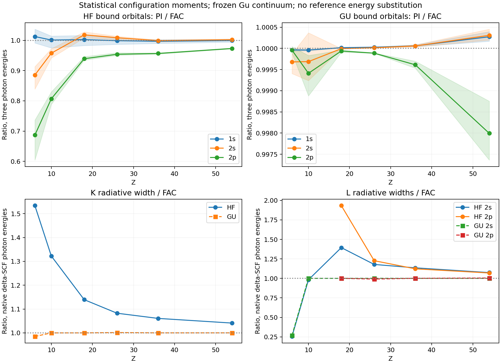

# 统计组态与统一原子场对比

本轮修正了组态统计权重与 HF 势构造中的实现问题，并比较 C、Ne、Ar、Fe、Kr、Xe 的 K/L 光电离截面和荧光宽度。统一为初态冻结 Gu 连续场、采用 atomx 自身松弛 ΔSCF 能量后，Gu 绑定态的 54 个 PI 点相对 FAC 为 0.997363–1.000453；HF 绑定态为 0.604334–1.036870。HF 与 Gu 是明确保留的模型选择；本轮没有更改默认 HF 为 Gu，没有用外部阈值或参考跃迁能量代替原生能量。

| 元素 | HF PI/FAC 九点范围 | Gu PI/FAC 九点范围 | HF K 荧光/FAC | Gu K 荧光/FAC |
|---|---:|---:|---:|---:|
| C | 0.604334–1.036870 | 0.999404–1.000042 | 1.533961 | 0.984860 |
| Ne | 0.788296–1.014132 | 0.998879–1.000367 | 1.322396 | 0.999858 |
| Ar | 0.934443–1.027997 | 0.999908–1.000021 | 1.139339 | 0.999983 |
| Fe | 0.950343–1.013451 | 0.999883–1.000033 | 1.082424 | 1.001361 |
| Kr | 0.954379–1.002154 | 0.999532–1.000084 | 1.060681 | 1.000037 |
| Xe | 0.971900–1.004714 | 0.997363–1.000453 | 1.041114 | 1.000117 |

PI 使用初态冻结 Gu 连续场与松弛 ΔSCF 阈值。荧光使用初态偶极矩与松弛 ΔSCF 光子能量，只有 E1 长波长度规范，不是完整的多电子轨道松弛跃迁。非零 K/L 荧光宽度的 Gu/FAC 范围为 0.269577–1.004729；C 的 2s 例外保留在范围内。

[PDF](comparison.pdf)、[PI 全部变体](pi.csv)、[荧光全部变体](fluorescence.csv)、[统计摘要](summary.json)。CSV 同时保存 FAC 和 XATOM 比值；Gu 与 FAC 接近不代表与 XATOM 的 HFS 模型一致。外部参考与原始运行记录来自 [上一轮报告](../systematic_xray_2026_10_02/README.md)，本轮复用参考数值，没有重新运行外部程序。

## Gu 模型与 XATOM

以下比值与上表使用相同的原生结果，只更换比较对象。

| 元素 | Gu PI/XATOM 九点范围 | Gu K 荧光/XATOM |
|---|---:|---:|
| C | 0.828588–1.087988 | 0.660304 |
| Ne | 0.894728–1.074997 | 0.797563 |
| Ar | 0.934799–1.058820 | 0.888864 |
| Fe | 0.940330–1.034943 | 0.929292 |
| Kr | 0.898936–1.015830 | 0.952573 |
| Xe | 0.775706–1.051470 | 0.978055 |

## 实现修复

原驱动把分数占据直接传给 DF，却没有传统计 jj 组态的权重。同壳层电子对数应为 ⟨q(q−1)⟩，不能由平均占据推成 ⟨q⟩(⟨q⟩−1)。例如一个 2p 电子的统计平均在两个 jj 轨道上都有非零占据，但电子对数必须为零。

`DFSolver.from_configuration` 同时构造平均占据和整数 jj 分布。HF 的跨轨道交换与同壳层高阶势现在使用与直接势相同的电子对权重；同壳层高阶势也补上大、小 Dirac 分量之间的密度贡献。新增 2p² 检验将逐轨道求解器的 Fock 矩阵与 batch 模式的独立角系数构造比较，四个分量块在约 10⁻¹⁴ 内一致。单电子氢的能量、解析 Lyα 速率提供独立归一化锚点。

PI 原先把高斯点上的绑定函数线性插值到 shooting 网格，现在直接计算 B-spline 展开。连续场显式区分初态冻结密度与去掉捕获电子的残余核密度，渐近电荷读取实际势的元数据。新 `subshell_photoionization` 接口记录阈值、场模型及占据数，截面按每原子计且占据只乘一次。

`frozen_configuration_energy` 在固定原始轨道上计算组态平均 HF 能量；松弛 ΔSCF 则另行求解初、末组态。Gu 的总能量也沿用求解器的 HF 能量泛函，不称作 Gu LDA 能量。`fluorescence_rates` 同时返回每空穴宽度、总空穴宽度和分通道宽度，并标明光子能量来源。

## C 的 2s 分辨能级差异

C 的 2s 空穴 Gu 宽度为 FAC 的 0.269577。原生组态间 ΔSCF 光子能量为 8.053797 eV，而 FAC 分辨线为 3.825202–13.865520 eV。保持 FAC 的分辨线强度及简并态权重，只把各线的光子能量改为该原生能量，宽度由 1.530729×10⁹ 降至 4.127159×10⁸ s⁻¹；atomx 是 4.126497×10⁸ s⁻¹，比值 0.999840。

这个 [控制](C_2s_resolved_control.json) 表明，在相同的单一光子能量下，两者的总 E1 强度接近；主要差异来自能级分裂、允许通道和 ω³ 的相关性。单一组态平均不能复现该分辨谱的宽度，仍需要原生分辨能级及其跃迁强度。控制没有代入原生面板，也没有用于调节原生速率。

## 采样与限制

正式面板包含十二组元素模型计算：432 个 PI 点，108 个空穴荧光宽度。每个模型的 PI 保留残余场/轨道阈值、冻结场/轨道阈值、冻结场/冻结组态阈值、冻结场/松弛 ΔSCF 阈值四种变体。每个空穴宽度保留轨道差、冻结组态差和松弛 ΔSCF 差三种变体。C/Ne 的 2p 空穴无允许的向下 E1 通道，双方为零，不定义 0/0 比值。

径向参数为 ns=180、ks=9、r_max=80 a₀、点核、TFDA 起点、SCF tol=10⁻⁹，shooting 网格 16000 点。每次 SCF 检查收敛；最大迭代数、所有原生轨道能量及组态总能量保存在各元素模型 JSON。入射光子能量沿用上一轮参考能量轴，约为 XATOM 中性 K 阈值的 1.2、2、4 倍，取整到 eV；原生的出射电子动能仍使用 atomx 自身阈值。

本轮没有重算 LS Auger Z 扫描或将新辐射宽度混入旧产额。原九格矩阵中的 Auger、产额和散射仍指向原先模型的归档证据；可用 `--consistency` 单独切换 PI 与荧光的证据。Fe 的五个 jj LMM 锚点、K 产额和 X 射线散射的模型限制仍按旧报告说明，不能从本轮 Gu/FAC PI 闭合推断它们也达到相同精度。

## 验证与复现

修复后的相关测试 90 项通过；Ne/Fe Auger 与 DR 外部锚点检查 7 项通过、2 项预期失败。检查记录为 [接口与数值测试](validation.log)、[外部锚点](external_validation.log) 与 [静态检查](lint.log)。RR 快照仅刷新 atomx 列，最大变化约 0.348%；外部 FAC 列、精度门槛和历史计时值均保留，因此该 CSV 不能作为本轮性能测量。

[复现命令](REPRODUCE.md)、[源码及参考身份](source_identity.json) 与源码归档 `source_snapshot.tar.gz` 固定本轮实现。先前报告的原始数据及源码快照保留，工作区的 benchmark 驱动已改用正确的统计组态构造。
