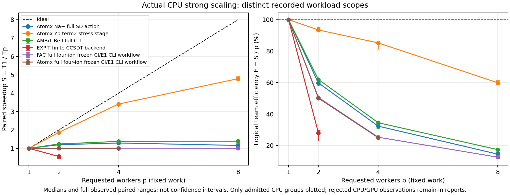

# FAC 纳入完整精度、效率和并行效率对照

本次重新运行本地 FAC，与 Atomx 的共同积分／共同轨道及完整四离子流程分别比较。原 absolute **1e−11 Ha**、relative **1e−10**、实际进程最多 **8线程**、地址空间 **8GiB**、每流程 **600s** 的门未放宽。前瞻条件见 [合同](contract.json)，原软件对照见 [父报告](../README.md)。

## 完整共同输入的数值精度

四组包含 He-like Z=10 的98能级、C-like Z=6 的20能级、Ne-like Z=26/82 各37能级，总 **192能级／2003径向积分**。保留所有 J／宇称矩阵、带符号积分、轨道、特征值和配置基身份，不能从代表根推断完整块正确。FAC／Atomx CSF 相位约定不同，因此比较各完整对称块的特征值多重集合；全部 signed 矩阵仍保存，没有声明逐项相位相同。

| 完整范围 | 共同 FAC 积分的能级最大差（Ha） | 原两项门 | 共同 FAC 轨道，Atomx 4000点且解析对齐 c 后最大差（Ha） | 原两项门 |
|---|---:|---|---:|---|
| He-like Z=10，98能级 | 1.350031e−13 | 通过 | 1.244688e−8 | 未通过 |
| C-like Z=6，20能级 | 5.684342e−14 | 通过 | 1.672110e−8 | 未通过 |
| Ne-like Z=26，37能级 | 3.410605e−12 | 通过 | 1.221474e−7 | 未通过 |
| Ne-like Z=82，37能级 | 3.092282e−11 | 绝对失败／相对通过 | 1.261316e−6 | 绝对失败／相对通过 |

Pb 共同积分相对差2.286e−15，绝对门仍判失败。共同轨道4000点的径向积分最大差分别4.062e−8、4.650e−9、2.723e−8、1.028e−6Ha，均未通过；2000/4000点完整结果分别保留，不能靠提高网格点数声称已经消除差距。原始 c 与解析 c 对齐结果分列，不混入共同积分门。FAC 使用8000点／density4，压缩 Yk 缓存关闭而双精度 Slater 缓存保留。此次没有注册和执行新的默认压缩 Yk 对照，不能据本轮宣称压缩的精度或效率贡献。

这些是同算符的数值实现比较，不是两软件相对实验的精度。来源：[精度 owner](precision/README.md)、[全部结果](precision/result.json)、[独立审核](review/README.md)。旧 fixture 的较宽回归门保持原样，与新严格门分别报告。

## 完整流程与固定工作量并行效率

四离子为 Ar IX／Fe XVII／Xe XLV／Pb LXXIII，逐个离子从进程初始化、基态优化和虚轨道到 gnd／up3s／up3d 分组独立的冻结配置CI及 E1，**不含3s／3d组间耦合**。每离子 **17能级／5条物理E1跃迁×2光子模式**，分别5条长波和5条有限波长记录，共 **68能级／20条物理跃迁×2模式＝40条记录**。禁用 SE／VP／Breit，点核、无限质量，配置平均能量修正关闭；逐个 upper level 计算实际光子频率。完整共同零点的16激发与全部10条模式记录的强度／A分别保存。

两软件分别优化中心势，轨道模型和诊断工作量不同：FAC 的表格／二进制 Hamiltonian 导出在计时内、NPZ转换在计时外；Atomx 的 signed Hamiltonian／特征向量／径向与振幅捕获及NPZ导出在计时内。它们各自的自缩放工作量固定，但绝对耗时比不能称相同模型、相同实验精度的生产速度排名。计时为四个全新子进程寿命之和，包含上述初始化及I/O；编译／Numba首次冷准备、锁等待分别排除，OS缓存为warm。

| 各自固定的完整四离子流程，3轮 | 1／2／4／8请求线程中位耗时（s） | 2线程 S／E | 4线程 S／E | 8线程 S／E |
|---|---|---|---|---|
| FAC | 4.769／4.718／4.731／4.752 | 1.0105／50.53% | 1.0100／25.25% | 1.0051／12.56% |
| Atomx，私有缓存完整 epoch | 8.929／8.981／8.964／拒绝 | 1.0013／50.06% | 0.9990／24.97% | null |

两种小流程在当前固定工作量上增加线程几乎无收益；这不外推为大矩阵或大CI不能并行。只有完整有效 epoch 出现在表中。独立优化模型的完整16激发／10线每离子逐项差如下，百分比以FAC为分母；不是实验误差：

| 离子 | 全16激发最大相对差 | 全10条模式记录的 Einstein A 最大相对差 |
|---|---:|---:|
| Ar IX | 0.124292% | 3.78510% |
| Fe XVII | 0.044422% | 1.61774% |
| Xe XLV | 0.006903% | 1.35173% |
| Pb LXXIII | 0.002624% | 0.24247% |

匹配以冻结配置、J／宇称和能量排序为条件，未建立避免交叉的态重叠对应。长波和有限波长分别比较，每条线的两端能级／强度／振幅／A原值完整保留；没有把两种模式混为10个不同物理跃迁，也没有只选误差最小的几条线。

三次单线程完整流程的分阶段时钟显示主成本在基态优化：FAC 的物理设置／网格／基态SCF合计中位3.253s，Atomx 基态SCF中位7.058s，后者导入中位1.196s。FAC 虚轨道／积分／CI／H导出中位0.175s，光子与线表导出0.0209s；Atomx四个虚轨道／CI／E1段分别0.1431/0.0297/0.0189/0.0396s，NPZ导出0.0086s。它们的阶段边界不同，FAC打印时钟精度较低，每段中位数独立求取，不能把中位数相加当作完整流程中位数。原时钟和边界见 [完整阶段记录](performance/stages.json)。据该面板成本分布，下一步优先优化SCF和重复初始化。

FAC OpenMP 构建采用 USE_MPI=2，实际脚本显式 InitializeMPI(p)，不只设置环境变量；实际科学进程观测1/2/4/8线程。Atomx 两套链接的 BLAS 池导致请求1/2/4线程时实际峰1/3/7；请求8线程实际峰15，超过原8线程门而停止，受控 S/E 为 null。E=S/p 是请求team口径，另保存 S/观测峰线程数；两者都不是CPU利用率。

原 Atomx Pb 样本在 Numba cache index 序列化时抛出 ReferenceError，退出1；它们是不完整流程，未用于有效耗时或加速比。只在私有 per-Z NUMBA_CACHE_DIR 中复验，同物理条件下冷12.876s／warm2.212s两次完成，再重做完整四离子配对；不删除全局缓存，不修改生产源和旧物理 fixture。已失败和超限的记录保持原样。

采用私有 C++ monotonic fork/exec/wait4 及独立 watchdog，避免短CLI退出轮询的计时量化。warmup与3轮配对分开，实际计时、回归和复核共用父 timing.lock。S为同轮T1/Tp的中位数，时间另取各档中位数；绘图范围是全部样本范围，不是统计置信区间。来源：[效率 owner](performance/README.md)、[合并数据](metrics.json)、[CSV](performance.csv)、[汇总来源](aggregation_provenance.json)。

导出：[SVG](parallel_efficiency.svg)／[PDF](parallel_efficiency.pdf)。重放：`.venv/bin/python docs/atomic_external_benchmark_2026_10_11/fac/aggregate.py`；重画：`.venv/bin/python docs/atomic_external_benchmark_2026_10_11/plot_scaling.py --owner docs/atomic_external_benchmark_2026_10_11/fac`。

## 实验精度、缺口与交付

四离子面板的跨软件差是独立优化模型差，不是 NIST 实验误差。本轮没有新相同完整模型的 FAC／Atomx 实谱对照，所以没有建立实验精度排名。原 [Yb II／NIST 完整上下文](../experimental_precision_context.json)未重新求解，四激发偏差+0.925/+1.168/+4.141/+3.380%，只有一项通过原1%门；两精细分裂+3.146/−9.362%都失败。未把旧Yb谱或历史FAC散射量拼接为本轮生产证书。

接下来由 [测得 gap 登记](gaps.json)决定方向：共同轨道径向积分需要逐项定位积分／插值／边界差，先保持同轨道和相同 c；小四离子任务需要分阶段profiling，优先尝试独立离子进程批处理和复用初始化，新增吞吐测量须保持固定任务数与总资源门。该吞吐方向本轮未测，不能当作已取得的并行倍数。大规模 SD／FSCC 的物理空间、保留秩及性质/NIST收敛仍按父报告的独立科学门推进。方法名字、微小共同积分差或已启用OpenMP不能替代这些验证。

每个 owner 保存实际 dirty source、构建／二进制、映射的运行依赖及前后哈希；独立审核重读完整数组、归档和逐轮S/E。当前快照／文档／卡片与服务端回读绑定在 [交付证明](delivery_proof.json)。此前交付 epoch 的原报告、图脚本与卡片来源在 [原交付快照](prior_campaign_snapshot/manifest.json)，不覆盖历史指标。新的合并 metrics 供每小时卡片重新读取，成功回执沿用现有 gap 准入规划；未注册的新方向保持 implementation_frontier，不声称自动生产实现已经开始。

FAC 官方来源：[Flexible Atomic Code](https://github.com/flexible-atomic-code/fac)。官方 README 提供 OpenMP 编译方式并声明 PFAC 非线程安全；独立离子吞吐应使用隔离进程。本轮没有修改该物理库。
