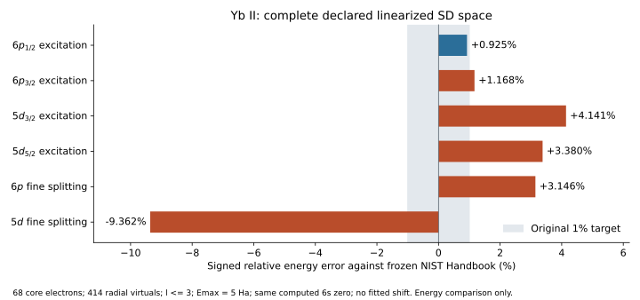

# 原生积分驱动的直接约化核 SD：活动续篇

本续篇实现 `methods.core_sd`，把原始 pCI 核 SD 图项接到 Atomx 的原生
Dirac–Coulomb cell 积分，并补齐非正则 Fock 项。前序
[有限 J=0 方程锚](../atomic_reduced_sd_2026_10_09/README.md)保持封存。
当前用法见[权威接口指南](../ATOMIC_LINEARIZED_SD.md)。本专题仍在计算，
尚未封存；最高水准所需的价电子算符、空间/径向收敛与实验精度门仍未全部完成。

2026-10-10 的[技术路线](technical_roadmap.md)按有效态/谱学消费、共同空间收敛、
J 约化与流式完整三激发、CPU/GPU 完整任务验收列出依赖和里程碑。
它是依据当前证据与一手文献的实施建议，不改变下面已测结果、公共能力或原验收门。

路线的首个[跨 J/宇称有效态谱线增量](finite_bloch_transitions.md)现已实现：
原生有限 Be⁺ 三个完整 sector、16 条电多极控制，带符号算符和归一化矩阵元
分别通过 `1e-11` 原门，最大差 2.67e-15/5.78e-15 a.u.。共享角展开四处弱振幅
剔零已移除；扩大后的 240 项受影响检查全通过，新增弱分量回归保留约 2.78e-17 的项。
它扩展有限精确 CI 的消费，不把大空间固定能量 SD 列升级为已验证物理谱线。

第二个增量实现[有限 standalone 单价 SD](../ATOMIC_LINEARIZED_SD.md#finite-standalone-monovalent-sd)：
固定真实核振幅，补齐价单激发图和相关能反馈，输出归一化 SD 态及单体算符双线性消费。
普通附着交换子多减价单激发图的失败保存在 `monovalent_sd001/`，逐项诊断见
`monovalent_sd002/`；最终源码的 `monovalent_sd006/` 封存十个完整磁态、八条真实频率
E1 控制和 195 个数组。独立原方程差最大 2.81e-15 Ha，SD 投影残差最大 4.79e-16 Ha。
完整薛定谔残差仍达 2.552e-3 Ha，长度/速度矩阵元差约 2.5%；模型和空间尚未物理收敛。
不能把这些数值门升级为最高精度或大空间 GPU 能力。`monovalent_sd003/` 的最小反馈
幅度预估失败亦保留，004 按原残差/振幅门重新验收。
15 个文件的回归首次通过 159 项，三个外部 FSCC 启动因子进程缺少固定工具链的
libgfortran 库路径失败；补齐运行库路径后，三个外部门及十个新增门全部通过。
两次运行共验证 162 个不同检查，无跳过；原失败日志保留在 005，补跑日志在 006。
最终格式化源码与前一版 AST 等价，195 个科学数组逐项位相同；这不是性能认证。

第三个增量实现[独立的 J 约化 standalone 单价 SD 方程接口](../ATOMIC_LINEARIZED_SD.md#j-reduced-standalone-monovalent-sd)。
新构建器复用固定 pCI 原图、恢复接收物理振幅的 `term31`，新增裸核 Fock 的完整
磁多重态补项；价相关能只进入独立消费方程，核分母不随它移动。
矩阵自由 GMRES／解析反馈导数复用原分块 BLAS 双激发核；无物理坐标裁剪，
完整载荷、编译静态数组和 Krylov 向量均预检。构造入口在未缓存核重验前检查预算，
分母拼装不再把数百万 double 转成 Python 对象。没有默认 GPU 接管或性能声明。

`reduced_monovalent001` 的首个小面板保留 7 个失败；002 的源隔离诊断测得
强旋转根的独立原始残差 `4.321e-10 Ha`。003 的初次粒子次序补项仍有 3 个失败；
004 把标量单激发直接作用到完整 H 源，破坏核正规序 Coulomb 排除项，留下
9 个失败。005 分离裸 Fock 与 Coulomb 后，38 项原门全部通过。没有放宽门限。
最终源码 006 面板扩大到全部十个 M、四种完整轨道设置、完整核／固定能量价／
屏蔽回归：147 项通过，3 项因未给串行 BLAS 变量跳过；补齐该变量后三项通过，
两次运行覆盖 150 个不同检查。固定能量列在新接口交错执行前后逐位相同。

更严格的归一化态比较在 006/007 均失败于 `1.3624e-11`；收紧实际求解门至
`1e-14 Ha` 没有消除它，失败及数组保留。新的 008 事先声明独立总 J 控制：
在完整 fixed-M 行列式空间构造 J²，保留目标 J 的全部角向子空间，另解由独立
费米矩阵图项构造的有向 pencil，并继续检查未投影完整残差。
[008 的 40 态／824 数组](reduced_monovalent008/summary.json)全部通过，随机映射最大差
`3.96e-16 Ha`，独立根差 `4.16e-15 Ha`，未投影原始残差 `1.73e-15 Ha`，
归一化态差 `1.78e-15`。更强的未分解态门在其中两例仍失败，最大 `2.353e-11`；
独立分解测得同样大小的目标 J 外分量，J 内差仅 `2.17e-15`。这支持近简并浮点
角动量泄漏的解释，不把旧失败改成通过，也不构成实验精度证明。

有限锚的裸 Fock 补项也在当前源码[008 状态／E1 回放](monovalent_sd008/comparison.json)重验：
十态、八条真实频率 E1 门全部通过。195 个数组中 155 个与历史 006 逐位相同，
40 个变化见[逐数组记录](monovalent_sd008/historical006_comparison.json)；本次是物理约定
修正，历史 005/006 的格式化等价不被挪用。

[完整 Yb 算术预检](reduced_monovalent007/full_yb_resource_plan.json)保留原 68 核电子、
414 径向虚轨道及全部允许通道；五列分别含约 2.02–3.77 百万个坐标。
40 Krylov 向量／restart20 的最大载荷界 `9,750,842,316 B` 小于原 32GiB 主机预算。
没有由此推出新的完整 Yb 根、GPU 加速或谱认证。下一阶段仍须完成完整大空间解、
原生约化 SD 态／性质消费、多价有效算符、全三激发和物理收敛，最高水准未达到。

完整空间验证现由[独立驱动](probe_yb_full_monovalent.py)推进。
[001 运行预检](yb_full_monovalent001/resource.json)计入当前完整核重验的
2822 万坐标与 40 个 Krylov 向量，整轮最大载荷界 `12,844,848,516 B`；
它与上述仅 standalone 求解的 `9,750,842,316 B` 范围不同，均在原 32GiB 内。
[002 失败](yb_full_monovalent002/failure.json)在实际准备后拒绝历史物理源码身份：
共享 `csf_hamiltonian.py` 已移除四处弱振幅阈值剔零，旧源哈希不能原样继承。
新的 [003 前瞻契约](yb_full_monovalent003/contract.json)只允许逐字核验这四处
已通过有限控制的变更，另外重验旧存档的完整带符号核作用、源、分母、能量及
当前完整原始方程；不把旧核结果重盖成当前证书。
003 完成当前完整核重验：历史完整核作用差 `2.776e-17 Ha`，源与能量差为零，
分母逐位相同；实际核解原始残差 `4.438e-13 Ha`。首个完整 6s 列的仿射／齐次
恒等式差 `3.711e-17 Ha`，双激发部分与未改固定能量映射相同。
[停止记录](yb_full_monovalent003/stopped.json)保留 11 次完整价作用及源码身份；
由于重复逆作用成本，转向完整作用复用。003 没有求得反馈根。

私有 [term31 GEMM](monovalent_term31_blas_control.py)只替换最终径向求和，
保留所有带符号角向、P/Q、direct/exchange 与 Coulomb 项；同一 COMMON 中另留
可调用原始组件。[有向 Davidson 控制](monovalent_davidson_control.py)缓存裸 ev
下完整坐标的作用，解 `(1,rho)` 有向增广 pencil；数值子空间不删物理坐标。
每个耦合阶段都以实际 public map 重验完整原始方程与能量，最后另验实际仿射作用。
[当前有限控制 002](monovalent_davidson002/result.json)通过 84 项独立门、144 个数组，
涵盖四列、全部十个 M 与四种完整轨道设置。配对原始／私有最大差
`6.662e-16 Ha`；相同八步分支与 `1e-14 Ha` 目标下，完整 native 作用数由
262–698 降为 22–25。这是作用数比较，不能当成端到端时间加速比。

[004 完整契约](yb_full_monovalent004/contract.json)采用上述私有控制，先核对全部
五列原始／GEMM term31 带符号数组及完整映射，再求 6s、6p、5d 五个根。
计入私有额外静态 scratch `6,506,240 B` 后整轮上界 `12,851,354,756 B`，
仍用原 32GiB 主机预算。004 的五列完整映射全部通过：仿射误差最大
`6.182e-17 Ha`，双激发固定能量回归差为零，term31 原始／GEMM 组件差最大
`3.897e-20 Ha`。[停止记录](yb_full_monovalent004/stopped.json)及
[映射阶段源码核验](yb_full_monovalent004/map_phase_source_postcheck.json)保留全部数组
与 367 个源码身份；停止重复 CPU 求根以减少与 005 的资源争用，没有 CPU 反馈根。
公开求解器、默认构建器与 CPU/GPU 策略不变。时间记录是当前负载下的 workload
观察，没有可控端到端加速比声明。

私有数值控制另有[七项拒绝／重启检查](test_monovalent_davidson_control.py)通过，
[执行日志](monovalent_davidson_rejection001.log)覆盖完整非对称 pencil、真实重启、
缓存图像不一致、复杂分支和预算拒绝。[standalone CPU/CUDA 001](monovalent_cuda001/result.json)
与加入 term41／terma4 精确 GEMM 的 [002](monovalent_cuda002/result.json)分别通过
164 项独立有限门、96 个数组、16 个配对反馈根。002 的 CPU/CUDA 根最大差
`1.499e-15 Ha`，GPU 原始残差最高 `1.93e-15 Ha`；这不是实验差距。
小算例实际单次 GPU 根约 `0.049–0.130 s`，CPU 约 `0.008–0.014 s`，
较慢结果保留，不声称可控时间比或默认 GPU 应当启用。

[完整 GPU 执行包装](probe_yb_monovalent_cuda.py)复用完整输入／当前核重验驱动，
before-load 安装精确 term31／41／terma4 GEMM 与显式 CUDA term2；
[005 前瞻执行契约](yb_full_monovalent005/gpu_launch_contract.json)额外计入
`78,524,416 B` 主机 scratch，整轮上界 `12,929,879,172 B`，原 32GiB 主机／
2GiB 设备预算不变。所有五列完整数组须先与 004 当前原始 CPU 映射对照；
每个 GPU 自洽根再经实际完整 CPU 原始方程与能量检查。
[五列 CPU/CUDA 完整数组](yb_full_monovalent005/complete_cpu_cuda_maps.json)现全部
通过，共 50 个数组，最大差 `5.205e-17 Ha`。
首个 [6s 根](yb_full_monovalent005/root_6_-1.json)与
[实际 CPU 回代](yb_full_monovalent005/cpu_root_recheck_6_-1.json)通过：相关能
`−0.03104919988326371 Ha`，原始残差 `1.631e-11 Ha`，能量残差
`5.898e-17 Ha`；102 次 native 作用、5 次数值重启，单轮求根／回代约 598 s。
这是当前负载下观察，没有控制时间比。005 的其余三个根没有完成；
[显式停止](yb_full_monovalent005/stopped.json)保留全部五列映射、两个已验收根与
[部分源码核验](yb_full_monovalent005/partial_source_postcheck.json)，没有完整五根证书。
与 006 并行时旧作用约 8–12 s 上升至 19 s，停止重复 16 维迭代以避免争用；
该现场观察不是控制加速比。GPU 契约补充基础驱动的 CPU 契约，不修改公共默认值。
[实验基准 002](yb_monovalent_experiment002/reference.json)在 GPU 根产生前冻结
NIST Handbook 的五个 Yb II 名义态、同计算 6s 零点与原 1% 目标。
本机原 HTML 抓取 HTTP403 保留；归档的是已检查网页的明确转录，不能冒充
原 HTML 哈希或最新 ASD 数据。完整对照仍待全部求解门通过。

[历史文献数值摘录](yb_monovalent_literature001.json)在新五态对照之前另行冻结。
Porsev、Safronova 与 Kozlov 的 2012 年单价线性化 SD 表 I，相对这里的 Handbook
能级，5d 两态偏差约 `−0.61%/−0.29%`，6p 两态约 `+3.26%/+3.58%`。
这提供特定方法与体系的历史背景，不能外推为所有软件的精度，也不是与 Atomx 同空间
重放。论文讨论邻近 4f 空穴态混合；当前 SD 已保留 2p1h 双激发，不能称空穴全部缺失。
平衡的非微扰模型空间和更高阶相关仍是待验解释，必须通过共同上下态的控制来判别。
[一手论文](https://link.aps.org/accepted/10.1103/PhysRevA.86.022504)

6s 的重启成本另触发[私有数值容量 64 控制](probe_monovalent_cuda_subspace.py)，
没有修改活动 005 或物理空间。003 的 164 项计算门通过，但最后用了错误的归档文件名，
[归档对照失败](monovalent_cuda003/numeric64_failure.json)保留；修正后的
[004 完整验收](monovalent_cuda004/numeric64_result.json)通过 164 项门，96 个科学数组
与数值容量 16 的原控制逐位相同。有限原子作用数仍为 22–25，不能因此宣称改善。
[独立 42 维有向矩阵控制](monovalent_wide_subspace001.json)另检验实际宽子空间：
容量 16／32／64 的已用维数 15／29／40，作用数 262／81／50，重启 15／2／0，
三项数值门通过。[实际测试](test_monovalent_wide_subspace.py)只提供数值压力锚，
不代替原子物理门或完整 Yb 数值容量 64 的性能／求根验收。

005 的第二个 [6p₁/₂ 根](yb_full_monovalent005/root_6_1.json)及完整 CPU 回代也通过：
相关能 `−0.019158459569027623 Ha`，原始残差 `1.878e-11 Ha`，135 次作用。
基于完整根的重启成本和上述独立数值控制，另立
[完整 numerical64 执行包装](probe_yb_monovalent_subspace.py)；
[006 前瞻契约](yb_full_monovalent006_numeric64_contract.json)不修改活动 005 或物理空间。
[实际加载前资源检查](yb_full_monovalent006/numeric64_resource.json)通过，额外计入
`2,894,669,568 B` 的完整向量／投影储备，保守整轮上界 `15,824,548,740 B`，
原 32GiB 主机／2GiB 设备上限不变。
[两轮并行资源预检](yb_full_monovalent006_preflight.json)记录主机／设备余量，
这些并行现场时间不构成控制加速比；随后停止重复 005。
[006 完整结果](yb_full_monovalent006/result.json)现已完成当前核重验、五列映射和五个反馈根，
所有 50 个 CPU/CUDA 配对数组及每根实际完整 CPU 回代均通过。
[数值容量证书](yb_full_monovalent006/numeric64_result.json)和
[源码后核验](yb_full_monovalent006/source_postcheck.json)也通过；物理空间与原判据不变。
五态实际 native 作用数依次为 56、78、93、71、70，数值重启为 0、1、1、0、0。
最大原始／能量残差 `2.320e-11/2.838e-15 Ha`，整轮约 4908 s，峰值 RSS
`9,175,396,352 B`；这些是当前负载下观察，没有受控端到端加速比。
[两态 numerical16/64 配对](yb_monovalent_numeric_capacity_partial001.json)保留相同物理输入下
6s／6p₁/₂ 的作用数 102→56／135→78，能量差不超过 `1.009e-13 Ha`。
原裸 `D0` 逐位相同；各根保存的分母为自身 `D0+δEv`，不能要求不同已解根的该数组逐位相同。
[实验契约 003](yb_monovalent_experiment003/reference.json)在 006 根产生前冻结，
额外要求 numerical64 完成／源码审计；实验值、状态、零点和原 1% 门不变。

[完整实验对照](yb_monovalent_experiment003/comparison.json)与
[CSV](yb_monovalent_experiment003/comparison.csv)以本次计算的同一个 6s 基态为零点，
没有拟合平移。以下为名义参考连接分支，尚无完整组态权重匹配或线强度证书：



[PNG 导出](yb_monovalent_experiment003/energy_errors.png)和
[图源／输入绑定](yb_monovalent_experiment003/plot_metadata.json)可用于审查；
图中展示能量误差，未给不具来源的实验不确定度。

| 态 | 计算激发能 / cm⁻¹ | Handbook / cm⁻¹ | 差 / cm⁻¹ | 相对差 | 原 1% 门 |
|---|---:|---:|---:|---:|---|
| 6p₁/₂ | 27312.139 | 27061.82 | +250.319 | +0.9250% | 通过 |
| 6p₃/₂ | 30747.339 | 30392.23 | +355.109 | +1.1684% | 未通过 |
| 5d₃/₂ | 23911.667 | 22960.80 | +950.867 | +4.1413% | 未通过 |
| 5d₅/₂ | 25155.120 | 24332.69 | +822.430 | +3.3799% | 未通过 |

6p 劈裂计算／实验为 `3435.200/3330.410 cm⁻¹`，相对差 `+3.1465%`；
5d 为 `1243.454/1371.890 cm⁻¹`，相对差 `−9.3620%`，两项都未通过原 1% 门。
对应 6s 连接的真空波长也保存在 CSV，属于能量换算，不代表已计算跃迁强度。
参考为 [NIST Handbook Yb II 能级表](https://physics.nist.gov/PhysRefData/Handbook/Tables/ytterbiumtable6.htm)
及其 M67 引文，表中未提供标准不确定度，印刷位数不能当作实验误差条。
这不是对所有软件的精度排名，也没有达到最高水准。优先对共同 6s／5d 上下态的
高分波和能窗尾部进行受控收敛，再区分非线性／三激发、平衡核空穴模型空间及
Breit/QED 的贡献；目前这些归因都待验。减小既有方程残差不构成实验差距收敛证据。

私有[完整线性化 SD 物理范数](monovalent_norm_control.py)另补齐
`(1+T_core+S_v)|Phi_v>` 的核旁观双激发、价参考泡利阻塞与核单激发／价双激发干涉。
计算复用完整径向块视图和小型带符号角 Gram 矩阵，不展开磁四阶振幅张量或完整行列式。
[首个失败](monovalent_norm001/failure.json)定位同一径向核壳层内仍需反对称化两个空穴磁分量；
修正后，[当前四种完整轨道设置](monovalent_norm003/result.json)的 80 个带符号／全 M 情形
通过 672 项独立费米展开门，最大总范数平方差 `4.441e-16`。
[当前多核空穴控制](monovalent_norm_multicore004/result.json)以抽象正交完整磁多重态检验
同／异径向和同／异 κ 核空穴，再通过 168 项门、20 情形，最大差 `2.221e-16`。
所有原 `1e-11` 门不变；此处不是完整 H 的本征态或跃迁强度证明。
完整向量的有限性检查改用固定 1Mi 元素布尔 tile，额外计入预检，不生成整条 2822 万元素
临时 mask；不完整／复数振幅、非法磁投影、预算不足和缓存 Gram 写入等
[六项边界检查](test_monovalent_norm_guards.py)也通过。003／multicore004 的科学结果
与前版逐项相同，所有来源仍分别封存。
[完整 Yb 范数驱动](probe_yb_monovalent_norm.py)须在 006 五根及 CPU／源码门全部通过后
才可加载：另重解完整核并实测核振幅与原完整种子逐位相同，再消费全部核—价通道与
每个态的全部 M；32GiB 上限与 64MiB 范数 scratch 预检不裁物理坐标。
[001 前瞻契约](yb_monovalent_norm001/contract.json)现已完成。
[完整物理范数结果](yb_monovalent_norm001/result.json)通过五态的全部 18 个磁分量，
各多重态 M 范数平方差均为零；[实际芯层重放](yb_monovalent_norm001/core_replay.json)
两次完整作用后实测振幅与原种子逐位相同，raw `4.438e-13 Ha`。
[源码／数据后核验](yb_monovalent_norm001/source_and_payload_postcheck.json)通过
381 个源码与 33 个核种子、根、CPU 复核、GPU／数值容量证书和有限控制文件的哈希。

| 态 | 完整线性化物理范数平方 | 全部 M 数 | 范数收缩观察时间 / s |
|---|---:|---:|---:|
| 6s₁/₂ | 1.168793281554539 | 2 | 1.797 |
| 6p₁/₂ | 1.181305018618906 | 2 | 1.264 |
| 6p₃/₂ | 1.180524023101550 | 4 | 2.754 |
| 5d₃/₂ | 1.176459381694123 | 4 | 2.722 |
| 5d₅/₂ | 1.172043793472035 | 6 | 4.145 |

各态共同未阻塞前的核双激发范数贡献为 `0.11710458098863234`；泡利阻塞和
核 S1／价 S2 干涉仍逐态保留，不能用核／价范数简单相加。
联合预检上界 `16,629,201,972 B`，范数 scratch 上界 `23,609,344 B` 低于 64MiB；
含完整核准备／重放整轮约 822 s，峰值 RSS `3,955,884,032 B`。
收缩时间及整轮时间是当前负载下不同范围的观察，不构成受控加速比。
[16 项私有数值／边界检查](monovalent_private_guards002.log)和
[17 个私有文件静态／格式检查](monovalent_private_quality003.log)通过。
此项完成真实范数标量，生产态导出、dressed 算符、完整 H 驻定性、相关空间收敛和
物理共振极点仍分别待验，没有因范数通过而提升实验精度声明。

## 预设契约与实现

[起始契约](contract.json)固定 pCI `4d685d82bfdf27876098a87808dadc5fcf3038d1`、
原生度量/核模型与完整请求空间。径向、独立交换子门均为 `1e-11 Ha`，
原始方程残差门为 `1e-10 Ha`；空间 `1 cm⁻¹` 和实验 `1%` 门保持原定义，
未用拟合平移、轨道计数截断或弱振幅筛选改变它们。

新增内容：

- `numerics.bspline.coulomb_features`：精确稀疏辅助节点作用。跨 cell 复用
  累积矩，cell 内保留原始三角 Gauss 子节点和全部 PP/PQ/QP/QQ 项。
  P/Q 分别标记，动能平衡时不同积分阶数不混用。返回加权双线性作用，
  原 pCI RINT 改为求和；不得再乘另一套径向积分权重。
- `angular.sd_rho`：完整带符号 rho 角系数，不除以可能为零的电多极约化元。
- `methods.core_sd`：原始 pCI 图项、完整非正则 Fock 核/虚块及 Fov*T2
  单激发项、带符号能量、原生度量和版本绑定、矩阵无显式存储的 GMRES。
  全部请求虚轨道均保留；计数、静态数组/中间量及 Krylov 资源在运行前核算。
- `methods.atomic_space`：SD 与 FSCC 共用的完整 VN 能窗构造。只在调用方
  显式指定时划分冻结核；共享构造器不删任何本征根。
- `tools/build_pci_sd_backend.py`：保留上游原始源码和 GPL-3.0 许可证，
  校验图项/角系数源 SHA，生成独立 case 库与实际编译/文件身份。
  原 pCI 图项保持原样，作为默认路径与独立对照；可选的精确 BLAS 初始化、
  分量合并及虚对复用实现均保存在构建附件，分别记录源码与工作线程身份。

直接路径覆盖实数 DC 闭壳层核；单价 Bloch/SD、一般 CI+all-order 的 Σ₁/Σ₂、
非线性 CC、三激发、Breit/QED/反冲及物理共振极点不由这一接口提供。
已有有限 DC/DCB 和 EXP-T FS-CCSDT 的覆盖保持各自独立约定。

## 独立判别结果

以下比较逐分量检验 `Q_SD(H+[H,T])|Phi>`；独立 oracle 用完整 M=0/even
SD determinant 投影及基本 Fock 操作。该投影对 linked SD 残差精确：
H|Phi> 的 rank≤2，T 不能降低激发 rank。先另设正则校准 h，再检验实际
原生非正则 h；校准模型不会冒充原生物理 Hamiltonian。

| 同空间控制 | 原生非正则交换子最大差 / Ha | 解出的物理振幅最大差 | 相关能差 / Ha |
|---|---:|---:|---:|
| Be²⁺ 两电子核 | 9.89e-17 | 原生 CSF 单元锚通过 | <1e-12 |
| Be 四电子核、完整核/虚轨道旋转 | 5.90e-17 | 1.67e-14 | 1.49e-17 |
| Ne 十电子核、完整核/虚轨道旋转 | 3.66e-15 | 1.24e-13 | 7.43e-20 |
| Be²⁺、s/p/d/f 全分波有限控制 | 1.53e-16 | 2.42e-14 | 9.03e-17 |
| Be 四电子核、不同阶数动平衡、完整旋转 | 6.94e-17 | 1.25e-14 | 2.41e-17 |

原始角系数、核同 κ 非对角块、虚同 κ 非对角块、交换项与占据/虚耦合
均保留；每 κ 最初保留两个虚径向函数的控制是有限方程锚，不是完整能窗。
见 [Be 解与原始数组](probe007/result.json)、[Ne 解与原始数组](probe008/result.json)、
[d/f 控制](probe009/result.json)及[动平衡控制](probe010/result.json)。
全部 PP/PQ/QP/QQ、实/复 c-product、原点单 cell、动能平衡与非平衡的
11 个径向测试通过。[图项复用后的相关测试面板](term21_streamed_affected_first.log)
**97 passed**（此面板在新增BLAS并发门之前），
含实际 EXP-T 三电子 FS-CCSDT、复旋转/空穴及 packed/streamed 对照。

## 完整 Ne 能窗与规模测量

固定原生 ns30/ks7、全部10核电子、50 Ha 以下全部声明 VN 虚态，未加
Breit/QED；单 BLAS/OpenMP 线程。各模型自己的完整空间求解：

| 分波空间 | 冗余 rho 振幅 | 独立标量计数 | 核相关能 / Ha | 原始残差 / Ha | 解时 / s |
|---|---:|---:|---:|---:|---:|
| s/p | 6,711 | 2,492 | −0.159715174580 | 2.79e-12 | 2.45 |
| s/p/d | 17,531 | 6,502 | −0.284539068078 | 1.60e-12 | 9.97 |
| s/p/d/f | 29,015 | 10,668 | −0.320361942231 | 7.58e-13 | 26.65 |
| s/p/d/f/g | 39,959 | 14,574 | −0.332240872861 | 8.44e-13 | 55.33 |

原始输入/计划/解/时段记录分别保存在
[s/p](ne_complete_s_p_50/result.json)、[s/p/d](ne_complete_s_p_d_50/result.json)、
[s/p/d/f](ne_complete_s_p_d_f_50/result.json)、[s/p/d/f/g](ne_complete_s_p_d_f_g_50/result.json)。f 模型完整 matrix action 约1.02秒，
共26次求解作用；全进程峰值 RSS 约378 MB，含解释器/JIT。
这些是对应 workload 的时间观察，未建立与另一实现的端到端加速比。
从 d 到 f 的相关能增量约0.03582 Ha，f 到 g 仍有约0.01188 Ha，明确不能判作物理空间收敛，
核总能量结果也不能替代价电子跃迁或实验谱线精度。

## 完整 Yb 请求

[完整预检](yb_full_preflight.json)保持原封存 V68/Fermi/ns123、全部68核电子，
以及 ℓ≤3/5 Ha 的414个虚径向键、1894个虚磁态。独立标量计数13,165,103；
原 pCI rho 表示28,218,500。显式16384项径向缓存后，原实现完整
静态/中间量/初始化 payload 上界约8.68 GB，
另加声明的 Krylov 存储。已为该完整请求预声明32 GiB上限，没有改用冻结核
或删虚轨道。

[完整 Yb 驱动](probe_yb_full.py)与
[原实现运行日志](yb_full_run004.log)及
[复用径向势的运行日志](yb_full_run005.log)继续检验真实方程、内存和耗时。
原实现准备118.38秒，峰值RSS约3.20GB，首轮完整作用105分钟仍未完成；
已停止重复的run004，保留[停止记录](yb_full_run004_stopped.json)与原日志。
复用实现请求16个核对工作线程、单线程BLAS；
[预检](yb_full_run005/yb_full_plan.json)含1.536GB新增工作内存，
完整payload上界10.220GB，另加40个完整Krylov向量9.030GB，仍在32GiB约定内。
run005在首次完整作用中出现串行OpenBLAS内存池警告，已停止并
[拒绝数值验收](yb_full_run005_runtime_rejection.json)，不能作为通过结果。
状态以运行结果文件为准；尚未给出新的 Yb 价谱，也不声称实验误差已缩小。
使用绑定OpenMP库的[run007](yb_full_run007.log)完整准备130.02秒，
首轮`terma4`测得269.302秒、`term21`3439.617秒、`term31`462.586秒；
全部首轮图项完成，总作用4527.407秒。完整向量及原节点源已捕获；
[停止重复原路径求解](yb_full_run007_stopped.json)以复用独立完整作用门。
run004是未完成的性能观察，不作为方程或精度失败。

## 同模型性能验证

[Ne g 图项分析](ne_g_profile001/stages.json)显示原始 term21 占整次作用约94%。
保持完整39,959维向量和全部轨道，比较原路径与两个精确实现：

| 实现 | 解/随机向量完整作用最大差 / Ha | 交替配对整次作用 / s | 同空间26次作用求解 / s |
|---|---:|---:|---:|
| 合并P/Q节点、4核对线程 | 0（逐项相同） | 原约2.1 → 约0.65 | 16.39 |
| 每分波/秩复用虚对径向势、4核对线程（并发运行库结论撤回，待重放） | 3.33e-16 / 5.55e-17 | 旧观察原约2.0 → 约0.32 | 旧观察8.41 |

两个解与原始解的带符号振幅最大差分别1.87e-16、1.94e-16，残差均约8.44e-13Ha。
见[合并实现](ne_g_term21_compact001/result.json)及
[复用实现](ne_g_term21_streamed001/result.json)。完整向量交替计时通过负载门；
求解时间是独立观察，未进行配对端到端加速比测量。d/f 与动平衡有限控制
也重放了两条路径，逐项作用与解均通过；这些控制不替代全Yb验证。

Yb扩大并发后的警告推翻了“串行BLAS可直接并发调用”的运行假设。
串行库只有单核对调用可继续使用；多核对streamed路径现在在构建前要求
OpenMP OpenBLAS，并在加载后校验实际线程模型及单线程内部BLAS。
此前四线程streamed的数值比对保留为历史观察，不作为可靠并发性能验收。
依据[官方线程说明](https://www.openmathlib.org/OpenBLAS/docs/faq/)，
串行构建的并发调用需要额外线程安全保障；当前选择独立、绑定SHA的
[OpenMP 0.3.32运行库](openblas_openmp_runtime/identity.json)重新验证。
[完整Ne OpenMP重放](ne_g_term21_openmp001/result.json)已通过：全部作用最大差
3.33e-16Ha，解的最大差1.94e-16，残差8.44e-13Ha；4工作线程配对整次作用
0.342–0.348秒，原路径2.30–2.33秒，负载门通过。请求16实际钳制到10个核对。
26次作用求解4工作线程8.92秒，为单次观察，未给出配对求解加速比。

新`core_singles_blas=True`严格保留`terma4`直接与所有交换重耦合项。
[完整Ne检查](ne_g_core_singles_blas001/result.json)和
[d/f](probe009_core_singles_blas001/result.json)、
[动平衡控制](probe010_core_singles_blas001/result.json)通过完整带符号作用与解门。
这批负载超过24，计时不用于性能结论。

精确胞内多项式坐标将Yb的28980节点变为3910节点，原始积分权重均在
`Aᵀ K原 A`中保留；这是表示变换，不是替换积分网格。
[稠密核轨道及虚轨道的256个径向值](yb_polynomial_integrals002/result.json)
最大差1.07e-14Ha，原控制[保留](yb_polynomial_integrals001/result.json)。
[42项径向与独立SD检查](polynomial_core_live_first.log)通过，
4项跳过是零工作线程与BLAS单激发选项的无效组合。
随后[完整Ne多项式表示](ne_g_polynomial001/result.json)已通过：全部39,959维
带符号作用最大差3.33e-16Ha，解的最大差1.94e-16，原始残差8.44e-13Ha。
核相关能−0.33224087286065423Ha；26次作用。该批负载门失败，计时不构成
性能结论。d/f及不同阶动平衡控制也保留[完整作用与解](probe009_polynomial001/result.json)
及[对应动平衡结果](probe010_polynomial001/result.json)。

补充[完整68核电子的有限虚态控制](yb_full_core_equation001/action_errors.json)，
保持原V68/Fermi/ns123、全部19核径向键，每分波显式选两个虚态，共14个。
8060个完整角通道及32,278维带符号向量的初始/随机作用最大差分别
2.78e-16/3.55e-15Ha。该控制仅用于高核角动量方程，不替代生产414虚态空间。
在[根控制](yb_full_core_equation002/result.json)中，新表示1/4工作线程均23次作用
收敛，相关能−0.0391492903531642Ha；代回原pCI完整作用，原始残差
1.30487e-12Ha、带符号能量差1.39e-17Ha。两解逐字节相同，严格核对后才复用
同一次原作用。原路径只执行必要的独立残差检查，保留[停止重复昂贵求解的处置](yb_full_core_equation001_solver_redesign.json)，没有放宽残差门。

[受影响依赖面板](polynomial_affected_first.log)120项通过，其实际源保存在
`source_for_polynomial_affected/`；最终[核/径向面板](imported_identity_live_second.log)
43项通过、无跳过，包含有限输入溢出拒绝和非零作用计数。后续仅调整导入排序。
结果身份改为捕获导入时的模块字节，防止长进程在源码编辑后错误标记运行版本。

[完整新表示Yb预检](yb_full_polynomial_preflight.json)仍为68核/414虚轨道，
全部28,218,500维rho坐标；按16工作线程估计payload3.831GB，加40个
完整Krylov向量9.030GB，低于32GiB约定。
[run008](yb_full_run008.log)实际选8工作线程以限制与运行中16线程参考的争用，
物理空间不变，实际源字节保存在`source_for_yb008/`，
[启动契约](yb008_launch_contract.json)明确完整带符号作用门1e-11Ha和原始残差门1e-10Ha。
run008完整准备458.267秒，首轮完整作用248.745秒；其中`terma4`0.864秒、
`term21`138.262秒、`term31`40.612秒、`term32`38.989秒。
这些是不同负载下的单次阶段观察，不是受控端到端加速比。
[同空间完整作用门](yb_full_run008/yb_full_reference_action.json)已通过：
逐字节核对全部原生输入及物理空间；同一28,218,500维带符号向量的作用最大差
1.39e-16Ha，源差3.05e-16Ha，分母差0。
[完整核解](yb_full_run008/yb_full_result.json)已完成36次GMRES作用：原始最大残差
4.43772e-13Ha、L2残差7.99107e-12Ha，相关能−0.6363421005996561Ha，
参考能−14067.058077561142Ha。求解9748.348秒、完整运行11269.154秒，峰值RSS11.532GB。
这些是归档源的实际观测，无配对端到端加速结论；全部带符号振幅、源、分母
保存在[解文件](yb_full_run008/yb_full_solution.npz)。当前没有新的Yb价谱、
空间收敛或实验精度结果，核方程通过不等于谱线精度通过。

[精确X1/X2 BLAS初始化](ne_g_blas001/result.json)使Ne完整准备中的指定阶段
约0.105秒降至0.035秒，全X1/X2数组最大差1.07e-14/3.55e-14Ha，
100个带符号公共原生径向值最大差4.31e-15Ha。此为阶段测量。
`numerics.bspline.pair_contraction`另有精确分块实现；在已缓存的Ne小矩阵上
反而慢约5倍，保留为负结果，未接入生产SD路径。

原图项的大型静态数组未整体开启OpenMP；仅堆内存有明确上界的工作例程
分开编译，节点作用使用可重入局部量，各线程写入不重叠核对通道。
原始图项及GPL-3.0许可证在每个后端构建中保留。

## 保留的失败与边界

首次共享库静态 libgfortran 链接由于 TLS relocation 被拒绝，记录在
[原始编译失败](probe001/backend/compiler.log)。改用显式版本运行库路径，
不改变图项或原生 Hamiltonian。首次扩展面板的两项 EXP-T 失败来自未配置
libgfortran 运行路径，见[原始失败面板](affected_second.log)和
[loader 报错](expt_runtime_failure_cc.log)；相同数值测试在正确已记录环境下
46项通过，没有放宽方程门。

Yb 输入捕获的前两次失败分别是尝试序列化局部核势 callable、误把其视为
数组函数；均发生在振幅求解前，原始日志/附件保留。续次捕获明确核模型参数
和数值采样，实际计算继续使用原始 Fermi callable；没有替换为点核或改物理输入。

Yb run003及BLAS准备控制沿用了1024项缓存，栈采样显示重复径向卷积；
已记录[停止原因与版本](cache_fix_restart.json)，显式恢复16384项缓存后
run004完整准备完成。两次旧任务为未完成的性能实验，不能当作方程或精度失败。
有限控制重放工具首次未识别旧输入身份格式，失败发生在后端构建前，原日志保留。
系统拒绝perf/gdb采样权限，未改系统配置；已保留对应诊断日志。
计时接口首次构建缺少Fortran声明分隔符，6项后端测试及run006均在编译阶段
失败；修复后[同组9项检查](stage_logging_live_second.log)通过，未修改数值门。

一次有限值守卫整理误使作用计数语句不可达。其[21项通过日志](nonfinite_core_live_first.log)
不足以发现计数错误，明确拒绝作为生产版本验收；[错误源与理由](source_nonfinite_counter_rejected/reason.json)
均保留。恢复原有有限作用拒绝并修正计数位置后，新增实际计数断言，最终43项通过。
未用该错误版本启动生产计算。

## 文档处置与蒸馏

当前接口/能力/README/迁移/验证/测试及参考索引已同步指向此续篇；旧封存
证据保持只读。本增量采用既有约定与资源规则，不新增根 AGENTS 条款。
可复用行动：连接独立图项前先核对原生积分的加权作用与所有分量；非正则
轨道必须逐项验证完整交换子；残差、物理空间和实验门分别记录。
大空间生产的性能与价有效算符仍继续推进，不以本面板结束最高水准目标。


## 价电子有效算符：隔离的方程控制

[预声明契约](valence_ci_contract.json)固定pCI `valsd-ci.f`及真实原生径向积分，
单独采用可审计的canonical验证Hamiltonian，避免把缺失的非canonical项藏进
轨道替换。Be2+核保留两个电子，显式每分波选两根s/p虚轨道；该有限控制
只验证方程，不代表生产虚空间收敛或实验谱线精度。

[原型桥](valence_control.f90)调用原pCI图项，先把物理核振幅乘原分母转成
Σ分子；遵守CI+all-order固定能量约定、原循环不调用`term31`。
[第二次控制](valence_control002/sigma1_mbpt2.json)的2s对角及3s–2s非对角Σ₁，
在两个能量参数处与独立全磁态反对称ERI二阶求和一致，最大差6.23e-19Ha。
输入全向量和[实际控制源](valence_control002/control_source_sha256.json)保留。

[第三次全磁态作用](valence_control003/magnetic_map.json)的单激发响应差
1.76e-19Ha，但完整512个磁态双激发坐标响应差1.794638e-3Ha，验收失败。
保存[全带符号张量](valence_control003/magnetic_vectors.npz)及源快照，继续逐图项
排查；此结果尚不定位为参考程序错误或物理误差。第四次诊断在组件拆分时
留下临时变量，Ruff发现问题但启动器未依退出状态拦截；[实现失败记录](valence_control004/failure.json)
明确该次不是科学失败。后续启动器先通过静态检查再运行。
目前没有公共价电子SD/Σ₁/Σ₂精度结果，也没有新的Yb价谱。


后续[逐项控制](valence_control005/diagram_errors.json)证明差异仅在交换重耦合两项；
它在全部磁态坐标上严格对称。保持原1e-11Ha门，按原SD式9统一Σ的冗余表示
后，[完整作用](valence_control006/result.json)最大差2.26e-17Ha；
论文式37与此表示的物理反对称响应差3.69e-18Ha。
[代数与表示契约](valence_gauge_contract.json)保留两份完整张量，利用Coulomb
粒子对交换恒等式把差写为`F_mn+F_nm`，证明它在费米产生算符中恒等抵消。
这里没有删去小振幅、改物理模型或放宽容差。

[收敛核/价全阶控制](valence_control007/allorder.json)同时求解独立磁态方程。
核/价原始残差2.81e-14/2.54e-14Ha，独立磁态根残差4.97e-13Ha；
完整带符号根差5.11e-13。储存648个磁态张量坐标，包括512个虚态双激发坐标
及136个严格为零的核占据填充坐标，未通过筛选省略方程。
解析总能量导数包含Σ振幅响应，再与三个步长的独立重新求解比较：
最终2s对角/3s–2s非对角误差3.29e-14/1.15e-14。
固定振幅的2s导数−4.64216e-5，而含响应为−5.65130e-5，偏约18%；
此为有限控制的导数差，不是生产谱线误差预算。

## 两体屏蔽Σ₂：完整有限空间方程锚

[Σ₂预声明契约](sigma2_contract.json)调用固定SHA的原pCI `sdvw-ci.f`图项，
六个s/p径向虚态全部作为价列。不同COMMON布局仅改命名；两个原始查找表
初始化硬写0..10，改为绑定声明的0..KK，所有物理图项保留。
[构建源与说明](build_sigma2_control.py)及[原生桥](sigma2_control.f90)保留
原代码/许可证/完整编译命令，且预检全部存储。

[全部价列控制](sigma2_control002/valence_columns.json)覆盖六列的完整16个磁态，
全部签名响应及原始残差门通过。随后272个原径向通道展开为65,536个磁态
两体矩阵元，与[独立式38求和](sigma2_magnetic_oracle.py)逐项比较：
[最大差7.05e-19Ha](sigma2_control002/sigma2_comparison.json)，
同时保留双端反对称和粒子对交换检查、[完整张量](sigma2_control002/sigma2_magnetic.npz)。
Σ₂原输出除以无宇称筛选的`S1_m-v S1_n-w`，桥明确还原该归一化，
不能直接把径向输出当作Σ分子或Coulomb Slater积分。
[联合导数契约](sigma2_joint_derivative_contract.json)明确同时移动两个价能量，
包含全部价振幅响应，核分子保持固定。原单个导数字段的显式分母斜率为1，
联合变量斜率为2；桥增加原图项的固定振幅导数，原值逐位不变。
[完整解析对照](sigma2_control003/sigma2_derivative_comparison.json)最大差3.18e-19，
上游单字段直接充当联合导数会偏7.27e-5；这是变量约定差，不定位为参考物理错误。
[六次独立重新求解](sigma2_joint_resolved_comparison.json)保留完整65,536个坐标，
核输入、积分、通道、编译文件逐位相同。步长1e-3/3e-4/1e-4Ha的最大导数误差
为2.75e-11/2.47e-12/2.77e-13，全部通过预声明abs1e-9+rel1e-6门，
[检查源](check_sigma2_joint_derivative.py)和[全部差分向量](sigma2_joint_resolved_vectors.npz)保留。
该控制不是QED响应或生产误差预算。
Σ₂这些结果是隔离canonical验证模型；完整非canonicalΣ₂、生产接口、完整Yb价相关、
空间收敛、非线性/三激发及实验精度仍未完成。

## 完整非canonical价Fock：算符已锚，求解响应继续验收

[Fock契约](valence_fock_contract.json)用原生Dirac–Coulomb径向积分，分别保留
两电子和四电子闭壳层、六个s/p径向虚态及全部16个磁态。额外声明的标量
非对角Fock探针同时覆盖核—核、核—虚及虚—虚块；零非对角对照逐位为零。
[原生扩展](valence_fock_control.f90)补齐完整一体交换子，裸F_mv留在H1，
不重复加进相关Σ₁。[独立磁态与费米算符](valence_fock_oracle.py)分别检查
完整带符号张量和物理反对称投影。四电子[第三次控制](valence_fock_control003/comparison.json)
两者最大差为1.30e-18/1.75e-18Ha，覆盖全部价列和磁态。
[失败的第二次控制](valence_fock_control002/)保留了误读原核对三角存储的
独立展开；修正展开器后重算，没有修改原参考图项。

[完整根/响应契约](valence_fock_allorder_contract.json)固定价能量ε_v+.075Ha，
核分子对该能量响应保持固定。004、005、006的失败源与完整向量分别保留。
006直接求解使4s带符号根差降到5.16e-15Ha，但完整响应差1.64e-11仍未通过
1e-11门；条件数约3.23e4，说明小残差不足以保证前向误差。
[006证据](valence_fock_allorder006/comparison.json)与[失败记录](valence_fock_allorder006/failure.json)
明确区分残差、响应、差分截断误差和物理精度。
[007分离控制](valence_fock_allorder007/comparison.json)通过完整原图项源项/线性作用
分离的一致性门，但响应仍差2.27e-11，保留[失败记录](valence_fock_allorder007/failure.json)。
[008共享径向表示](valence_fock_allorder008/comparison.json)将响应差降到1.03e-11，仍未通过。
[009完整控制](valence_fock_allorder009/result.json)对同一float64物理输入使用扩展精度
独立收缩及实际算符LU改进，全部六个径向列/16个磁态通过原门：带符号作用/根/响应
最大差6.34e-17/5.40e-15/1.35e-12Ha；解析Σ₁导数差2.95e-14。
全部三个原步长的独立重新求解通过差分门，独立响应残差≤1.14e-18。
空间、能量、门限保持原值，004–008失败证据全部保留。
有限直接求解仅用于锚定，不构成Yb谱线改善。

## 公共固定能量价SD/Σ₁接口

[`ValenceSD`](../../src/atomx/methods/valence_sd.py)与
[源码绑定构建](../../tools/build_pci_valence_backend.py)已加入独立公共接口。
[3项live测试](public_valence_pytest003.log)全部通过且无跳过；测试覆盖NX>NXX、
完整响应/重新求解导数、核COMMON恢复、不可变结果和物理/源码/核振幅/资源拒绝。
前两次planning测试夹具失败保留，003通过的实际源码快照单独绑定。
[优化后独立重放](public_valence002/result.json)固定旋转.37rad的真实原生DC Fock、
四电子核/六径向列/16磁态；完整作用/根/响应最大差2.09e-16/2.82e-14/1.12e-12，
核原始残差2.60e-14Ha。packed int32索引和逐列缓冲复用前后全部五类输出逐位一致。
无小振幅截断、能量拟合或门限放宽。该接口给出固定能量参数的相关Σ₁行与隐式响应，
尚未构成带CI能量/度量消费的完整有效哈密顿量，不宣称大空间性能或实验谱线精度。

## 非canonicalΣ₂一体贡献：完整原始与不可约算符锚

[预声明契约](sigma2_fock_contract.json)及[原生桥](sigma2_fock_control.f90)加入
核—虚Fock与两个价双激发列的收缩；两价能量联合导数含分母斜率2。
[002完整对照](sigma2_fock002/comparison.json)保留65,536个带符号原始值/导数，
与独立磁态式比较最大差3.40e-16/1.53e-13Ha。实际费米算符通过全部14,400个
价电子对行列，差4.79e-16Ha；反向P S F P逐位为零。
[001失败](sigma2_fock001/failure.json)由于直接将含嵌入Σ₁的两价投影当成不可约Σ₂；
002通过相同分母的独立单价算符投影计算并保留嵌入项，再完整带符号扣除。
没有修改原始pCI或磁态公式。该锚用声明的任意完整输入方向，不是完整已解Σ₂
或实验谱学精度；下一验收将合并完整非canonical价振幅与原始Coulomb屏蔽。

## 完整已解非canonicalΣ₂：固定能量与联合响应

[003完整重放](sigma2_solved003/result.json)使用旋转.37rad的实际原生DC Fock、
同一四电子核、六径向列/16磁态，核振幅保持固定；公共矩阵自由价SD求解后，
完整原始Coulomb屏蔽加不可约Fov贡献，与独立磁态全部65,536个值/联合导数对照。
25个重新求解案例全部通过原1e-11门，最大差4.09e-17/3.73e-16Ha。
[三个原步长的O(h8)差分](sigma2_solved003/re_solved_derivative.json)全部通过原
abs1e-9+rel1e-6门，最大误差1.18e-11。输入积分/Fock/核振幅与public_valence002
逐位相同，源码与GPL原图项均保留。实际Fov在这套DHF核中很小，强Fov贡献的
独立算符锚仍由上节声明方向给出，不外推为所有非canonical核均已验证。
[001构建失败](sigma2_solved001/failure.json)记录COMMON声明计数预期错误；
逐段源码核对后修正为三处。002完整解析门通过，但二阶中心差分
[失败](sigma2_solved002/re_solved_derivative.json)随步长平方收敛；003采用
预声明的h/h2/h4/h8 Richardson提高阶数，没有修改原物理空间、能量范围或验收门。

公共[`Sigma2SD`](../../src/atomx/methods/sigma2_sd.py)、完整约化规划与
[源码绑定构建](../../tools/build_pci_sigma2_backend.py)已通过
[6项组合live测试](public_sigma2_pytest003.log)，无跳过；
[005公共独立重放](sigma2_solved005/result.json)全部25案例通过，并逐位保持
[此前完整输出](sigma2_public_reuse_equality.json)。公开磁态查询的全部65,536值/导数
独立对照分别差4.19e-17/4.28e-16Ha。索引复用避免第二次native价X1/X2构建，
其完整缓存容量已计入预检；该批次没有受控性能计时。公共测试001的method角色
误匹配失败保留，002修正角色区分后通过，003验证最终索引复用源。
它保留定向带符号元素与两价能量联合响应，不自动施加pCI近似对称交换、
厄米平均或经验能量外推；完整CI能量/度量消费及谱线精度仍需验收。

[同案例定向消费审计](directed_effective_audit001/comparison.json)保留全部14,400价对矩阵元：
同时交换两电子协变差2.09e-17Ha，而Σ₁/Σ₂物理价对的伴随差分别0.01674/0.03687Ha，
合并冻结能量价矩阵差0.03933Ha，裸Coulomb差5.56e-17Ha。这里使用明确的列能量参数，
这些数是有限约定诊断，不是谱线误差预算。必须检验能量、左右态与有效度量；
不能直接用对称化或普通厄米CI把原始定向结果当成已完成物理哈密顿量。
原pCI `second-ci.f`选择单侧Σ₁输入，`integrals.f90`还存在显式近似索引对称及受限能量外推；
这些消费约定与原始方程门分开审计，本接口没有自动采用它们。

## 能量约定、强核—价耦合与物理度量续验

[公共006](sigma2_solved006/result.json)采用每个分波最低声明虚轨道的Fock对角能量
加同一个0.075Ha探针参数，固定所有物理输入和误差门，25次完整联合重求解通过。
[对应消费审计002](directed_effective_audit002/comparison.json)使Σ₁伴随差从0.01674
降到0.002295Ha，Σ₂最大差仍0.03687Ha，合并矩阵差0.03687Ha。
该探针不是谱线能量拟合；剩余差的唯一原因尚未定位。
[原论文](https://arxiv.org/html/0905.2578)明确讨论这种分波参数约定；
[FSCC性质论文](https://doi.org/10.3390/sym12111845)的Bloch中间归一有效算符可非厄米，
需要波算符、左右态和物理范数。非厄米差不能单独作为实现错误判据，
也不能直接丢给普通厄米CI或用矩阵平均修补。

[公共价003](public_valence003/result.json)在重新构造全部原生积分前将占据2s与虚3s
旋转0.07弧度，实际Fov最大0.0774013Ha；这是声明的新占据投影，不是仅换坐标。
完整16磁态的作用/解/响应/Σ₁响应最大误差分别1.50e-16/1.33e-14/1.53e-12/5.49e-15，
核原始残差3.30e-14Ha。全部物理身份、完整空间和原1e-11Ha门保持。
[同投影Σ₂公共007](sigma2_solved007/result.json)25次联合重求解通过，输入逐位匹配003；
非零Fov项与独立磁张量核对，三档步长的完整导数差门均通过。
两个驱动的实际源、完整数组、来源及新投影身份已保留。

`FiniteCIModel.bloch_reduction`补入其自身完整原生有限CI哈密顿量的波算符和物理度量。
它不从任意Σ₁/Σ₂结果猜测度量。`Omega=Psi(P Psi)^-1`、`G=Omega^T Omega`，
逐项检查Bloch方程、带度量伴随、左右态和归一；正交表示由真实等距映射构造，
没有矩阵平均。分裂简并空间、奇异/病态投影和资源超限明确拒绝。
完整性质算符同时保留Q贡献。[九项无跳过测试](bloch_metric_pytest001.log)通过。
[原生Be+完整17CSF、2P态](native_bloch_metric001/comparison.json)定向矩阵非厄米差4.79e-6Ha，
物理度量伴随残差1.94e-17Ha，完整重构态差1.12e-16、能量差1.25e-14Ha、
核占据全部带符号性质差5.11e-15。它证明非厄米与物理不一致必须区分，
不证明当前截断SD消费已经满足同样的Bloch/度量方程。

## 核单激发到双激发的精确收缩优化

完整Yb运行中原始term31/32各占每次作用约40秒，仍反复逐元素径向求和。
新增专题内原型将完整单激发试探密度和原始加权Coulomb势共享，用BLAS收缩，
线程写入不相交核对通道。保留所有原始角选择及径向行。
[全部68核、14声明虚轨道控制](single_to_doubles001/result.json)的初始/随机完整向量
与原始作用最大差2.78e-16/3.56e-15Ha。该有限空间不是414虚轨道生产请求的替代。
[完整414虚轨道控制](single_to_doubles002/result.json)通过：同28,218,500维
初始作用差1.39e-16Ha；独立激发全部允许的核单振幅后，原始/新term31和term32
在全部33,014,976个含padding坐标上分别差8.95e-19/1.52e-18Ha。
0.66/0.61秒是新项单次观测，未进行同负载交替配对，不能与旧约40秒直接作加速比。
公共路径现提供默认关闭的`core_single_to_doubles_blas=True`及完整内存、运行时守卫；
核心/价/Σ₂构建CLI均有同名开关。归档源的[公开回归](public_single_to_doubles_pytest002.log)
32项通过，无跳过；包含三种并发serial-BLAS拒绝以及独立原生CSF完整方程控制。
后续新增完整初值`CoreSD.solve(initial_amplitudes=...)`只复用迭代种子，
重新计算当前完整方程与能量；[核面板](core_warm_start_pytest001.log)26项通过，无跳过。
[公共全414虚轨道重放](single_to_doubles003/result.json)已通过原门：完整初始作用差1.39e-16Ha、强单激发term31/32全坐标差8.95e-19/1.52e-18Ha。实际源分别归档，008的历史解/源不被覆盖。

## 完整Yb核解向价SD与屏蔽的接入

[首轮完整价计算](yb_full_valence001.log)由[完整价空间驱动](probe_yb_full_valence.py)预声明并执行：保持008全部
68核/414虚轨道/Fermi/V68/ns123/l≤3/<5Ha，外部模型列为6s、6p₁/₂、6p₃/₂、
5d₃/₂、5d₅/₂，每列内部均使用全部414虚轨道和所有核通道。
每κ采用最低声明虚态的原生Fock对角能，不拟合实验、不作平移。
先以008完整解为新源绑定后端的迭代初值，逐项核对物理身份、完整源和分母，
重算原始残差与相关能，然后解完整Σ₁/列响应及定向Σ₂；原门仍为1e-10Ha，
同物理核能门1e-11Ha。仅凭这些定向算符仍不宣称物理CI谱，左右态、波算符、
度量与完整性质消费需要独立验收。完整静态屏蔽及48列Krylov的上界约20.6GB，
低于32GiB约定；不缩小内部池以适应内存。

[完整核重放](yb_full_valence001/core_replay.json)通过：源差为0、分母逐字节相等、
相关能差为0，当前完整作用的原始残差4.44e-13Ha。
随后首列6s在通道顺序门[失败](yb_full_valence001/failure.json)，尚未得到价列或屏蔽结果。
独立只调用原始rhoval的[完整通道数组](yb_full_valence001/channel_only_diagnostic.npz)
576列和顺序均一致；[完整初始化诊断](probe_yb_valence_init.py)保留同一失败后端、全部轨道和
旧核振幅，仅比较初始化前后COMMON与完整通道，不能当作新的物理解。

[完整初始化002](yb_valence_init002/full_init.json)实际计数576正确，但桥只读取第一行。
原因是优化核`.o/.mod`先于价维度绑定编译，导出的NXV/NVH仍为占位1；
价桥误用该编译常量，原始价图类使用完整549/1076，造成COMMON布局失配。
修复为价模块自己的完整维度include后，原始/streamedBLAS两个配置的
[10项公共价/屏蔽检查](valence_dimensions_pytest001.log)通过，无跳过。
[完整002重放](yb_full_valence002/core_replay.json)仍保持核源差0、分母逐字节一致、
能差0、残差4.44e-13Ha；但在完整价映射入口[进程139失败](yb_full_valence002/process_failure.json)。

[实际gdb重放](yb_valence_stack_old003.log)在通道全部一致后定位到
`atomx_val_map_full_fock`入口第一条栈写。旧可执行指令为分配`0x4340428`字节栈，
超过当前8MiB软限；尚未进入物理映射。原因是构建直接把OpenMP链接命令兼作
价/屏蔽源编译，隐含recursive局部数组。现在价/屏蔽单元分别无OpenMP编译，
保留原始静态数组和共享owner锁，仅显式堆工作区的核worker保留OpenMP。
新入口栈分配为`0x428`字节，完整数组仍由静态内存和原32GiB预检覆盖。
[修复回归](valence_static_pytest002.log)10项通过，无跳过；
[同完整空间实际入口对照](yb_valence_stack_new004/result.json)已正常返回：全部576通道一致，完整单/双分子及解析导数均有限；完整双分子2,016,402个非零坐标保留。此项证明完整映射入口修复，不是求解或光谱精度门。随后[私有分项计时契约](yb_valence_profile006/contract.json)在相同算术与完整空间中逐图定位耗时；005仅在构建清单序列化时失败，未运行物理映射，失败记录保留。

## EXP-T完整三激发的精确轴向/宇称分块控制

[实验补丁](expt_axial_patch.py)调用原始Dinfh直积表与张量分块，保留全部自旋轨道、
完整CCSDT方程和triples DIIS。每个自旋轨道的有符号2m和宇称显式输入；
不足的六阶irrep范围拒绝，未作M折叠或振幅截断。
首轮[控制001失败](expt_axial_control001/failure.json)：EXP-T先进入scratch，
相对路径sidecar未被读取，实际仍为C1。原失败和实际源保留；
[路径修复002契约](expt_axial_build002/contract.json)将sidecar绑定到实际一电子积分文件的父目录，
驱动同时验证日志实际消费的分块类型。

[独立有限控制002](expt_axial_control002/result.json)保持Be²⁺1s²/Z4/ns30/点核、
全部10个磁自旋轨道、2核/8虚、完整0h0p/0h1p CCSDT：原生和复数同M/宇称虚轨道旋转
均通过完整带符号HEFF比较、相位协变及独立完整3电子FCI谱门。
C1/轴向最大矩阵差1.67e-20Ha，复相位协变差1.15e-16Ha，FCI能差不超过4.45e-14Ha。
实际路径修复后源、补丁链和可执行文件绑定在[构建清单](expt_axial_build002/actual_backend_manifest.json)。
随后公共构建提供`--axial-parity`、公共消费显式`tensor_symmetry="axial"`，默认C1。
导出逐项核对所有禁戒Fock/packed ERI恰为0，sidecar带完整标签和字节哈希；
重放再次核对。返回值保留原始块，并恢复完整物理态顺序的不可变矩阵。
[公共首轮001失败](axial_public001/pytest.log)捕获恢复矩阵被谱循环临时变量覆盖，
原失败和实际运行输入保留。修复后[公共002检查](axial_public002/pytest.log)
19项通过，无跳过，覆盖实际原生/复旋转、完整3电子FCI、0h0p/0h1p/1h0p、
分块矩阵与全序矩阵、禁戒非零拒绝、不同导出分片和sidecar篡改拒绝。
运行完整输入/HEFF/振幅/矩阵保存在[实际用例清单](axial_public002/retained_cases.json)。
未放宽任何原门；不证明大规模全J约化、生产Yb三激发、
径向/相关收敛或实验精度，也不据单次计时宣称加速。


## 价响应源分离与完整term2继续验证

公共价响应利用固定核、固定能量下的精确仿射关系：
完整根映射保留`b′+L′σ`，再计算齐次`Lσ′`得到总单分子响应，
避免第三次重复全部核源图。根仍以完整原始仿射映射验残差。
[预声明与实际源](valence_response_split001/contract.json)、
[10项原始/streamed检查](valence_response_split001/pytest.log)通过，无跳过；
包含完整原始导数映射直接对照、重新求解有限差分、Sigma2联合响应。
[更强原生占据投影参考005](public_valence005/result.json)保留.37rad核—虚旋转与
.37rad虚—虚旋转、全部16磁态、独立扩展精度磁方程。
完整动作/根/振幅响应/单分子响应最大差分别6.76e-16/4.62e-15/7.50e-14/1.85e-14Ha。

另加.61rad核—虚旋转的[004负结果](public_valence004/failure.json)
在响应逆解阶段未通过1e-11Ha残差门（实测1.80e-11Ha），发生在响应源复用之前。
[同输入诊断006](valence_condition006/result.json)保留全部六列完整算符矩阵与
70位数对其float64系数的逆解；2p1/2列条件数约820、最小奇异值.00237，
振幅响应最大约1.01e5，实际原生响应缺陷9.15e-11Ha。
这是舍入放大的支持证据，不是高精度原生算符或单纯分母接近零的证明。
原门未放宽；该较强负结果保持未解决，不能从较小旋转的通过结果掩盖它。

[原始完整Yb分项计时006](yb_valence_profile006_map/result.json)输出全部四组数组逐字节
等于未插桩004。实际图项累计624.95s，其中term2为613.09s，占98.10%；
这一测量定位瓶颈，未宣称新内核加速。随后，
[精确共享虚轨道对势/批量投影实现](valence_term2_streamed.f90)先做私有控制。
[有限Na+控制002](valence_term2_finite002/result.json)保留全部10核电子与声明的
3s4s3p4p3d虚轨道、五个s/p/d外列、所有角通道，完整带符号图项及解析响应
与原始term2最大差均小于4.75e-20Ha。001仅在资源清单JSON序列化失败，
未运行图项，源和失败保留。
[完整Yb控制003](valence_term2_full003/result.json)通过：保留原68核/414虚、
全部随机带符号分子和解析响应；与原始图项最大差2.51e-19/3.12e-19Ha。
原始/串行批量图项单次用时602.49/84.31s，属于诊断，不能据此宣称受控加速。

公共构建与资源计划显式接受`valence_term2_blas=True`及
`valence_term2_threads=1`（默认原始图项、单线程）；价与Sigma2使用相同计划。
完整虚对势在工作线程间共享，按核通道分配的输出严格不重叠；
只有这个全部堆分配的图项单元用OpenMP编译，原始价／屏蔽的大数组仍静态。
核BLAS绑定、价图项源哈希、三处完整响应调用与一处仅值调用、逐工作线程完整scratch及
inner-one OpenMP BLAS均检查；内存不足拒绝完整请求，不截断轨道。

[串行公共004](valence_term2_public004/pytest.log)14项及
[并行公共007](valence_term2_public_parallel007/pytest.log)18项检查均通过，无跳过。
后者覆盖原始、优化核、串行优化价、8线程优化价四条路径的完整根／响应、
Sigma2联合响应、COMMON恢复、资源／源码／运行时拒绝。
[串行独立007](public_valence007/result.json)与
[8线程独立008](public_valence008/result.json)均保留六个s/p径向列、16磁态、
实际.37rad占据投影变化和虚轨道旋转，通过独立扩展精度磁方程带符号门。

[私有8线程完整006](valence_term2_parallel_full006/result.json)通过全部原始带符号／
解析响应门，单次图项17.61s。[完整输入及输出绑定复核](valence_term2_parallel_full006/post_binding_check.json)
确认全部866组径向大／小分量、能量、完整分子和全部输出逐字节等于串行003。
该项不等于完整求解或光谱精度；[交替计时008](valence_term2_paired008/contract.json)
对同一公开内核和后端分别做1／8线程预热及三组交替配对，负载门预声明。
[三组配对结果](valence_term2_paired008/result.json)已通过全部数值和负载门：
1／8线程warm图项加速4.82–4.91倍，中位数4.84倍；全部八次完整带符号
输出／响应均逐字节一致。计时范围包含图项与C接口复制，排除构建、积分、
完整求解及屏蔽，未声称端到端加速。[完整五列003契约](yb_full_valence003/contract.json)
随后启动，保持原68核/414虚、全部核源／分母／能量和完整根／响应门。
较强.61rad响应负结果、高分波／径向收敛、物理CI消费及实验光谱门仍未完成。

参考约定复核：2026-10-09重读[pCI官方all-order文档](https://pci.readthedocs.io/en/latest/extensions/all-order.html)及[2009原始方法论文](https://arxiv.org/pdf/0905.2578)，并核对固定版本`valsd-ci.f`的头注释和`kval`分支。当前固定能量CI+all-order有意去掉将由CI重复计算的价单激发反馈；默认分波参考能量取最低价轨道。最终物理CI／有效算符、相关空间和实验验收仍须独立完成。不能把补回这些项或任意改变能量约定当成无条件提高精度。

私有后续图项实验：[value-only有限009](valence_term2_value_finite009/result.json)保留全部
五个s/p/d外列和原始符号，通过完整值门，最大差3.73e-20Ha。候选仅省去
Krylov动作不消费的图项导数，并不替代完整响应；[完整Yb010契约](valence_term2_value_full010/contract.json)
保持原68核/414虚和原始图项输出。[完整010结果](valence_term2_value_full010/result.json)
与[全部输入／值复核](valence_term2_value_full010/post_binding_check.json)已通过，完整值
逐字节等于串行003。它与正在工作的完整核重放并行，单次用时30.42s不能
作为性能对照；此候选尚未接入公共路径。
[同一后端三组交替计时011](valence_term2_value_paired011/result.json)随后通过预声明的
负载与完整有符号值门：仅计算值的图项加速1.22–1.36倍，中位数1.27倍。
完整响应对照保持全部值／导数逐字节相等；候选只返回值，不伪造导数。
计时包含各自C接口复制，排除积分准备、完整求解及屏蔽，不证明端到端加速。

为避免两套物理公式，另做[单内核显式响应策略](valence_term2_response_policy_contract.json)。
它保持全部值收缩、通道顺序和完整scratch，只按明确布尔参数跳过未消费的
导数算术。[五列完整值／响应控制012](valence_term2_policy_finite012/result.json)及
[五列仅值控制013](valence_term2_policy_value_finite013/result.json)通过原始图项门，
最大值差3.73e-20Ha、响应差4.75e-20Ha。
[完整Yb原始输出重放与模式恢复014](valence_term2_policy_full014/result.json)通过：
完整响应、仅值及再次完整响应逐字节一致；
[输入／原始输出绑定](valence_term2_policy_full014/post_binding_check.json)核对全部866组
径向分量、能量与全部带符号分子／导数／输出，未改变模型。
[单内核交替计时015契约](valence_term2_policy_paired015/contract.json)保持完整原输入和
负载27门；公共接口复用同一齐次图项／Fock准备，显式只返回值的入口不提供导数。
[公共接入016契约](valence_response_policy_public016/contract.json)及实际源码已保存，
原始／优化核／串行优化价／八线程优化价的完整根／响应／Sigma2和模式恢复检查
[22项通过](valence_response_policy_public016/pytest.log)，无跳过；
[独立009](public_valence009/result.json)保留全部六列／16磁态及原.37rad两种旋转，
动作／根／振幅响应／单分子响应最大差分别6.597e-16/4.200e-15/6.092e-14/1.943e-14Ha。
[单内核三组配对015](valence_term2_policy_paired015/result.json)通过全部原始值／响应与负载门，
仅值请求的warm图项加速1.34–1.60倍，中位数1.36倍；排除完整求解／端到端声明。
[接入证据链](valence_response_policy_public016/adoption_gates.json)绑定实际公共源码、
完整原输入／输出、独立磁方程及计时；运行中的完整003仍用其启动时的完整响应路径。

[完整五列003的核重放](yb_full_valence003/core_replay.json)通过：完整源差0、分母
逐字节相等、相关能差0、原始残差4.44e-13Ha。
[首个完整6s列](yb_full_valence003/valence_6_-1.json)及其
[全部分子／响应](yb_full_valence003/valence_6_-1.npz)通过：保持68核电子、414虚轨道及
2,016,402完整分子坐标，72次动作；实际根／响应残差1.715e-15/3.385e-15Ha。
固定列参数E=-0.4136654527300543Ha，Sigma1对角项=-0.02992847883992824Ha；
它们是固定能量方程的参数与分项，不能当作物理价能级或实验谱线。
单列1916.80s含当前并行机器负载，不是受控端到端加速结果。
[003进程结束观察](yb_full_valence003_interruption.json)保留桥接边界后的进程缺失，
没有独立证明终止机制；已完成6s保留，6p仅有未完成动作观察。后续
[公共检查点017](valence_checkpoint_public017/pytest.log)26项检查通过，无跳过：
完整初值数组仅作为Krylov初猜，重验当前完整根／响应／Sigma2，拒绝错误形状、复数与非有限值。
[恢复004契约](yb_full_valence004/contract.json)保持原物理输入、空间、能量和门限，
核对原保存列的输入／源码证据链、完整通道和分母，再用当前算符重验全部有符号数组。
原003源码与输出不改写；恢复004的p/d列和屏蔽尚未完成。
[004当前6s重验](yb_full_valence004/checkpoint_6_-1.json)已完成：全部分子、响应、
Sigma1及其响应与003逐字节相同，当前根／响应缺陷1.715e-15/3.386e-15Ha。
这是原固定能量列的源码恢复门，未完成的p/d列与屏蔽不能据此继承通过。

## 强参考响应的实际算符精度控制

[私有mixed-width002](valence_native_wide002/result.json)使用全部六个C2+径向列／16磁态、
原.37rad虚旋转与.61rad占据参考旋转；全部径向、Fock、工作区及核解输入保留。
14个原始价图、价独占COMMON、局部收缩与原生密度作用使用真实64有效二进制位
的extended算术（128位存储不等于128位有效精度），核字段和角帮助函数仍用double。
先对实际basis动作系数做70位十进制逆解，再以实际原生图重算残差。
六列全部原始1e-11Ha门通过，最大根／响应／分离缺陷
2.694e-16/6.789e-14/1.776e-14Ha；fresh公共double的2p1/2响应仍失败1.796e-11Ha。
[001失败](valence_native_wide001/failure.json)仅是Python长双精度FFI命名错误，未运行物理动作。
这是数值表示诊断，不增加物理覆盖，也尚无公共或完整Yb的extended后端。

[无矩阵003](valence_native_wide_matrixfree003/partial_result.json)保持所有物理输入逐字节相同，
使用double齐次Krylov内解与实际extended原生残差作外层修正；未构建求解矩阵。
在同一2p1/2列，实际根／响应缺陷降至8.272e-17/2.104e-14Ha，
但带符号响应向量与002系数参考差2.260e-11，未通过原1e-11对照门，
[失败保留](valence_native_wide_matrixfree003/failure.json)，不以较小残差改写此结论。
内层严格归一化门返回info=100也保留。后续
[binary128实际收缩控制004](valence_native_quad004/contract.json)改变算术而保持物理输入／空间；
004在物理动作前错误要求十进制传输结果与70位十进制float精确相等，
[失败保留](valence_native_quad004/failure.json)；修正为原double轨道能量逐值恢复检查。
[实际113有效位控制005](valence_native_quad005/result.json)六列全部原始门通过：
最大根／响应／分离缺陷8.079e-32/1.001e-28/6.479e-29Ha，普通double/quad图项
差不超过2.762e-14Ha；完整物理输入逐字节等于002。
2p1/2列的002系数参考与quad解响应差2.225e-11，超过原对照门；
003无矩阵解与quad响应差3.476e-13，根差6.913e-15，均低于原1e-11门。
这支持80位basis系数舍入经条件数放大的归因，003对002的原失败仍保留。
这些是相同原始方程的算术控制，不是独立物理方程或均匀quad Hamiltonian。
[fresh无矩阵006](valence_native_wide_matrixfree006/result.json)重新执行全部六列，
物理输入逐字节绑定005；最大实际根／响应缺陷3.777e-15/2.104e-14Ha，
与113有效位参考的完整带符号根／响应最大差1.084e-14/1.226e-12Ha，
全部通过原1e-11门。没有为求解装配矩阵；已保存参考矩阵仅用于条件数／对照。
该结果不回写003对002的原失败；独立磁方程、可扩展实现、生产空间与实验精度仍须另验。

## GPU实际径向批量控制

2026-10-10用户要求尽可能采用GPU高效并行。设备实际报告RTX4090、约48GiB显存、
计算能力8.9；不据型号推断双精度性能。主环境没有CuPy/CUDA工具链，
按[CuPy官方安装约定](https://docs.cupy.dev/en/stable/install.html)在所属目录隔离安装
CuPy14.2.0与CUDA13.2组件，保持主环境NumPy2.2.6。安装日志
[保留](cuda_python_install.log)，无需修改系统CUDA或其它任务的环境。
[私有完整密度原型](cuda_density_control.py)复用公共weighted cell特征、全部原始边、
对角两方向、确定次序和显式float64；驻留几何并对每个完整批次预检资源。
[实际GPU控制驱动](probe_cuda_density.py)预声明同一完整Yb径向子块：
全部59个s虚轨道／3481有向虚对／3910节点及0..7多极阶，对照所有原始带符号输出；
另检实际同形float64矩阵乘法，交替记录GPU驻留和往返传输耗时。
[001失败](cuda_density001/failure.json)保留真实CUDA头文件发现失败，物理门尚未执行；
显式绑定隔离组件根目录后，[002实际结果](cuda_density002/result.json)八阶全部3481有向对
与CPU逐字节相同；同形矩阵乘法／投影最大误差0/1.041e-17Ha。
三组交替配对通过预声明load≤24门：单核CPU驻留密度动作中位0.43749s，
GPU驻留0.002273s、含往返传输0.022297s，对应192.51/19.65倍。
这只比较该完整径向子块与单核CPU，不是相对八核CPU、完整term2或SD总耗时的加速。
完整输入／输出、设备和组件版本、实际源码与编译缓存均保留在002。
[私有完整term2桥](cuda_term2_control.py)只替换原虚对密度作用，保持CPU全部角项、
Fock、分母和值／解析响应收缩；完整phi驻留GPU，批次包含所有有效虚对，无CPU静默回退。
[驱动](probe_valence_term2.py)用`--response-policy --cuda-density --compare-value-policy`
执行所有带符号输出及full→value→full恢复门；CUDA设备预声明1GiB，实际资源先计数。
完整414虚轨道term2的密度桥控制见下述002；生产SD门仍待验，不能宣称生产GPU加速。
[完整Na+五列001](valence_term2_cuda001/result.json)保留全部10核电子和原声明虚轨道，
五个s/p/d列全部带符号值／解析响应差≤4.744e-20Ha，full→value→full逐字节恢复。
单次GPU图项0.50–1.60s、原始CPU0.012–0.036s仅作诊断，完整小空间调用开销保留。
[完整Yb002](valence_term2_cuda002/contract.json)保持原68核／414虚、核型／所有工作区和
轨道，核对完整原随机分子／响应、所有866径向分量及原固定能量，再验全部输出。
[002结果](valence_term2_cuda002/result.json)全部值／解析响应通过，最大带符号差
2.575e-19/3.118e-19Ha，full→value→full逐字节恢复，原始图项输出及完整输入身份保留。
单次完整图项34.891s含三次模式控制中每次84个GPU批次；首映射回调累计8.400s。
这仅为负载下诊断，未作相对八核CPU的性能结论。
另可用`--paired-cpu`在同一个后端编入相同八核CPU算符，执行三组交替完整图项计时，
包含GPU传输；预声明load≤27门未过则仅保存观测，不报告受控加速。
[003原生F布局](valence_term2_cuda003/result.json)五个完整有限列仍通过全部输出和恢复门。
[004编译失败](valence_term2_cuda004/failure.json)保留CPU配对包装符号重名错误，未运行物理门；
修正独立CPU符号后，[005配对契约](valence_term2_cuda005/contract.json)启动同一完整空间。
[005配对结果](valence_term2_cuda005/paired_result.json)八次完整映射全部数值门通过；
三个CPU/GPU耗时比1.250/1.005/0.974，仅为观测。原load≤27门失败，受控加速为null；
另保留[同设备有限控制重叠](valence_term2_cuda005/timing_overlap.json)，不采用此GPU密度路径
作为已证明的生产提速。每次F布局密度回调约3.4s仍含完整下载与主机复制。
[全GPU私有候选](cuda_full_term2_control.py)机械提取共享原生算符的全部有序角项，
先计数后分配，不筛除小系数；全部径向投影、值和解析响应留在GPU，只传递完整输入／输出。
设备预声明2GiB、有序角计划128MiB，不自动作为公共或生产后端。
[006有限五列](valence_term2_cuda006/result.json)全部带符号门通过，最大值／响应差
6.438e-20/7.454e-20Ha，full→value→full逐字节恢复；小空间仍有明显派发开销。
完整414虚轨道和八核配对结果见009；完整生产SD残差门仍待验。
[007当前完整有限列](valence_term2_cuda007/result.json)增加真实后端尺寸/完整COMMON形状
验证；value-only不传输或检查未请求的prime，不改变完整输出与恢复门。
[008完整构建失败](valence_term2_cuda008/failure.json)揭示`nmaxx`实际存储长度为NX=64，
不是NK=7；有限测试恰有NX=NK。只导出全部有效7个κ通道的实际范围，保留原NX/NXX
和414虚轨道，[009完整GPU契约](valence_term2_cuda009/contract.json)重启原模型／门限。
参考EXP-T的实际`mulblocks_cuda.c`采用cuBLAS D/ZGEMM，但逐次分配／传输／创建句柄；
本工作将检验驻留／批量路径，不能把已有接口等同于有效GPU并行。


[009完整全GPU结果](valence_term2_cuda009/result.json)保持全部68核／414虚和原始866径向分量，
值／解析响应完整带符号差2.575e-19/2.846e-19Ha，模式恢复逐字节通过。
22,538条有序原生角记录全部保留，估计设备负载520,003,072字节低于预声明2GiB。
[三组CPU/GPU配对](valence_term2_cuda009/paired_result.json)全部数值门通过，
CPU约31.96–33.69s，GPU约3.28–3.30s；耗时比观测中位10.181。
预声明load≤27门失败，受控加速仍为null，不能将其当作生产SD或受控硬件加速结果。

## 完整数值迭代检查点

[公共回调018](valence_iteration_public018/pytest.log)26项检查通过，无跳过。
`iteration_callback`在每个GMRES重启边界接收完整只读数值猜测、root/response阶段、
refinement和当前核／分子／实际源码／全部packed坐标／分母哈希；明确标记未认证。
回调不增加物理算符调用，不改变maxiter重启预算；消费异常直接传播，完整两向量scratch计入资源。
[私有原子持久化019](valence_restart_storage019/pytest.log)五项通过，含四后端真实中断后
全带符号根／响应／Sigma1重验，以及未提交文件和资源拒绝。损坏文件、能量／列／核分子／
源码／packed坐标／分母不符全部拒绝。
[保存实现](restart_storage.py)先提交不可变NPZ代，再原子替换阶段指针，并记录哈希和fsync。
[完整生产驱动](probe_yb_full_valence.py)已接入：各列存储预算8GiB，保存完整未认证猜测；
载入后仍需当前完整源／仿射／根／响应门。当前旧源码CPU004不热修改，不会补得此能力。


[私有完整SD桥](cuda_valence_bridge.py)在原三处完整响应／一处仅值调用位置绑定显式
CPU/GPU选择，将完整term2结果加到已有xvo/dxvo，保留此前所有图项。
失败写出实际回调异常并终止，没有CPU静默回退；完整两个输出临时数组计入主机预算。
每次所属ValenceSD初始化COMMON都销毁旧设备字段／计划绑定，重新保留当前核／分子／
共享库／完整字段的上下文快照；另验实际NHF、NXX/NVH及响应策略。
[完整SD控制001](cuda_valence001/result.json)五个Na+ s/p/d列全部通过：完整仿射／齐次／
值／解析响应带符号差≤4.337e-19Ha，full→value→full逐字节恢复。
重新求解的全部分子／分子响应／Sigma1／Sigma1响应CPU/GPU差≤5.205e-18Ha，
实际根／响应残差≤2.085e-15/1.229e-15Ha。小空间GPU派发开销明显，保留更慢结果，
不据此采用GPU为小问题默认后端。
[002完整Yb契约](cuda_valence002/contract.json)预声明全部68核／414虚与五个s/p/d列。
[完整结果](cuda_valence002/result.json)五列的完整源／仿射／齐次／解析响应和模式恢复全部通过，
最大仿射分子／响应带符号差1.388e-17/1.735e-18Ha，齐次响应最大差2.982e-19Ha。
这是完整映射对照，五列生产根尚未因此认证；保留真实耗时，但不申报受控计时。
001启动后仅增加当前私有绑定的显式NHF尺寸拒绝门，002保存并执行该实际修订源码。
生产驱动的私有`--cuda-term2`已接入相同累加桥；002与当前独立011门通过后，
[005生产契约](yb_full_valence005/contract.json)已启动原全空间五列与有向screening／联合响应，
保留原残差门、56完整向量预算、32GiB主机及2GiB设备上限。
004完成列仅用作猜测，005仍重新验当前完整核／根／响应；完整GMRES边界检查点原子持久化。
公共CPU接口与默认值不变，尚无公共GPU后端。

[GPU独立磁方程010](public_valence010/result.json)六径向列／16磁态全部通过：
实际native Fock与.37rad虚旋转／.37rad占据参考旋转，核心与价根重新求解，未拟合移位。
[完整对照](public_valence010/comparison.json)动作／根／分子响应／Sigma1响应最大差
6.597e-16/4.173e-15/6.092e-14/1.322e-14Ha，保持原1e-11门。
该实验由GPU候选对独立long-double磁方程验算，并非CPU/GPU同源互相比对。
010与002在同设备上只作正确性控制的重叠保留，二者均不申报受控计时。
核动作外部采样[权限拒绝](cuda_valence002/core_stack_dump.txt)及
[非交互权限尝试](cuda_valence002/core_stack_dump_sudo.txt)保留；没有更改系统ptrace设置，
未知具体运行栈不写作已知原因。
当前公共增量021将同一个CoreSD刚验得的不可变结果和完整输入／源码／算符身份绑定，
复用已执行的原始残差门，避免价空间构造再次执行完整核动作；重建／跨实例／修改／门限不足
的结果仍执行原完整验算。实际完整源／分母／振幅／能量及残差标量／provenance／动作函数
均参与身份；仅保留最新结果的弱引用，无跨进程或持久化凭据。
[当前契约](valence_core_certificate_public021/contract.json)与
[回归](valence_core_certificate_public021/pytest.log)56项全部通过，无跳过。
初始020的53通过／3缺少串行运行库环境跳过及[补验](valence_core_certificate_public020/serial_runtime_gates.log)
3项通过保留，不改写为同一源码的无跳过结果。
[当前源码独立GPU复验011](public_valence011/result.json)六径向列／16磁态全部通过；
完整有符号动作／根／分子响应／Sigma1响应最大差
6.597e-16/4.173e-15/6.092e-14/1.322e-14Ha，原1e-11门不变。
本次优化只删除一次已经验过的完整核动作，不声称受控性能提升；旧002/004加载源码不热改。

## 同列迭代子空间复用：未采用的负结果

CPU004的完整6p1/2列通过原根／响应残差门，125次实际矩阵动作；不能由此推断实验精度。
GCROT同列C/U复用候选[022有限回归](valence_recycling_public022/pytest.log)60项通过、无跳过，
但[独立GPU012](public_valence012/failure.json)的旋转参考4s列在100轮及原精化预算后发散：
原完整raw门测得7.552e174Ha并拒绝。相同参考与能量的[GMRES基线011](public_valence011/comparison.json)
用117次矩阵动作通过，根／响应残差2.713e-15/3.164e-15Ha。
候选及SciPy原始算法源码、全序列GPU图项记录均保留；[撤回记录](valence_recycling_public022/withdrawal.json)
把公共valence与测试精确恢复为021已验源码；当时私有独立驱动亦恢复011。
不把小回归通过当独立方程通过，也不加入自动回退或放宽门限。
当前生产005保持已验证的GMRES与56完整向量预算；此前180向量候选预检保留为未启动规划。

[023完整64维诊断](valence_recycling_diagnosis023/result.json)保持相同4s能量、核分子、
完整物理算符与原预算。密集及原生算符保留C的响应均失败，最大raw分别7.505e256与9.832e195Ha；
原生路径每次逆解前重算实际C=A U后根／响应raw2.384e-15/4.385e-15Ha通过，90次算符调用。
原完整算符条件数97.084，不据此将失败归为病态物理极点。
这支持有限算例中的向量像刷新方案，尚非充分因果证明或公共／生产能力。
[当时私有刷新控制](public_valence013/source/docs/atomic_pci_sd_native_2026_10_09/private_recycling_control.py)保留全部当前物理方法与原验收门，
[013独立契约](public_valence013/contract.json)对全部六径向列／16磁态重新验证。
首个3s列通过，但[4s实际响应失败](public_valence013/failure.json)，raw1.457e238Ha；
因此刷新方案也未采用，不将023的单点通过外推到GPU。
[025矩阵观察](valence_recycling_images025/result.json)对固定dense-root响应右端两种方案均通过，
没有复现023；它没有重新计算各个迭代根的实际响应右端，属于不同诊断条件。
024的LinearOperator输入类型错误及实际脚本保留；
[026契约](valence_recycling_invariants026/contract.json)恢复每个根的实际原生响应右端，
同时观察C=A U与C正交性，未改变公共或生产算符。

026完整复现023的实际响应失败；不是不同矩阵布局的替代比较。
密集响应在初始raw约4.996e-15Ha附近仍可失去C=A U与正交性，随后发散；原生对照也失效。
只有首次逆解的观察残差可直接解释为实际状态残差；026精化回调没有加上已有解，
其回调值不用于精化解认证。最终独立raw门与失败记录仍有效。
[两遍完整MGS控制027](valence_recycling_reorthogonal027/result.json)保留全部C/V投影系数与原预算，
密集／原生根与响应全部通过；原生81次动作，raw2.373e-15/4.604e-15Ha。
[实际源码派生记录](reorthogonal_gcrot_source_binding.json)及SciPy BSD许可保留；没有猴子补丁。
[私有独立014](public_valence014/result.json)全部六径向列／16磁态通过，
带符号动作／根／响应／Sigma1响应最大差6.597e-16/1.673e-15/1.826e-14/1.654e-14Ha。
[四后端回归028](valence_reorthogonal_private028/pytest.log)保持完整当前物理方法，25项通过、无跳过。
私有数值结果不直接进入公共Sigma2；[015实际公共再认证](public_valence015/result.json)
先产生完整数值猜测，再调用原公共GMRES重新验算源／根／响应，六列全部通过，完整私有／公共
有符号数组也通过原1e-11门。公共求解器与其021源码未变。

[004停止记录](yb_full_valence004_redundant_stop.json)保留已完成CPU列；005重新认证这些列后，
仅终止该重复CPU进程。未完成的004价列没有认证结果。
[006完整生产契约](yb_full_valence006/contract.json)使用相同68核／414虚、五外部列与有向screening／
联合响应，私有两遍MGS产生完整猜测后仍由公共GMRES认证。
[007预检](yb_full_valence007/preflight_only.json)主机完整负载25,959,725,700字节，
196完整向量及额外核数组均在原32GiB内；007只是规划，没有根或谱认证。
005与006当前都保留实际源码及检查点；重叠执行只作正确性推进，不申报受控速度。

## 私有GPU驻留Krylov向量

[GPU完整64维控制002](cuda_krylov002/result.json)保留026完整算符及native-root响应右端，
两遍MGS与有向像QR在设备上执行，少量Hessenberg／最小二乘系数在CPU。
完整根／响应raw2.375e-15/4.240e-15Ha，有符号解差4.420e-15/2.465e-14Ha通过原1e-11门，
87次完整动作。调用方allocator与默认池上限均保持。
001因kernel cache提前创建输出目录而未开始数值计算，原失败保留；002缓存使用独立目录。
[实际私有源码](cuda_krylov_control.py)独立8GiB池／流，完整FP64向量和每次逆解前实际像刷新，
实际物理动作仍走原native算符与已验证GPU term2；不是所有物理图项均在GPU。
与原2GiB图项池合计上限10GiB显式记录，没有静默修改原图项预算。
[独立016结果](public_valence016/result.json)全部六径向／16磁态及实际公共再认证通过：
有符号动作／根／响应／Sigma1响应最大差6.597e-16/2.006e-15/1.980e-14/2.320e-14Ha，
每列公共求解实际7次矩阵动作；这不是受控计时。
[003资源／异常门](cuda_krylov003/result.json)再次通过完整64维根与响应，
不足8字节池在任何池分配前拒绝，完整回调异常原样传播并恢复调用方allocator／池配置。
私有流在成功及异常路径均排空。
[当前实际源码017](public_valence017/result.json)补入资源规划与实际控制的一致性拒绝门、
异常流同步后，再次通过全部六径向／16磁态与公共再认证。
[完整010预检](yb_full_valence010/resource.json)主机负载25,959,725,700字节、
设备完整核图项／两上下文1,040,006,144字节、188完整驻留向量与图项合计6,708,152,000字节，
低于独立8GiB数值池上限；图项池仍为原2GiB。
[008启动身份](yb_full_valence008_launch_binding.json)绑定当前017／003及完整010规划后，
[008生产](yb_full_valence008/contract.json)启动全部原68核／414虚／五列／有向screening／联合响应。
已有完成列仍需公共完整再认证，新列使用私有驻留GPU猜测再认证。完整生产尚未完成，
没有端到端提速、径向收敛或实验精度认证；公共默认与接口仍为021。


## 完整图项分解与精确可达GPU投影

[当前有限分解019](public_valence019/result.json)保持全部六径向／16磁态及公共根、
隐式响应独立验收；完整齐次图项重构最大差3.968e-17Ha。
[全Yb分解003](cuda_valence003/result.json)在当前源码重新验算完整核源／分母／相关能／raw后，
保持全部68核／414虚与五外部列，原齐次作用等于`terma4+term2+term41+齐次Fock`，
完整有符号重构最大差6.133e-19Ha。
[分解控制](valence_stage_profile.py)读取COMMON前校验实际符号字节长度、原布局和ABI。
单次观察中`terma4`约2.73–4.41秒、`term41`约1.47–2.67秒，term2完整旧式响应约11.0–20.5秒；
这些分项保留旧式响应工作，不能相加解释仅值整图时间，亦非配对速度结果。
五列E为Fock对角加0.075Ha，不是生产列的全部固定参数，更不是物理跃迁。

[批量全分波投影001](batched_projection001/result.json)重放完整原生字段、22538行角计划及
全部414虚轨道；对封存原CPU term2有符号值／解析响应最大差2.575e-19/2.846e-19Ha，
full→value→full恢复差为零。这是字段算术重放，不是新COMMON作用或生产解。
全分波展开使投影乘法工作量变为原通道可达计算的3.182倍，因此未据此采用。
[精确可达投影002](batched_projection002/result.json)按原有角通道形成16组字段，
所有物理轨道及角行保留，不按振幅或系数大小筛选。缓存1773字段列，完整设备负载上界
575,945,840字节，仍在原2GiB内；完整有符号值／解析响应差2.507e-19/2.982e-19Ha，
模式恢复为零。[当前候选](cuda_batched_projection_control.py)每个owned上下文失效缓存；
[独立020结果](public_valence020/result.json)通过全部六径向／16磁态完整方程及公共GMRES根；
最大有符号响应差1.558e-12Ha，仍按原1e-11门验收。没有受控端到端提速或公共CUDA采用。

生产[005完整6p3/2](yb_full_valence005/valence_6_-2.json)通过根／隐式响应raw，
分别3.070e-15/1.631e-15Ha，共183次实际动作。6s和6p1/2亦已重新认证；
[005完整5d3/2](yb_full_valence005/valence_5_2.json)也通过根／响应raw1.519e-15/1.027e-15Ha，
95次实际动作；[005完整5d5/2](yb_full_valence005/valence_5_-3.json)也通过根／响应raw
1.660e-15/1.372e-15Ha，95次动作。005五列及有向screening／联合响应均已完成。
006私有CPU向量与008驻留GPU向量
分别保留完整猜测和当前公共再认证过程；阶段／字段验证不能代替它们的完整结果。
[历史017与当前驱动身份链](current_cuda_evidence020_binding.json)保留017实际归档驱动，
明确后续仅增诊断／候选选项的源码；不将新驱动冒充017已验版本。


[term41矩阵收缩候选](valence_term41_blas_control.py)机械保留原始全部核心、直接／交换角环，
仅将最后`nr/n/m`和及完整响应变为FP64 `y@x`、`dy@x`，旧单元仍按串行静态编译，
调用已绑定的inner-one BLAS。[独立021](public_valence021/result.json)保留精确可达GPU投影，
六径向／16磁态完整方程／公共根／响应通过，最大响应差1.558e-12Ha，未放宽1e-11门。
[全Yb对照004](cuda_valence004/result.json)重验当前完整核，并在同一五列随机输入／能量上
比较封存003每个完整图项及齐次算符数组；全部通过，最大有符号差5.319e-19Ha。
这是完整齐次作用验收，尚未认证新的生产根或受控速度。
[006完整6p3/2](yb_full_valence006/valence_6_-2.json)的私有两遍MGS根／响应通过后，
实际公共GMRES再认证raw1.082e-15/1.665e-15Ha；与005同参数全数组对照另行保留。
[008驻留GPU的6p3/2](yb_full_valence008/valence_6_-2.json)也经实际公共GMRES认证，
raw1.055e-15/1.520e-15Ha，7次公共动作。005／006／008的同E、完整通道、分母、
分子及Sigma1响应[全数组对照](yb_full_p3_public_comparison002.json)通过原1e-11门，
最大差1.348e-12Ha；不同负载下的生产时长不构成Krylov速度结论。


[完整P/Q单激发候选](valence_terma4_blas_control.py)保留原直接／交换角系数及native RINT，
仅把径向`P@x`／`Q@x`及两个完整响应中间量变为FP64 GEMM，随后按原n顺序回缩。
四个完整静态缓冲在构建／加载前计入主机负载，全Yb新增8,007,680字节。
022在机械选取源码时发现terma4为文件最后一个例程，未开始候选数值计算；
[原始失败与处置](public_valence022/source_boundary_disposition.json)保留。
修复边界后的[独立023](public_valence023/result.json)全部六径向／16磁态根／响应通过，
最大响应差1.558e-12Ha，原1e-11门保持。
[全Yb完整值／响应对照005](cuda_valence005/contract.json)保持全部五列、原随机分子／导数，
共同检验精确可达GPU投影与两个矩阵收缩候选；封存002每个完整affine／homogeneous／value／
恢复数组均作为有符号对照。[完整005结果](cuda_valence005/result.json)全部五列通过，
原始全数组最大差8.674e-17Ha；stage004已通过全部齐次数组。
已加载生产005／006／008保持其归档实现，不能在运行中改成新候选。

[融合角累加候选](cuda_fused_angular_control.py)逐组验证原角行输出通道不重叠，
才将逐行GPU乘加合为一个CUDA核。保留全部角行、原组顺序、FP64及完整解析导数，
禁用FMA；重复通道直接拒绝，不以原子加或删行规避。新增行元数据在分配前计入原2GiB池。
[完整6s原CPU对照003](batched_projection003/result.json)通过全部414虚轨道、22538角行、
6733组的值／响应／模式恢复门，设备负载上界576,486,752字节。
[独立024](public_valence024/result.json)也通过全部六径向／16磁态及公共GMRES根，
最大有符号响应差1.558e-12Ha，沿用原1e-11门。
[完整五列字段对照](fused_full_fields001/result.json)覆盖22538至75642角行，
完整值／响应相对原GPU路径最大差5.421e-20Ha，full→value→full恢复均通过。
其参照是002中已验完整CPU／GPU算符所用的冻结原生字段；这是明确的传递算术锚，
不冒充新COMMON完整作用、生产解或受控计时。原CPU独立term2直接锚目前为6s列。
[当前024源码链](current_cuda_evidence024_binding.json)区分每个归档驱动时期，保留旧017／023记录。
完整算符、生产根和配对计时各自验收；目前没有公共CUDA采用或最高水平完成结论。

[新完整作用006](cuda_valence006/contract.json)重新认证当前核，再检验融合候选的全部五列
affine／homogeneous／value／解析导数／模式恢复。原002已验完整CPU数组显式复用，
不将复用数组记成新的CPU执行或计时；物理输入及随机分子／导数要求逐字节一致。
[006完整结果](cuda_valence006/result.json)全部五列通过，原始全数组最大差8.674e-17Ha。
原CPU数组复用明确记录，GPU作用及完整核认证新执行；首次错误解释器启动在导入前退出，
[失败处置](cuda_valence006_launch_failure.json)保留。生产005／006／008仍使用各自归档驱动。

[候选生产011预检](yb_full_valence011/resource.json)保持原68核／414虚／五列／screening，
额外四个完整单激发缓冲及128MiB融合主机元数据在加载前计入原32GiB上限；
单完整GPU字段上下文上界及原2GiB图项池保持。[预检结果](yb_full_valence011/preflight_only.json)
仅证明资源规划，不是根或谱认证。生产驱动在构建新数值库前要求所有五列实际源码的完整作用门，
并拒绝未经独立资源规划的融合候选与驻留数值handoff组合。
[交替计时驱动](probe_fused_term2_pair001.py)已准备，完整6s／414虚／22538角行，
包含全部输入／输出传输，同时要求原27负载门和GPU没有其他计算进程。
[计时001结果](fused_term2_pair001/result.json)完成四次完整值／响应预热，原CPU输出最大差
2.982e-19Ha；外部GPU计算进程导致独占门失败，按契约不启动配对并置受控速度为null。
字段阶段观测也不替代完整SD求解速度。

[原始公共生产005](yb_full_valence005/result.json)与[私有CPU向量生产006](yb_full_valence006/result.json)
均完成全部五列固定能量根／隐式响应及有向Σ₂／联合响应。006每列均由实际公共GMRES再认证，
没有把私有猜测重标记为已认证结果。[完整对照](yb_full_public_screening005_006.json)
保持同一物理输入、逐字节分母与能量，完整列最大差1.348e-12Ha，
Σ₂值／联合导数最大差1.123e-15/3.635e-14Ha，全部通过原1e-11门。
运行时长处于重叠负载，不据此报告受控加速、物理谱收敛或实验精度。

[新组合生产012](yb_full_valence012/contract.json)在完整005猜测上执行原公共GMRES根／响应及screening，
显式选择融合GPU角核与两个完整矩阵收缩候选。启动前绑定已完成的全部五列完整作用006和
[011资源规划](yb_full_valence011/resource.json)：主机上界21,203,747,428B低于原32GiB，
单完整融合设备上下文577,761,248B低于原2GiB；没有与未经规划的驻留Krylov组合。
[012完整结果](yb_full_valence012/result.json)五列根／响应及screening全部完成。
[005／012完整对照](yb_full_public_screening005_012.json)全列最大差1.735e-17Ha，
有向Σ₂值／联合导数逐字节一致；原门限不变，受控速度另验。

## FS-CCSDT紧凑索引与精确空轴构造

[源导出的存储候选](expt_compact_index_patch.py)保留原始全部对称性、置换、准粒子／价空间／
triples空间检查和每个允许块。实际允许块的完整线性键／原始块序号组成排序二元索引，
动态指针列表保持原始块顺序；不再先分配完整B⁶反向索引或用浮点pow转int计数。
每个完整键、字节乘积、重复键和旧二进制格式均显式拒绝；新文件声明ATXDG002，
读回完整块后重建索引。[查找002](expt_compact_index002/lookup.json)通过全部小空间
和较大底数抽样共25,642次查询；B64/rank6/五块构造控制的索引为80B，
对应旧密集索引的理论512GiB。这个五块控制只验证索引存储，不能当作原子生产空间。

[完整原生002](expt_compact_index002/result.json)重链一个已绑定的实际引擎对象，
其余原始对象逐个保留哈希。原生和复旋转、C1和轴向四种全CCSDT0h0p／0h1p计算
及各自真实七个振幅／HEFF磁盘读回均通过原raw1e-12／bound1e-9／signed1e-11门；
完整带符号有效矩阵与原始控制逐字节一致，独立3电子FCI能差≤4.45e-14Ha。
[旧格式拒绝](expt_compact_index002/old_format_rejection.json)在原生读回时真实执行。
001保存驱动误传恢复矩阵参数的失败；原生C1、重启及查找已通过，
修正驱动形参后新002重验全部门，不删除原失败。

[精确空轴003](expt_compact_index003/result.json)用原始rank-one零块谓词形成每个轴
按原序排列的非空列表；谓词源码逐字节绑定其轴间独立性。仍执行原完整rank零块门
及全部DPD／置换检查。相同八项原生／重启计算全部逐字节一致。记录的候选访问
在C1由183,537减至25,021，在轴向由8,582,076减至869,068，分别减少7.34／9.88倍；
这些是该有限模型中的访问计数，不是计时或大规模生产三激发认证。允许轴的笛卡尔积、
高阶收缩、积分存储、J约化、物性和实际大空间资源仍须继续改进。

公共构建候选现在显式支持`--compact-block-index`，通过相同实际源码导出紧凑索引
和精确非空轴；默认仍为原密集布局。[完整新构建](expt_compact_public_build001_source_proof.json)成功，生成引擎源码与003逐字节相同。
[源绑定公共面板002](expt_compact_public002/result.json)12项全部通过，无跳过；
当前全部包／测试／工具Python源码在运行前保存，运行后哈希一致，可执行文件亦未改变。
覆盖原生／复旋转全CCSDT、闭壳层／加电子／空穴和完整3电子FCI，保持原始全部门限。

[同一完整Yb带的资源算术](fscc_growth_memory004.json)按每个径向轨道的完整磁多重态
展开：19个核径向键为68磁自旋轨道，414个虚径向键为1894磁自旋轨道，共1962。
当前通用FSCC驻留packed复积分需29,626,360,376,496B；一份原始未约化复核T3
张量需34,181,148,002,705,408B。这里只做完整同模型的表示计数，未分配、未求解，
亦未把414径向轨道误当414磁自旋轨道。紧凑索引／空轴修复不能替代完整J约化、
积分块流式与三激发收缩架构；实际大空间FS-CCSDT仍未完成。

## Numba CPU与CUDA共享数值核

2026-10-10按用户要求实装[统一批处理原型](numba_density_control.py)：
`NumbaDensityControl(..., backend="cpu"|"cuda", batch=..., memory_bytes=...)`
共享同一套标量moment／scan／scatter函数与公共几何、完整rank权重。
CPU用`njit(parallel=True)`／`prange`，CUDA用显式grid／stream；分别编译、
分别调度，共享物理与数组契约。后端必须明确选择；复数、错误布局、超预算均拒绝。
CPU调用恢复调用者线程mask，CUDA原型持有自己的缓冲及stream。
公共SD／FSCC接口及物理覆盖没有改变。

[完整子块001](numba_density001/result.json)保留原68核／414虚径向带中全部59个s虚态、
3481有向对、3910带P/Q标签坐标、68425原边和0–7阶。
值与固定几何下`phi*dphi+dphi*phi`密度方向响应均对照原公共有序edge算符，
全部逐字节一致；CPU1／CPU8值、GPU值／方向／恢复门通过。
这是密度的线性方向控制，不冒充SD的能量或完整态响应。
原始完整数组、实际源码／输入／runtime和[预声明契约](numba_density001/contract.json)均保留。
[原公共算符的独立锚](numba_native_anchor001/result.json)22项通过，无跳过，
覆盖原生cell卷积、四分量、复c-product、非等阶kinetic balance及解析积分。

CPU关闭fastmath，GPU显式使用`dadd_rn`／`dmul_rn`，避免仅凭decorator推断无FMA。
[实际PTX审计](numba_density001/ptx_audit.json)无fma／atomic／reduction指令。
原2GiB主机／512MiB设备cap不变；预分配估计分别为1,697,047,488B及237,588,160B。
[三组CPU交替测量](numba_density001/cpu_pairs.json)负载门通过，
同一完整rank0单线程／八线程中位数0.44847／0.09722s，比值4.6131。
第一调用（含JIT编译）耗时另列。该比值只针对这个批处理核，不代表整个SD或原八worker后端。
同一GPU仍有其他compute PID，独占设备门失败，[GPU计时记录](numba_density001/gpu_pairs.json)
不执行受控配对，加速比为null；保留诊断耗时，不外推性能。

[零拷贝CuPy衔接](numba_cupy_density_adapter.py)复用原完整geometry／rank／preflight及
原2GiB图项pool，Numba视图每次验证设备指针逐一相同。
完整CuPy生产、Numba密度核及后续cuBLAS／角核使用同一调用者stream；
`sync=False`仅在这个已检查的同stream条件下使用。
[五列完整term2控制002](numba_full_fields002/result.json)覆盖6s、6p1/2、6p3/2、
5d3/2、5d5/2，各保留完整414径向虚带／22538、22854、60163、58903、75642角行，
每列252次实际Numba密度调用，所有值／完整能量解析响应／full→value→full恢复门通过，
最大带符号差5.421e-20Ha。实际非默认stream、3481／3540／3600完整batch和PTX均留证。
这是冻结字段算术对照，原CPU／GPU完整map002为传递锚；并非重新初始化COMMON、
重新求解五列或独立新CPU实验。合并完整设备估计最大1,097,764,320B，仍在原2GiB内。
[001失败](numba_full_fields001/failure.json)保存cuBLAS库发现错误，计算尚未开始；
显式绑定两个隔离库目录后的新002通过，原失败不删除。

重放使用主`.venv/bin/python`。GPU组件安装在独立`numba_cuda_runtime`中，
`site.addsitedir`加载发行包的CUDA重定向；仅`sys.path.append`不会执行`.pth`。
主NumPy2.2.6／Numba0.65.0／llvmlite0.47.0不替换，CUDA target为numba-cuda0.30.4、
toolkit13.2.2／NVVM13.2.86；[安装日志](numba_cuda_install001.log)保留实际版本。
官方[CPU并行说明](https://numba.readthedocs.io/en/stable/user/parallel.html)和
[CUDA安装说明](https://nvidia.github.io/numba-cuda/user/installation.html)分别定义执行模型。
原内置CUDA target已弃用；当前numba-cuda首页同时声明维护模式与后续MLIR方向，
见[官方状态](https://nvidia.github.io/numba-cuda/)。这里验证的是记录的发行版本，
没有认证MLIR或其他GPU供应商的后端。

```bash
export CUDA_PATH="$PWD/docs/atomic_pci_sd_native_2026_10_09/numba_cuda_runtime/nvidia/cu13"
export LD_LIBRARY_PATH="$CUDA_PATH/lib:$PWD/docs/atomic_pci_sd_native_2026_10_09/cuda_python_runtime/nvidia/cu13/lib"
export CUPY_CACHE_DIR="$PWD/docs/atomic_pci_sd_native_2026_10_09/numba_replay_kernel_cache"
OPENBLAS_NUM_THREADS=1 OMP_NUM_THREADS=1 .venv/bin/python docs/atomic_pci_sd_native_2026_10_09/probe_numba_density001.py --run-name numba_density_replay
OPENBLAS_NUM_THREADS=1 OMP_NUM_THREADS=1 .venv/bin/python docs/atomic_pci_sd_native_2026_10_09/probe_numba_full_fields001.py --run-name numba_full_fields_replay
```

目录必须是新目录；失败不覆盖。块GEMM继续由cuBLAS处理，Numba负责适合显式循环的
数值核与衔接；没有把大规模T3存储问题误当作GPU编译问题。
实际SD新后端、完整大空间J约化三激发、物理收敛、实验及端到端受控性能仍未认证。

## 动态 Breit 的完整积分与有限 FS-CCSDT

2026-10-11 按用户要求，将已有实频 Coulomb 规范横向算符接入原生 signed
spinor 积分、冻结核账目和 EXP-T CCSD／FS-CCSDT。静态和有限频率共享 Gaunt／迟滞
角张量、径向核及相位；完整两电子项先进入 frozen constant、reference、one-body、
Fock 与 ERI，再求解。动态项替换静态项，不另加标量。公共 DC 默认保持。
用法与频率／缓存约定见[算符指南](../TRANSVERSE_INTERACTION.md#signed-integral-and-fscc-consumers)
和[FSCC 指南](../ATOMIC_FSCC.md#native-integral-and-space-contracts)。

[最终面板004](transverse_integrals004/result.json) **81 项通过，无跳过**：
静态／有限频率完整 17×17 带符号 CI 矩阵、冻结核全行列式投影、packed／stream
逐字节重放、调用者改动隔离、缓存逐出、完整能带和真实 C1／轴向 FS-CCSDT。
有限 Z=4、ns=30、十磁 spinor 的三电子 oracle 保留全部 120 行列式和八个低根；
[独立保存结果重构](transverse_integrals004/saved_confirmation.json)
测得最大根差 **8.729e-10 Ha**，通过原 1e-9 门。
C1／轴向完整 FCI 矩阵逐字节相同，完整 directed HEFF 差 **8.957e-21 Ha**。
实际 T3 范数约 0.00262686，方程残差界约 1.786e-12 Ha；后者不界定 FCI 根差，
更严格的账目定位列入后续门。[重构脚本](confirm_transverse_saved.py)仅消费原始积分／结果，
没有新解或计时。三电子完整 triples 的有限通过不替代大规模 Yb 收敛与实验认证。

[原生 DC 回归005](transverse_native_dc005/result.json) **110 项通过，无跳过**，
覆盖 core 与 reduced monovalent 的原始和优化路径；没有重跑旧全 Yb 五根。
001 的磁 spinor 次序相位／临时目录／内存门测试设置失败及缺失 Fortran runtime、
002 的旧二进制轴向能力拒绝均保留。003 为 80 通过／1 跳过；004 显式提供实际
C1 和轴向 runtime 后完成全部门，原科学容差未放宽。

性能策略是有界不可变 snapshot、公共算符复用和完整流式 export；缓存逐出只重算，
不删除小幅度、轨道或 rank。每个 evaluator 的 FP64 保留数组界
`12 * cache_size * Gauss_node_count * 8` 纳入分配前检查，输入／Python／标量键／
活动临时量及 EXP-T 全 tensor 另算。没有根据本轮小体系耗时声称 CPU／GPU 加速。

### 非 canonical 附着精度控制

精度继续定位的[同 H 阈值控制007](transverse_precision007/result.json)将实际
方程残差降至 2.035e-15 Ha，但两个偶宇称 2s 根仍差 8.729e-10 Ha，
闭核只差 1.777e-15 Ha、六个奇宇称根约 1.6e-14 Ha。
[Fov 干预008](transverse_fov008/result.json)仅一致修改 Fock 与 one-body 的核—价
非对角元，每个新 H 都重建完整 CI；Fov=0 时差 2.309e-14 Ha，Fov 倍增时
差 1.721e-9 Ha。这支持非 canonical 附着项关联，不是具体缺图证明；
去掉 Fov 改变 H，未采纳为修复。
[当前严格目标009](transverse_precision_gate009/result.json)为 **6 通过／1 strict xfail／0 跳过**，
显式保留更严 1e-10 Ha 完整八根目标失败。原 1e-9 门通过仍只适用于其容差。
下一步是完整 tensor 方程推导与跨代码验证，不是继续调迭代阈值。

[最终源身份与文档复核010](transverse_final_review010.json)验证原004之后仅有两处
spinor-integral 文档字符串更新，全部可执行 AST 不变；原测试函数全部 AST 不变，
只追加严格目标。007／008／009各有自己的后续源码快照。实际 backend 与 manifest
SHA 未变；本地文档目标已检查，未将当前脏工作区或尚未纳入 Git 的材料当作发布证明。

### Yb⁺ 同轨道动态因素实验

[当前源码003](yb_dynamic_breit003/result.json)固定原 V68 的 24 个径向轨道、有限核及
五个 69 电子态，共同比较 DC、静态、零频和动态 CI。原 DC 回放及零频全静态矩阵
差均为零，五态身份门通过。

| 上态（共同 6s 零点） | 静态减 DC / cm⁻¹ | 动态减静态 / cm⁻¹ | 动态 CI / cm⁻¹ | NIST 历史表 / cm⁻¹ | 动态 CI 相对差 |
|---|---:|---:|---:|---:|---:|
| 5d₃/₂ | +27.5872 | −0.6232 | 24299.5285 | 22960.80 | +5.8305% |
| 6p₁/₂ | −37.2296 | −0.3770 | 24664.8167 | 27061.82 | −8.8575% |
| 5d₅/₂ | −14.2410 | −1.5620 | 24736.3473 | 24332.69 | +1.6589% |
| 6p₃/₂ | −65.5419 | −3.8873 | 27443.6414 | 30392.23 | −9.7018% |

原 5% 实验目标失败。共同深核的绝对能量变化不是发射光子修正；该实验
不能将增量拼到旧 DC-SD，也不能作为完整相关态横向贡献的误差上界。
003 实测 3.5945 s／峰值 RSS 789,331,968 B，仅是当前负载下观察；源码与输入
前后身份通过，不构成受控性能比。弛豫、原生 J 约化横向图项、相关尾部、完整 QED、
dressed 跃迁／寿命和生产 FS-CCSDT 仍待完成，尚未达到最高水平。

[每小时飞书卡片](../atomx_hourly_progress_2026_10_10/README.md)已部署并实际整点送达。
卡片每次重读保存的能级、寿命、Ne 位置和本轮动态结果，区分实验／跨代码／待执行；
每小时同步不代表每小时自动完成科学计算。
当前发卡会按证据自主选择可执行任务；资源不足或实现前沿明确报告，
而不是机械推进固定列表。这个机制仍不保证每小时完成新的物理方法实现。

## 独立 Bloch 有效算符与发卡迭代（2026-10-11）

[同 H 的完整算符对照011](transverse_bloch011/result.json)由二电子完整 CI
构造精确 Tcore，再通过 exp(−Tcore) 和中间归一化构造八列附着波算符。
完整 Bloch 方程差7.189e−15 Ha；后端两个2s有效矩阵对角仍差8.729e−10 Ha。
这排除了仅靠能级排序、迭代阈值或模型根特征值比较解决差异，尚未指明缺失图项，
也未采用行列式替代来宣称大规模 CCSDT 已修复。

[实际小时计算](../atomx_hourly_progress_2026_10_10/README.md)已完成
[ns42 dynamic](hourly_iterations/finite_ns42_dynamic/result.json)及
[ns42 static](hourly_iterations/finite_ns42_static/result.json)：完整 effective matrix
仍差8.750e−10 Ha，严格1e−10门未闭合。每任务保存源码快照和实际后端输入；
后续队列包含径向细化和声明的算符因素，不等同生产Yb误差预算。

[NIST 周期表](../NIST_SPECTRUM_ATLAS.md)已发布；本地 ASD 对 Yb 四个名义
分支的重新匹配未改变已有实验差距。历史组态平均不转成精细谱线认证。

## 按 gap 自主选择科学迭代（2026-10-11）

[选择器与本轮证据](../atomx_hourly_progress_2026_10_10/adaptive001/README.md)
按相同 Z／核／后端／空间／物理源分组，识别动态四点径向误差平台，
自动延后剩余低信息扫描，转向完整 Bloch 算符的一／二核孔分解和全横向 λ 对照。
分解闭合8.882e−15 Ha；λ=0.5/1.5 的完整 HEFF 差为4.402e−10/1.304e−9 Ha。
每项都保留120个行列式与8个模型根；仅支持下一步方程审计方向，
不宣称有限 CCSDT 目标已修复，也不把 changed-H 数字拼成 Yb 实验修正。
原严格1e−10门、高性能、复用公共 signed 物理路径及模块边界继续保留。


## 首次三方向并行推进（2026-10-11，历史批次）

[回执驱动的批次调度](../atomx_hourly_progress_2026_10_10/parallel001/README.md)
在总资源预算内并行推进独立方向：

- [实际 FSCC 幅度与非 canonical 图项](parallel_fscc012/README.md)：完整 signed 方程残差定位和隔离候选验证，旧后端不覆盖。
- [横向 J 耦合与有限 SD 锚](parallel_sd_transverse001/README.md)：公共完整 ERI 到不可变 J／宇称对块，保留 Fock 与参考账本；大规模 pCI SD 横向图项仍待接入。
- [Yb 完整尾空间预检](parallel_tail007/README.md)：五态 lmax=3/4 × Emax=5/10 Ha 的完整窗口，不缩模型；资源、范数 scratch 与实际求根精度各有独立门。

一条失败不丢失同批完成证据。每张成功卡片按当前 gap 和 source/input 身份重新准入，
该批次最多三条有限探针，不据此宣称生产大空间的端到端 GPU 加速或最高谱学精度。

当前[六方向增量](../atomx_hourly_progress_2026_10_10/parallel_six002/README.md)
分别推进扩大 FSCC 投影验证、有限相关性质、完整 SD source/PP/HH 子图集、
Numba CPU/CUDA 实际消费、完整旧 Yb 波函数的当前范数、严格 NIST 谱种/覆盖审计。
上限为六个独立 OS 进程；任务经科学门与源码冻结审阅后才准入，已完成的同身份
任务不重复。保留四激发、其余 SD 图项、新尾空间求根、受控端到端计时和实验精度缺口。
