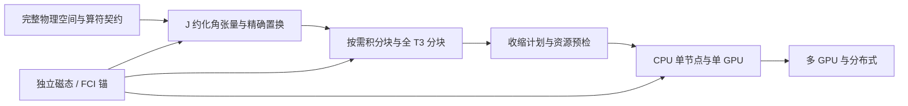

# Atomx 达到高精度、高性能谱学水准的技术路线

日期：2026-10-10。状态：**技术建议与待验收路线，不是能力完成声明**。
本文依据当前源码指南、封存数值证据及一手文献制定优先级；初次路线制定没有
新增数值计算，随后完成的有限 CI 和单价 SD 增量在第 3 节登记。
已完成能力以[活动专题](README.md)、
[线性化 SD 指南](../ATOMIC_LINEARIZED_SD.md)及[FSCC 指南](../ATOMIC_FSCC.md)为准。

推荐主线是：先完成有效态与谱学消费，再以完整空间收敛控制物理误差；
同步建设 J 约化、分块流式收缩，使全三激发有可执行的资源契约；
CPU/GPU 作为共享物理契约下的执行后端，按完整任务而非局部核验收性能。
不同体系采用相应的相关方法，最终按指定体系和可观测量证明领先水准。

## 1. 最高水准的可验收定义

软件名、三激发开关、很小的数值残差都不能单独定义精度。
建议每个目标算例先声明以下六个独立关口：

| 关口 | 交付物 | 验收依据 |
|---|---|---|
| 同模型实现正确 | 完整带符号算符、振幅、根及响应 | 同 H/空间/核/投影/度量的独立锚；保留当前原始门限 |
| 物理消费闭合 | 自洽能级、左右态、范数和性质算符 | 与声明的方法推导一致；有限精确模型及截断阶次控制 |
| 空间与相关收敛 | 上下态共同空间的逐次增量、交叉项 | 径向、能窗、分波、激发层级分别验证；未认证尾部明确列出 |
| 算符覆盖 | DC/DCB、QED、反冲及响应账目 | 每项纳入阶段明确、无重复计数、有独立极限或参考 |
| 实验与外部方法 | 留出谱线/性质及误差预算 | 态匹配与数据版本预先冻结；不拟合平移后再当独立预测 |
| 高性能与可靠性 | 完整任务 wall time、峰值资源、重启 | 同模型交替配对、冷暖缓存分列、实际负载守卫及源码身份 |

既有 `1e-10 Ha` 方程残差、`1e-11 Ha` 实现比较及既有 `1 cm⁻¹` 空间、
`1%` 实验门保持原定义。后两者是已有任务的里程碑，不能普遍当作世界领先标准。
原子钟的精细结构、等离子体诊断的线比、稀土的组态混合、XAS 的化学位移
需要不同的精度契约。更严格的新目标应另立前瞻契约，不能回写历史 pass/fail。
对尚无可靠上界的模型遗漏，报告条件估计和未决项，不能把残差当总不确定度。

## 2. 当前起点及真正缺口

| 当前证据 | 已证明 | 尚未证明 |
|---|---|---|
| [完整 Yb 固定能量解](yb_full_valence012/result.json)、[同数组对照](yb_full_public_screening005_012.json) | 68 核电子、414 径向虚轨道、五外部列的原方程及有向屏蔽；列差最大约 `1.735e-17 Ha` | 单价 Bloch 反馈、多价 CI 物理消费、跃迁与实验收敛 |
| [有限 Bloch 锚](native_bloch_metric001/comparison.json) | 完整有限 CI 的波算符、真实度量和带符号性质 | 不能把这个有限模型的度量直接移植给截断 SD 输出 |
| [公开 FSCC 面板](expt_compact_public002/result.json) | 有限原生/复旋转、闭壳层/附着/空穴、完整三电子 FCI 锚 | 大空间 J 约化完整三激发、一般多价性质与生产精度 |
| [Numba 完整五字段控制](numba_full_fields002/result.json) | 私有 CPU/CUDA 共享数值核及同 stream 零拷贝衔接；冻结字段最大差 `5.421e-20 Ha` | 新公共 SD 后端的完整根、端到端 GPU 加速及物理精度 |
| [完整同带资源计数](fscc_growth_memory004.json) | 414 径向虚轨道展开为 1894 磁自旋轨道，完整共 1962 | 紧凑索引通过不等于这些物理张量已经可驻留或可快速收缩 |

当前固定列能量下的[有向消费审计](directed_effective_audit001/comparison.json)
测得非厄米差。它揭示普通厄米 CI 消费不能直接假定成立；**非厄米本身不证明实现错**。
应先核对有效理论、能量参数、波算符和左右态，而不是把矩阵平均作修复。
线性化原子 SD 与完整指数 CCSD 是不同方法；现有 EXP-T 后端的完整非线性
方程也不等于已经完成大空间原子 J 约化实现。

## 3. 第一优先级：把有效算符接成物理态与谱学流程

交付物是一套明确携带模型分区、能量参数、波算符、归一和算符覆盖的有效态消费。
复用已有 `ValenceSD`、`Sigma2SD`、原生 CI/CSF 和有限 Bloch 锚，
按[现有架构](../ARCHITECTURE_DESIGN.md)保持 methods 选择物理、numerics 执行算法。

单价 SD 相关能反馈已完成[有限原生独立锚](../ATOMIC_LINEARIZED_SD.md#finite-standalone-monovalent-sd)，
保留十个磁态和八个真实频率 E1 控制。下一步将核清的完整图项接入 J 约化、
分块流式生产表示；多价 CI+all-order 的能量参数处方与物理态仍须分别推导和实现。
不能把每个外部轨道的参数误当作整个多电子总能量，也不能将已含在 CI 中的
价—价图再次加进 Σ。CI+all-order 原论文明确区分能量依赖与 CI 已消费的项；
这里建议按原图逐项登记，而不是拼接能级移位。[原论文](https://arxiv.org/html/0905.2578)

有限精确模型先使用

```text
Psi = Omega C
G = Omega† Omega
H Omega = Omega H_eff
O_eff(i,j) = Omega_i† O Omega_j
```

这里先采用正交完整 CI 表示；非正交原生表示的范数必须保留对应重叠矩阵 S，
例如 `G = Omega† S Omega`，不能把 S 丢弃。
在目标空间封闭且 H 厄米的这个精确锚中检查 `H_eff† G = G H_eff`，
并检查物理归一化、简并子空间、相位协变性和全部非对角性质。
截断 SD/CC 的消费随后按其实际推导、投影方程和遗漏阶次另验；
不能要求它无条件等于有限 full-CI，也不能从任意 Σ 导数猜出一个 G。
尤其当 Σ 参数是分波能量而非总能量时，不机械套用 `G = I - dSigma/dE`。
CC 性质所需的左响应/Λ 与物理范数也应明确区分，不能仅用右态求平方当强度。

首个最小判别实验建议固定已有有限 Be 核/价空间和实际原生 H：
在能量反馈前后逐项比较公共 Σ 输出、独立费米图、波算符的投影残差及性质。
只改变一项消费约定；完整值和解析响应继续沿用原比较门。
如果差异只由截断方法造成，应保留阶次误差；若 P/Q 图重复则修消费并重验。
随后在同一完整 Yb 带上完成实际谱能与 E1 矩阵元，而不把冻结字段控制升级为谱认证。

2026-10-10 的[首个消费增量](finite_bloch_transitions.md)已完成有限 native CI 的
跨 J/宇称电多极接口：直接使用两端 Omega/G，分别检验 Bloch 与正交表示，
对照独立磁量子数行列式作用和完整归一化根。注意上面的 `Omega† O Omega`
是物理双线性形式；与双正交左右态一起使用的 directed Bloch 算符另含
bra 端 `G_b^-1`，两者不能混用。单价 SD 反馈与生产 CI+all-order 物理态
仍是 M1 的生产验收关。后续有限单价 SD 已闭合价单激发/相关能反馈，与精确
有限 CI 保持独立方法契约；其完整态残差和规范差尚未达到物理收敛。

这次有限锚还定位了生产接线必须处理的具体图项：固定的 pCI
`lib/all-order/valsd-ci.f` 中 `term31` 接收物理价单激发振幅 `rvi`，
将其径向组合注入价双激发。当前固定能量 CI+all-order 路径有意省略它，
不能只打开调用或把 numerator 当振幅。后续 standalone 约化接口应独立保留
价单激发及含参考价轨道的双激发，明确完成 numerator/物理振幅转换，
分别保留固定核分母与价相关能反馈；逐图对照本次完整磁态锚后再验大空间。
现有 `ValenceSD` 的固定能量语义与结果身份继续保持。后续的
[独立 J 约化方程接口](../ATOMIC_LINEARIZED_SD.md#j-reduced-standalone-monovalent-sd)
已完成上述接线，并分离非正则标量 S1 的裸核 Fock 源与核正规序 Coulomb 排除项。
150 个不同回归检查、四种设置的 40 个完整磁态／独立总 J 控制通过；强未分解态门
仍测得最高 2.353e-11 的目标 J 外浮点泄漏，失败保留。固定能量旧列交错运行逐位
相同。完整 68 核／414 虚轨道的 2.02–3.77 百万坐标随后进入实际验证：003
完成当前完整核重验与第一列 signed map，但在重复逆作用成本下停止，没有反馈根。
私有 term31 GEMM 与完整作用复用的有向 Davidson 通过 84 项有限独立门；
七项另立数值检查覆盖重启、缓存不一致、复杂根和资源／作用预算拒绝。
在相同八步分支和 `1e-14 Ha` 目标下，有限 native 作用数由 262–698 降至
22–25；这个观察尚不构成端到端加速比。完整 004 五列映射门全部通过，
保留完整数组与当前源码核验后停止重复 CPU 根，减少与完整 GPU 005 的资源争用；
五个 GPU 根均须另外通过实际完整 CPU 回代。另立 CPU/CUDA standalone
有限控制在两次源绑定运行中各通过 164 项门与 16 个配对根；
小 GPU 根的实际单次时间更慢，保留这一负性能结果。005 完成两个根后显式停止重复
16 维迭代；当前 006 的 64 维数值子空间在同一物理空间中完成全部五根、50 个
CPU/CUDA 配对数组与每根实际完整 CPU 回代。作用数为 56／78／93／71／70，
最大 raw `2.320e-11 Ha`；与 005 同参数完成的前两根作用数由 102／135 降至
56／78。内存预检保留原 32GiB／2GiB 上限，没有受控时间加速比。
独立费米展开验证的物理范数已通过 840 个有限组件／全 M 门，补齐芯层旁观项、
泡利阻塞和带符号干涉；完整 Yb 核重放实测种子逐位一致、全部 18 个 M 范数也通过，
381 个源码与 33 个数据／证书后核验无变化。真实范数收缩单态约 1.3–4.1 s，
与含芯层准备／两次作用的约 822 s 整轮时间分列，不声称控制加速比。
M1 的生产原生约化态与 dressed 性质消费、多价物理消费仍未完成。
[活动证据](README.md)维护完整当前结果与边界。

## 4. 第二优先级：以共同上下态收敛定位差距

在现有完整能窗构造上分别改变径向分辨率/盒边界、能量上限和完整分波上限；
每个请求保留全部允许轨道及磁多重态。先核对本征谱容量、正能投影及原生度量，
再讨论虚态尾部。冻结核必须是显式物理近似；关闭某核层后不能仍称完整核—价空间。

目前已有原 `l≤3/5Ha` 空间的实际五态基线和冻结实验对照：6p₁/₂／6p₃/₂
激发能偏高 0.925%／1.168%，5d₃/₂／5d₅/₂ 偏高 4.141%／3.380%；
6p 劈裂偏高 3.146%，5d 劈裂偏低 9.362%。原 1% 门仅一个激发能通过，
两个劈裂均失败。数值方程通过与这些实验失败分别记录，不能据 raw 残差宣布最高水平。
下一项判别应在同一核模型／径向参考及八步根连接协议下，对完整五态执行
`l_max=3,4` 与 `E_max=5,10Ha` 的二维交叉控制；这些是待执行的设计值，
不是已测结果或已知收敛空间。每个新角动量／能窗必须预检完整坐标、谱容量、
内存和工作量；保留原物理请求，预算不足则报告拒绝。再以新的 `l_max=5`
或更高能窗独立检验尾部推断，不能用已用于拟合的同一批点声称外推通过。
该控制优先区分高分波／能窗不足，不能事先把 5d 劈裂差归因于某一缺失算符。

每次记录 `delta E_upper`、`delta E_lower` 和
`delta omega = delta E_upper - delta E_lower`，并独立跟踪精细结构劈裂。
以同一组态/简并子空间身份比较，避免扩空间后换根或只移动一端。
能窗、高 L、三激发和 Breit/QED 的响应存在交叉项，不能把几个筛选代理直接相加。
最小二维交叉控制用于判断是否可以近似分离；尾部模型须经尚未用于拟合的新空间检验。

现有完整 Ne 的 d→f、f→g 核相关能增量约 `0.03582`、`0.01188 Ha`，
已经说明有限残差通过并不意味着分波收敛；详见[原始空间记录](README.md)。
这一核能增量不能移植成 Yb 跃迁尾部，也不能当作实验误差上界。
建议按目标谱线的差分敏感性决定下一块空间；完整全三激发仍是所需方法能力，
但在某条线的基组误差占主导时，先补三激发无法自动解决主导差距。

## 5. 第三优先级：改变表示，才能扩大全三激发

同带当前 generic FSCC 表示的驻留 packed 复积分为
`29,626,360,376,496 B`（约 29.6 TB）；一份未约化有序复核 T3 为
`34,181,148,002,705,408 B`（约 34.2 PB），后者按 `16 o³v³` 计算。
这是特定表示的资源算术，未分配也未求解，不是所有正确算法的必需内存。
紧凑块索引和精确空轴构造已解决各自问题，仍需以下依赖链。



1. 建立原子总角动量约化振幅和积分，以 J、宇称及耦合路径分块；
   同时用精确反对称/置换保存独立坐标。必须推导完整三激发的重耦合与符号，
   不能只把磁态索引表改成径向表。用原磁态引擎验证所有允许坐标及复相位。
2. 积分 provider 从原生径向/角因子按需生成 tile，消费者 loader 和收缩调度一起接入。
   只有导出流式而求解器随后整表加载，并未解决峰值内存；积分值覆盖与缓存身份分别验。
3. 完整 T3、残差和中间量采用有界分块与可恢复存储；以收缩复用顺序减少重读、转置和传输。
   单块峰值下降不代表整体时间可接受，还须核算块数、总 FLOPs、磁盘/主机/设备搬运。
4. 从实际 SD 与 EXP-T 图项提取足够小的收缩描述，记录指标、符号、对称性、覆盖及依赖。
   先服务这些真实消费者，再扩编译功能；不先另造一个没有数值消费的通用框架。
5. 每次扩空间先给出完整允许块、最大 tile、所有同时存活缓冲及重启成本。
   若完整问题超预算，报告所需资源或更改算法；不静默删虚轨道、弱振幅或 T3 块。

EXP-T 的原论文采用张量分块、置换与 GEMM，并讨论积分 I/O 与小块调度对并行的限制。
这支持按实际收缩和搬运组织后端；上述完整原子 J 约化路线是本文建议，
不是该代码已提供的能力。[EXP-T 原论文](https://arxiv.org/html/2004.03682)

分块/对称性降低资源常数，不能消除高阶方法的增长。
自然轨道截断、低秩、选择性三激发、微扰 triples 可作为另行声明并收敛验证的近似方法，
不把它们冒充用户要求的完整 FS-CCSDT。其误差与资源收益均需独立测量。

## 6. 方法组合：按体系进入最高精度路径

以下是推荐用途，具体原子/离子仍须先冻结参考态、P/Q 与目标能级。

| 体系/问题 | 推荐方法及动机 | 主要风险与验证 |
|---|---|---|
| 闭壳核及少电子锚 | 原生线性化 SD；完整非线性 CCSD/CCSDT；有限 CI 独立锚 | 区分线性/非线性与相关阶次，完整带符号方程比较 |
| 单价低激发态，如 Na、Ca⁺，随后 Yb⁺ 的适合态 | 自洽单价 SD/非线性 CC；适当参考的 0h1p FSCC | 核—价耦合、范数、三激发与内禀病态响应 |
| 少价电子，如 Mg、Sr、Yb 的适合态 | CI+MBPT 作阶次诊断，CI+all-order 处理核相关并由 CI 处理强价相关 | 有向有效算符消费、CI 空间、减除项及重复计数 |
| 4f 空穴/多组态强混合稀土 | 粒子–空穴 CI 和一致重建的 MBPT/全阶有效算符；按模型选多参考路径 | 打开原被消去的核层时必须重建互补 Q 图，不能复用旧全核 Σ |
| 适合的附着/脱附/激发/多价 Fock 扇区 | 完整 FS-CCSDT；必要时显式选择 intermediate-Hamiltonian 路径 | intruder、模型空间、参考可靠性和实际扇区覆盖；不承诺全部体系适用 |

pCI 提供 CI+MBPT/CI+all-order 和相关原子性质；AMBiT 提供粒子–空穴 CI+MBPT。
这两条线路具有不同的参考与图覆盖，应作为独立基准来源而非互换标签。
[pCI 论文](https://arxiv.org/abs/2410.06680)、[AMBiT 论文](https://arxiv.org/abs/1805.11265)、
[粒子–空穴原论文](https://arxiv.org/abs/1605.08111)。
完整三激发也有实际重原子应用：Bi 的三粒子 Fock 扇区使用 DCB+全 triples 计算性质。
这是方法可行性的文献案例，不是 Atomx 当前 Yb 大空间精度的证明。
[Bi 原论文](https://arxiv.org/abs/2106.04308)

对多价、开放 f 壳层，还要评估核极化诱导的**有效三体算符 Σ₃**。
文献中某些体系的贡献会改变能级顺序，不能预先认为 Σ₁+Σ₂ 已足够。
Σ₃ 是价空间有效算符的体数，T₃ 是簇振幅的激发秩，两者不是同一开关。
建议从一致 P/Q 的最低阶完整三体图及独立有限投影开始，
再依据目标谱线实测决定全阶扩展；本文没有 Atomx Σ₃ 数值结果。
[有效三体原论文](https://arxiv.org/abs/1607.05843)

完整 FS-CCSDT 仍有高于三激发的截断误差。若目标精度要求，
应以能承受的共同空间建立更高阶激发/独立精确方法的差分控制，
再验证其可迁移范围，而不是仅因全 triples 已启用便关闭相关误差账目。

intruder 的处理先区分病态数值、缺少模型态与方法适用性；选择相应模型空间或
明确的 IH 方程，不仅用任意分母平移取得“收敛”。GMRES/DIIS 预条件属于数值层，
不得隐式改变最终物理方程。高条件数时增加真实残差、前向误差与解析响应检查；
必要的扩展精度用于可判别的误差来源，并保留同物理输入的独立对照。

## 7. 性质算符、Breit/QED 与物理共振

能级之后首先完成 E1 跃迁、g 因子和态识别，再推进寿命、极化率、超精细及同位素位移。
有效跃迁算符应与所选 SD/CI/CC 的态、左响应、范数和核心极化一致；
结构辐射、归一化项等按声明阶次登记，不能机械叠加不同方法的修正。
长度/速度与和规则只在共同 H、投影和完整响应算符的适用条件下验，
不把裸非局域势的差异直接归咎于波函数质量。

算符账目分别记录有限核、no-pair 投影、Coulomb、Gaunt、静态 Breit 的迟滞部分、
模型 QED 的 SE/VP、反冲及纳入阶段。冻结轨道一阶评估、CI 重解、轨道 SCF 重优化
是不同控制；各阶段响应若已含在最终能量中，不再作为额外修正相加。
按用户要求，有限频率横向交换已沿原公共径向／角算符接入 signed spinor 积分、
冻结核账目及 EXP-T 的完整 CCSD／FS-CCSDT 方程；
[81 项有限对照](transverse_integrals004/result.json)及
[110 项原生 DC 回归](transverse_native_dc005/result.json)均通过，无跳过。
频率来自固定核／VN 虚轨道本征能，平均两个顶点的算符，替换静态项；
没有改用多电子发射光子频率，也没有迭代更新为 dressed Fock 对角。
有界数组缓存通过逐字节流式重放与逐出检查，只影响重算。

[Yb⁺ 同轨道因素实验](yb_dynamic_breit003/result.json)的四条激发能
动态减静态增量为 −0.6232、−0.3770、−1.5620、−3.8873 cm⁻¹。
该冻结核模型原 5% 实验门未通过，不能把这些增量直接拼入旧 DC-SD 能级，
也不能据此限定完整相关态的动态贡献。
后续[同 H 阈值控制007](transverse_precision007/result.json)将实际方程残差降至
2.035e-15 Ha，两个 2s 根仍差 8.729e-10 Ha；收紧迭代不是充分修复。
[一致 Fov 干预008](transverse_fov008/result.json)支持非 canonical 附着项关联，
更严 1e-10 Ha 门作为[严格已知失败009](transverse_precision_gate009/result.json)保留。
先推导并独立验证完整扇区图项，再验证更大共同空间的稳定性、资源与数值门；
不能以删除 Fov、改参考或放宽容差取代修复。
原生 J 约化 SD 仍是 DC：其横向接入需要完整 Gaunt／迟滞角张量与全部图项一致化，
不能仅替换 Coulomb RINT 或后加标量。生产相关态、跃迁与核响应另设共同算符门。
二阶 QED、核极化等项按目标误差预算及可验证性推进；
“模型 QED 已启用”不能作为完整 QED 精度认证。

物理共振另设路线：明确通道阈值和出射边界，固定解析延拓/复缩放的表示及度量，
跟踪 `E_pole = E_r - i Gamma/2`，验证基组、连续谱容量和延拓参数变化下的稳定性，
再核对残数/通道耦合与相应谱线行为。正能空间、非局域交换及耦合通道覆盖单独声明。
仅凭小分母、慢收敛、孤立复本征值或人为展宽，不认证物理极点。

## 8. CPU/GPU 统一框架的具体边界

统一物理契约、数组/块身份及可共用标量算法；CPU 和 GPU 分别编译、调度并管理资源。
Numba 的 `prange` 不会自动成为 CUDA kernel。当前私有共享标量原型可作为起点，
公共采用先完成整个算符与求解门，而不是仅换 import。

| 工作 | 推荐执行方式 | 验收重点 |
|---|---|---|
| 径向 moment/scan、可融合角核、索引与小块循环 | Numba CPU / CUDA 专用 kernel | 完整带符号输出、方向/能量响应、稳定顺序和无竞态 |
| 大块收缩、批量多个右端 | CPU BLAS / GPU cuBLAS 等已验证库 | 合适块粒度、FP64 能力、布局、传输与峰值资源 |
| Krylov/DIIS、正交化、预条件 | 设备驻留向量和有界工作区，复用已验数值控制 | 真残差、正交性、响应及重启；统计全部同步和迭代次数 |
| 独立态/扇区与多 GPU | 完整块任务划分，先测单设备后设计通信 | 内外线程数、通信/归约、负载均衡及完整模型身份 |

优先使积分块、振幅和中间量驻留/复用，合并小任务，减少 Python 调用、kernel launch、
主机拷贝与临时数组。以实测 FP64 吞吐、带宽及块形状选 CPU/GPU，不以显卡型号或
理论核心数保证收益。已有 CPU 核的 `4.6131×` 只属于[密度阶段](numba_density001/cpu_pairs.json)；
[GPU 独占门失败](numba_density001/gpu_pairs.json)时不发布受控速度。
混合精度可先限于明确的预条件器/初值，以 FP64 完整物理残差和性质重新认证；
不把低精度收缩误差隐入物理预算，最终是否采用仍由目标精度决定。

当前 NumPy/Numba/LLVM 与 CUDA runtime 保留源绑定版本。官方 numba-cuda 已进入维护模式，
新功能转向 Numba-CUDA-MLIR；该项目要求 Python ≥3.11，而当前主环境为 Python 3.10。
推荐另建隔离工具链，重放原 8 rank、五字段、整个算符/根/响应和性能门后再迁移；
它不是当前已验版本的无条件等价替换。
[维护说明](https://nvidia.github.io/numba-cuda/)、
[MLIR 官方要求](https://github.com/NVIDIA/numba-cuda-mlir)。

## 9. 三个交付里程碑与下一步

| 里程碑 | 必须交付 | 进入下一阶段的条件 |
|---|---|---|
| M1：有效态与首条物理谱线 | 有来源的单价反馈/多价能量处方；波算符/性质消费；同空间谱线 | 有限独立带符号和响应门通过；重复计数排除；截断误差明确 |
| M2：完整空间与可扩展执行 | J 约化/分块积分与 SD 消费；共同上下态空间增量；公共 CPU/GPU 完整任务对照 | 全允许坐标计数与资源预算、原数值门、完整求解和受控计时通过 |
| M3：完整 triples 与基准组合 | 可执行的完整 FS-CCSDT 空间/扇区；适合稀土的多参考/粒子–空穴路线；留出性质集 | 独立同 H 比较、相关/空间/算符误差、实验及资源可靠性均达预设目标 |

三者按依赖推进，J 约化与 kernel 原型可与 M1 并行研究，但不能跳过其物理消费验收。
下一最小动作是 M1 的有限有效态消费控制；同时输出当前完整 Yb 请求的
约化允许块与收缩/I/O 资源计划，以决定扩大的硬件需求，而不是再次启动必然超内存的磁态 T3。
不预报没有收缩计数、资源和实测支持的完成日期或 GPU 加速倍数。

建议采用 Be/Ne 的独立方程锚 → 适合的单价谱线 → 少价电子谱线 →
4f 空穴/强混合稀土的阶梯基准。先冻结一组开发案例，再留出不同态/谱线检验泛化。
来源优先使用原论文、可本地执行的参考源码和带来源字段的
[NIST ASD](https://www.nist.gov/pml/atomic-spectra-database)。
共同复用 pCI 图项的两个包装不是两个独立物理实现；独立费米/FCI 锚、
跨方法比较和同算法重放的证据类型须分别标记。方法间差值可帮助诊断，
未经遗漏项控制和外部检验，不能自动解释成严格误差上界。
比较时保留实验不确定度、同位素、能级零点、真空/空气波长、J/宇称与组态混合；
数据没有提供不确定度时不自行伪造认证范围。

面向光源与材料的后续故事线可采用“原子能级/核心跃迁标定 → 分子配位与电荷转移 →
晶体/界面 XAS 与原位响应”。原子引擎提供局域相关、相对论和多重态基础；
分子需要独立的多中心积分与轨道体系，周期 XAS 需要屏蔽、核心空穴/激子及周期环境。
建议以明确嵌入/后端耦合推进，不能把原子 FSCC 或原子谱线成功直接称为晶体 XAS 完成。

Agentic science 的实现闭环应让 agent 提出可区分的假设、估算成本与目标可观测量的收益，
执行带源/输入身份的任务，解析完整结果及失败，再选择下一实验。
输出必须区分已测、推断、条件估计和未决项；不能以生成式文字替代科学验收。

## 10. 本轮核查与文档处置

本轮只复核现有证据、当前指南及上述一手资料，保存路线；未改求解器、依赖或默认方法。
来源能支撑的方法范围与本文的具体实施建议分开，不将文献示例精度移植为 Atomx 成绩。
MDPI 的性质论文页面本轮访问失败，未把其未读页面作为新增论据。
本路线链接由活动专题维护；当前架构与公共接口指南保留，因为公开能力没有变化。
既有性能/度量/约定规则足以覆盖本规划，**无新增实证洞察或根规则**。
[本轮核查记录](technical_roadmap_review001.json)分别记录文档检查与已有数值证据，
不把前者计入科学测试通过数。
