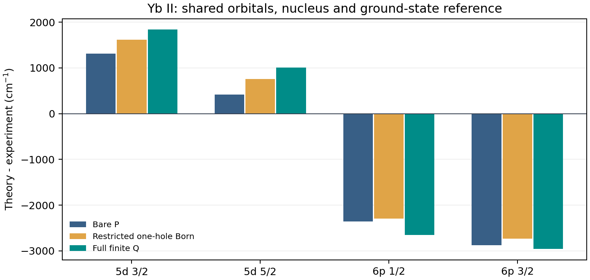

# Atomx：独立二阶对照与有限核心空穴高阶传播

记录：2026-10-09。承接 [pCI / AMBiT / EXP-T 下载与第一阶段升级](../ci_fscc_reference_upgrade_2026_10_09/README.md)。

**本轮完成了两件实质工作：用官方 AMBiT 的已编译代码核对 Atomx 的带符号二阶 Σ₁；新增原生、互补 P/Q 组态消元，并实算 Yb⁺ 五态的 4f 空穴响应。实现门通过，实验精度尚未解决。**

本轮判断是：在已测的共同积分面板中，二阶交换、相同轨道对权重和空穴约定一致；有限 Q 空间内部的相互作用能产生数百 cm⁻¹ 的响应，重新求能量参数的响应小得多。但只补本轮的 4f¹³v² 空间，6p 跃迁反而进一步偏低。因此不能把“再迭代一次”或“补一组空穴组态”当作已经找到的完整修复。

## 1. 先对齐物理量，再比较软件

AMBiT 使用固定的价电子能量构造同 κ 通道的 Brillouin–Wigner 分母，保证有效算符 Hermitian；Atomx 的矩阵快照还能在同一虚空间上求能量依赖的 Dyson 根。这两个默认输出不是同一控制。[官方 AMBiT 源码](https://github.com/drjuls/AMBiT/tree/fe1115aaed97b340e1f4d625d451b165c5bcd7a5/src/MBPT)和[软件论文](https://arxiv.org/abs/1805.11265)是本轮参考。

参考版本固定为 `fe1115aaed97b340e1f4d625d451b165c5bcd7a5`。独立 C++ 适配器直接链接上一轮编译的 AMBiT MBPT/角动量库，没有重写其二阶公式，也没有改动上游源码。适配器只注入相同的轨道能量和 Coulomb 径向积分，并按核心指标数分别执行 2p1h、2h1p 和总和。

固定条件见 [预设契约](contract.json)：Ne 闭芯 1s²2s²2p⁶、Z=10、点核、纯 Dirac–Coulomb、ns40/ks7；κ=−1,1,−2,2,−3 各取前三个 Vᴺ 正交虚轨道。外部三个同 κ 轨道分别测 s₁/₂、p₃/₂、d₅/₂ 三块。外部轨道仍包含在共同中间态池，未删除弱项。每块使用同一个固定能量参数。

AMBiT 的默认分母 floor 为 0.01 Ha，并可跳过被判为非微扰的图。本轮显式设为 10⁻⁸ Ha，且要求警告输出为空、积分键完全覆盖；实际没有图被跳过。这个门没有修改 Atomx 的默认物理选择。

| 核对内容 | 实测 |
|---|---:|
| 共用的有符号径向积分 | 37,350 |
| 轨道数：完整闭芯与声明的虚空间 | 19 |
| 同 κ 矩阵元 | 27；每项分别核对两个图类和总和 |
| 最大 Atomx−AMBiT 绝对差 | 1.4294×10⁻²¹ Ha |
| 直接原生积分与共同规范表结果差 | 3.1764×10⁻²² Ha |
| 径向对称性重复计算舍入差 | 8.6736×10⁻¹⁹ Ha |
| 预设绝对/相对门 | 10⁻¹¹ Ha / 10⁻¹⁰；通过 |

非零有符号非对角项被实际检验。这是**独立角动量与图求和**核对：两边共用 Atomx 径向积分，故不验证径向求解器、虚空间尾部或全 Yb 相关精度。此面板不覆盖 f/g 等高分波的跨代码核对。输入、逐项差值、源码和构建命令分别见 [结果](matched_sigma_results.json)、[适配器](ambit_sigma_probe.cpp)、[重放脚本](run_matched_sigma.py)。

## 2. 新增原生有限 P/Q 有效哈密顿量

新的 [ci_effective.py](../../src/atomx/methods/ci_effective.py) 从一个共同的原生 CI 哈密顿量出发，把显式 CSF 分成互不重叠的 P 和 Q：

`H_eff(E) = H_PP + H_PQ (E − H_QQ)⁻¹ H_QP`

原来的二阶控制冻结中间态传播；这里保留整个 `H_QQ`，因此包括声明空间内的 Q–Q 耦合和能量反馈。它是**有限 CI 空间内的全阶传播**，并非 pCI 的全阶 SD、通用 CI+MBPT Σ₂ 或 EXP-T 的 FS-CCSDT。

实现复用现有原生 Coulomb/Dirac CSF 装配、耦合树、度量检查与矩阵自能求根。它捕获轨道相位、B-spline 度量、核势及 CSF 身份，保留带符号的 P–Q 振幅，输出规范化的完整 P+Q 波函数、P 权重和全哈密顿量残差。

接口显式拒绝重复 CSF、混合 N/J/宇称、非法 P 索引、超出预设空间上限、跨非零耦合极点或不明确的简并 P 分支。Q 中可以有核心空穴，因为这里从裸 DC 矩阵统一消元，**没有叠加此前已积分消去同一芯层的 Σ₁**。现有闭芯有效一体算符的空穴守卫继续保留。

能量参数是包含核心零点的 **N 电子总能量**，不是之前附件自能的单电子参数。当前接口只接受裸 Dirac–Coulomb 和共同 B-spline 轨道；没有 Breit/QED、外部自能注入或自动生成无限 Q 空间的入口。默认 CSF 上限 256，超限报错，不会偷偷缩小模型。

调用示意（`csfs`、`od`、`workspace` 和 `bracket` 必须来自同一物理参考）：

```python
from atomx.methods.ci_effective import build_finite_ci_effective_hamiltonian

model = build_finite_ci_effective_hamiltonian(
    csfs, p_indices, od, workspace, Z, ns,
    reference_identity=physical_snapshot_id,
    nuclear_potential=nuclear_potential,
)
root = model.solve(bracket)
print(root.energy_Ha, root.p_weight, root.residual_Ha)
```

`diagonal_q_control(E)` 仅用于分辨非对角 Q–Q 作用。它的对角已经包含 Coulomb 相互作用，是依赖表示的控制，**不是完整 MBPT(2)**。

## 3. Yb⁺：统一五态、同轨道、同核、同组态规则

科学契约和预检分别见 [Yb 契约](yb_contract.json)、[空间清单](yb_preflight.json)。沿用只读的 `v68_default` 共同轨道与 Fermi 核势（Z70、A175、ns123），不重新优化轨道。

- P：全部 `[Xe]4f¹⁴v¹`，v 池为 6s₁/₂、5d₃/₂、5d₅/₂、6p₁/₂、6p₃/₂。
- Q：同一个池里的全部 `[Xe]4f¹³v²`，每个目标 J/宇称保留全部允许的 jj 耦合树。
- 省略：4f¹²、高于该池的径向轨道、其他芯层空穴、Breit/QED 和全阶 SD/CC。没有按实验误差挑选组态。

| 态 | P / Q 的 CSF 数 | 固定 M 行列式数 | 全 Q 后能量变化（cm⁻¹） | P 权重 |
|---|---:|---:|---:|---:|
| 6s₁/₂ | 1 / 12 | 114 | −777.884 | 0.99239 |
| 5d₃/₂ | 1 / 23 | 122 | −251.854 | 0.99665 |
| 5d₅/₂ | 1 / 30 | 103 | −186.615 | 0.99763 |
| 6p₁/₂ | 1 / 13 | 121 | −1070.091 | 0.97752 |
| 6p₃/₂ | 1 / 25 | 136 | −857.907 | 0.98100 |

总能量、哈密顿量、波函数与零点均保存。五态总耗时约 8.58 s，最大进程 RSS 702.27 MiB；这是本轮小空间执行测量，不是生产 SD/HPC 性能比较。资源预设：串行 BLAS、每态 300 s、地址空间 4 GiB、CSF≤256、行列式≤2000。

| 数值门 | 五态最大值 | 预设门 |
|---|---:|---:|
| 完整 HΨ−EΨ 残差 | 1.8190×10⁻¹² Ha | 10⁻¹⁰ Ha |
| 相对独立完整矩阵对角化的能量差 | 5.4570×10⁻¹² Ha | 10⁻¹⁰ Ha |
| 波函数投影矩阵差 | 4.7313×10⁻¹² | 10⁻⁸ |
| 核 CI 零点 + Vᴺ Fock 期望值对 P 能量的差 | 2.0073×10⁻¹¹ Ha | 10⁻¹⁰ Ha |

## 4. 分辨“少高阶图”与“少一次迭代”

按 [额外预设契约](born_control_contract.json)，在相同 P–Q 振幅下，Q₀ 由独立原生闭芯 CI 零点及真实 Vᴺ Fock 期望值按占据差构造，无拟合能移。`Born(E₀)` 是本轮**受限一空穴空间**的严格二阶传播控制，不是整个原子的完整 MBPT(2)。分解为：

`FullQ(root) − Born(E₀)`

`= [FullQ(E₀) − Born(E₀)] + [FullQ(root) − FullQ(E₀)]`

第一项改变 Q 内部传播；第二项只重新求能量参数，不包括径向 SCF、密度反馈或 QED 轨道响应。

| 态 | Q 相互作用反馈（cm⁻¹） | 能量参数重求（cm⁻¹） |
|---|---:|---:|
| 6s₁/₂ | −356.970 | +6.015 |
| 5d₃/₂ | −132.419 | +0.849 |
| 5d₅/₂ | −95.010 | +0.445 |
| 6p₁/₂ | −732.984 | +25.215 |
| 6p₃/₂ | −589.704 | +16.965 |

在固定完整 Q 控制内部，去掉非对角 Q–Q 元再恢复它，固定能量响应另为 +48.146、+19.296、+15.050、+157.809、+124.843 cm⁻¹。这与上表的严格 Born 控制不同：Q 对角相互作用也有贡献。所有控制是替代计算，不能相加。

**本面板支持优先检查传播核/图类，而不能用“只缺一次能量迭代”解释数百 cm⁻¹ 的差异。**这句话的范围限于本轮固定 DC、冻结轨道的一空穴模型，不能推成全阶 SD 或 QED SCF 的误差上界。

## 5. 谱线和实验：保留负结果

以下每个模型都由自己同条件的 6s 基态作差，单位 cm⁻¹。实验采用前序已冻结的 Yb II ASD 数据，未混换电离阈值；出处及数据身份见 [此前绝对零点核对](../yb_correlation_tail_2026_10_08/README.md)。实验只用于评估方向，当前没有新的准确度认证。

| 跃迁上态 | 裸 P | 受限 Born 控制 | 完整有限 Q | 实验 |
|---|---:|---:|---:|---:|
| 5d₃/₂ | 24272.565 | 24579.209 | 24798.595 | 22960.800 |
| 5d₅/₂ | 24752.150 | 25087.029 | 25343.419 | 24332.690 |
| 6p₁/₂ | 24702.423 | 24767.031 | 24410.217 | 27061.820 |
| 6p₃/₂ | 27513.071 | 27654.832 | 27433.048 | 30392.230 |

5d 劈裂由 479.586 增至 544.824 cm⁻¹，实验 1371.890；6p 劈裂由 2810.647 增至 3022.831，实验 3330.410。劈裂改善和绝对谱位改善是不同的判断：本轮有限 Q 相对裸 P 使四条谱位的实验残差绝对值均增大。



不能把这一有限 Q 响应加到此前已经含同一芯层二阶相关的 Yb 谱线上。此前的大虚空间矩阵 Σ₁ 和本轮一空穴 CI 的图类、投影空间与核心相关平衡不同。旧的 5.868% 误差和本轮结果是不同模型，保持分开。

有判断力的后续选择是：以本轮完整小空间矩阵作为高阶算法的独立锚，再引入完整核心/价电子 SD 或互补的更大 Q 空间，同时核对二空穴与径向尾部。继续保留上下态响应与劈裂，另做 Coulomb–Breit 交叉项的匹配控制。**本轮没有完成这些扩展、FS-CCSDT 或物理复共振极点；不把编译和小空间数值门表述为已解决稀土精度。**

## 6. 验证、重放与维护

[新测试](../../tests/test_ci_effective_qspace.py)覆盖独立完整矩阵能量/波函数/P 权重、解析 Schur 控制、有符号相位、导数、空 Q/无耦合极点、原生 Be⁺ 核心空穴以及构造前的身份/资源守卫。本轮 [相关测试面板](affected_tests.log) **53 项通过**；未运行全测试套件。

源码包解压后已确认导入的是包内的全部 335 个生产模块，53 项相关测试再次通过；使用包内冻结输入重放完整五态及 Born 控制，五态能量与本地结果完全一致。原生新模块及测试的 lint 检查通过。上游 AMBiT 静态库/编译器不随源码包复制，其重放依赖已记录的固定版本环境。

```bash
PYTHONPATH=src:. OPENBLAS_NUM_THREADS=1 OMP_NUM_THREADS=1 .venv/bin/python docs/ci_mbpt_matched_qspace_2026_10_09/run_matched_sigma.py
PYTHONPATH=src:. OPENBLAS_NUM_THREADS=1 OMP_NUM_THREADS=1 .venv/bin/python docs/ci_mbpt_matched_qspace_2026_10_09/run_yb_qspace.py
PYTHONPATH=src:. OPENBLAS_NUM_THREADS=1 OMP_NUM_THREADS=1 .venv/bin/python docs/ci_mbpt_matched_qspace_2026_10_09/analyze_qspace.py
```

这些脚本按此专题目录输出；重放应在新副本/新输出目录执行，交付后的封存原件保持只读。AMBiT 探针依赖上一轮记录的本地官方源码、库和隔离工具链；源码与链接输入 SHA 记录于 `reference_execution_identity.json`。原子矩阵和控制数组保存为 NPZ。

保留了适配器失败：初版错用 workspace 键；初版对已规范化积分键又做一次规范化导致缺键；Yb 单位名和 Python 3.10 语法错误。修复的是本轮实验适配器，无证据把这些错误归因给 Atomx 物理核。相关失败日志同目录保存，阈值未修改。

文档处置：[能力说明](../ARCHITECTURE_CAPABILITIES.md)、[验证](../VERIFICATION.md)、[测试](../TESTING.md)、[参考索引](../AGENT_REFERENCE.md)、[登记簿](../AGENT_INSIGHTS.md)与导航同步更新。旧六个封存专题不变；本轮合并 `convention-first` 经验，未增加根 AGENTS 规则。源码身份、归档完整性、文档检查和交付清单在同目录登记。
