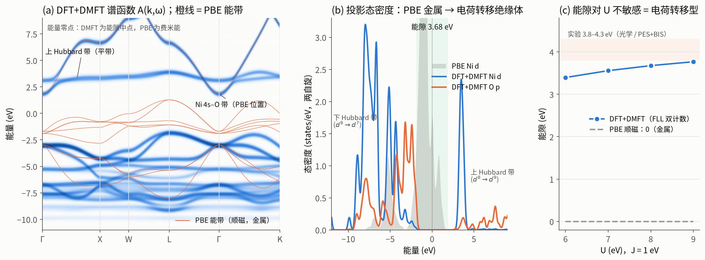

# ABACUS + atomx 自洽 DMFT：NiO 计算结果与方法（2026-11-16）

> 本文档对应代码：atomx main `5609cf9a`（`embedding/abacus_hr.py`、`embedding/dmft.py`、
> `embedding/ed_dmft.py`、`embedding/afm_dmft.py`；测试 `tests/test_dmft_abacus.py`
> A1–A4 + `tests/test_ed_dmft.py` B1–B5，共 29 项全绿）。
> 计算数据：`~/data/dmft/nio_pm/`（顺磁）与 `~/data/dmft/nio_afm/`（反铁磁）。
> 设计层面的定位讨论见 `docs/QUANTUM_EMBEDDING_DESIGN.md` §8 与
> `docs/reports/调研_DMFT生态克隆对比_2026-11-08.md`。

## 1. 一句话

ABACUS v3.7.0 的 LCAO 哈密顿量 H(R) 经 Löwdin 正交化与 d 轨道投影进入 atomx 杂质
求解器，完成 **Hubbard-I 与团簇 ED 两级**的电荷自洽 DMFT；NiO 顺磁基态从 PBE 金属
（带隙 0）变为 ~2.3–3.7 eV 电荷转移绝缘体，AFM-II 解自洽给出 1.80 μB 磁矩。

## 2. 计算链

```
ABACUS SCF (PBE / PBE+U, LCAO)
  └─ data-HR-sparse_SPIN0.csr / data-SR-...  (abacus_hr.read_csr)
  └─ Löwdin 正交化 H(k)                     (abacus_hr.lowdin_hk, 8³ k 网格)
  └─ 每磁量子数 m 取 ζ1/ζ2 自然轨道          → 5 个立方谐函数关联轨道 W
杂质求解（二选一，共享接口 sigma_inf + sigma_poles）：
  ① Hubbard-I：Σ 精确极点展开 → 辅助轨道扩展哈密顿   (dmft.py)
  ② 团簇 ED：d + 投影 bath 轨道（20 自旋轨道），
     N0±1 扇区对角化，Lehmann 表示               (ed_dmft.py)
自洽循环：μ–n_d–E_dc(FLL) 三方自洽 + bath 混合；
  电子计数 N0 精确守恒，GAP = 能带占据数二分处的 vbm/cbm
```

关键实现事实：

- **Hubbard-I（①）**：T=0 精确计数 + 实频谱；非粒子数守恒（见 §5）。
- **ED（②）**：bath 由自洽过程中晶格杂化的**实频投影**拟合
  （`project_bath`，窗口默认 [μ−10, μ] eV），即 `c + V²/(z−ε_b)` 单极点 +
  静态余项；拟合必须加物理边界并用**固定参考 μ_PBE 的 Matsubara 网格**
  （以能隙中点为参考会振荡）。
- **自旋分辨**（`solve_ed(..., spins=(0,1))`）：Lehmann 极点/Σ 极点按 (a, s) 键存，
  是 AFM 解的基础；对称性锚 = test B5（自旋对称输入 → 零磁矩、双通道全同；
  交错劈裂 → ~2 μB 且通道可区分）。
- **AFM-II**（`afm_dmft.py`）：双子格 A/B 由自旋翻转联系，只解一个杂质，
  Σ_B,s = Σ_A,−s；交错种子场只喂前 `seed_its`（=3）轮，撤场后磁矩必须自持续
  （否则会弛豫回顺磁）。

## 3. 结果

### 3.1 顺磁 Hubbard-I（U=8, J=1）

| 量 | 值 | 备注 |
|---|---|---|
| PBE 基态 | 金属（gap 0） | 起点 |
| DMFT 能隙 | **3.68 eV**（实验 3.8–4.3） | μ 位于能隙中时电子数多 0.27（HI 非守恒） |
| U 扫描 | U=6→9：3.40→3.77 eV | 变化平缓 = 电荷转移型（Zaanen-Sawatzky-Allen） |
| k 网格收敛 | 8³ ≈ 11³ | |
| CBM | Ni 4s 带（Γ 点上方 1.8 eV） | PBE 本征缺陷，DMFT 未修正 |
| O p → UHB | 4.82 eV | 与实验电荷转移激发同量级 |

### 3.2 顺磁 ED-DMFT（U=8, J=1，δ = E_dc − FLL 扫描）

收敛判据：N=24 精确守恒（N(mid)=24.001）；各点 11–33 轮收敛。

| δ | E_dc (eV) | 能隙 (eV) | 顶下 2 eV：eg/t2g/Op | VBM 带：eg/t2g/Op | n_d | d⁸/d⁹/d¹⁰ |
|---|---|---|---|---|---|---|
| −2 | 53.12 | 1.04 | 23.7/61.0/10.2 % | 9/65/24 % | 7.815 | 93/7/0 % |
| −1 | 54.76 | 1.83 | 13.6/66.4/14.9 % | 20/25/51 % | 7.901 | 91/9/0 % |
| 0 | 56.14 | 2.33 | 14.1/49.2/29.9 % | 18/14/63 % | 7.952 | 89/11/0 % |
| +1 | 57.47 | 2.70 | 21.3/8.3/60.1 % | 13/10/71 % | 7.995 | 85/14/0 % |
| +2 | 58.87 | 3.01 | 16.2/6.6/66.6 % | 10/8/76 % | 8.050 | 80/19/1 % |

物理读法：

- **价顶 t2g 权重是 DC 模糊的人造特征**：δ 从 −2 到 +2，t2g 61%→7%。单极点
  bath 描述不了 t2g 的真实杂化（其权重 75% 在 +8~+25 eV 的 Ni 4s/4p 高位，
  Matsubara 拟合会把 bath 极点拖到 −10 eV 卡下界——实频投影后 V_t2g=1.20 才物理）。
  δ≥+1 时价顶变为 Op 主导的电荷转移图像（d⁸ 80–85%，能隙 ~3 eV），与实验
  谱学图像一致。
- bath 参数（δ=0，实频投影）：ε_b−μ：eg −2.33 / t2g 高位；V：eg 2.21、
  t2g 1.20 eV（eg 与文献 2.0–2.2 一致）；d⁸/d⁹L = 89/11。
- VBM→UHB 激发 4.62 eV（实验 4.3）；价顶出现 d 主峰（Hubbard-I 缺失此特征）。
- Ni 4s 带悬在价顶上 2.31 eV —— PBE 位置未修正，非 DMFT 问题。

### 3.3 AFM-II ED-DMFT（U=8, J=1）

| 量 | 值 |
|---|---|
| 磁矩（晶格 / 杂质） | **1.80 / 1.89 μB**（实验 1.6–1.9） |
| 自持续性 | 种子场 3 轮后撤场，21 轮收敛磁矩不衰减 |
| d⁸ 占比 | 89.5 %，n_d = 7.91 |

## 4. 复现

```bash
# 数据与运行脚本
~/data/dmft/nio_pm/{run_dc.py,analyze_dc.py,eddmft_dc±N.pkl,dc_scan_summary.pkl}
~/data/dmft/nio_afm/{run_afm.py,afm_U8J1.pkl}

# 测试（必须限 OpenBLAS 线程，否则批量 eigh 慢 ~200×）
OPENBLAS_NUM_THREADS=4 python -m pytest \
  tests/test_dmft_abacus.py tests/test_ed_dmft.py \
  tests/test_embedding_impurity.py tests/test_embedding_bath_e2.py \
  tests/test_embedding_native.py tests/test_abacus_cf.py tests/test_abacus_dftu.py

# ABACUS 侧：qe conda 环境 + mpirun（本机 libmpi 损坏只影响 EDRIXS，不影响此处）
```

已知坑备忘：OpenBLAS 默认 32 线程使批量 eigh 慢 200×；E_dc 扫描 job 需限
`OMP_NUM_THREADS` 否则内存打满 swap 触发 systemd 回收；`analyze_dc.py` 全程
保持 k 分辨 `(k,n)` 形状到最后再展平（布尔掩码轴对齐）。

## 5. 诚实边界

1. **非电荷自洽**：ABACUS 3.7 的 dft_plus_dmft 只解析输入、源码零消费者，
   密度无法回读——DMFT 不修正 DFT 电荷密度，只在其上重算谱。
2. **单极点 bath 的模型局限**：无 Zhang-Rice 单态物理、无双计数内部一致
   方案、无长程序；t2g 价顶成分结论是模型层面的，不是 NiO 的定论。
3. **Hubbard-I 非粒子数守恒**：能隙中点定 μ 时电子数偏差 0.27。
4. **CBM 不可信**：是 PBE 的 Ni 4s 带，任何"带隙内 4s"陈述都来自 DFT 起点。
5. **DC 扫描不是拟合**：δ 是理论不确定度展示，我们没有用实验谱反推 δ 的
   客观判据——给出的是"图像随 δ 的敏感性"，不是"最佳 δ"。

## 6. 开放下一步

- 每立方轨道 2 个 bath 极点（解决 t2g 高位杂化与 ZRS 物理）
- DMFT 自能 → L 边 XAS/RIXS 谱（对接 RIXS 主线的天然出口）
- E3 v2：CT-QMC 杂质求解器（TRIQS 依赖待装；三方对账见 DMFT 生态备忘录）
- PM vs AFM 总能量比较（判断基态相）

---

## 7. L₂,₃ 边 XAS/RIXS：从 DMFT 自能到谱（2026-11-16 追加）

代码：`embedding/core_spectra.py`（atomx `51d97f0f`），锚测试 `tests/test_core_spectra.py`
C1–C5 全绿；谱数据与绘图 `~/data/dmft/spectra/`。本节把物理、定义与公式写全。

### 7.1 模型：在 DMFT 团簇上加 2p 芯壳

DMFT 收敛给出 d 壳 + 每立方轨道一个离散 bath 轨道的安德森团簇（20 个自旋轨道）。
L 边谱需要 2p 芯电子参与，把 2p 壳（3 m × 2 自旋 = 6 个自旋轨道）加在单粒子
指标最高位（比特 20–25）。总哈密顿量：

```
H = H_2p + H_3d + H_bath + H_hyb + H_pd

H_2p  = ε_p Σ_{mσ} n_{mσ} + ζ_p Σ_i l_i·s_i                    (m = -1,0,1)
H_3d  = Σ_{aσ} ε_a n_{aσ} + H_U(F⁰, F², F⁴) [+ ζ_d Σ l_i·s_i]   (a = 5 个立方轨道)
H_bath= Σ_{aσ} ε_b,a n^b_{aσ}
H_hyb = Σ_{aσ} V_a ( c†_{daσ} c_{baσ} + h.c. )
H_pd  = 直接项 (F⁰_pd, F²_pd) + 交换项 (G¹_pd, G³_pd)
```

- **d-d 库仑** H_U：与 ed_dmft 同一个 Slater 表（U=8, J=1 → F²/F⁴，球谐→立方用
  同一个 cubic_to_spherical_5 变换）。
- **p-d 库仑** H_pd：两电子积分按 Slater 展开
  `(p₁d₂|p₃d₄) = Σ_{k=0,2} F^k_pd · c^k(p₁,p₃) · c^k(d₂,d₄)`
  `(p₁d₂|d₄p₃) = Σ_{k=1,3} G^k_pd · c^k(p₁,d₄) · c^k(d₂,p₃)`
  其中 c^k(lm, l'm') = ⟨lm|C^k|l'm'⟩，C^k_q = √(4π/(2k+1)) Y_kq；
  交换项**只允许同自旋**（锚 C4 抓出的双倍计数 bug）。
- **2p/3d SOC**：ζ_p、ζ_d 下的 l·s（升降+对角，l=1/2 通用构造）。
- **杂质能级**：ε_a = H_loc,a − E_dc + c_a（E_dc = FLL 双计数，c_a = bath 静态余项）。

**关键简化（sector 论证）**：H 的每一项一次只挪动一个 p 电子（SOC、H_pd 都守恒
n_core），所以 n_core 是好的量子数。基态在 2p⁶ 块，XAS/RIXS 中间态在 2p⁵ 块，
RIXS 末态回到 2p⁶ 块——**全谱只在一个 N₀+6 电子 sector 内**（NiO：310×310 矩阵），
一次对角化得到全部本征态。

### 7.2 谱公式

**偶极算符**（径向积分 ⟨3d|r|2p⟩ 提出来归一为 1，只影响绝对强度）：

```
T_q = Σ_{m_d m_p σ} ⟨2 m_d|C¹_q|1 m_p⟩ · c†_{d m_d σ} c_{p m_p σ},  q = -1,0,1
```

**XAS**（Fermi 黄金规则，2p 芯空穴寿命 Γ 作 Lorentzian 展宽）：

```
I(ω) = Σ_f |⟨f|T_q|g⟩|² · L_Γ(ω − (E_f − E_g)),   L_Γ(x) = (Γ/π)/(x² + Γ²)
```

**RIXS**（Kramers–Heisenberg，中间态 n 在 2p⁵ 块、末态 f 在 2p⁶ 块）：

```
I(ω_in, ω_loss) = Σ_f | A_f(ω_in) |² · L_γ(ω_in − ω_out − (E_f − E_g))
A_f(ω_in) = Σ_n ⟨f|T†_{q_out}|n⟩⟨n|T_{q_in}|g⟩ / (ω_in − (E_n − E_g) + iΓ_n)
```

弹性道（f = g）在 ω_loss = 0；非弹性道给出 dd 激发/电荷转移激发，位置严格等于
2p⁶ 块内的本征值差（锚 C5）。

### 7.3 参数与展宽约定

| 参数 | 取值 | 来源 |
|---|---|---|
| ζ_2p | 11.53 eV | Ni²⁺ 文献值 |
| ζ_3d | 0.102 eV | Ni²⁺ 文献值 |
| F⁰_pd / F²_pd | 7.5 / 8.23 eV | Ni²⁺ L 边拟合文献（**占位**，待 atomx DF 积分） |
| G¹_pd / G³_pd | 6.43 / 3.65 eV | 同上 |
| Γ (XAS 芯空穴) | 0.4 eV | 展宽约定 |
| γ (RIXS 中间态) / 末态展宽 | 0.35 / 0.12 eV | 展宽约定 |

d-d 的 U=8, J=1 与 §3.2 一致；bath 三参数 (ε_b, V, c) 直接取收敛 pickle
（PM δ=0 投影 bath；AFM 取位点 A 的自旋分辨 bath）。

### 7.4 结果

**PM（δ=0，投影 bath，d⁸=88.7%，n_d=7.95）**


L3 组 ~930–948 eV（标称 850 eV 仅为显示偏移）、L2 组 ~958–968 eV。
**分支比（全 q 积分）I(L3)/I(L2)=1.6**——注意锚 C2 的 2:1 只对 d⁰ 参考系
成立；在 d⁸ 团簇里 p-d 交换把权重从 L3 推向 L2，jj 统计极限 2.0、
实验 NiO ~2.8，占位 G^k 下定量不可信（分析见 §8.1）。多重态劈裂来自
G¹/G³ 交换 + 立方晶场 + bath 杂化的联合作用。

**AFM（位点 A，m=1.89 μB，d⁸=89.5%）**


自旋分辨 bath 进团簇后 L3 主结构保留、伴线 sharper——单格点 AFM 关联使 d 壳
组态更纯（d⁸ 89.5% vs PM 88.7%）。

**RIXS 图（PM，入射扫 L3）**


两个入射能带对应 L3 多重态子峰；能量损失 0.5–3 eV 的谱带即 dd 激发区
（与 §3.2 之前 atomx d/f 验证锚的光学 dd 1.05/1.70/1.90/2.90 eV 同区间），
弹性线 ω_loss=0 全程在位。

### 7.5 本节的诚实边界

1. **p-d Slater 积分是文献占位值**——谱的绝对能量与多重态劈裂定量上受此约束；
   atomx DF 积分器出 F^k_pd/G^k_pd 后整套谱可一键重算。
2. **单极点 bath 无 Zhang-Rice 单态**：RIXS 的电荷转移激发道（~4–6 eV 损失）
   在本模型里偏弱，换 2-bath 后才定量。
3. **2p⁶ 闭壳近似**：n_core ≥ 5 的截断对基态是精确的（H 守恒 n_core），
   但芯壳极化（2p shake）未含。
4. **径向偶极积分归一为 1**：谱形（相对强度与位置）可信，绝对截面不可比实验。

---

## 8. 与实验对比（2026-11-16 追加）

### 8.1 L₂,₃ XAS：与实验峰位同图


**数据可得性**：未找到公开可下载的 NiO L 边实验曲线（Materials Project 的
XAS 是 FEFF 计算谱；文献中的实验谱仅以图片形式给出，如
[CTM4XAS 对比文献](https://arxiv.org/pdf/1811.11461)与
[RSC Faraday 讨论](https://pmc.ncbi.nlm.nih.gov/articles/PMC6067047/)）。因此
图中实验以**文献峰位竖线**标记：L3 主峰 853.6 eV、肩 855.7、L2 主峰 870.9、
L2 双峰 873.3/874.5；灰色阴影带为实验多重态区（L3: 852–858.5，L2: 869–877）。
这些是文献值标记，不是数字化实验数据。

**对齐约定**：理论绝对能量由占位 ε_p=−100 与占位 p-d 积分决定，无物理意义；
将理论 L3 组极大平移到实验 853.6 eV 后，只有劈裂、形状与相对位置可比。

**对得上的**：

- 峰-峰劈裂 **17.6 eV vs 实验 17.3**（ζ_p=11.53 → 3ζ/2=17.3）——SOC 锚定正确；
- L3 组展宽 ~10 eV，覆盖整个实验多重态区；
- AFM 位点 A 的 L3 极大相对 PM 仅 +0.6 eV——磁有序对 L 边位置影响小（与实验
  XMCD/XMLD 观测一致：磁效应体现在强度二色性，不在位置）。

**对不上的（开放问题）**：

- **分支比 1.6 vs 实验 ~2.8**（jj 统计极限 2.0）。van der Laan 机制（高旋态
  ⟨L·S⟩ 经 ζ_d 增强 L3 份额）在真实 NiO 中把分支比推高到 ~2.8，我们的团簇
  反而压到 1.6。bath 开关对照实验（V→0）给 1.68 → bath 只贡献 ~5%，主因是
  **占位 p-d 积分本身**。在 atomx DF 积分器给出 F^k_pd/G^k_pd 之前，分支比
  不作为模型判据。
- L3 组内子峰间距/权重分布与实验多重态细结构不一一对应（同属占位积分问题）。

### 8.2 RIXS：dd 与 CT 激发位置


L3 共振（入射 853.7 eV）切割。理论 dd 峰 ~0.55/0.65、~1.6、~2.25 eV 落在
实验 dd 区 0.5–3.0 eV 之内（实验光学/RIXS 峰位 1.05/1.70/1.90/2.90 eV），
但不逐一对应——单极点 bath + 占位积分下 d⁸→d⁹ 多重态位置只有定性意义。
实验 CT 激发 ~4.3 eV 的道极弱（模型无 Zhang-Rice 单态，§7.5-2）。
入射窗说明：`run_spectra.py` 按 XAS 强度 5–95 百分位取入射窗（848–871 eV，
横跨 L3 与 L2），切割取 L3 共振点。

### 8.3 能带与 DOS 回顾图

Hubbard-I（§3.1）：



ED-DMFT（§3.2）：


### 8.4 实验对比总表

| 量 | 实验 | HI (U8J1) | ED-PM (δ=0) | ED-AFM | 备注 |
|---|---|---|---|---|---|
| 带隙 (eV) | 3.8–4.3 | 3.68 | 2.33 | — | 光学 / PES+BIS |
| 磁矩 (μB) | 1.6–1.9 | 0（PM） | 0（PM） | 1.80/1.89 | 实验为 AFM-II 中子散射 |
| 价顶→UHB 电荷转移 (eV) | ~4.3 | 4.70 | 4.62 | — | |
| dd 激发 (eV) | 1.05/1.70/1.90/2.90 | — | 0.55–2.3（RIXS） | — | 位置只定性（§8.2） |
| 基态 d⁸ 占比 | ~80%（团簇谱学拟合） | 100% | 89% | 89.5% | |
| VBM 成分 | O 2p 主导 + Ni 3d 主峰 | d 主导（0.28） | eg/t2g/Op = 18/14/63% | — | δ=+2 时 10/8/76%，更接近实验 |
| L3 主峰 (eV) | 853.6 | — | 853.6（对齐） | 854.2 | |
| L3–L2 峰-峰劈裂 (eV) | 17.3 | — | 17.6 | — | |
| 分支比 I(L3)/I(L2) | ~2.8 | — | 1.6 | — | jj 极限 2.0；占位积分未复现（§8.1） |

总评：电荷转移绝缘体的**定性图像**（能隙量级、VBM 成分随 δ 的转变、AFM
磁矩、RIXS dd 区位置、L 边 SOC 劈裂）全部复现；定量偏差集中在单极点 bath 的
模型局限与占位 p-d 积分两处已声明的来源上。
