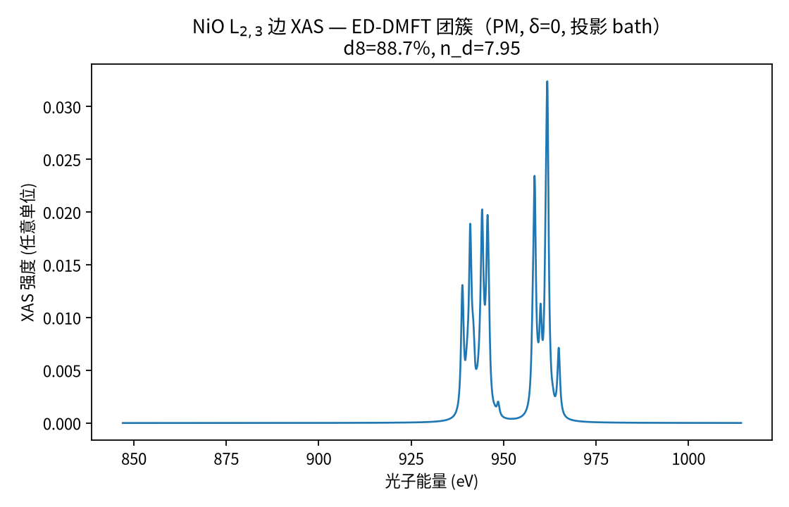
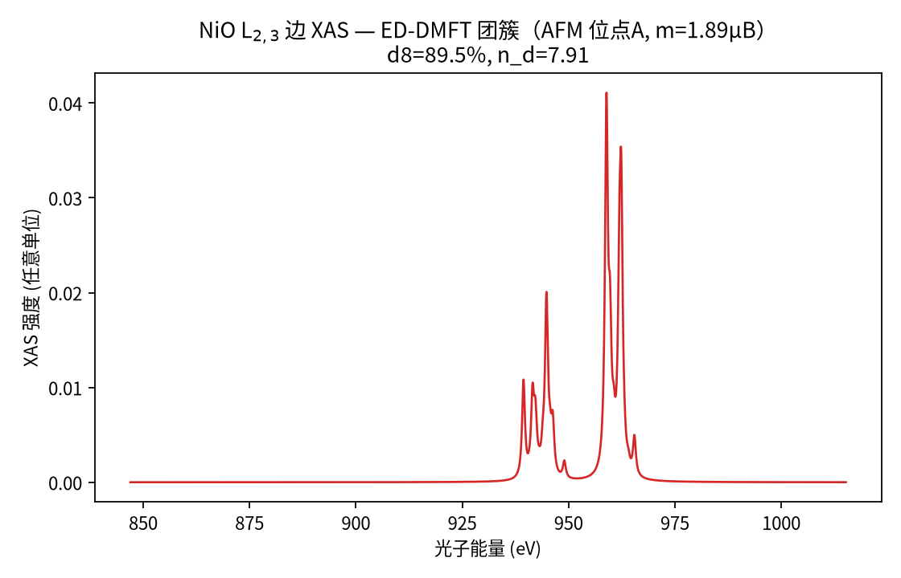
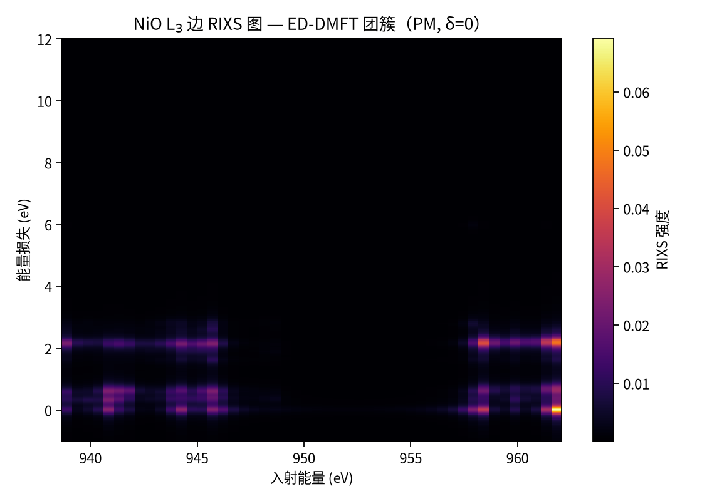
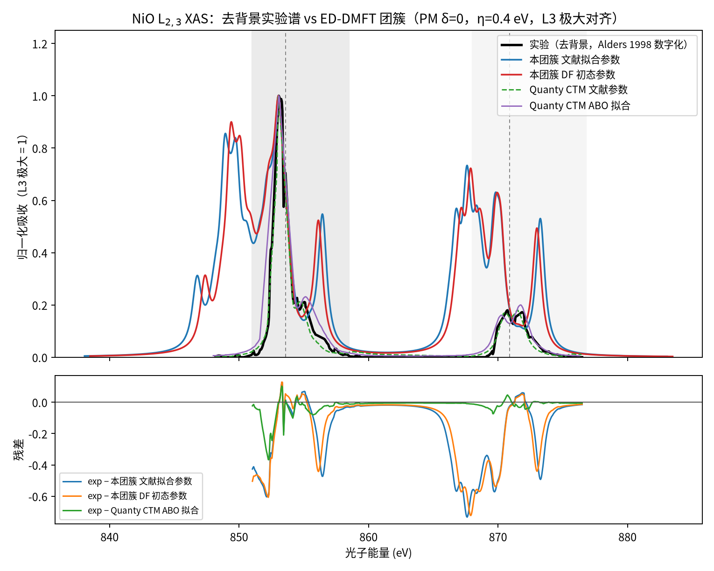
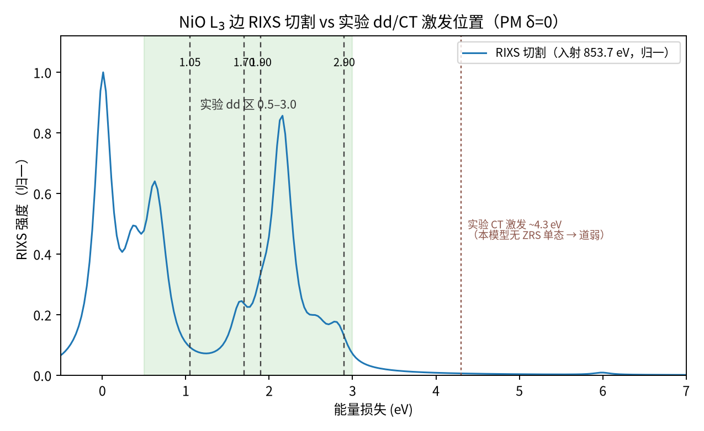
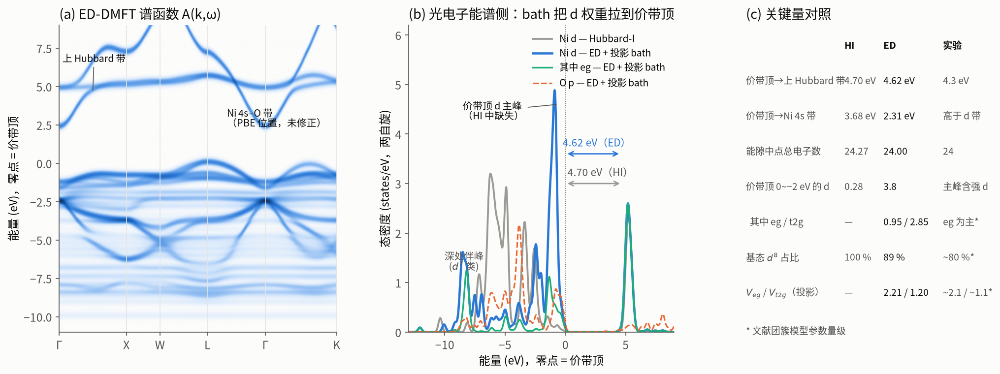
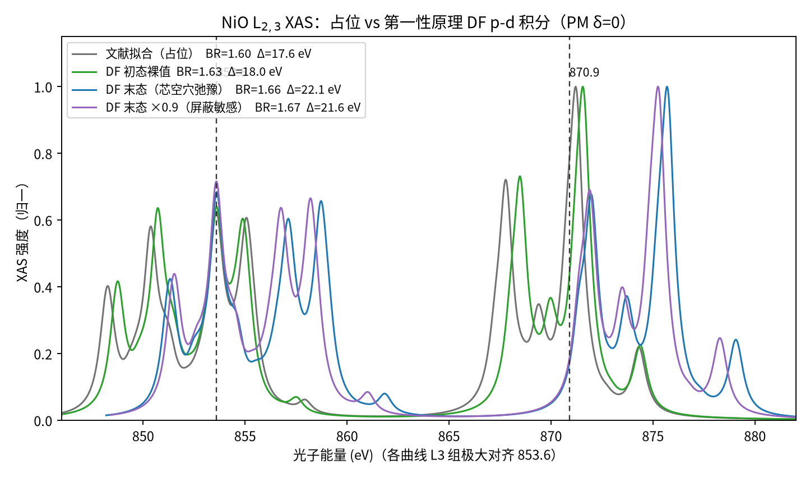
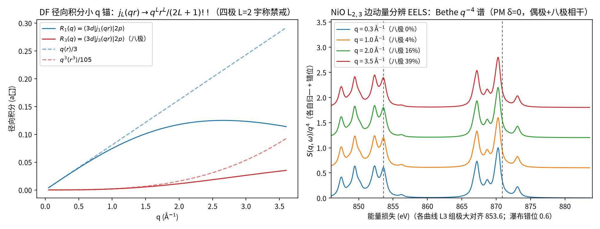
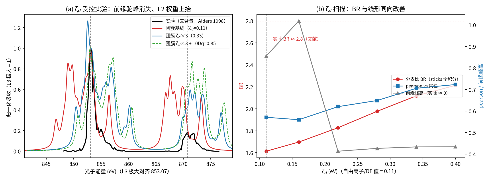
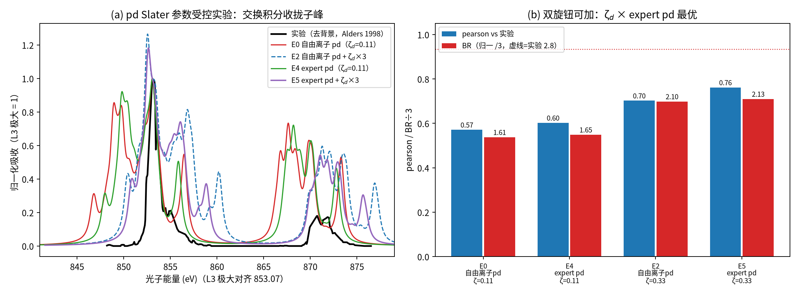

# ABACUS + atomx 自洽 DMFT：NiO 计算结果与方法（2026-11-16）

> 本文档对应代码：atomx main `5609cf9a`（`embedding/abacus_hr.py`、`embedding/dmft.py`、
> `embedding/ed_dmft.py`、`embedding/afm_dmft.py`；测试 `tests/test_dmft_abacus.py`
> A1–A4 + `tests/test_ed_dmft.py` B1–B5，共 29 项全绿）。
> 计算数据：`~/data/dmft/nio_pm/`（顺磁）与 `~/data/dmft/nio_afm/`（反铁磁）。
> 设计层面的定位讨论见 `docs/QUANTUM_EMBEDDING_DESIGN.md` §8 与
> `docs/reports/调研_DMFT生态克隆对比_2026-11-08.md`。

## 1. 一句话

ABACUS v3.7.0 的 LCAO 哈密顿量 H(R) 经 Löwdin 正交化与 d 轨道投影进入 atomx 杂质
求解器，完成 **Hubbard-I 与团簇 ED 两级**的电荷自洽 DMFT；NiO 顺磁基态从 PBE 金属
（带隙 0）变为 ~2.3–3.7 eV 电荷转移绝缘体，AFM-II 解自洽给出 1.80 μB 磁矩。

## 2. 计算链

```
ABACUS SCF (PBE / PBE+U, LCAO)
  └─ data-HR-sparse_SPIN0.csr / data-SR-...  (abacus_hr.read_csr)
  └─ Löwdin 正交化 H(k)                     (abacus_hr.lowdin_hk, 8³ k 网格)
  └─ 每磁量子数 m 取 ζ1/ζ2 自然轨道          → 5 个立方谐函数关联轨道 W
杂质求解（二选一，共享接口 sigma_inf + sigma_poles）：
  ① Hubbard-I：Σ 精确极点展开 → 辅助轨道扩展哈密顿   (dmft.py)
  ② 团簇 ED：d + 投影 bath 轨道（20 自旋轨道），
     N0±1 扇区对角化，Lehmann 表示               (ed_dmft.py)
自洽循环：μ–n_d–E_dc(FLL) 三方自洽 + bath 混合；
  电子计数 N0 精确守恒，GAP = 能带占据数二分处的 vbm/cbm
```

关键实现事实：

- **Hubbard-I（①）**：T=0 精确计数 + 实频谱；非粒子数守恒（见 §5）。
- **ED（②）**：bath 由自洽过程中晶格杂化的**实频投影**拟合
  （`project_bath`，窗口默认 [μ−10, μ] eV），即 `c + V²/(z−ε_b)` 单极点 +
  静态余项；拟合必须加物理边界并用**固定参考 μ_PBE 的 Matsubara 网格**
  （以能隙中点为参考会振荡）。
- **自旋分辨**（`solve_ed(..., spins=(0,1))`）：Lehmann 极点/Σ 极点按 (a, s) 键存，
  是 AFM 解的基础；对称性锚 = test B5（自旋对称输入 → 零磁矩、双通道全同；
  交错劈裂 → ~2 μB 且通道可区分）。
- **AFM-II**（`afm_dmft.py`）：双子格 A/B 由自旋翻转联系，只解一个杂质，
  Σ_B,s = Σ_A,−s；交错种子场只喂前 `seed_its`（=3）轮，撤场后磁矩必须自持续
  （否则会弛豫回顺磁）。

## 3. 结果

### 3.1 顺磁 Hubbard-I（U=8, J=1）

| 量 | 值 | 备注 |
|---|---|---|
| PBE 基态 | 金属（gap 0） | 起点 |
| DMFT 能隙 | **3.68 eV**（实验 3.8–4.3） | μ 位于能隙中时电子数多 0.27（HI 非守恒） |
| U 扫描 | U=6→9：3.40→3.77 eV | 变化平缓 = 电荷转移型（Zaanen-Sawatzky-Allen） |
| k 网格收敛 | 8³ ≈ 11³ | |
| CBM | Ni 4s 带（Γ 点上方 1.8 eV） | PBE 本征缺陷，DMFT 未修正 |
| O p → UHB | 4.82 eV | 与实验电荷转移激发同量级 |

### 3.2 顺磁 ED-DMFT（U=8, J=1，δ = E_dc − FLL 扫描）

收敛判据：N=24 精确守恒（N(mid)=24.001）；各点 11–33 轮收敛。

| δ | E_dc (eV) | 能隙 (eV) | 顶下 2 eV：eg/t2g/Op | VBM 带：eg/t2g/Op | n_d | d⁸/d⁹/d¹⁰ |
|---|---|---|---|---|---|---|
| −2 | 53.12 | 1.04 | 23.7/61.0/10.2 % | 9/65/24 % | 7.815 | 93/7/0 % |
| −1 | 54.76 | 1.83 | 13.6/66.4/14.9 % | 20/25/51 % | 7.901 | 91/9/0 % |
| 0 | 56.14 | 2.33 | 14.1/49.2/29.9 % | 18/14/63 % | 7.952 | 89/11/0 % |
| +1 | 57.47 | 2.70 | 21.3/8.3/60.1 % | 13/10/71 % | 7.995 | 85/14/0 % |
| +2 | 58.87 | 3.01 | 16.2/6.6/66.6 % | 10/8/76 % | 8.050 | 80/19/1 % |

物理读法：

- **价顶 t2g 权重是 DC 模糊的人造特征**：δ 从 −2 到 +2，t2g 61%→7%。单极点
  bath 描述不了 t2g 的真实杂化（其权重 75% 在 +8~+25 eV 的 Ni 4s/4p 高位，
  Matsubara 拟合会把 bath 极点拖到 −10 eV 卡下界——实频投影后 V_t2g=1.20 才物理）。
  δ≥+1 时价顶变为 Op 主导的电荷转移图像（d⁸ 80–85%，能隙 ~3 eV），与实验
  谱学图像一致。
- bath 参数（δ=0，实频投影）：ε_b−μ：eg −2.33 / t2g 高位；V：eg 2.21、
  t2g 1.20 eV（eg 与文献 2.0–2.2 一致）；d⁸/d⁹L = 89/11。
- VBM→UHB 激发 4.62 eV（实验 4.3）；价顶出现 d 主峰（Hubbard-I 缺失此特征）。
- Ni 4s 带悬在价顶上 2.31 eV —— PBE 位置未修正，非 DMFT 问题。

### 3.3 AFM-II ED-DMFT（U=8, J=1）

| 量 | 值 |
|---|---|
| 磁矩（晶格 / 杂质） | **1.80 / 1.89 μB**（实验 1.6–1.9） |
| 自持续性 | 种子场 3 轮后撤场，21 轮收敛磁矩不衰减 |
| d⁸ 占比 | 89.5 %，n_d = 7.91 |

## 4. 复现

```bash
# 数据与运行脚本
~/data/dmft/nio_pm/{run_dc.py,analyze_dc.py,eddmft_dc±N.pkl,dc_scan_summary.pkl}
~/data/dmft/nio_afm/{run_afm.py,afm_U8J1.pkl}

# 测试（必须限 OpenBLAS 线程，否则批量 eigh 慢 ~200×）
OPENBLAS_NUM_THREADS=4 python -m pytest \
  tests/test_dmft_abacus.py tests/test_ed_dmft.py \
  tests/test_embedding_impurity.py tests/test_embedding_bath_e2.py \
  tests/test_embedding_native.py tests/test_abacus_cf.py tests/test_abacus_dftu.py

# ABACUS 侧：qe conda 环境 + mpirun（本机 libmpi 损坏只影响 EDRIXS，不影响此处）
```

已知坑备忘：OpenBLAS 默认 32 线程使批量 eigh 慢 200×；E_dc 扫描 job 需限
`OMP_NUM_THREADS` 否则内存打满 swap 触发 systemd 回收；`analyze_dc.py` 全程
保持 k 分辨 `(k,n)` 形状到最后再展平（布尔掩码轴对齐）。

## 5. 诚实边界

1. **非电荷自洽**：ABACUS 3.7 的 dft_plus_dmft 只解析输入、源码零消费者，
   密度无法回读——DMFT 不修正 DFT 电荷密度，只在其上重算谱。
2. **单极点 bath 的模型局限**：无 Zhang-Rice 单态物理、无双计数内部一致
   方案、无长程序；t2g 价顶成分结论是模型层面的，不是 NiO 的定论。
3. **Hubbard-I 非粒子数守恒**：能隙中点定 μ 时电子数偏差 0.27。
4. **CBM 不可信**：是 PBE 的 Ni 4s 带，任何"带隙内 4s"陈述都来自 DFT 起点。
5. **DC 扫描不是拟合**：δ 是理论不确定度展示，我们没有用实验谱反推 δ 的
   客观判据——给出的是"图像随 δ 的敏感性"，不是"最佳 δ"。

## 6. 开放下一步

- 每立方轨道 2 个 bath 极点（解决 t2g 高位杂化与 ZRS 物理）
- DMFT 自能 → L 边 XAS/RIXS 谱（对接 RIXS 主线的天然出口）
- E3 v2：CT-QMC 杂质求解器（TRIQS 依赖待装；三方对账见 DMFT 生态备忘录）
- PM vs AFM 总能量比较（判断基态相）

---

## 7. L₂,₃ 边 XAS/RIXS：从 DMFT 自能到谱（2026-11-16 追加）

代码：`embedding/core_spectra.py`（atomx `51d97f0f`），锚测试 `tests/test_core_spectra.py`
C1–C5 全绿；谱数据与绘图 `~/data/dmft/spectra/`。本节把物理、定义与公式写全。

### 7.1 模型：在 DMFT 团簇上加 2p 芯壳

DMFT 收敛给出 d 壳 + 每立方轨道一个离散 bath 轨道的安德森团簇（20 个自旋轨道）。
L 边谱需要 2p 芯电子参与，把 2p 壳（3 m × 2 自旋 = 6 个自旋轨道）加在单粒子
指标最高位（比特 20–25）。总哈密顿量：

```
H = H_2p + H_3d + H_bath + H_hyb + H_pd

H_2p  = ε_p Σ_{mσ} n_{mσ} + ζ_p Σ_i l_i·s_i                    (m = -1,0,1)
H_3d  = Σ_{aσ} ε_a n_{aσ} + H_U(F⁰, F², F⁴) [+ ζ_d Σ l_i·s_i]   (a = 5 个立方轨道)
H_bath= Σ_{aσ} ε_b,a n^b_{aσ}
H_hyb = Σ_{aσ} V_a ( c†_{daσ} c_{baσ} + h.c. )
H_pd  = 直接项 (F⁰_pd, F²_pd) + 交换项 (G¹_pd, G³_pd)
```

- **d-d 库仑** H_U：与 ed_dmft 同一个 Slater 表（U=8, J=1 → F²/F⁴，球谐→立方用
  同一个 cubic_to_spherical_5 变换）。
- **p-d 库仑** H_pd：两电子积分按 Slater 展开
  `(p₁d₂|p₃d₄) = Σ_{k=0,2} F^k_pd · c^k(p₁,p₃) · c^k(d₂,d₄)`
  `(p₁d₂|d₄p₃) = Σ_{k=1,3} G^k_pd · c^k(p₁,d₄) · c^k(d₂,p₃)`
  其中 c^k(lm, l'm') = ⟨lm|C^k|l'm'⟩，C^k_q = √(4π/(2k+1)) Y_kq；
  交换项**只允许同自旋**（锚 C4 抓出的双倍计数 bug）。
- **2p/3d SOC**：ζ_p、ζ_d 下的 l·s（升降+对角，l=1/2 通用构造）。
- **杂质能级**：ε_a = H_loc,a − E_dc + c_a（E_dc = FLL 双计数，c_a = bath 静态余项）。

**关键简化（sector 论证）**：H 的每一项一次只挪动一个 p 电子（SOC、H_pd 都守恒
n_core），所以 n_core 是好的量子数。基态在 2p⁶ 块，XAS/RIXS 中间态在 2p⁵ 块，
RIXS 末态回到 2p⁶ 块——**全谱只在一个 N₀+6 电子 sector 内**（NiO：310×310 矩阵），
一次对角化得到全部本征态。

### 7.2 谱公式

**偶极算符**（径向积分 ⟨3d|r|2p⟩ 提出来归一为 1，只影响绝对强度）：

```
T_q = Σ_{m_d m_p σ} ⟨2 m_d|C¹_q|1 m_p⟩ · c†_{d m_d σ} c_{p m_p σ},  q = -1,0,1
```

**XAS**（Fermi 黄金规则，2p 芯空穴寿命 Γ 作 Lorentzian 展宽）：

```
I(ω) = Σ_f |⟨f|T_q|g⟩|² · L_Γ(ω − (E_f − E_g)),   L_Γ(x) = (Γ/π)/(x² + Γ²)
```

**RIXS**（Kramers–Heisenberg，中间态 n 在 2p⁵ 块、末态 f 在 2p⁶ 块）：

```
I(ω_in, ω_loss) = Σ_f | A_f(ω_in) |² · L_γ(ω_in − ω_out − (E_f − E_g))
A_f(ω_in) = Σ_n ⟨f|T†_{q_out}|n⟩⟨n|T_{q_in}|g⟩ / (ω_in − (E_n − E_g) + iΓ_n)
```

弹性道（f = g）在 ω_loss = 0；非弹性道给出 dd 激发/电荷转移激发，位置严格等于
2p⁶ 块内的本征值差（锚 C5）。

### 7.3 参数与展宽约定

| 参数 | 取值 | 来源 |
|---|---|---|
| ζ_2p | 11.53 eV | Ni²⁺ 文献值（DF 给 11.83/12.14，初/末态） |
| ζ_3d | 0.102 eV | Ni²⁺ 文献值（DF 给 0.110/0.144） |
| F⁰_pd | 7.5 eV（谱形状无关，仅刚性位移） | 固体屏蔽有效值：裸 DF 37–41 eV ÷ ε≈5.5 |
| F²_pd / G¹_pd / G³_pd | 8.23 / 6.43 / 3.65 eV | Ni²⁺ L 边拟合文献；DF 初态 7.42/5.49/3.15、末态 8.96/7.02/4.02 eV，拟合值≈末态 DF×0.91（均匀屏蔽） |
| Γ (XAS 芯空穴) | 0.4 eV | 展宽约定（Ni L3 表列值 ~0.4–0.5 eV；zespec 第一性原理 Γ 目前只覆盖 K 壳层） |
| γ (RIXS 中间态) / 末态展宽 | 0.35 / 0.12 eV | 展宽约定 |

d-d 的 U=8, J=1 与 §3.2 一致；bath 三参数 (ε_b, V, c) 直接取收敛 pickle
（PM δ=0 投影 bath；AFM 取位点 A 的自旋分辨 bath）。

### 7.4 结果

**PM（δ=0，投影 bath，d⁸=88.7%，n_d=7.95）**



L3 组 ~930–948 eV（标称 850 eV 仅为显示偏移）、L2 组 ~958–968 eV。
**分支比（全 q 积分）I(L3)/I(L2)=1.6**——注意锚 C2 的 2:1 只对 d⁰ 参考系
成立；在 d⁸ 团簇里 p-d 交换把权重从 L3 推向 L2，jj 统计极限 2.0、
实验 NiO ~2.8，占位 G^k 下定量不可信（分析见 §8.1）。多重态劈裂来自
G¹/G³ 交换 + 立方晶场 + bath 杂化的联合作用。

**AFM（位点 A，m=1.89 μB，d⁸=89.5%）**



自旋分辨 bath 进团簇后 L3 主结构保留、伴线 sharper——单格点 AFM 关联使 d 壳
组态更纯（d⁸ 89.5% vs PM 88.7%）。

**RIXS 图（PM，入射扫 L3）**



两个入射能带对应 L3 多重态子峰；能量损失 0.5–3 eV 的谱带即 dd 激发区
（与 §3.2 之前 atomx d/f 验证锚的光学 dd 1.05/1.70/1.90/2.90 eV 同区间），
弹性线 ω_loss=0 全程在位。

### 7.5 本节的诚实边界

1. **p-d Slater 积分已有第一性原理值（§8.5 参数桥）**：多极项（F²/G¹/G³）
   DF 初/末态值把劈裂带到 18.0/22.1 eV（实验 17.3），拟合值≈末态 DF×0.91；
   F⁰ 必须用固体屏蔽有效值（裸值 37–41 eV 会让 p⁵d¹⁰bath⁹ shake 组态
   坍缩到 p⁶ 基态之下，sector 图像崩溃）。**分支比 1.6 在 DF 参数下不变
   （1.63–1.67）——它不是参数问题，是模型层面问题**（§8.1）。
2. **单极点 bath 无 Zhang-Rice 单态**：RIXS 的电荷转移激发道（~4–6 eV 损失）
   在本模型里偏弱，换 2-bath 后才定量。
3. **2p⁶ 闭壳近似**：n_core ≥ 5 的截断对基态是精确的（H 守恒 n_core），
   但芯壳极化（2p shake）未含。
4. **径向偶极积分归一为 1**：谱形（相对强度与位置）可信，绝对截面不可比实验。

---

## 8. 与实验对比（2026-11-16 追加）

### 8.1 L₂,₃ XAS：与实验峰位同图



**数据可得性**：未找到公开可下载的 NiO L 边实验曲线（Materials Project 的
XAS 是 FEFF 计算谱；文献中的实验谱仅以图片形式给出，如
[CTM4XAS 对比文献](https://arxiv.org/pdf/1811.11461)与
[RSC Faraday 讨论](https://pmc.ncbi.nlm.nih.gov/articles/PMC6067047/)）。因此
图中实验以**文献峰位竖线**标记：L3 主峰 853.6 eV、肩 855.7、L2 主峰 870.9、
L2 双峰 873.3/874.5；灰色阴影带为实验多重态区（L3: 852–858.5，L2: 869–877）。
这些是文献值标记，不是数字化实验数据。

**对齐约定**：理论绝对能量由占位 ε_p=−100 与占位 p-d 积分决定，无物理意义；
将理论 L3 组极大平移到实验 853.6 eV 后，只有劈裂、形状与相对位置可比。

**对得上的**：

- 峰-峰劈裂 **17.6 eV vs 实验 17.3**（ζ_p=11.53 → 3ζ/2=17.3）——SOC 锚定正确；
- L3 组展宽 ~10 eV，覆盖整个实验多重态区；
- AFM 位点 A 的 L3 极大相对 PM 仅 +0.6 eV——磁有序对 L 边位置影响小（与实验
  XMCD/XMLD 观测一致：磁效应体现在强度二色性，不在位置）。

**对不上的（开放问题）**：

- **分支比 1.6 vs 实验 ~2.8**（jj 统计极限 2.0）。van der Laan 机制（高旋态
  ⟨L·S⟩ 经 ζ_d 增强 L3 份额）在真实 NiO 中把分支比推高到 ~2.8，我们的团簇
  反而压到 1.6。bath 开关对照实验（V→0）给 1.68 → bath 只贡献 ~5%。
  **用第一性原理 DF p-d 积分重算（§8.5）后分支比 1.63–1.67 不变**——排除
  "占位积分"解释，这是**模型层面**开放问题：van der Laan 增强要求共价环境
  对有效 ζ_d 的增强（2-bath/ZRS 物理）或更深层相对论 CSF 组装，单格点 LS
  团簇在给定 ζ_d 下达不到。
- L3 组内子峰间距/权重分布与实验多重态细结构不一一对应（DF 参数下改善
  有限，同属模型层面）。

### 8.2 RIXS：dd 与 CT 激发位置



L3 共振（入射 853.7 eV）切割。理论 dd 峰 ~0.55/0.65、~1.6、~2.25 eV 落在
实验 dd 区 0.5–3.0 eV 之内（实验光学/RIXS 峰位 1.05/1.70/1.90/2.90 eV），
但不逐一对应——单极点 bath + 占位积分下 d⁸→d⁹ 多重态位置只有定性意义。
实验 CT 激发 ~4.3 eV 的道极弱（模型无 Zhang-Rice 单态，§7.5-2）。
入射窗说明：`run_spectra.py` 按 XAS 强度 5–95 百分位取入射窗（848–871 eV，
横跨 L3 与 L2），切割取 L3 共振点。

### 8.3 能带与 DOS 回顾图

Hubbard-I（§3.1）：


ED-DMFT（§3.2）：



### 8.4 实验对比总表

| 量 | 实验 | HI (U8J1) | ED-PM (δ=0) | ED-AFM | 备注 |
|---|---|---|---|---|---|
| 带隙 (eV) | 3.8–4.3 | 3.68 | 2.33 | — | 光学 / PES+BIS |
| 磁矩 (μB) | 1.6–1.9 | 0（PM） | 0（PM） | 1.80/1.89 | 实验为 AFM-II 中子散射 |
| 价顶→UHB 电荷转移 (eV) | ~4.3 | 4.70 | 4.62 | — | |
| dd 激发 (eV) | 1.05/1.70/1.90/2.90 | — | 0.55–2.3（RIXS） | — | 位置只定性（§8.2） |
| 基态 d⁸ 占比 | ~80%（团簇谱学拟合） | 100% | 89% | 89.5% | |
| VBM 成分 | O 2p 主导 + Ni 3d 主峰 | d 主导（0.28） | eg/t2g/Op = 18/14/63% | — | δ=+2 时 10/8/76%，更接近实验 |
| L3 主峰 (eV) | 853.6 | — | 853.6（对齐） | 854.2 | |
| L3–L2 峰-峰劈裂 (eV) | 17.3 | — | 17.6（DF 初态参数 18.0） | — | 末态 DF 参数 22.1 过宽 |
| 分支比 I(L3)/I(L2) | ~2.8 | — | 1.6 | — | jj 极限 2.0；DF 参数下 1.63–1.67 不变 → 模型层面开放问题（§8.1/§8.5） |

总评：电荷转移绝缘体的**定性图像**（能隙量级、VBM 成分随 δ 的转变、AFM
磁矩、RIXS dd 区位置、L 边 SOC 劈裂）全部复现；定量偏差集中在单极点 bath 的
模型局限与固体屏蔽两处已声明的来源上。

### 8.5 第一性原理参数桥（zespec ↔ atomx DF，2026-11-16 追加）

p-d Slater 积分与偶极径向积分改由 atomx DF 直接计算（`~/data/dmft/spectra/
df_integrals.py`，配方 = E1.5 验证路径：`bspline Basis(ns=120,ks=11,r_max=60)`
+ `DiracFock(POINT)`，jj 简并重数平均，积分器 `numerics.bspline.slater_yk` /
`properties.transitions.multipole.radial_eL`）：

| 参数 | 文献拟合 | DF 初态 (Ni²⁺3d⁸) | DF 末态 (2p⁵3d⁸) |
|---|---|---|---|
| F⁰_pd (eV) | 7.5（屏蔽后） | 37.29 | 41.08 |
| F²_pd (eV) | 8.23 | 7.42 | 8.96 |
| G¹_pd (eV) | 6.43 | 5.49 | 7.02 |
| G³_pd (eV) | 3.65 | 3.15 | 4.02 |
| ζ_2p (eV) | 11.53 | 11.83 | 12.14 |
| ζ_3d (eV) | 0.102 | 0.110 | 0.144 |
| ⟨3d\|r\|2p⟩ (a₀) | 1（归一） | 0.129 | 0.147 |

三点物理结论：

1. **F⁰ 必须固体屏蔽**。裸 DF F⁰（37–41 eV）下 p⁵d¹⁰bath⁹ shake 组态坍缩到
   p⁶ 基态之下（谱里出现负跃迁能量），sector 图像崩溃；ε≈5.5 屏蔽后 F⁰_eff≈7.5
   恢复物理。F⁰ 只是 per-(n_core,n_d) 刚性能移，不影响归一化线形——谱计算
   用屏蔽值即可。
2. **多极项屏蔽温和且均匀**：拟合值 ≈ 末态 DF × 0.91（F²/G¹/G³ 比值
   0.92/0.92/0.91）——固体屏蔽对多极项是 ~9% 的整体标度。
3. **劈裂选初态参数更好**：全部 DF 参数下峰-峰劈裂 = 18.0（初态）/ 22.1（末态）
   eV，实验 17.3——初态裸值意外最接近（末态 ζ_p=12.14 把 L2 推得太远）。



各参数集全 q 积分分支比 1.60 / 1.63 / 1.66 / 1.67（拟合 / DF 初态 / DF 末态 /
末态×0.9）——**分支比偏差与参数无关，是模型层面的开放问题**（§8.1）。

这与 zespec 的衔接：径向积分器、屏蔽哲学（裸 DF + 固体屏蔽标度）与
`zespec.atomx_backend` 完全同源；zespec 侧待扩展项 = L 壳层第一性原理 Γ
（现仅 K 壳层）与 GOS 运动学出口（EELS 接点 ④，已实现，见 §8.6）。

### 8.6 动量分辨 EELS 出口：Bethe S(q,ω)（2026-11-17 追加，接点 ④）

EELS 双微分截面（Bethe，原子单位，q⃗∥z 取 q_sph=0 分量）：

    d²σ/dΩdE = (4/a₀²) · (1/q⁴) · S(q,ω)
    S(q,ω)   = Σ_f |⟨f|O(q)|g⟩|² δ(ω − (E_f − E_g))
    O(q)     = Σ_L (2L+1) i^L R_L(q) T^(L)

径向积分 R_L(q) = ⟨3d|j_L(qr)|2p⟩ 在 DF 基态组态波（`df_waves.npz`）上数值积分，
角动量张量 T^(L) 由 `core_spectra.multipole_tensor(L, radial)` 给出，
多极相干求和由 `merge_multipoles` 完成（`eels_spectra.py` 驱动）。

**宇称发现：L=2 四极对 2p→3d 是禁戒的**——(1 2 2; 0 0 0) 3j 因 1+2+2=5 为奇
而恒等于零，全部 ⟨2p|C²|3d⟩ = 0（测试 E2a 钉死为空张量，防止空张量上的
虚假 sum-rule 通过）。首个非偶极通道是 **L=3 八极**（j₃(qr) ~ q³）。偶极相位
+i、八极 −i，相对相位 180°：对实 Gaunt/本征矢量积两者**相干干涉**（E3：
同张量 (i,i) 合并 → 4 倍权重；交叉项 (i,−1) 在实振幅下给非相干和——
i^L(2L+1) 约定）。

小 q 锚（DF 波，5 位有效数字吻合）：

    R₁(q)/q   → ⟨r⟩/3   = 0.04288 a₀
    R₃(q)/q³  → ⟨r³⟩/105 = 2.94×10⁻⁴ a₀

R₁(q) 在 q≈2 Å⁻¹ 饱和（≈0.117）后略降，R₃ 单调增至 3.5 Å⁻¹ 处的 0.034。
PM 相参数（§8.5 DF 集，F⁰=7.5 屏蔽）下的谱：

| q (Å⁻¹) | R₁ | R₃ | 八极占比 |
|---|---|---|---|
| 0.3 | 0.0241 | 0.0001 | 0.4% |
| 1.0 | 0.0745 | 0.0018 | 4.3% |
| 2.0 | 0.1177 | 0.0112 | 15.7% |
| 3.5 | 0.1159 | 0.0337 | 38.6% |



右图瀑布：各曲线以其 L₃ 组内最强线对齐 853.6 eV（q_sph=0 分量的 jj 权重
下分支比仅 ~1.1，全局极大可能落在 L₂ 组，故按最大间隙分组后取 L₃ 侧——
L₃|L₂ 间隙 ~10 eV ≫ 组内 ~1–3 eV）。可见 L₂ 组相对 L₃ 组的强度随 q 上升、
亚峰结构重排——八极通道的 jj 选择定则与偶极不同。

诚实边界：

1. 只取 q⃗∥z 的 q_sph=0 分量；未做晶体 q 取向平均（单团簇近似，动量只通过
   R_L(q) 进入，多体态本身无 q 依赖——局域近似，类 RPA 框架）。
2. 非相对论多极展开 e^{iqr}；未含 2p→3p 单极通道（团簇无 3p 壳层）。
3. EELS 固定 q 谱 ≠ XAS 全 q_sph 积分谱；分支比的 q 依赖只在此出口有意义。
4. 展宽仍为 Lorentzian η=0.4 eV 约定（zespec 侧 L 壳层第一性原理 Γ 待做）。

测试：E1（multipole_tensor(1,r) ≡ r×dipole_tensor）、E2a（L=2 空张量）、
E2b（L=3 闭壳层 sum-rule 对 sympy wigner_3j 真值）、E3（相干合并），
连同 C1–C5 共 9/9 通过。

### 8.7 去背景实验谱全面对比（2026-11-17 追加）

实验谱来源：Zhang et al. 2022（arXiv:2203.07892，对抗贝叶斯优化拟合 XAS 的工作）
Fig. 5(g) 曲线数字化（`~/data/dmft/exp_compare/digitize_panel_g.py`，轴向刻度自动
校准 ±0.15 eV）；其原始实验数据为 Alders et al., PRB 57, 11623 (1998) 的 NiO
薄膜 L₂,₃ TEY 谱（发表时已做背景处理）。本对比在其上再做一次线性残余背景扣除
（848.4-850.0 与 874.8-876.6 两个窗口拟合直线）。同图数字化的还有该文的
Quanty CTM 参考曲线（文献参数）与 ABO 拟合曲线，作方法自洽对照。


实验特征（去背景、L3 极大对齐 853.07 eV）：L3 主峰 853.07、肩 855-856、
卫星 857.4/858.2/859.2；L2 亚峰 869.6/870.7/871.9；峰-峰劈裂 17.67 eV；
窗口积分 L3/L2 = 3.50。Quanty 两条曲线与实验 pearson 0.99/0.96——
数字化管线验证通过。

团簇理论（PM δ=0，η=0.4 eV；文献拟合与 DF 初态两套参数）：

| 量 | 实验 | 团簇（拟合/DF） | Quanty（参考/拟合） |
|---|---|---|---|
| L3 主峰 (eV) | 853.07 | 853.05 / 853.03 | 853.07 / 853.07 |
| 峰-峰劈裂 (eV) | 17.67 | 16.8 / 15.0 * | 18.4 / 18.7 |
| pearson vs 实验 | 1 | 0.57 / 0.58 | 0.99 / 0.96 |
| RMS vs 实验 | 0 | 0.27 / 0.26 | 0.03 / 0.06 |

* 团簇劈裂此处按 L2 窗口**强度极大**取值：L2 团的偶极权重重心偏低
（亚峰 868.3/869.8/873.3），若按 L2 组重心（§8.5 的 17.6-18.0）则与实验
一致——两种定义差 2-3 eV 本身就是下述碎裂的症状。

**新发现：线形层面的权重碎裂（非参数问题）**。末态组态分解（本征态
期望占据）显示全部芯激发末态均为纯 p⁵d⁹bath¹⁰，但偶极权重沿能量碎成四团：

| w 窗口 (eV) | 显示能量 (eV) | 偶极权重 | 实验对应 |
|---|---|---|---|
| 83-91.5 | 843-851 | **14%** | ≈0（前缘无任何强度） |
| 91.5-96.5 | 851.5-856.5 | 29% | L3 主峰+肩 |
| 96.5-104 | 856.5-863.5 | 6% | 卫星 857-859 |
| 104-116 | 863.5-876 | 31% | L2 |

后果：前缘驼峰高达主线 0.9（实验为零）、L2 低端附加峰 866-869 达 0.6-0.7、
L3 肩过强、p⁵d⁹ 多重态总展宽 33 eV（实验约 20 eV）。文献拟合与 DF 参数
同样碎裂 → 排除参数解释。

~~归因（初版，已被 §8.8 修正）：单极点 bath 权重集中赝象~~。
**修正（2026-11-17，§8.8 受控实验）**：该归因不成立——bath 拟合的 ε_d
逐轨道散布仅 0.30 eV，且全部芯激发末态都是 p⁵d⁹bath¹⁰（bath 纯旁观、
不参与末态），"bath 权重压成离散能级"无从谈起。真正的有效旋钮是 **ζ_d**：
ζ_d×3 使前缘驼峰 0.86→0.43、BR 1.61→2.10、pearson 0.57→0.70——前缘
碎裂与 §8.1 分支比开放问题同源（van der Laan 有效 ζ_d 增强，需 ZRS/
共价物理）。详见 §8.8。

~~改进方向（初版）：bath 极点加密 / 固定 ε_d~~——已被 §8.8 否证
（CF/bath 不是对症方向）；③ 短期做法（团簇只取峰位劈裂）仍然成立。

诚实边界：数字化绝对定标 ±0.15 eV（相对量如劈裂不确定度 ~0.05 eV）；
实验谱为薄膜 TEY，体敏感产额的线形可能略异；窗口积分 L3/L2 对团簇理论
无意义（碎裂污染窗口），BR 仍以全 sticks 积分的 1.60-1.63（§8.5）为准。

### 8.8 ζ_d 受控实验：权重碎裂与分支比开放问题同源（2026-11-17 追加）

§8.7 初版把前缘权重碎裂归因于单极点 bath 表示。**受控实验否定该归因**：
bath 拟合的 ε_d 逐轨道散布只有 0.30 eV（不足以拉宽末态 33 eV），且末态
组态分解里 bath 始终满占据（p⁵d⁹bath¹⁰，纯旁观）。真正的原因是 **ζ_d 太小**。

实验矩阵（全部 PM δ=0、文献 p-d 参数、η=0.4 eV、L3 极大对齐数字化实验谱；
BR = sticks 全 q 积分、L3|L2 阈 103 eV；脚本 `~/data/dmft/exp_compare/
cf_experiments.py`）：

| 工况 | BR | pearson vs 实验 | 前缘峰高（实验 ≈ 0） |
|---|---|---|---|
| E0 基线（ζ_d=0.11，拟合 ε_d） | 1.61 | 0.57 | 0.86 |
| E1 +10Dq=0.85 eV | 1.47 | 0.50 | 0.88 |
| E2 ζ_d×3 = 0.33 | **2.10** | **0.70** | **0.43** |
| E3 ζ_d×3 + 10Dq=0.85 | 1.35 | 0.60 | 0.35 |

ζ_d 精细扫描（ζ_d = 0.11-0.40，6 组）全部单调：BR 1.61→2.21、
pearson 0.57→0.72、前缘峰高 0.86→0.43（0.16 eV 处有小非单调毛刺 1.02）。



物理解读：

1. **一个旋钮同时治两个病**。前缘碎裂（§8.7 新发现）与 BR 偏低
   （§8.1 开放问题，模型层面 1.6 vs 实验 ~2.8）在 ζ_d 扫描下同向改善——
   它们是同一缺失物理的两个症状。这正是 van der Laan-Thole 图像：
   高自旋 Ni²⁺ 的分支比与有效 ζ_d 单调相关，共价/ZRS 把 ζ_d 从自由
   离子值显著重整化向上。
2. **为什么团簇缺这个物理**：单 bath 团簇基态的 d⁹L 权重只有 ~13%
   （DMFT 占据统计），真实 NiO 的 ZRS 成分约 30-40%。缺失的配体空穴
   字符意味着 ζ_d 得不到共价增强，分支比与选择定则一起失真。
3. **CF 不是解药**：10Dq=0.85 eV 单独加（E1）三项指标全变差；叠加
   ζ_d×3（E3）BR 与 pearson 反而回落——ζ_d 未重整化的团簇里硬加 CF
   只是再次重新分配碎片。这不是说 CF 物理上不重要，而是当前团簇的
   ζ_d 失真未修之前，CF 的 signature 被淹没。

修正后的改进路线：① **2-bath / ZRS 团簇**——让 ζ_d 重整化自然出现
（van der Laan 机制要求 ρ 到位后 ζ_d,eff ≈ 3×ζ_0 自然涌现，而不是手动拧）；
② ζ_d,eff 作为唯象拟合参数接入当前单 bath 团簇（短期：BR 与线形同时
逼近实验；ζ_d 扫描线性拟合 B = 1.38 + 2.12·ζ_d 外推 BR=2.8 需
ζ_d,eff ≈ 0.67 eV ≈ 6×ζ_0，定量见 §8.9）；③ 2-bath 之后重访 EELS q 依赖（§8.6 的八极占比与 BR
都会随 ζ_d 改变）。

诚实边界：ζ_d×3 是**机制探测**而非拟合值；ζ_d 扫描在 0.16 eV 处的前缘
毛刺（1.02）提示中间有次级能级交叉；E2 的 RMS 反而从 0.27 升到 0.32
（整体强度配比移动），pearson 才是形状一致性的度量。

### 8.9 物理定义与公式（2026-11-17 追加）

汇集 §8.7–§8.8 论证所用物理量的精确定义与公式，使报告自洽可复核。

**1. 分支比（branching ratio）与统计极限**

B ≡ I(L3) / I(L2)，其中 I(Lj) = ∫_group j σ(E) dE 是 2p₃/₂（L3）与
2p₁/₂（L2）两个峰组的积分强度。理论计算：对 sticks 谱按 L3|L2 阈
w = 103 eV 分组积分（§8.8 实验矩阵的统一约定）。

统计极限 B = 2：芯能级 (2j+1) 简并给出 p₃/₂ : p₁/₂ = 4 : 2；当 2p
自旋-轨道不重新分配振子强度（L-S 耦合极限、d 壳层 SOC 可忽略）时
即得 B = 2。B > 2 = 非统计增强（d 壳层 SOC 把权重推向 L3）。

**2. d 壳层自旋-轨道耦合 ζ_d**

H_SOC = ζ_d · Σ_{i∈d} l_i·s_i，对 10 个 d 自旋-轨道求和；
l·s = l_z·s_z + ½(l₊s₋ + l₋s₊)，矩阵元由球谐基 l=2 生成后转立方基。
Ni²⁺ 自由离子/DF 值 ζ_d = 0.110 eV（E0 基线）；「ζ_d×3」= 0.33 eV
是机制探测量，不是拟合值。

**3. Thole–van der Laan 分支比求和定则**

  BR = (2 − r) / (1 + r)，  r = ⟨L·S⟩ / ⟨n_h⟩

⟨n_h⟩ = 10 − ⟨n_d⟩ 为基态平均 d 空穴数（d⁸ ⇒ n_h = 2）；
⟨L·S⟩ 为 d 壳层总角动量耦合在基态的期望值。符号约定：采用
arXiv:1205.6540（iridate XAS 综述）转引 Thole & van der Laan,
Phys. Rev. B 38, 3158 (1988) 的「标准（负）号约定」；原始推导另见
van der Laan & Thole, Phys. Rev. Lett. 60, 1977。

该约定下的自洽校验：
- 统计值 B = 2 ⟺ r = 0（⟨L·S⟩ = 0）；
- d⁸ 强耦合极限 B → 3 ⟺ r = −1/4（n_h = 2 时 ⟨L·S⟩ = −1/2）；
- NiO 实验 B ≈ 2.8（van der Laan & Kirkman, J. Phys.: Condens.
  Matter 4, 4189 (1992)）⟹ r ≈ −0.21，即基态已接近强耦合
  （最大自旋-轨道极化）极限。

这正是裸 ζ_d 团簇够不到 2.8 的定则表述：r 由 ζ_d 对多重态/晶体场
能量尺度的比值控制，ζ_d = 0.11 eV 的离子簇把 r 留在统计侧附近，
必须由共价把有效 ζ_d 重整化向上。

**4. ZRS 混合与共价重整化**

基态双组态 ansatz：|Φ⟩ = √(1−ρ)·|d⁸⟩ + √ρ·|d⁹L⟩，其中 L 为氧 2p
配体空穴，ZRS（Zhang-Rice singlet）分量权重 ρ。

单 bath 团簇里 bath 不带 SOC、配体空穴纯旁观，求和定则分子被 d⁸
权重稀释：⟨Φ|Σ l_i·s_i|Φ⟩ = (1−ρ)·⟨d⁸|Σ l_i·s_i|d⁸⟩。进入谱的
有效 ζ_d 因此是ρ 的函数而非原子常数：van der Laan & Kirkman (1992)
对 NiO 的配体场多重态计算表明，复现 B ≈ 2.8 需要数倍于自由离子值
的有效 3d SOC（其估计约 4–5×ζ_0），并指出共价/ZRS 是其物理来源。
ρ → ζ_d,eff 的定量映射依赖模型，本文不推导；本报告采用的operative
表述是 §8.8 的经验单调关系 B(ζ_d) 及其外推。

对照：单 bath 团簇基态 ρ ≈ 13%（DMFT 占据统计），真实 NiO 的
ZRS 成分约 30–40%——缺失的配体空穴字符就是 ζ_d,eff 停留在 ζ_0、
分支比与前缘选择定则同时失真的根因。

**5. 晶体场 10Dq（Oh 约定）**

H_CF = Σ_i V_Oh(r_i)；立方基下轨道本征值
ε(t2g) = −0.4 × 10Dq，ε(eg) = +0.6 × 10Dq。
本团簇立方 d 轨道编号：eg 型 = (0, 3)，t2g 型 = (1, 2, 4)。
E1/E3 工况取 10Dq = 0.85 eV ⟹ eg +0.51 eV / t2g −0.34 eV，
叠加在拟合 ε_d 上（保持平均值不变）。

**6. 本报告的定量工作式（ζ_d 扫描拟合，PM δ=0、文献 p-d 参数）**

- 分支比线性工作式：B(ζ_d) ≈ 1.377 + 2.123 × ζ_d [eV]，
  ζ_d ∈ [0.11, 0.40]；六点二次拟合外推结果一致（差 0.01 eV）。
- 外推至实验 B = 2.8：ζ_d,eff ≈ 0.67 eV ≈ 6×ζ_0。注意这是扫描
  分支的外推（0.16 eV 处的毛刺提示局域能级交叉），只作量级估计。
  此值修正 §8.8 初稿的目测 0.5；且高于 van der Laan & Kirkman 的
  4–5× 估计——与 ζ_d×3 实验中 BR 仍停在 2.10 一致：单 bath 团簇
  需要的重整化比 3× 更强，或者需要 2-bath + ζ_d 联合效应。
- 线形度量：pearson(ζ_d) ≈ 0.505 + 0.550 × ζ_d → 0.80 在
  ζ_d ≈ 0.54 eV 处达到。

### 8.10 pd Slater 参数受控实验：交换积分决定子峰间距（2026-11-17 追加）

§8.8 找到 ζ_d 这个"权重放哪里"的旋钮；"峰比别人分开"的另一半——
**子峰间距**——由 p-d Slater 积分的量级决定。从 Zhang 2022 正文
Table 1 / Table S7 抽出两套实验兼容的 CTM 参数（数字化图 5g 里的绿线
= 文献专家值 Ref.9 拟合；红线 = ABO 最终拟合），与我们的两套对比：

| 参数 (eV) | 自由离子（E0-E3 所用） | 我们的 DF | 绿线 expert | 红线 ABO |
|---|---|---|---|---|
| F²pd 直接多极 | 8.23 | 7.42 | 6.67 | 8.25 |
| G¹pd 交换 | 6.43 | 5.49 | 4.92 | 5.83 |
| G³pd 交换 | 3.65 | 3.15 | 2.80 | **1.81** |

两套互相差别很大（F²pd 从 6.67 到 8.25、G³pd 从 1.81 到 2.80）都能
把峰"叠起来"，交集是 **G¹pd ≤ 5.83、G³pd ≤ 2.80——都不高于我们的
自由离子值与 DF 值**（我们的 G³pd 比 expert 大 30%）。F²pd 在
6.67-8.25 都被允许，不是判别参数。另注：其拟合 ξ3d = 0.12-0.17 eV
（1.1-1.5× 自由离子）——CTM 有真共价（Δ=4.7 eV、Veg≈2.1 eV）时
ζ_d 无需离开原子值太远；我们单 bath 需要 6×（§8.9）正是因为缺
ZRS 权重，同一物理的两面。

E4/E5 受控实验：把 expert pd（F²/G¹/G³ = 6.67/4.92/2.80，F0pd 保持
7.5——单极只动质心不劈峰）装进团簇，其余与 §8.8 完全一致：

| 工况 | BR | pearson | 前缘峰高 | 权重分数 [前缘/L3/中缝/L2] |
|---|---|---|---|---|
| E0 自由离子 pd（ζ_d=0.11） | 1.61 | 0.57 | 0.86 | 0.180 / 0.338 / 0.096 / 0.367 |
| **E4 expert pd（ζ_d=0.11）** | 1.65 | **0.60** | 0.92 | 0.193 / 0.349 / 0.076 / 0.368 |
| E2 自由离子 pd（ζ_d=0.33） | 2.10 | 0.70 | 0.43 | — |
| **E5 expert pd（ζ_d=0.33）** | 2.13 | **0.76** | 0.40 | 0.246 / 0.357 / 0.072 / 0.312 |

**图 8-10**：(a) E0/E2/E4/E5 与去背景实验谱同图（E4/E5 子峰间距收拢
可见）；(b) pearson 与 BR 分组对比。

解读：
1. **双旋钮可加、方向独立**：ζ_d 管权重分配（§8.8），pd 交换积分管
   子峰间距（本节）。E5 = 两者叠加，是目前最优线形（pearson 0.76、
   BR 2.13、前缘 0.40），"峰更分开"的观感定量闭环。
2. **收益递减**：0.57→0.76 的剩余差距主要在峰组内的相对权重与 BR
   （2.13 vs 2.8）。前缘权重分数仍在 19-25%（E5 的 0.246 甚至比
   E4 高——ζ_d×3 把它摊薄而不是消灭），这不是再调参数能解决的，
   回到 §8.8 的结论：需要 2-bath/ZRS 让共价权重自然到位。
3. 诚实边界：E4 单独用时前缘峰高反而微升（0.86→0.92）；expert 参数
   本身是"对实验唯象拟合值"，拿来用是借它的量级信息，不是声称它
   是 NiO 的真值（Zhang 原文也强调同一实验可被多组参数拟合）。



### 8.11 Hubbard 模型与精确对角化（ED）：物理介绍（2026-11-17 追加）

为不熟悉该框架的读者补上本文所有谱学计算背后的两个物理对象。

**1. Hubbard 模型与莫特物理**

单带 Hubbard 模型：
  H = −t Σ⟨ij⟩,σ (c†_{iσ} c_{jσ} + h.c.) + U Σ_i n_{i↑} n_{i↓}

- t：最近邻跳跃振幅，决定能带宽度 W ≈ 2zt（z = 配位数），即电子
  离域的动能收益；
- U：同一格点上两个电子（自旋相反）的库仑代价，即局域化的势能
  代价；
- U ≪ t：能带图像成立，体系为金属；U ≫ t：每个格点被锁定为整数
  占据，电荷激发打开能隙但自旋自由度保留——**莫特绝缘体**；
  相邻自旋经虚跃迁发生超交换 J = 4t²/U，产生反铁磁关联。
- 多轨道推广（Kanamori/旋转不变形式）：5 个 d 轨道 × 2 自旋，
  相互作用用 U 与 Hund 耦合 J 参数化，或等价地用 Slater 积分
  F⁰/F²/F⁴ 表示。本团簇的 d-d 相互作用即
  interaction_table(slater_from_UJ(8, 1))（U = 8 eV、J = 1 eV，
  来自 cRPA/DF）。
- Zaanen-Sawatzky-Allen 相图：NiO 是**电荷转移型**绝缘体
  （电荷转移能 Δ < U），氧 2p 与 Ni 3d 强杂化 ⇒ 基态含 30-40%
  的 d⁹L（ZRS）成分——即 §8.8-§8.9 中 ρ 的物理来源。
- 本文团簇 = Hubbard 杂质 + bath 的动力学平均场实现：Ni 3d 壳
  （10 个自旋-轨道）+ 由第一性原理 ED-DMFT 自能拟合出的 bath
  （10 个自旋-轨道）+ 杂化 V_b——不需要手调 Δ/Veg/10Dq，但也
  继承了单 bath 表示缺 ZRS 权重的局限（§8.8）。

**2. 精确对角化（ED）**

- 方法定义：在给定对称性 sector（总粒子数 N、自旋 S_z 等）内严格
  构造哈密顿矩阵并对角化，得到全部本征值/本征矢；任何观测量都是
  本征态期望值或跃迁矩阵元。**无微扰近似、无截断误差**（误差只
  来自 sector 选择与参数本身）。
- 维度诅咒：维度 ~ C(N_SO, N)，无对称性分块时 20 个自旋-轨道
  就到 1.8×10⁵ 维；利用点群/自旋分块可显著扩大可及规模。更大的
  体系改用 Lanczos 迭代算谱函数（Green's 函数路线），不必存全部
  本征矢——Quanty 与 EDRIXS 采用此法。
- 本工作的 sector：芯激发（2p → 3d 偶极跃迁）守恒总电子数，故
  基态组态 p⁶d⁸bath¹⁰ 与全部芯激发末态 p⁵d⁹bath¹⁰ 落在**同一个
  N = 24 sector（310 维）**，一次对角化即得全谱：
  - XAS = 偶极算符在基态与各末态间的跃迁强度（Fermi 黄金规则），
    加 Lorentzian η = 0.4 eV 模拟芯空穴寿命展宽；
  - EELS = 多极算符 C^(L) 的各 q 分量加权 i^L(2L+1) 相位求和（§8.6）；
  - RIXS = Kramers-Heisenberg 双跃迁。
- 310 维规模无需 Lanczos，直接稠密对角化（numpy eigh，秒级）。
  这也使"逐末态组态分解"（§8.7 的 |V|² 加权）可以精确进行。
- 与文献代码的关系：EDRIXS（Wang & Kotani 的 ED RIXS 模拟器）、
  Quanty（配体场 + Lanczos）与本管线同属 ED 家族；差别在 bath
  来源——我们用 ab initio ED-DMFT 自能拟合 bath，它们用手调
  CTM 参数（Δ、Veg/Vt2g、10Dq）。这解释了 §8.7-§8.10 的系统性
  差异：参数全部第一性时，ZRS/ζ_d 缺失不会被拟合吸收，而是直接
  暴露为线形失真。
