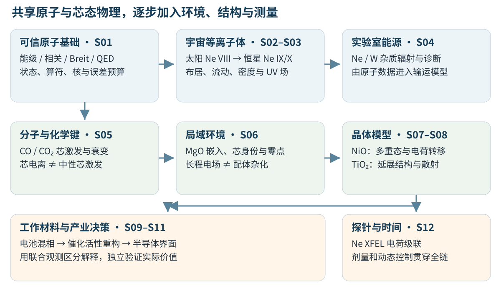
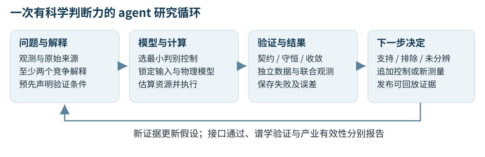

# 从原子能级到产业材料：Atomx 驱动的谱学研究体系

原子、分子、晶体谱学 · QED · XAS · Agentic Science

面向“北京光源与未来产业”主题的科学叙事与案例设计

版本：2026 年 10 月 6 日。案例研究计划与软件能力核查稿。

**项目主张：以可信的原子物理为起点，把电子结构、光谱形成和实验反演连接起来，帮助研究者判断太阳与聚变等离子体的状态、分子中的化学键、晶体中的局域电子结构，以及工作条件下材料如何改变。**Atomx 提供原子结构、相对论修正、跃迁与动力学计算基础；分子和晶体部分通过有边界的接口与成熟电子结构、谱学软件协作。

本文的 12 个完整案例是可执行研究的设计，尚未全部完成。随文已执行的三个小例子仅检验软件接口；它们没有产生经实验认证的 XAS 或完整 QED 结果。此前 Ne 芯激发精密计算作为一项有边界的已有证据保留，不承担整套研究体系的证明责任。

## 1. 宏观问题：从“看见光谱”到“理解物质状态”

我们很少能够直接看见材料中的电子、恒星中的等离子体或聚变装置内部的杂质。光谱把这些不可直接观察的状态转化为可测量的能量、强度、线形和时间变化。困难在于，同一个谱峰变化可能来自温度、密度、电荷态、化学键、芯空穴屏蔽、结构无序或仪器漂移。科学计算的价值在于建立这些原因与观测之间的定量关系，并设计能区分解释的下一步测量。

这构成北京光源与未来产业之间的一条具体连接：光源提供元素、空间和时间分辨的观测；计算提供模型、判据和不确定性；材料研究把结果用于选择电池配方、识别催化活性结构、解释半导体界面缺陷，或提高聚变等离子体诊断的可信度。这些是本项目拟建立的应用路径，尚不等于已经实现产业性能提升。

“北京光源”在本文主要指北京同步辐射装置及高能同步辐射光源 HEPS 所代表的实验基础。HEPS 官方介绍列出 **6 GeV 储存环电子能量、首期 14 条公共光束线**。6 GeV 是电子束能量，不能当作所有实验使用的光子能量。[HEPS 官方装置介绍](https://www.ihep.cas.cn/dkxzz/HEPS/zzjs/)

本体系也包含太阳卫星、天文 X 射线望远镜、聚变诊断和 XFEL 的案例。它们提供不同环境下的科学问题与验证数据；进入 HEPS 的主要是分子、材料吸收及相关散射案例。这样安排的理由是共享原子与芯激发物理，而不是假定每个案例都能在同一束线上完成。

### 1.1 四个递进问题

| 层次 | 必须回答的问题 | 代表案例 | 向下一层提供什么 |
|---|---|---|---|
| 原子与离子 | 能级和跃迁本身是否可信？ | 少电子离子 QED、Ne VIII/IX/X | 状态身份、跃迁能、强度、衰变率 |
| 分子与局域环境 | 化学键与环境如何改变芯激发？ | CO/CO₂、MgO 嵌入 | 芯空穴弛豫、轨道局域性、环境位移 |
| 晶体与材料 | 局域多体作用与延展结构如何共同塑造谱？ | NiO、TiO₂、电池与界面 | 多重态、杂化、散射路径与结构候选 |
| 工作条件与决策 | 测量时物质如何变化，哪些解释可排除？ | 工况电池、动态催化、XFEL | 状态轨迹、联合验证和下一步实验 |



### 1.2 为什么用 Ne 串起宇宙与实验室

Ne 的价值来自多个电荷态具有可辨认的谱线，同一种元素可以连接不同温度与密度环境。Ne VIII 是 Ne⁷⁺、三个电子；Ne IX 是 Ne⁸⁺、两个电子；Ne X 是 Ne⁹⁺、一个电子。谱学罗马数字等于电荷数加一。**中性 Ne、类锂 Ne VIII 和类氢 Ne X 不能用同一套构型或线表混用。**

太阳大气的 Ne VIII 紫外线、热恒星等离子体中的 Ne IX/Ne X X 射线、聚变装置中的 Ne 杂质辐射，都调用原子数据，但等离子体分布与辐射形成机制不同。同样，Ne VIII 的价电子紫外跃迁与它的约 908 eV 芯激发共振属于不同跃迁；元素和电荷态相同并不使两条谱线承担相同诊断任务。

## 2. 谱学地图：先确定测量的是什么

### 2.1 不同光谱对应不同的状态与算符

| 方法 | 物理过程 | 主要观测与用途 | 计算中必须保留的区别 |
|---|---|---|---|
| 发射谱 | 激发态向低态辐射 | 温度、密度、电荷态、流速 | 强度还取决于上态布居及辐射输运 |
| XAS / XANES | 芯电子吸收光子，进入未占据或连续态 | 局域对称性、杂化、价态变化 | 需要跃迁矩阵元与芯空穴，不能仅画态密度 |
| EXAFS | 吸收后的电子被邻近原子散射 | 配位、键长、无序 | 需要散射振幅与相位；傅里叶峰不直接等于键长 |
| XPS / 芯电离 | 移走电子，探测光电子 | 芯能级化学位移、界面与表面 | 最终态电子数为 N−1，能量零点需明确 |
| Auger 谱 | 芯空穴衰变，另一电子逸出 | 双空穴态、电子相关、衰变通道 | 需要双电子振幅与连续态归一化 |
| RIXS | 吸收后再发射，测量能量损失 | 低能激发、多重态、电荷转移 | 需要中间态传播和两个光学顶角 |
| 红外 / Raman | 核振动与光场耦合 | 键振动、相结构、反应中间体 | 需要势能面与核运动，不能由原子能级直接替代 |
| 时间分辨谱 | 激发后状态随时间变化 | 电荷迁移、相变、辐照损伤 | 静态谱与动力学、探针响应共同决定测量 |

XANES 和 EXAFS 是 XAS 的两个互补区域；边前峰有时还包含四极跃迁或因杂化获得强度的偶极通道。材料价态有用，但整数形式价态、轨道占据、电荷划分和谱峰位置是不同量。

### 2.2 从 Hamiltonian 到测量的共同链条

对于吸收，示意性的多体表达为：

```text
I(ω, ε) ∝ Σ_i p_i Σ_f |⟨Ψ_f|D(ε)|Ψ_i⟩|² L(ℏω − E_f + E_i)
测量谱 = 仪器响应 ⊗ 本征谱 + 背景
```

这里的初末态可以包含芯空穴、电子相关和环境屏蔽。L 表示所选线形或谱函数；其归一化、半宽/全宽和能量单位都必须声明。发射谱中的布居、EXAFS 中的散射以及 RIXS 中的中间态，还要分别计算。

因此，各案例都沿着同一条链条建立：**科学问题 → 体系与环境 → 电子结构 → 跃迁或散射 → 布居与动力学 → 仪器响应 → 可检验推断**。只完成电子结构计算，还没有完成观测量预测。

### 2.3 芯激发与芯电离为什么不能混为一谈

气相芯电离的 ΔSCF 比较 N 与 N−1 电子体系的总能量；中性芯激发的初末态都具有 N 个电子，末态同时有芯空穴和激发电子。二者的屏蔽与电子—空穴相互作用不同。固体还需区分相对真空、费米能或价带顶的能量定义，以及带电超胞有限尺寸修正。

轨道能量可以提供线索，但不是一般意义上的精确芯结合能。统一平移能轴能帮助比较形状，不能证明绝对能量准确。后面的 CO、MgO 与 Si/SiO₂ 案例专门检验这些差别。

## 3. 理论层次：QED、相关与材料环境各解决什么

### 3.1 原子精度的物理账本

原子部分以相对论单电子 Dirac 描述和电子间 Coulomb 相互作用为基础，在明确的正能投影、核模型与组态空间下加入 Breit、反冲和 QED 修正。Breit 处理磁相互作用与低频迟滞近似；它不等价于所有频率依赖的量子电动力学交换。QED 的自能、真空极化及屏蔽项也有阶次与模型边界。

对少电子高 Z 离子，较强核电场使相对论与束缚态 QED 更有判别力；有限核尺寸及核不确定性也会变得重要。He-like U 的精密实验是这类研究动机的实证，而本文选择较易建立数值阶梯的 Ne/Ar/Kr/Xe 作拟议算例。[He-like U 极端电场 QED 实验，Nature 2024](https://www.nature.com/articles/s41586-023-06910-y)

Atomx 的模型 QED 算符可以支持多电子计算中的辐射修正研究，但 **“加入模型 QED”与“完成严格多体束缚态 QED”具有不同含义**。模型算符方法本身的原始文献说明了这一定位。[Shabaev 等，模型 Lamb 位移算符](https://arxiv.org/abs/1305.6333)

QED 也存在于轻分子精密能谱中。例如 H₂ 的高精度理论会计算领先阶 QED；这说明 QED 不只属于高 Z 原子。它要求专门的高精度波函数和理论框架，本文的非相对论 PySCF 接口例子没有实现这项能力。[H₂ 领先阶 QED 原始研究](https://arxiv.org/abs/2301.07481)

### 3.2 加入 QED 后是否需要自洽迭代

这应分成四个可分别测量的问题：在固定未修正波函数上取修正期望值；把修正算符加入固定轨道 CI 矩阵并重新对角化；重新优化包含修正的轨道；重新评估屏蔽、核模型或投影的选择。后两步的缺失不能由第一步或第二步自动补齐。

固定轨道下重新对角化可以包含所保留空间中的状态响应，但不会自动补上空间外相关或轨道弛豫。对平稳、非简并状态的微扰，波函数响应对能量常从较高阶进入；近简并、不同轨道优化目标和不平衡截断需要单独检查。是否足以解释某个偏差，必须比较同一跃迁的上下态响应。

研究中采用四条并行证据列：原始能量、各修正算符、CI 状态响应、轨道与空间响应。若某项已纳入对角化，不能再次以“自洽补偿”加到总能量上。**一次迭代是否必要应由误差预算与响应测量决定，不能仅因存在实验差距就归因于未迭代。**

### 3.3 从孤立原子到材料，不止增加原子数量

分子引入成键与核运动；局域簇引入配位、电场和环境；晶体引入能带、长程周期性与延展连续态。金属 L 边还常需要芯空穴—价电子多重态及配体电荷转移，K 边与 EXAFS 则经常需要延展末态及多重散射。不同材料应选不同模型，不能用一个万能近似替代这些问题。

| 计算路线 | 适合回答的问题 | 主要收敛轴 | 典型失效信号 |
|---|---|---|---|
| 原子 DHF / CI / MCDHF | 离子能级、强度、精细结构 | 径向、分波、相关空间、态选择 | 上下态相关不平衡、表示约定错配 |
| 分子 ΔSCF / 芯响应 | 芯化学位移、局域中性激发 | 芯区基组、虚轨道、核几何、响应空间 | 芯空穴塌缩、把电离能当吸收峰 |
| 嵌入簇 | 环境对局域芯态的影响 | 固定量子区下的嵌入收敛、量子区扩展 | 边界伪电荷、不同簇模型假装连续外推 |
| 多重态 / 电荷转移 | 金属 L 边、局域强相关 | 组态、浴轨道、参数与基变换 | 任意峰缩放、重复计入相互作用 |
| 周期 DFT + 芯空穴 / BSE | K 边、延展态、激子效应 | 超胞、k 点、空带、赝势与芯处理 | 周期芯空穴相互作用、pDOS 冒充 XAS |
| 多重散射 + EXAFS 拟合 | 配位、路径、无序、键长 | 簇半径、路径、能区、拟合相关性 | 原始 FT 峰当键长、参数超过独立信息 |

常规材料 XAS 的峰形与化学位移通常首先需要解释环境、屏蔽、相关和结构；QED 的作用要在匹配模型后评估。不能把每个未解释的材料边位移称为 QED 信号。

## 4. 十二个案例及其相互承接

这些案例不是彼此独立的选题清单。S01 建立原子物理基准；S02–S04 把原子数据转为宇宙与聚变诊断；S05–S06 引入化学键和环境；S07–S08 比较局域强相关与延展结构；S09–S11 把这种模型选择用于产业材料；S12 检验测量过程本身是否改变了对象。

| 编号 | 核心体系与谱学 | 科学问题 | 后续连接 |
|---|---|---|---|
| S01 | 少电子 Ne/Ar/Kr/Xe，精密能级 | 什么因素限制基础能量精度？ | 所有原子参数与参考能标 |
| S02 | 太阳 Ne VIII 紫外线 | 蓝移、线强怎样约束质量流动？ | 等离子体布居与视线反演 |
| S03 | 恒星 Ne IX/X X 射线 | 密度、温度、UV 泵浦如何区分？ | 多观测量打破退化 |
| S04 | 聚变 Ne/W 杂质辐射 | 如何识别辐射与杂质状态？ | 诊断到能源应用 |
| S05 | CO/CO₂ C/O 芯谱 | 化学键怎样重排激发与衰变？ | 从原子到成键与局域位点 |
| S06 | MgO 分子与嵌入簇 | 长程环境怎样改变芯能量？ | 局域材料模型的边界 |
| S07 | NiO L₂,₃，晶场与电荷转移 | 原子多重态何时需要配体？ | 强相关晶体与功能材料 |
| S08 | 两种 TiO₂，K 边 / EXAFS | 同类近邻为何产生不同谱形？ | 延展结构与模型选择 |
| S09 | LiFePO₄/FePO₄ 工况谱 | 电极状态是均匀变化还是混相？ | 电池失效与工况设计 |
| S10 | Pd 单原子、簇与载体 | 活性对象是否在反应中重构？ | 催化选择性与原子利用 |
| S11 | Si/SiO₂ 界面芯谱 | 局域键与界面缺陷如何区分？ | 半导体界面表征 |
| S12 | Ne 的 XFEL 电荷动力学 | 探针什么时候改变了被测物？ | 全部案例的剂量与时间控制 |

下列网格、几何和误差阈值均为**起始研究设计**。它们不是已收敛参数、机时承诺或产业工艺建议。实际实验、数据集和后端版本必须在执行前锁定；无法满足验证条件时报告失败或模型边界。

### S01 · 精密少电子离子：先把基础物理账算清楚

**科学动机：**材料与等离子体谱学调用能级、跃迁强度和衰变率。若这些基础量的算符或表示有问题，后续反演会把误差错归给温度或化学环境。用少电子离子分层检验，可以区分电子相关、Breit、QED、有限核尺寸与数值误差。

**体系与起始输入：**Z=10、18、36、54；分别构建一、二、三电子等电子序列，电荷为 Z−N。先做类氢 1s 与 2p 参照，再扩展类氦 1s²/1s2s/1s2p、类锂 1s²2s/1s²2p。核同位素、质量与电荷半径从选定参考记录中读取；较重体系不能用未声明的点核替代实际核模型。

**模型与软件：**Atomx 原子原生后端，明确 DC 基线，再逐项加入静态 Breit、模型 QED 与反冲。严格 QED 文献或独立求解器作为外部参照。轨道优化、CI 空间与目标 J/宇称分别记录，不能只靠组态名标识状态。

**计算步骤：**依次做径向与盒半径控制、分波/相关扩展、算符开关、固定轨道重解与轨道响应。量化每个上下态的能移，再计算跃迁及分裂的变化。高 Z 同时比较核模型和核参数敏感性，不能仅按残差小宣称精密。

**观测量与验证：**能级差、精细结构、振子强度与寿命。类氢点核 DC 能量可作同模型解析控制；真实离子则对照匹配的独立文献。拟议轻离子精密任务先以 1 meV 数值稳定性作为目标，重离子根据实验及核不确定性另建预算；所有目标均需实测证明。模型 QED 与严格 QED 的差别单列。

**Atomx 的位置与故事承接：**这里检验原子基础，不要求宣称所有电荷态已达到统一精度。随附 Ne X 无修正基态例子仅演示 API。基础原子数据随后进入 S02–S04 的谱线形成，而不是直接替代这些环境模型。

### S02 · 太阳大气与太阳风：Ne VIII 的谱线不是单一风速计

**科学动机：**太阳风起源涉及热等离子体沿开放或闭合磁结构的质量输运。Ne VIII 紫外谱线的线心和强度可约束这些过程，但视线叠加、静止参考波长与闭合环中的供质运动都可能影响解释。SOHO 的原始观测计划明确将 Ne VIII 770 Å 多普勒测量用于日冕洞外流研究。[SOHO JOP 101 原始观测计划](https://soho.nascom.nasa.gov/soc/JOPs/jop101.html)

**体系与起始输入：**Ne⁷⁺，1s²2s→1s²2p 的两条共振线；首先选择约 770 Å 分支并锁定参考波长。CHIANTI 的 Ne VIII 条目记录了 770.428 Å 参考及来源。本计划以 log₁₀(T/K)=5.4–6.1、log₁₀(nₑ/cm⁻³)=7–10 作探索网格，另扫描已声明的视线速度与观测几何；这些范围不是所有太阳区域的统一形成条件。[CHIANTI Ne VIII 原始数据说明](https://db.chiantidatabase.org/ne/ne_8.html)

**模型与软件：**Atomx 检验能级、辐射跃迁与态身份；电子碰撞激发及电离/复合数据采用有出处的 CHIANTI 数据或独立计算。外层求解碰撞辐射布居与视线积分。先声明光学薄、Maxwell 电子和电离平衡，再分别检验非平衡与多温度分布。

**计算步骤：**生成原子线表，构建多温度/密度发射系数，合成静止、单流与双流视线的谱。把仪器响应和波长校准误差带入多普勒拟合。单独比较开放流与闭合环供质假设，不用蓝移自动宣布太阳风源。

**观测量与验证：**线心、线宽、强度与空间关联。使用公开观测或预先登记的合成盲测；拟议合成速度恢复误差目标为 5 km/s，并报告波长零点产生的系统误差。若物理模型无法区分两个场景，应报告不可辨识。闭合日冕环中的 Ne VIII 蓝移已有原始研究，构成必要反例。[闭合环质量供给研究](https://arxiv.org/abs/0906.3007)

**Atomx 的位置与故事承接：**提供基础线物理，不负责太阳磁场重建。这个案例说明“原子线 → 布居 → 视线谱 → 物理推断”的完整链条，随后把同一链条应用到更热的恒星环境。

### S03 · 恒星大气与恒星风：Ne IX/X 的多观测量诊断

**科学动机：**热恒星等离子体可以产生 Ne IX 的类氦三线与 Ne X 的类氢线。Ne IX 的禁戒线/互组合线比对密度敏感，也会被 UV 光致激发改变；温度、多温度分布、混线与风中的吸收进一步造成退化。原始类氦诊断研究明确涵盖 Ne IX 和外部辐射场。[Porquet 等，类氦离子诊断](https://arxiv.org/abs/astro-ph/0012218)

**体系与起始输入：**Ne⁸⁺ 的 1s2p ¹P₁、1s2p ³P₁,₂、1s2s ³S₁ 到 1s² 跃迁，以及 Ne⁹⁺ Lyα。以 log₁₀(T/K)=6–7.5、log₁₀(nₑ/cm⁻³)=8–13 的模型网格起步；UV 场用所选恒星大气光谱及几何稀释因子定义。恒星风应用还需速度场、遮挡与吸收模型，不能使用静态日冕公式覆盖所有恒星。

**模型与软件：**Atomx 计算或复核原子辐射量，碰撞与复合级联依赖有出处的数据。外层分别建立碰撞主导日冕模型与光致/风模型。Chandra 对 17 颗 OB 星的原始研究用类氦 f/i 与类氢/类氦线比约束风中 X 射线源的位置和温度，说明这些线需要与恒星环境共同解释。对照数据的对象、仪器与观测编号需在执行前确定。[OB 恒星风原始谱学研究](https://arxiv.org/abs/0707.0024)

**计算步骤：**先比较 R=f/i 与 G=(f+i)/r，再联合 Ne X/Ne IX、线形和其他元素约束。以“高密度弱 UV”与“低密度强 UV”作为竞争解释；扫描的单位及积分区间固定，混线贡献独立计入。

**观测量与验证：**R、G、离子线比和线形。拟议原子/动力学网格加密后诊断线比变化小于 2%；用合成数据检验区间覆盖，并向真实观测报告密度—UV 退化。恢复的温度或密度如果只在预先固定 UV 的条件下成立，应写为条件结论。

**Atomx 的位置与故事承接：**为同一元素的多个电荷态提供一致原子账本；完整恒星风输运是外部模块。由此转入 S04：把远距离观测的等离子体诊断，变成实验室能源系统中的杂质诊断。

### S04 · 核聚变 Ne 与 W：谱学连接辐射冷却和杂质输运

**科学动机：**聚变装置需要识别杂质产生的辐射，并区分边缘有益辐射与核心污染。Ne 注入与 W 杂质行为受装置、输运和电离条件共同影响；Ne 不是在任何装置中都更优的冷却选择。Ne 注入位置、输运及 W 行为已有专门的 SOLPS-ITER 原始研究。[EAST Ne 注入位置研究](https://pst.hfcas.ac.cn/cn/article/doi/10.1088/2058-6272/ac320f)

**体系与起始输入：**Ne 全电荷态的显式线/能级分辨范围，以及针对所选 W 线组的模型。探索域：Tₑ=5–5000 eV、nₑ=10¹²–10¹⁵ cm⁻³；按边缘与核心分区，不把全域当作单一 Maxwell 均匀等离子体。另记录输运驻留时间、电子分布、杂质密度及各率系数的来源。

**模型与软件：**Atomx 可用的原子结构、辐射、光电离/Auger 和动力学模块是基础；电子碰撞、复合、荷交换以及高复杂度 W 数据需要外部原子数据库/代码补齐。外层碰撞辐射模型输出布居与辐射量，输运使用 SOLPS-ITER 或另经验证的模型。

**计算步骤：**先在固定 Tₑ、nₑ 下验证电荷与布居守恒，再比较稳态与有限驻留时间响应。逐项扰动电离、复合与激发数据，计算线组及辐射损耗系数的敏感性。遗漏通道要记录，不能以零值替代并宣称总辐射完整。

**观测量与验证：**电荷态分布、诊断线比、辐射损耗系数 Lz（需声明 W·m³ 等单位）、发射功率与时间响应。拟议归一化守恒误差小于 10⁻⁸，率表加密后相关输出变化小于 5%；先同模型独立回放，再对照所选装置放电数据。这不构成装置热负荷控制或 MHD 稳定性验证。

**Atomx 的位置与故事承接：**连接原子数据与能源诊断。常规杂质播撒和用于破裂缓解的含 Ne 碎裂弹丸是不同任务；后者有 ITER 专门系统，本文不把两者混成同一种控制策略。[ITER 破裂缓解系统](https://www.iter.org/machine/supporting-systems/disruption-mitigation)

### S05 · CO 与 CO₂：从孤立能级走向化学键的芯谱

**科学动机：**同一个 C 或 O 吸收中心处于不同化学键环境时，芯激发能、π*/σ* 特征、偏振响应和衰变末态都会变化。CO/CO₂ 是把“元素识别”提升为“化学环境识别”的小体系起点，也为 CO₂ 转化与吸附中间体研究提供方法基准。

**体系与起始输入：**线性 CO 与 CO₂，分别考察 C 1s 与 O 1s。接口演示固定 CO 键长 1.128 Å、RHF/cc-pVDZ；研究计算应使用注明来源或重新优化的几何，并对键长 ±0.02 Å 做敏感性控制。基组阶梯从含芯区灵活性的双ζ到三ζ/四ζ，并检查弥散函数及芯轨道局域选择。

**模型与软件：**Atomx 已有 PySCF RHF/ROHF 数据适配、芯空穴 ΔSCF 入口和有近似边界的分子 Auger 接口。中性芯激发 XAS 采用外部明确选择芯空间的响应方法，例如 CP2K 芯 TDDFT 或独立 CVS-EOM-CC；Atomx 的耦合簇入口不能作为已实现 CVS 求解器。CP2K 官方教程给出芯 TDDFT 路线。[CP2K X 射线吸收 TDDFT 教程](https://manual.cp2k.org/trunk/methods/properties/x-ray/tddft.html)

**计算步骤：**先记录 AO/MO 度量和电子数，再分别建立 N−1 芯电离与 N 电子中性芯激发。按吸收原子追踪芯轨道；计算跃迁偶极及平行/垂直偏振。需要解释高分辨细结构时增加核振动与 Franck–Condon 处理，这一步是外部核运动计算。

**观测量与验证：**相对芯化学位移、吸收峰间距、偏振强度比和 Auger 动能。拟议基组加密后主要峰位变化小于 0.1 eV、相对强度变化小于 5%；绝对能量单独预算。离散 MO 连续态的 Auger 强度不能宣称为经能量归一化的物理宽度，也不能据其倒数给出真实寿命。

**Atomx 的位置与故事承接：**它把原子芯物理与分子电子结构契约连接起来。S06 再把分子的局域化学环境扩展为固体的长程静电与嵌入环境。

### S06 · MgO：局域芯态如何感受远处的晶体环境

**科学动机：**仅靠孤立原子或小分子，不能代表离子晶体中的长程电场和屏蔽。MgO 是较清楚的离子性基准，适合检验环境作用、芯身份与能量零点，然后再进入更复杂的过渡金属材料。

**体系与起始输入：**孤立 Mg、MgO 分子和 Mg 中心的岩盐型点电荷嵌入。演示参数为最近邻距离 2.106 Å、形式点电荷 Mg=+2e/O=−2e、qm0/mm1 与 Evjen 边界。STO-3G 仅用于接口检查；物理芯能量任务另使用芯区合适的基组。

**模型与软件：**Atomx 的 `rocksalt_embedding`、`build_embedded_scf`、`core_orbital_identity` 和 `embedded_core_hole_delta_scf` 是实际实现。当前所读嵌入 SCF 入口使用 RHF；不能据一般 PySCF 能力宣称它已经接受任意自旋及周期模型。形式点电荷是模型参数，不是从电子密度测量得到的原子电荷。

**计算步骤：**固定量子区和电荷态，独立扩大 mm 壳层，之后再设计量子区扩大控制。先核对 Mg 1s AO 投影身份，再以相同环境比较芯电离 ΔSCF。已有 qm0 与 qm1 构造拥有不同组成和电荷模型，不能把两个点拟合为同一体系的收敛外推。

**观测量与验证：**Mg 芯轨道身份、ΔSCF 位移、环境敏感性。拟议固定量子区的 mm 加密后芯电离位移变化小于 0.1 eV；芯身份需满足现有接口的主导性与歧义拒绝条件。当前演示只得到 MO 芯轨道量，未计算 ΔSCF 或 MgO 周期 XAS。

**Atomx 的位置与故事承接：**建立原子—分子—嵌入之间的可追踪桥梁。它对 S07 的局域多重态、S11 的界面芯位移都有直接方法价值；但长程静电不能替代配体杂化或周期能带。

### S07 · NiO：晶场之外还需要电荷转移

**科学动机：**NiO 的金属 L 边直接触及局域 3d 强相关。它适合展示原子多重态为何有用，以及为什么单纯改变一个晶场参数仍可能漏掉配体共价性。这里比较三层模型，不预先宣布最复杂模型必然最准确。

**体系与起始输入：**八面体 NiO₆ 局域环境；原子 d⁸、晶场 d⁸、配体电荷转移 d⁸/d⁹L̲/d¹⁰L̲²。外部复现起点采用 edrixs 官方 NiO Anderson 模型：Udd=7.3 eV、Udp=8.5 eV、Δ=4.7 eV；保留其完整参数出处和约定。教程中的经验屏蔽与能轴调整必须标为模型/拟合选择。[edrixs 官方 NiO 案例](https://nsls-ii.github.io/edrixs/auto_examples/example_3_AIM_XAS.html)

**模型与软件：**Atomx 提供原子径向、角动量、多重态与已实现的晶场张量算符基础；完整配体浴与电荷转移 XAS 由 edrixs 或 Quanty 计算。接入需要明确 Slater 积分、SOC、基序和局域坐标，当前未宣称这些外部适配器全部完成。

**计算步骤：**在匹配的原子参数下先对照孤立多重态，然后加晶场，再逐步开启配体杂化。扫描杂化倍率 0、0.5、1 可用于识别强度重分布的原因，不能当作三个独立真实材料。分别核对初态与带芯空穴中间态，以及复球谐/实球谐基变换。

**观测量与验证：**L₂,₃ 峰间距、卫星与主峰积分权重、偏振差和占据响应。拟议同模型跨软件峰位差小于 0.05 eV、归一化积分强度差小于 2%，先完成算符与基变换控制，再与实验比较。绝对能轴平移与逐峰缩放不可用于消除内部模型偏差。

**Atomx 的位置与故事承接：**Atomx 晶场输入的命名 B 使用文档所定义的径向因子未包含约定，单位为 cm⁻¹，并在算符中加入径向矩；不能直接当成 Stevens 参数或常见含径向矩的 Wybourne B。这个表示核对是材料软件桥接的关键。S08 随后转向局域配位相近、却因延展结构而产生谱差的材料。

### S08 · 锐钛矿与金红石 TiO₂：局域多重态并非唯一材料路线

**科学动机：**两种 TiO₂ 多晶型都包含 Ti—O 配位，却拥有不同连接结构。比较它们能够检验哪些谱特征由近邻局域环境解释，哪些需要更远邻、周期性和芯激子/散射处理。这也连接光催化与功能氧化物的结构选择。

**体系与起始输入：**锐钛矿、金红石的有来源 CIF 结构，以及可控的 TiO₆ 局域簇。研究 Ti K 边和 EXAFS，必要时辅以 O K 边。结构文件需记录来源、晶胞设置、原子位置及是否经过弛豫；本文没有生成或声称验证了这些 CIF。

**模型与软件：**周期 Quantum ESPRESSO + XSpectra 是 K 边路线之一；EXAFS 使用包含适当散射功能的 FEFF 系列及 Larch 分析。Atomx 提供原子芯参照和局域算符，不能用其非共振原子 Rayleigh/Compton 接口冒充晶体 XAS。[QEF 官方 XSpectra 输入说明](https://github.com/QEF/q-e/blob/develop/XSpectra/Doc/INPUT_XSPECTRA)

**计算步骤：**先固定交换相关、赝势和核处理，比较无芯空穴与显式芯空穴模型，再独立扩大超胞、k 点、能量截断和空带/响应空间。起步可用原胞与 2×2×2 超胞比较，但通过依据是谱收敛而非超胞名字。对边前峰检查偶极、四极与对称性破缺通道。

**观测量与验证：**边前峰、近边峰形、相对强度、χ(k) 与散射路径。拟议 XANES 数值加密后主要特征变化小于 0.1 eV、面积归一化谱形变化小于 5%；EXAFS 按实验可用 k/R 区间比较，并带散射相位解释键长。Larch 官方接口说明如何组织 FEFF 路径和拟合参数。[Larch 路径拟合文档](https://xraypy.github.io/xraylarch/xafs_feffit.html)

**Atomx 的位置与故事承接：**该案例规定软件应按可观测量选型。S07 强调局域多体与配体，S08 强调延展末态及散射，两者共同构成 S09–S11 的材料模型选择依据。

### S09 · 工况 LiFePO₄：谱边变化如何连接电池状态

**科学动机：**充放电改变 Fe 电子结构和晶体相，但平均光谱可能混合不同颗粒、相和时间状态。需要区分“两端元相混合”与“均匀连续中间状态”，才可能解释电极异质性与失效过程。SOLEIL 的原始研究说明 XAS 与 XRD 联合工况观测的价值。[SOLEIL 电池工况研究](https://www.synchrotron-soleil.fr/en/news/lithium-batteries)

**体系与起始输入：**LiFePO₄ 与 FePO₄ 端元，明确 Fe²⁺/Fe³⁺ 是形式价态标记。选取一个电极/电池的有时间戳充放电数据集，再定义中间状态和测量位置。模型候选包含端元线性混合及经独立结构约束的中间构型；不凭插值自动生成真实稳定相。

**模型与软件：**Atomx 提供 Fe 原子芯/局域多重态基础；周期结构、芯空穴 K 边与 O K 边需外部后端。Fe K 边与 XRD 用于结构—价态联合检验，必要时用 EXAFS 约束局域键长。金属箔校准、测量模式与样品自吸收独立登记。

**计算步骤：**锁定端元模型、线形与能标后预测中间谱；共同拟合 XAS、XRD 和电化学时间轴，比较混相与均匀变化假设。数据按整颗电池、颗粒或连续时间块划分训练与盲测，避免相邻扫描泄漏。通过重复点、低剂量对照或束流开关检验束流效应。

**观测量与验证：**边位移、峰形、端元权重、相分数及其时间一致性。拟议盲测先以混合分数绝对误差不超过 0.1 为研究目标，并检验预测区间与独立 XRD 是否相容；该阈值不是电池行业标准。没有谱数据与计数误差时，不能凭边位移给出唯一 SOC 或容量衰减因果。

**Atomx 的位置与故事承接：**它为芯物理和局域解释提供基础，材料与电池多尺度模型由外部计算协作。该案例把“谱拟合好看”提升为“能够区分工作状态”，然后 S10 进一步检验工作中的活性结构是否就是制备时的结构。

### S10 · Pd 单原子与小簇：催化活性物种会改变

**科学动机：**提高原子利用率并不自动提高反应活性；制备时的单原子可能在反应中聚集。Diamond 的原始研究案例通过 XAS、XPS 和 AC-STEM 检查碳氮载体上的 Pd 重构，为“单原子还是小簇”提供了可检验竞争解释。[Diamond 动态 Pd 催化研究](https://www.diamond.ac.uk/Science/Research/Highlights/2024/Exploring-the-Dynamics-of-Catalysis.html)

**体系与起始输入：**载体上的孤立 Pd 位点、Pd₂/小簇以及较大纳米颗粒参照。几何来自对应论文补充信息或明确的 DFT 构型优化；要记录载体缺陷、吸附物、总电荷和自旋。所比较的是明确结构候选，不是仅以“单原子”名称定义的唯一体系。

**模型与软件：**嵌入/周期 DFT 提供候选结构，Pd K 边 XANES 和 EXAFS 用外部谱学后端；必要时补充 XPS。Atomx 为 Pd 原子相对论芯参照、跃迁与局域解释提供基础，不能把现有 MgO 点电荷构造直接当成碳氮共价载体模型。

**计算步骤：**比较孤立位点和含 Pd—Pd 路径候选，生成可区分的联合谱特征，再对照反应时间和催化活性。实验型拓展应设计反应前、工况与恢复后的测量，并配置空载体和粒子参考；本文不提供装置操作条件或声称完成了催化实验。

**观测量与验证：**Pd—Pd/配体路径、边特征、芯位移与反应性能的时间对应。验证需要跨样本留出，并由显微或独立测量交叉检验；XAS 的平均结构及相近散射体的不可辨识性须保留。拟议候选筛选以排除与独立证据冲突的结构为主要成果，无法唯一识别时保留多个解释。

**Atomx 的位置与故事承接：**这里共享 S05 的成键、S06 的环境和 S08 的散射思想。它把材料设计问题从静态结构优劣，推进为活性结构的形成与稳定性；S11 再将同样的局域芯解释用于制造界面。

### S11 · Si/SiO₂：半导体界面需要能量零点与缺陷身份

**科学动机：**界面中的局域键、亚氧化结构和缺陷影响电子行为。同步辐射芯谱能提供化学环境信息，但充电、终态屏蔽和深度权重也会移动或改变谱。Si/SiO₂ 原始研究通过高分辨芯谱解析界面结构与氧化状态，是建立芯谱—界面模型连接的经典基准。[Himpsel 等，SiO₂/Si 界面芯谱](https://journals.aps.org/prb/abstract/10.1103/PhysRevB.38.6084)

**体系与起始输入：**晶体 Si、SiO₂ 参考及一个有明确晶向和终止的 Si/SiO₂ slab。分别引入来源明确的氧缺失或氢钝化候选；非晶氧化层需多个独立结构样本，单个理想晶胞不能代表工艺无序。结构、缺陷电荷和表面处理全部记录。

**模型与软件：**外部周期/簇后端计算 Si 2p 芯电离化学位移与 Si/O 相关吸收。Atomx 提供 Si 原子参照、芯态与相对论基础；当前没有已实现的通用 Si/SiO₂ 周期适配器。slab 的真空厚度、偶极修正与带电终态处理属于显式计算条件。

**计算步骤：**用共同能量参照比较独立原子、有限簇和 slab；追踪相同吸收/电离位点，独立收敛厚度、真空、k 点与局域弛豫。XPS 的逃逸深度、实验充电与能量校准作为测量模型，不能由逐样本任意能轴平移吸收掉。

**观测量与验证：**相对 Si 2p 位移、组分强度、深度敏感性以及吸收形状。拟议数值加密后相对芯位移变化小于 0.1 eV；使用独立参考和不同探测深度检验候选。观察到化学位移并不等于测得界面陷阱密度或器件寿命，还需要电学证据。

**Atomx 的位置与故事承接：**把原子芯物理用于制造过程的可追踪表征。界面案例尤其强调量子态、能量零点与仪器模型一起传递，这也是 S12 判断探针扰动所必需的条件。

### S12 · Ne 的 XFEL 动力学：测量过程中样品本身会变化

**科学动机：**强 X 射线脉冲可以在单个脉冲内改变电荷态与芯占据，使静态截面无法描述实际观测。Ne 是清楚的原子基准。LCLS 原始实验观察了超强 X 射线下 Ne 的连续电离及空心原子效应，为强场模型提供真实验证对象。[Young 等，Ne 飞秒 X 射线响应](https://www.nature.com/articles/nature09177)

**体系与起始输入：**中性 Ne 起始，显式保留后续电荷及芯空穴构型。拟议探索光子能量 800–2000 eV、脉冲 FWHM 5–100 fs、fluence 10¹⁰–10¹³ photons/μm²；分别声明面积、脉冲形状和归一化。该网格用于模型探索，并非复现原论文全部脉冲参数。

**模型与软件：**Atomx 现有光电离、Auger、率方程、蒙特卡洛级联及部分相干动力学模块。初始采用非相干单光子率模型，再按强度和失谐检查是否需要相干或多光子扩展。连续态采用何种冻结离子近似、交换及耦合通道覆盖必须明确。

**计算步骤：**生成同模型电荷态率表，先验证低 fluence 极限，再逐步增加剂量。比较固定 fluence 不同脉宽，求解末态电荷和时间占据，并积分焦斑分布；独立控制步长、构型空间和通道覆盖。相干密度矩阵任务另检查迹、正性及模型近似。

**观测量与验证：**电荷产额、电子动能、吸收变化和脉宽敏感性。拟议布居归一化误差小于 10⁻⁸、时间与空间加密后主要产额变化小于 2%；与论文或公开数据比较时带入真实焦斑和仪器模型，不能仅用名义峰值强度解释差别。

**Atomx 的位置与故事承接：**该案例展示 Atomx 原子动力学基础，并给所有材料案例加上一项共同控制：探针剂量和时间。由此可以提出材料辐照损伤的拓展，但固体载流子、热、核运动与化学损伤仍需外部模型，不能从 Ne 级联直接推出材料损伤阈值。

## 5. Atomx 作为计算基础：已有能力、接口和边界

### 5.1 为什么把 Atomx 放在底层

这些研究共享的底层并不是某一条实验谱线，而是状态、算符、单位、归一化、参考能和来源的传递。Atomx 的价值在于把原子计算的物理定义组织成可检查的软件对象，再让不同案例调用同一套基础。它可以成为研究工作流的原子物理核心，同时与专门处理分子、周期结构和散射的软件协作。

源代码核查以本工作区实际文件为依据。源码存在未提交的既有修改，附件记录了所审入口的 SHA-256；这些入口哈希不是全依赖源码快照。涉及生产科学结果时仍需完整源/输入封存。现有能力可进一步查阅项目[能力指南](../ARCHITECTURE_CAPABILITIES.md)与[晶场规范](../CRYSTAL_FIELD_SPEC.md)。

| 组成 | 当前可使用的基础 | 需要保留的边界 |
|---|---|---|
| 原子结构 | `Atom` 输入，DHF、B-spline/CI/MCDHF 等实际路径 | 具体态、后端与模型是否收敛需要逐任务验证 |
| 修正账本 | Breit、模型 QED、反冲与修正阶段身份 | 不能等同严格全阶 QED，不能重复加项 |
| 原子谱与连续态 | 辐射量、光电离、Auger、受支持的响应路径 | 冻结离子直接 Hartree Dirac DW 等近似不自动含全部交换/Fano 耦合 |
| 动力学 | 率表、布居、级联与有边界的相干路径 | 不是完整太阳风、聚变输运或固体核动力学 |
| 分子 provider | PySCF RHF/ROHF、AO/MO/S/密度、芯 ΔSCF | UHF 不受当前适配器接受；分子标签不是径向 Dirac 轨道 |
| 分子 Auger | 芯空穴、局域价空间、双空穴与离散谱接口 | 默认末态及离散 MO 连续态有近似，真实宽度需物理连续态 |
| 局域嵌入 | 岩盐点电荷、RHF、Mg 芯身份与 ΔSCF 路径 | 不是任意共价载体或完整周期 XAS |
| 晶场 | 角张量、m 分辨与所支持耦合 | 参数约定必须匹配；配体浴、电荷转移及外部桥接需另建 |
| 原子散射 | 受支持的非共振形状因子、Rayleigh/Compton | `scattering/xray.py` 的名称不表示完整材料 XAS/EXAFS |
| 外部协作 | Native/PySCF 的实际 provider 契约 | ABACUS、DeePTB 等提案不作为已实现适配器；耦合簇脚手架不作为可用求解器 |

### 5.2 统一输入契约

以下 JSON 表示拟议研究任务记录，**不是当前 `Atom` 构造器能够直接读取的万能配置文件**。案例登记表给出任务设计；实际原子与外部后端命令仍须由各适配层明确生成并核查。

```json
{
  "case_id": "S05",
  "system": {"kind": "molecule", "formula": "CO", "charge": 0, "spin_2S": 0},
  "observable": {"kind": "core_absorption", "absorber": "C", "shell": "1s"},
  "electronic_structure": {"backend": "external_core_response", "version": null},
  "physics": {"core_hole": "explicit", "qed": "not_in_this_setup"},
  "identity": {"geometry_sha256": null, "source_snapshot_sha256": null},
  "units": {"geometry": "angstrom", "spectrum_energy": "eV"},
  "energy_reference": "neutral_N_electron_excitation",
  "status": "planned_not_executed"
}
```

空值表示执行前必须补齐，不能自动猜测。实际 provider 中，分子 Z 字段可能表示总核电荷，而不是吸收原子的 Z；对 CO 不能把这个值当作 C=6 或 O=8 直接送入原子径向公式。AO 非正交度量与 MO 正交变换也必须保留，不能只传轨道能量数组。

### 5.3 三个已执行的软件起点

本次使用现有 `.venv`、单 BLAS 线程执行 `run_foundation_examples.py`。无新增物理求解器，也未修改既有科学封存数据。所有阈值在运行前写入 `foundation_results/contract.json`。

| 起点 | 固定设置 | 本次输出与检查 | 可以支持的结论 |
|---|---|---|---|
| Ne X 基态 | Z=10，q=9，1s¹，shooting，无修正 | 总能量 −50.066719603 Ha，入口运行完成 | 显式离子与无修正基态 API 可运行 |
| CO provider | RHF/cc-pVDZ，1.128 Å，14 电子 | SCF 收敛；电子数 14；MO 度量残差 9.24×10⁻¹⁵ | 数据接入与度量/电子数契约通过 |
| MgO 嵌入 | qm0/mm1/Evjen，STO-3G，26 个 MM 电荷 | SCF 收敛；Mg 1s 主导性 0.99368，次候选 0.00573 | 此模型中的芯身份可追踪 |

Ne X 例子没有输出跃迁或 QED；CO 例子没有芯空穴或 XAS；MgO 例子的 MO 能量不是 ΔSCF 电离能。实际耗时未做受控性能实验，不用来宣称加速比。

可回放命令，在 Atomx 仓库根目录运行：

```bash
.venv/bin/python docs/spectroscopy_science_story_2026_10_06/run_foundation_examples.py
```

完整脚本及其 JSON 输出随附件提供。若缺少 Atomx 或 PySCF，则先在对应版本的独立环境安装并核查依赖；不通过更换 Hamiltonian 或放松阈值让例子通过。

## 6. Agentic Science：让 agent 的下一步有科学理由

### 6.1 研究循环的实际任务

本项目的 agent 工作流围绕“哪个计算能区分两个解释”来组织。研究者给出问题及允许使用的数据/算力；agent 检索原始资料，建立模型与候选解释，估算计算规模，运行最小有判别力的控制，检查结果，再决定扩展模型或建议下一次测量。



| 环节 | agent 应交付的对象 | 必须由结果决定的下一步 |
|---|---|---|
| 文献与数据定位 | 原始来源、可用数据、版本与不确定性 | 排除不匹配的实验、参考与 Hamiltonian |
| 建模与预注册 | 输入、近似、竞争解释、资源上限、验收规则 | 决定最小控制与扩大模型的条件 |
| 计算调度 | 明确后端的命令、输入与完整运行记录 | 成功、失败或停止低信息量扫描 |
| 物理验证 | 状态、度量、守恒、收敛、独立比较 | 区分数值失败与模型失败 |
| 结果解释 | 观测、推断、未解决项分别报告 | 保留多个解释或设计追加测量 |
| 证据发布 | 可回放输入、原始输出、来源和报告 | 新数据到来后可修订结论 |

工具权限、批量计算或多个角色名称本身不证明科学自主性。提交材料应展示一次完整的决策：为什么选择这个控制，结果排除了什么解释，失败后为什么修改下一步；不是只展示 agent 生成了多少文本和命令。

### 6.2 三个可用于演示的决策分支

**Ne 诊断：**若 Ne IX 的 f/i 随密度变化和随 UV 变化都能解释数据，agent 不输出唯一密度。它应增加 UV 场约束、其他三线或时空信息，并比较预期信息增益。原子线比收敛未过时，先修正线物理与布居数据。

**NiO 模型选择：**若孤立原子和晶场模型都无法解释卫星权重，而杂化模型在固定能标与展宽下改善联合特征，就检验配体空间与参数来源。若只有允许逐峰缩放才改善，不把它判为物理成功。

**电池状态：**若 XAS 平均谱可以被端元混合解释，但 XRD 相分数不一致，就依次检查时间对齐、束流损伤、空间取样和候选结构。agent 应把冲突保存为证据，不能删除不一致的扫描使结论显得更清楚。

### 6.3 为未来执行制定的评价指标

拟议评价包含四部分：科学有效性、决策质量、可回放性和成本。科学有效性看匹配模型的独立误差与校准区间；决策质量看是否用更少计算区分预设解释；可回放性看 source/input 哈希及第三方重跑；成本看完整流程的实际资源，不只报某个小核的时间。

对照组至少包括固定网格扫描、专家制定的固定工作流，以及允许自适应下一步的 agent 流程。三组使用同一物理任务、信息来源与总资源预算，运行前固定评价规则，失败计算也计入成本。这是拟议试验设计，本文未完成这些对照实验。

## 7. 北京光源中的实验落点与跨设施连接

依据 HEPS 已公开的 2024 年设施报告，首期设置硬 X 射线吸收、高分辨谱学、软 X 射线电子结构及通用环境谱学等线站。下表使用该报告中的**公布范围作初筛**；不是 2026 年实时用户运行、探测模式或可申请机时的保证。正式实验需与线站确认能量、分辨率、样品条件、偏振、工况池和剂量。[HEPS 2024 设施年度报告](https://www.ihep.cas.cn/dkxzz/HEPS/ggjz/2023/202301/P020250510851107643516.pdf)

| 场景 | 物理落点 | 设施连接与初筛 |
|---|---|---|
| Fe/Ti/Pd K 边与 EXAFS | 硬 X 射线元素局域结构 | HEPS 吸收线站公布 4.8–45 keV；须按实际边与探测模式确认 |
| C/O K 边、Ni L 边 | 软 X 射线成键与多重态 | 电子结构线站公布 0.1–2 keV；表面、真空及工况兼容性需另核 |
| Si 界面与芯位移 | 软 X 射线吸收及光电子 | 选择合适光子能、逃逸深度与带电样品处理 |
| 低能激发、RIXS/XRS | 能量损失与联合谱学 | 高分辨谱学线站公布 7–25 keV 入射范围；能损谱不等于直接软 XAS |
| 电池与催化工况 | 时间、空间与环境分辨 | 联合吸收/衍射/成像，确认实际同步与采样能力 |
| Ne VIII 紫外太阳谱 | 约 77 nm 天文观测 | 对接太阳观测；不是 HEPS 硬 XAS 的直接实验 |
| Ne IX/X 恒星与聚变谱 | 热等离子体发射 | 对接天文或聚变数据；实验室原子基准可跨设施验证 |
| 强场 Ne 电荷动力学 | 飞秒高 fluence 原子响应 | 对接 XFEL；不能把同步辐射谱测量自动视为同一强场条件 |

材料实际方案至少包含：标准样品/参考能标、入射与探测模式、样品厚度与自吸收、气氛/温度/电化学条件、时间戳、剂量、重复测量，以及与理论同样重要的误差来源。计算推荐的“下一次测量”只有在这些条件可实现时才有实际意义。

## 8. 从案例到未来产业：应交付怎样的可验证价值

| 应用方向 | 科学问题与案例 | 本体系拟交付 | 产业价值最终如何验证 |
|---|---|---|---|
| 聚变能源 | Ne/W 杂质辐射，S04 | 有误差范围的线表、辐射量与诊断条件 | 独立放电数据、输运预测与装置评价 |
| 新型储能 | 相分数与电极异质性，S09 | 联合 XAS/XRD 状态解释和失败证据 | 对配方/循环条件的盲测及性能实验 |
| 绿色化学与催化 | 成键和动态活性结构，S05/S10 | 活性候选、工况谱预测、判别测量 | 实测活性、选择性与稳定性的可重复关联 |
| 半导体与先进制造 | 局域键和界面状态，S11 | 位点芯位移、结构候选、联合表征方案 | 电学/可靠性测试与批次验证 |
| 功能氧化物 | 强相关与多晶型，S07/S08 | 局域/延展模型选择、谱学指纹 | 独立结构与功能测量验证 |
| 空间科学与精密仪器 | 基础谱线、热环境，S01–S03 | 可溯源参考数据和条件反演 | 独立原子实验/天文数据及仪器校准 |
| 光源科研服务 | 探针扰动及多后端工作流，S12 | 可回放计算、剂量控制与自动报告 | 跨用户重放、机时决策与资源实测 |

项目首先建立科研软件与方法资产，再通过特定材料和实验合作形成产业证据。当前没有据此报告合作企业、商业收入、器件寿命提升或装置运行收益。

## 9. 验证架构与误差预算

### 9.1 五道必须分开的关

1. **契约正确：**电子数、电荷、状态、核模型、算符、能量零点、度量、单位和归一化匹配。
2. **数值正确：**SCF/本征残差、矩阵对称性、守恒、稳定性，以及步长/网格收敛通过。
3. **模型收敛：**径向、相关、芯区基组、嵌入、超胞、响应与连续通道分别受控。
4. **独立物理验证：**解析极限、匹配 Hamiltonian 的独立代码、参考实验或真实数据支持。
5. **应用有效：**盲测、联合观测与实际性能建立所需关联，并保留不可辨识部分。

通过第二关不会自动通过第三到第五关。接口测试、历史回放、独立代码比较和实验验证分别报告，不能合并成一个“准确率”。

### 9.2 谱学误差要按观测量分解

| 误差类别 | 影响例子 | 有判别力的控制 |
|---|---|---|
| 参考与身份 | 电荷态错配、峰混线、能量零点 | 固定态身份、来源、线组与校准 |
| 电子结构截断 | 相关尾部、芯区基组、空带 | 匹配上下态/初末态的系统扩展 |
| 算符与表示 | Breit 相位、晶场基序、偶极通道 | 独立矩阵元和基变换控制 |
| 末态与环境 | 芯屏蔽、簇边界、周期芯空穴 | 固定模型下扩空间，再独立更换物理模型 |
| 布居与动力学 | 电离平衡假设、级联、UV 泵浦 | 率表/时间步控制与竞争模型 |
| 仪器与样品 | 自吸收、能漂、束流损伤、背景 | 标准参照、剂量对照、联合测量 |
| 推断退化 | 价态/配位、密度/UV、混相/均匀 | 盲测、独立观测和追加测量 |

误差项可能相关，不能无条件把各模型差值平方相加。不同核模型、不同轨道优化或不同实验估计量的比较先作为敏感性，匹配后才建立可解释的误差预算。

### 9.3 共振极点的特别要求

离散实基组中的芯激发态、复尺度中的稳定本征值和物理自电离极点不是同一认证层次。拟议认证同时控制核与 Hamiltonian 一致性、束缚参考、连续谱旋转、角度/径向/相关稳定性、目标态身份以及宽度与通道覆盖。θ 轨迹平坦只是必要线索之一。

此前 Ne q/r 工作已包含完整有限窗口相关尾部、Breit 表示与复尺度控制；相关结论只对其封存源、输入及模型成立。完整相关和物理极点尚未认证，不能拿某个接近实验的有限结果替代全空间结论。详细证据保留在[独立诊断档案](../xfel_tail_breit_pole_2026_10_06/README.md)。本体系将它用于展示 agent 如何在失败控制后收窄主张，而不把它作为所有原子、分子和材料计算的统一误差预算。

## 10. 建设路线与比赛演示方式

### 10.1 建议的递进交付

| 阶段 | 建设重点 | 交付与进入下一阶段的条件 |
|---|---|---|
| A · 基础可回放 | S01 的基础控制，S05/S06 接口 | 状态与单位契约、完整来源、可运行脚本；接口通过后再做物理谱 |
| B · 两条科学闭环 | Ne 诊断 S02/S03；NiO/TiO₂ 模型选择 S07/S08 | 各完成一个独立对照与一次有理由的 agent 下一步决策 |
| C · 一个产业案例 | 在 S09、S10、S11 中选择有真实数据的一项 | 数据来源、模型与盲测锁定，联合观测支持结论 |
| D · 动态与扩展 | S04/S12，工况及剂量 | 完整率/通道覆盖边界、守恒与实验模型受控 |

时间与算力先通过小规模 pilot 实测，再约定任务预算。CPU 小例子、相关 CI、周期超胞和多重态浴空间的成本不同，不能凭接口例子秒级耗时承诺整套案例的机时。

### 10.2 一次演示应讲出的故事

开场提出“同一种谱峰变化是否代表同一种物理变化”。第一幕用 Ne 展示谱线能诊断宇宙和聚变，但必须补齐布居与环境；第二幕用 CO→MgO→NiO/TiO₂ 展示从化学键、静电环境到局域多体与延展结构的模型递进；第三幕选电池、催化或半导体的真实数据，让 agent 在竞争解释之间选择下一步控制；结尾用 Ne 强场响应说明探针本身也必须进入模型。

现场演示应包含输入、模型、原始输出、失败条件与最终证据，而不是把 12 个未运行案例做成模拟成功仪表盘。能够报告“本数据还不能区分两个解释”，并给出可行的追加控制，是研究质量的一部分。

### 10.3 面向 Agentic Science 平台的材料边界

本文按照用户给定的“北京光源与未来产业”主题组织，可作为研究项目基础文档、技术说明和答辩故事线。访问 [The Playground 官方入口](https://play.bohrium.com/) 可以确认平台入口，但本次读取的页面未提供可核查的完整当期评分规则、提交格式和截止时间，因此未把本结构称为官方强制模板，也未执行报名或提交。

若当期赛题要求固定数据集、运行镜像、工具接口或演示时长，应将本体系的一个完整闭环绑定到对应要求，再生成提交版。案例范围可以广，实际比赛核心应以能够回放和独立验证的完成项为依据。

## 11. 当前完成内容与后续边界

本次完成了宏观研究框架、12 个案例的动机与 setup、Atomx 源码能力核对、三个小规模接口运行，以及机器可读登记表和文档交付。它们构成后续工作的起点，不构成 12 项科学问题全部解决。

后续必须分别补齐：实际结构/光谱数据的授权与来源；完整原子和材料计算的收敛；周期 XAS、配体电荷转移及其他外部工具的具体适配；各场景的独立验证；agent 与固定工作流的公平对照；真实产业性能的实验关联。现有 API、外部工具能力与拟议桥接在本文和登记表中分开记录。

本题的连贯主线是：**先证明原子与芯态的物理定义可信，再证明环境怎样改变它们，最后证明这些变化能支持一个可检验的科学或材料决策。**Atomx 为这条链条提供共同基础，光源、电子结构软件、动力学和实验数据共同完成每个应用场景。

## 12. 原始来源与软件入口

以下来源核查于 2026-10-06。研究计划中的原创 setup、拟议阈值及软件协作设计由本文给出；链接提供科学动机、方法契约或既有实验，不表示本文已经复现所有来源。具体数据库/后端版本在执行时仍需冻结。

| 来源 | 本文所用内容 |
|---|---|
| [HEPS 官方装置介绍](https://www.ihep.cas.cn/dkxzz/HEPS/zzjs/) | 储存环电子能量与首期线站数量 |
| [HEPS 2024 设施年度报告](https://www.ihep.cas.cn/dkxzz/HEPS/ggjz/2023/202301/P020250510851107643516.pdf) | 公布线站能量范围，用于可行性初筛 |
| [SOHO JOP 101](https://soho.nascom.nasa.gov/soc/JOPs/jop101.html) | Ne VIII 多普勒外流观测动机 |
| [CHIANTI Ne VIII](https://db.chiantidatabase.org/ne/ne_8.html) | 电荷态、参考波长、原子数据来源与约定 |
| [Ne VIII 闭合环质量供给](https://arxiv.org/abs/0906.3007) | 蓝移不唯一指向开放太阳风的反例 |
| [类氦离子诊断](https://arxiv.org/abs/astro-ph/0012218) | Ne IX 线比与外部辐射场影响 |
| [OB 恒星风原始研究](https://arxiv.org/abs/0707.0024) | 风中 X 射线源、线比、温度与线形的联合解释 |
| [He-like U QED 实验](https://www.nature.com/articles/s41586-023-06910-y) | 高电场少电子精密谱学动机 |
| [模型 QED 算符](https://arxiv.org/abs/1305.6333) | 模型算符理论层次 |
| [H₂ 领先阶 QED](https://arxiv.org/abs/2301.07481) | 轻分子精密理论中的 QED |
| [EAST Ne 注入位置研究](https://pst.hfcas.ac.cn/cn/article/doi/10.1088/2058-6272/ac320f) | 杂质输运与装置条件的作用 |
| [ITER 破裂缓解](https://www.iter.org/machine/supporting-systems/disruption-mitigation) | 破裂缓解与常规播撒的任务区别 |
| [PySCF 官方快速入门](https://pyscf.org/quickstart.html) | 分子电子结构接口的外部基础 |
| [CP2K 芯 TDDFT](https://manual.cp2k.org/trunk/methods/properties/x-ray/tddft.html) | 有明确芯空间的分子响应路线 |
| [edrixs NiO 模型](https://nsls-ii.github.io/edrixs/auto_examples/example_3_AIM_XAS.html) | 配体浴、初/芯空穴态与参数出处 |
| [Quanty 官方文档](https://quanty.org/documentation/start) | 外部局域多体谱学候选后端 |
| [QEF XSpectra 输入契约](https://github.com/QEF/q-e/blob/develop/XSpectra/Doc/INPUT_XSPECTRA) | 周期 K 边外部后端 |
| [Larch 官方路径拟合](https://xraypy.github.io/xraylarch/xafs_feffit.html) | EXAFS 路径与拟合参数 |
| [SOLEIL 工况电池研究](https://www.synchrotron-soleil.fr/en/news/lithium-batteries) | XAS/XRD 联合及电极异质性 |
| [Diamond Pd 动态催化](https://www.diamond.ac.uk/Science/Research/Highlights/2024/Exploring-the-Dynamics-of-Catalysis.html) | 工况下单原子/簇竞争解释 |
| [SiO₂/Si 界面原始芯谱研究](https://journals.aps.org/prb/abstract/10.1103/PhysRevB.38.6084) | 界面局域化学环境与芯谱 |
| [Ne XFEL 原始实验](https://www.nature.com/articles/nature09177) | 强探针下电荷与芯占据变化 |
| [比赛平台入口](https://play.bohrium.com/) | 平台入口，不作为完整当期规则来源 |
