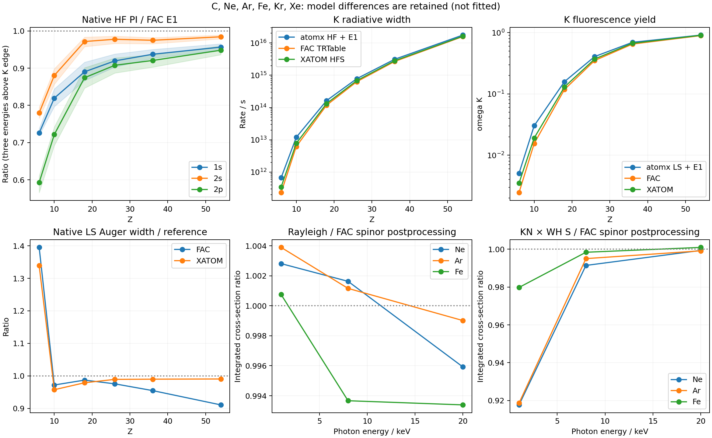

# atomx / XATOM / FAC：九格矩阵补齐（2026-10-02）

后续校正见 [统计组态与统一场重算](../atomic_consistency_2026_10_02/README.md)。本页保留原始数值与源码快照；原驱动把分数占据直接传入 DF，未附带统计 jj 组态的电子对权重，影响开壳层及部分空穴态的物理解读。后续报告修正该构造，并分开比较 HF/Gu、初态冻结场/残余核场与原生组态能量。本页的旧产额和 Auger 面板未用新辐射率替换，不能视作后续模型的产额结果。

四组缺口已有新鲜外部计算和 atomx 数值；覆盖完成并不表示精度达标。最明显的问题是低 Z 的原生 PI 和荧光宽度，而非 Einstein A 的单位/角系数。新增 [散射接口](../../src/atomx/scattering/xray.py) 与 [benchmark 驱动](../../benchmarks/bench_systematic_xray.py)，[矩阵](../../benchmarks/bench_systematic_fac_matrix.py) 根据 CSV/JSON 输出统计采样与误差。

| 面板 | 本次实测覆盖 | atomx / FAC | 解释 |
|---|---:|---:|---|
| 中性原子 K/L PI | C、Ne、Ar、Fe、Kr、Xe × 1s/2s/2p × 3 能量，共 54 点 | 0.566–0.989 | HF 绑定态 + residual-core Gu 连续态；不是旧高电荷 Fe RR 的误差范围 |
| 每初始空穴的 K/L 荧光宽度 | 六元素 × 三空穴，18 宽度 | 0.451–3.088 | E1；C/Ne 的 2p 空穴没有允许的向下 E1 通道，双方均为零 |
| K 壳荧光产额 | 6 个 Z 点 | 1.019–2.066 | 原生 LS Auger + E1，不把参考速率代入分母 |
| Rayleigh 积分截面 | Ne/Ar/Fe × 1/8/20 keV，9 点 | 0.993–1.004 | FAC 波函数独立后处理，不是 FAC 原生光子散射表 |
| Compton 积分近似 | 同上，WH 的 S(q) × Klein–Nishina | 0.918–1.001 | 角积分散射函数近似；未计算能量分辨的 DDCS |

PI 相对 XATOM 为 0.469–0.988；Rayleigh 相对 XATOM 为 0.953–0.998；使用与 XATOM 一致的 Thomson × WH 权重时，Compton 相对 XATOM 为 1.006–1.085。比值是各原生模型之间的差异，没有拟合到外部曲线。

图的独立导出为 [PDF](systematic_comparison.pdf)。原始数值：[PI](pi.csv)、[辐射通道](fluorescence.csv)、[空穴总宽度](fluorescence_totals.csv)、[产额](yield.csv)、[散射](scattering.csv)、[九格证据](matrix.json)。原始外部命令、输入、输出和时间位于 `raw/`；不修改 XATOM 或 FAC 源码。

## K 壳产额

| Z / 元素 | atomx 原生 | FAC | XATOM |
|---|---:|---:|---:|
| 6 / C | 0.005075 | 0.002457 | 0.003513 |
| 10 / Ne | 0.030264 | 0.015507 | 0.019081 |
| 18 / Ar | 0.158436 | 0.117925 | 0.129799 |
| 26 / Fe | 0.407092 | 0.351128 | 0.371587 |
| 36 / Kr | 0.695165 | 0.650953 | 0.669955 |
| 54 / Xe | 0.911409 | 0.894099 | 0.903733 |

`yield.csv` 同时保存独立的两条宽度，以及只替换 XATOM 通道电子动能的明确控制。主列的 Auger 电子动能是 atomx 初始空穴轨道的 ε_a+ε_b−ε_h。LS 的源壳层占据与等价电子因子由公开 `auger_rate_csf_average(..., angular_mode='ls')` 计算；DFSolver 的 B-spline 系数只经过存储格式适配。枚举 XATOM 输出的开放源对；本次 K 壳参考的源对清单覆盖各元素全部价壳层组合。

## 荧光差异的定位

`radiative_controls.csv` 用新鲜 FAC 空穴组态波函数隔离了 Einstein A 链。每源 jj 轨道贡献为

`q_source × vacancy/g_hole × A(source → hole)`。

单个 n-l 空穴在 jj 简并态间各向同性分布，因此 `vacancy/g_hole = 1/[2(2l_h+1)]`。E1 长波径向矩为 ∫r(P_a P_h + Q_a Q_h)dr；`einstein_A_eL` 处理角系数和 s⁻¹ 转换。FAC 的初始组态宽度按各能级的 (2J+1) 平均，TRTable 列是 A 而非 gA。

| 元素 | 原生 atomx/FAC | atomx 用 FAC 平均光子能量/FAC | FAC 波函数 + FAC 平均光子能量/FAC |
|---|---:|---:|---:|
| C | 2.889 | 1.558 | 1.000042 |
| Ne | 1.926 | 1.322 | 1.000000 |
| Ar | 1.390 | 1.139 | 1.000001 |
| Fe | 1.238 | 1.082 | 1.001373 |
| Kr | 1.168 | 1.061 | 1.000020 |
| Xe | 1.110 | 1.041 | 1.000131 |

FAC 同波函数控制在约 0.14% 内闭合，支持归一化及 Einstein A 链正确。换能量后 atomx 仍偏高，说明初始空穴轨道的偶极积分存在模型差异；原生轨道能量差又通过 ω³ 放大了偏差。FAC 控制使用每源壳层跃迁的速率加权平均能量，因此 Fe 的残差还包含多能级能量分布、组态混合及长波算符近似。该控制只诊断，不替换产额主结果。

## 新提交的 Auger 回归

运行中出现新提交 `858cd29`；针对它重新执行了现有公开接口及测试：

- Ne 的默认公共 `Atom`、`fac_frozen` 初始径向态、400 点连续态，输入归档 XATOM 电子动能：总率 **1.025040× XATOM**。通道比值是 **1.4842 / 1.2172 / 0.8770**，总率的接近不能代表三个通道同样准确。数据在 `ne_ls.json`。
- Fe 五个归档 FAC AITable 点，当前 `angular_mode='jj'`：**0.6437 / 1.1556 / 2.3901 / 2.6018 / 3.5620**。五个点都进原有 `[0.40,6.5]` 宽门限，10% 门限仍未达到。数据在 `fe_jj.json`。这是逐源对的组态平均 API 对逐能级参考的比较，不能宣称已完成精确 J 分辨/CI 宽度。
- Fe 面板的初始态是 2p 空穴加两个 n=3 电子的 11 电子 Fe XVI，最终是 10 电子 Fe XVII，因此过程为 **LMM**。旧文件名中的 KLL 不作为物理标签。
- 这两个补充锚点使用归档外部 fixture；六元素 K 空穴 Z 扫描的 XATOM/FAC 参考则是本次新运行。Ne 公共锚点与 Z 扫描的 DFSolver 有不同径向基组和初始态解，不能互换两者的总率比值。

## 散射定义与参考独立性

新增接口计算静态、非共振的 **f₀(q)**，不是异常散射因子 f₁/f₂。q 单位 a₀⁻¹，角度为弧度，微分截面单位 barn/sr；取弹性动量转移 q=2αω sin(θ/2)。Rayleigh 为 Thomson × f₀²；WH S(q) 使用所有占据轨道之间的投影积分，包含不同 n/l 壳层，不能用 `N−f₀²/N` 替代。壳内采用 XATOM 的 q_shell/g_shell 占据平均，壳间采用两个占据分数的积；本接口要求同 n-l 的 jj 伙伴占据分数相同。

FAC 参考用 `WaveFuncTable` 输出，独立用每个磁子态 exp(iqz) 的相干多极振幅、Simpson 径向积分作后处理；没有调用新的 `AtomicScattering`，也没有调用它使用的 reduced_C。径向范数最大误差约 5.5×10⁻⁸，S(0) 残差在 10⁻⁶ 以下；没有重归一化或截断成零来隐藏误差。XATOM 直接输出 1601 个 q 点的 f₀，以及 `.ixs` 中高精度的 S(θ)。Rayleigh 的 XATOM 角积分用原生 q 网格的插值，Compton 则直接使用它的角网格。

XATOM WH 原生输出用 Thomson 权重；默认生产接口采用 Klein–Nishina 权重，两者分别保存。后者是标准散射函数近似，[NIST 的过程说明](https://physics.nist.gov/PhysRefData/XrayMassCoef/chap2.html) 也分别使用 Thomson×F² 和 Klein–Nishina×S 来描述积分散射。这里没有逐元素对 NIST 表格做新的精度认证，也没有验证异常色散、共振散射或完整 Compton DDCS。

181 个角点的积分另与 256 节点 Gauss-Legendre 比较：Rayleigh 最大网格差 **0.0264%**，Compton **0.00373%**。这验证角积分，不替代初始态模型的物理精度。

## 条件、复现与后续优先级

中性组态及配置平均在 `references.json` 中；C 为 1s²2s²2p²，Fe 为 [Ar]3d⁶4s²。六个 Z 点是代表性稀疏扫描，非所有 Z=6…54 的 49 元素扫描。PI 对每元素取 XATOM 中性 1s 束缚能的 1.2、2、4 倍并四舍五入到 eV，壳层列包含全部初始占据，FAC 每壳层独立进程避免混阈值 RR 网格污染。

原生 atomx：DFSolver，HF 非局域交换，点核，无 Breit/QED，ns=180、ks=9、r_max=80 a₀，SCF tol=10⁻⁹；连续态 shooting=16000。FAC：关闭 SE/VP/MS/Breit，3200 径向点、密度尺度 4，ExactRR/E1，逐组态 Structure，无跨组态 CI 混合。XATOM：非相对论 HFS + Latter，N=300、r_max=80、dr=0.0025。高 Z 的相对论、初始/最终态场及能量模型差异均保留。

C/Fe/Xe 的 ns=180→240 径向抽查：PI 最大变化分别为 0.462%、0.00853%、0.01945%；Auger 总率最大变化 0.00848%，最弱单通道最大变化 0.363%；E1 宽度最大变化低于 10⁻⁸%。见 [收敛数据](convergence.json)。这说明本轮数值基组误差远小于主要模型差异；没有把三点抽查当作六元素/全参数收敛的证明。

FAC 的 ω_K 使用配置平均后的两条宽度取比值，不是逐能级产额的布居平均。原生 E1 仅为部分多极范围，M1/E2 等未纳入本次 K/L 辐射面板。

快照采于 `227982a` 加正在开发的 jj 修改，`source_identity.json` 逐文件标记实际使用源码；主面板显式使用 LS，不依赖该 jj 开发分支。后来完成的 `858cd29` 用于补充 Ne/Fe 锚点和回归检查，两种来源分开记录。[复现命令](REPRODUCE.md)、[运行身份](metadata.json)、[测试输出](validation.txt)。本轮新增散射解析/闭合/积分及从氢原子求解到观测量的测试。

下一步应优先统一初始/最终空穴轨道与跃迁能量模型，在原生条件下修复低 Z PI 和荧光差异，再收紧精度门限。不同场/阈值的匹配控制不能用于掩盖原生误差；Fe 的宽门限也不能代替逐能级精度。非共振积分散射的本轮验证范围应与异常色散、能量分辨 Compton 的后续工作分别标注。
