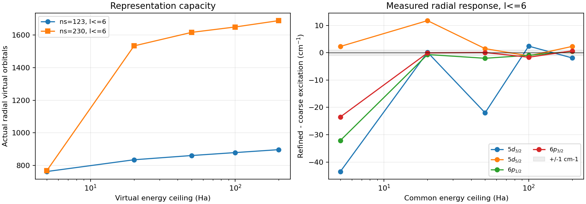

# Yb⁺ 谱线继续定位：相关尾部与径向表示

2026-10-08，Atomx 原生实算。承接[能量自洽与二阶自能修复](../yb_energy_dependent_sigma_2026_10_08/README.md)。本报告是当前尾部诊断；前两轮源码、输入、失败及结果保持封存。

## 有判断力的结论

本轮完成两组完整五态计算和共同空间对照：粗径向基扩至 ℓ≤8、200 Ha，加密径向基计算 ℓ≤6、200 Ha。核、全部占据轨道、反对称 Coulomb 算符和 Dyson 分支规则保持一致，未按实验改选根或调参。

**高分波和正能尾部仍未收敛。**粗基最后 ℓ7→8 的最大跃迁增量为 **39.156 cm⁻¹**；细基 100→200 Ha 的最大增量为 **17.577 cm⁻¹**。共同 ℓ≤6/200 Ha 的径向加密响应最高 **2.300 cm⁻¹**。这些是实际已算增量，均不能当作未算无限尾部的误差界。

粗基 ℓ≤8/200 Ha 的实验最大相对偏差为 **5.485%**，细基 ℓ≤6/200 Ha 为 **5.384%**，四能级 5% 目标分别为 **未通过 / 未通过**。扩空间对 5d 与 6p 的作用不同，不能用统一能量偏移解释剩余误差。数值闭合和实验准确度必须分别报告。

独立电离阈值锚进一步表明：细基模型的基态过束缚 **600.31 cm⁻¹**，5d 上态偏浅 **257.32/313.32 cm⁻¹**，6p 上态偏浅 **838.52/1036.08 cm⁻¹**。所以剩余跃迁偏差同时包含基态和上态的系统偏差，不能唯一归给基态。详见后面的 [NIST ASD 阈值对照](https://physics.nist.gov/cgi-bin/ASD/ie.pl?at_num_out=1&biblio=1&e_out=0&el_name_out=1&ion_charge_out=1&spectra=ytterbium&unc_out=1&units=1)；这是当前纯 DC 模型与物理实验的比较，还不是遗漏相关、Breit/QED 等分项的精密误差预算。

本轮修正了诊断 setup 的空间覆盖：完整保留更高能量、更高分波及加密径向表示中的虚轨道，同时减去各自空间的基态。**生产物理源码没有新增修改**；没有发现需据此改符号或改系数的 Coulomb 算符缺陷。不能把空间扩展、标量能量自洽或不同模型的文献修正相加，伪装成已收敛预测。

## 第一性原理与固定 setup

求解 Eₐ=εₐ+Σ₂,ₐ(Eₐ)，其中 Σ₂(w)=Σᵢ Wᵢ/(w−pᵢ)，原生反对称耦合 Wᵢ≥0；2p1h 与 2h1p 两类图全部保留。跃迁 Eγ=E上−E基，所以必须看 ΔE上−ΔE基。固定一套完整极点后，按虚轨道 κ 和能量精确筛选各子空间，每个空间重新求五态根；只去掉严格零耦合，没有幅度阈值或根数截断。

Z=70，经验 Fermi 核；68 电子 [Xe]4f¹⁴ 闭核，19 个占据径向轨道全部参加；五个外部态为 6s₁/₂、5d₃/₂、5d₅/₂、6p₁/₂、6p₃/₂。虚轨道在闭核完整 VN 场中产生，即相对 69 电子 Yb⁺ 的 V^(N−1)，不得再从 68 核移走一电子。两套参考均为已独立通过数值控制的冻结核 DF：粗基 ns=123、细基 ns=230，阶数 ks=9、外盒 R≈60 a₀；细基同时加密实际径向网格，不能将本对照归成单纯 ns 参数误差。

能级与能移表使用 cm⁻¹，参数、残差及权重另标单位。所有计算为纯 Dirac–Coulomb，没有添加 Breit、QED、反冲或超精细项。标量 Dyson 仅迭代外部能量，未重新优化轨道、密度或核 Fock 场，未实现完整 Brueckner/GF2/高阶屏蔽。这些实数附着根不认证此前 Ne 的复自电离共振或宽度。

## 虚轨道数与表示覆盖

下表包含束缚虚轨道及窗口内全部正能虚轨道；数量为实际构造值，不是默认上限。

| 正能上限/Ha | 粗基 ℓ≤6 | 粗基 ℓ≤8 | 细基 ℓ≤6 |
|---|---|---|---|
| 5 | 763 | 991 | 769 |
| 20 | 835 | 1086 | 1533 |
| 50 | 861 | 1121 | 1616 |
| 100 | 879 | 1146 | 1649 |
| 200 | 897 | 1170 | 1688 |

在共同 ℓ≤6/50 Ha，径向加密使虚轨道从 861 增至 1616；粗基提高上限至 200 Ha 仅增至 897。这提示能量窗与有限径向谱必须一起检查。**数量增加本身不能证明能量误差大或小，下一节以实际耦合响应判定。**初次细基预检仅构造 <50 Ha 谱，其文件里的“200 Ha 数量”受这个前置过滤限制；当前表采用另行完整构造的 200 Ha 快照及完整捕获，原预检保留并注明范围。

## 三因素的同空间控制

每一行均同时更新全部五态；“径向加密”对照使用各自 DF 核、五态与度量，不混用粗基基态和细基激发态。1 cm⁻¹ 门沿用预声明值，不因结果改变。

| 控制 | 5d₃/₂ | 5d₅/₂ | 6p₁/₂ | 6p₃/₂ | 1 cm⁻¹ 门 |
|---|---|---|---|---|---|
| 粗基 ℓ6→8，200 Ha | -119.995 | -108.070 | +28.149 | +31.421 | 未通过 |
| 粗基 ℓ7→8，200 Ha | -39.156 | -35.213 | +8.912 | +10.071 | 未通过 |
| 粗基 ℓ8，100→200 Ha | -16.598 | -22.180 | +10.266 | +11.238 | 未通过 |
| 细基 ℓ6，100→200 Ha | -17.577 | -15.218 | +10.372 | +12.402 | 未通过 |
| 径向加密，ℓ6/50 Ha | -21.990 | +1.487 | -2.043 | +0.076 | 未通过 |
| 径向加密，ℓ6/200 Ha | -1.914 | +2.300 | +0.480 | +0.681 | 未通过 |

这些是分别固定另两个因素后的条件响应，**不能相加成为误差预算**。高分波增量在不同能量窗有不同值，径向响应也随能量窗变化；只在一个低能窗观察平台会遗漏这种交互。细基 ℓ4→6 的最大跃迁增量仍为 569.499 cm⁻¹，尚未在细基测 ℓ7/8，因此粗基高分波结果不能移植为细基收敛证书。

共同 ℓ≤6/200 Ha 的单态变化如下。DF 与相关项分别列出，避免把参考变化错误归为相关；激发能明确减去同一模型基态。

| 态 | DF 附着能变化 | 相关能移变化 | 总附着能变化 | 跃迁变化 |
|---|---|---|---|---|
| 6s_1/2 | +0.0000 | -1.2341 | -1.2341 | +0.0000 |
| 5d_3/2 | -0.0000 | -3.1483 | -3.1483 | -1.9142 |
| 5d_5/2 | -0.0000 | +1.0655 | +1.0655 | +2.2996 |
| 6p_1/2 | +0.0000 | -0.7540 | -0.7540 | +0.4801 |
| 6p_3/2 | +0.0000 | -0.5533 | -0.5533 | +0.6808 |

## 能级、劈裂与实验

| 上态 | 实验 | 旧粗基 ℓ6/50 | 粗基 ℓ8/200 | 细基 ℓ6/200 | 细基−实验 |
|---|---|---|---|---|---|
| 5d_3/2 | 22960.80 | 23872.31 | 23700.35 | 23818.43 | +857.63 |
| 5d_5/2 | 24332.69 | 25273.08 | 25135.96 | 25246.33 | +913.64 |
| 6p_1/2 | 27061.82 | 28473.14 | 28528.32 | 28500.65 | +1438.83 |
| 6p_3/2 | 30392.23 | 31993.37 | 32059.36 | 32028.62 | +1636.39 |

实验沿用封存的 [NIST Yb II 能级表](https://physics.nist.gov/PhysRefData/Handbook/Tables/ytterbiumtable6.htm)，不做能量平移或参数拟合。粗基 ℓ8/200 的 5d、6p 劈裂为 1435.609、3531.037；细基 ℓ6/200 为 1427.897、3527.966；对应实验为 1371.89、3330.41。基态共同误差不影响这些同多重态劈裂，剩余劈裂误差须在上态相关和算符层面解释。

| 态 | 粗基 ℓ8/200 能移 | 细基 ℓ6/200 能移 | 细基 Z |
|---|---|---|---|
| 6s_1/2 | -8098.698 | -8042.991 | 0.982395 |
| 5d_3/2 | -8670.915 | -8497.127 | 0.974775 |
| 5d_5/2 | -7714.892 | -7548.815 | 0.975795 |
| 6p_1/2 | -4272.800 | -4244.762 | 0.988250 |
| 6p_3/2 | -3552.410 | -3527.443 | 0.989940 |

细基 ℓ6/200 中，能量求根相对直接相加自能的最大跃迁响应为 110.899 cm⁻¹。它与第三阶图、非对角轨道响应和辐射顶角不是同一修正。文献中的三阶/全阶结果只能帮助选择下一项控制，不能未经同模型验证加到本表。QED 加入后的完整轨道 SCF 本轮没有测量；先验纯 DC 相关与表示，是避免用小修正补偿未闭合主模型的必要步骤。

## 独立文献量级核对

重新读取已封存的 [Safronova 等 2009 年论文 Table I](https://doi.org/10.1103/PhysRevA.79.022512)，比较相同附着相关量的**在壳二阶值**，不将非线性 Dyson 能移混充论文 E₂。

| 态 | 论文在壳 E₂ | 粗基在壳 E₂ | 粗基−论文 | 细基在壳 E₂ |
|---|---|---|---|---|
| 6s_1/2 | -8288 | -8247.00 | +41.00 | -8190.17 |
| 5d_3/2 | -9003 | -8898.63 | +104.37 | -8719.93 |
| 5d_5/2 | -8001 | -7908.66 | +92.34 | -7738.12 |
| 6p_1/2 | -4344 | -4324.38 | +19.62 | -4295.97 |
| 6p_3/2 | -3606 | -3588.97 | +17.03 | -3563.72 |

论文采用 70 个九阶 B 样条、R=200 a₀，二阶 ℓ≤8 并外推更高分波；本轮为有限 R≈60、无外推。上述 17–104 cm⁻¹ 粗基差值支持二阶量级与约定，不能精确归为本模型的缺失尾项。

论文印刷三阶项相对基态的激发能差依次为 −2043、−2317、−681、−850 cm⁻¹。它们说明高阶相关可在当前残差尺度起作用，但直接移植会让 5d 过度修正，且模型并不匹配。仅再次迭代 Σ₂ 也不会生成完整三阶图：冻结参考下使全部 W→λ²W，Dyson 展开为 δE=λ²Σ₂(ε)+λ⁴Σ₂′(ε)Σ₂(ε)+…，只是特定能量反馈项。下一步需原生同模型高阶/非对角响应，不能靠经验常数或文献表值补齐。

## 独立绝对能量锚：区分基态与上态

[NIST ASD 5.12 电离数据](https://physics.nist.gov/cgi-bin/ASD/ie.pl?at_num_out=1&biblio=1&e_out=0&el_name_out=1&ion_charge_out=1&spectra=ytterbium&unc_out=1&units=1)给出 Yb II → Yb III 闭核基态的电离能 12.179185 eV、所列不确定度 0.000025 eV（L12907）。沿用 Atomx 单位转换，I=98231.75174 cm⁻¹，所列阈值不确定度约 0.202 cm⁻¹；[当前 ASD 能级表](https://physics.nist.gov/cgi-bin/ASD/energy1.pl?biblio=on&conf_out=on&de=0&format=0&j_out=on&lande_out=on&level_out=on&multiplet_ordered=0&output=0&page_size=15&perc_out=on&spectrum=Yb+II&submit=Retrieve+Data&temp=&term_out=on&unc_out=1&units=0)的四个激发能与本轮封存值一致。将实验和理论都放在 Yb III [Xe]4f¹⁴ ¹S₀ 零点：E基,exp=−I，E上,exp=Eγ,exp−I。没有平移理论能量、修改激发能或拟合阈值。

| 态 | 实验附着能 | 细基附着能 | 计算−实验 |
|---|---|---|---|
| 6s_1/2 | -98231.75 | -98832.06 | -600.31 |
| 5d_3/2 | -75270.95 | -75013.64 | +257.32 |
| 5d_5/2 | -73899.06 | -73585.74 | +313.32 |
| 6p_1/2 | -71169.93 | -70331.41 | +838.52 |
| 6p_3/2 | -67839.52 | -66803.45 | +1036.08 |

相对误差严格满足 δEγ=δE上−δE基，最大记账闭合误差为 1.455e-11 cm⁻¹。基态过束缚约 600 cm⁻¹ 是共同贡献，6p 上态还各有约 839/1036 cm⁻¹ 偏浅，故单独修正基态不足以解释当前四条激发能。

这次核对还发现：旧 Handbook 的阈值为 98207 cm⁻¹，2009 论文 Table I 引用的基态束缚锚为 98269 cm⁻¹，分别与当前 ASD 差 -24.75、+37.25 cm⁻¹。它们不改变原有激发能差或纯二阶增量对照，但不能混为同一个绝对能量基准。旧证据不重写；新绝对诊断明确使用当前 ASD。阈值不确定度不是完整实验能级、同位素/超精细或理论算符误差界。

## 验证、边界与下一项判别

两个完整空间及所有子空间的 Dyson 根均通过预声明无加权极点穿越、DF 连续分支与残差检查；根最大残差 **1.318e-16 Ha**。旧粗基在壳重放误差最高 **4.850e-15 Ha**，旧 Dyson 子空间重放误差最高 **0.000e+00 Ha**，门均为 1e−10 Ha。完整虚轨道 Gram 最大误差 **3.220e-14**，核空间最大重叠 **3.216e-15**，门均为 1e−7。

两组五态能移均实际注入各自原生 CI；能量匹配误差最高 **3.638e-12 Ha**，CI 残差最高 **0.000e+00 Ha**，门 1e−8；所有态匹配权重为 1。该门验证能量记账，不认证新的跃迁矩阵元、寿命或辐射率。生产源码哈希与上一轮 **137 项通过的测试版本完全相同**；本轮未重复未受影响的单元测试，新增证据是两组完整 live 捕获、子空间重放、径向度量和 CI 注入。

后续顺序由剩余门决定：在细径向表示继续扩高分波及正能上限，并检查外盒/有限谱密度；随后用原生同模型计算判别非对角轨道响应和高阶屏蔽，与同 Hamiltonian 的独立方法比较。现有两套径向基、有限能窗和分波上限不足以认证渐近外推、总理论误差或精密实验一致性。

## 复现、资源与文档处置

完整十态捕获耗时 2428.83 s，峰值单进程 RSS 4725.3 MiB。六个独立计算工作进程，每进程 BLAS/OMP 一线程；粗基单态上限 1800 s、细基 5400 s，均未超限。记录了实际机器负载，这些时间不是受控性能倍数。原候选项数预估有 1000 项算术笔误，已在 workload_count_check.json 更正；未改变模型、计算窗口或资源上限。

本目录保留契约、捕获源码、全量极点、轨道快照、原始日志、all_models.csv、每态身份、CI 和表示审计。前三次表示审计驱动分别遇到原生二维求积数组与两代 manifest 格式的读取错误，均发生在诊断脚本；失败契约、源码与日志保留，v4 用相同物理输入和容差通过。前两轮封存 manifest 的 **93 / 52 项哈希全部复核未变**。

交付复现包包含完整 Atomx 捕获源码、coarse/fine DF 输入、控制驱动和结果汇总；大体积全量耦合极点 NPZ 留在本地并封存哈希，不混称“可离线即时重放全极点”。从包中源码可重新捕获，按 REPLAY.txt 在独立目录运行，驱动拒绝覆盖旧结果。运行主顺序为 run_controls.py → analyze_controls.py → build_report.py；audit_representation.py 是已封存快照的补充审计。

当前文档入口和验证状态更新到本报告；上一轮自能 API、测试说明及独立 Breit/QED 对照保留为阶段证据，能力边界不变。洞察并入已有“跃迁反馈优先”规则：窗口扫描必须核对实际有限谱，并以完整上下态的共同空间响应判断；没有新增根规则。
