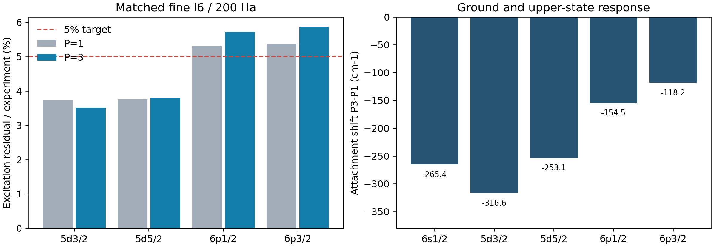

# Yb⁺ 非对角二阶自能：轨道响应与谱线偏差

启动 2026-10-08，完成 2026-10-09。承接[原始论文与下一阶段策略](../yb_literature_repair_strategy_2026_10_08/README.md)，把第一项“完整带符号矩阵 Σ₂”加入 Atomx。本专题拥有该实现及匹配五态实验；前面的[完整尾部与径向控制](../yb_correlation_tail_2026_10_08/README.md)保持封存。

**已加入完整带符号矩阵 Σ₂，并完成两套完整五态计算及保存矩阵重放。结论是：冻结核轨道响应不能同时修好当前绝对束缚能与谱位偏差。** 细基最大激发能偏差由标量模型的 5.384% 增至矩阵模型的 **5.868%**；四能级 5% 目标仍未通过。99 项受影响测试通过，计数为最终物理/架构面板 76 项与 pair/ladder 回归 23 项，不重复计算重检。

6s 附着根下降 **265.428 cm⁻¹**，相对 ASD 阈值的过束缚由约 600 cm⁻¹ 增至 **865.740 cm⁻¹**。上态各自也下降：5d₃/₂、5d₅/₂、6p₁/₂、6p₃/₂ 为 **316.644、253.139、154.487、118.250 cm⁻¹**。减去同模型基态后，四激发能分别移动 **−51.216、+12.289、+110.941、+147.178 cm⁻¹**；只有第一项的谱位偏差减小。数值闭合通过不等于实验改善。

在同一最低分支、共同无极点能区与不变核/Σ₂ 的条件下，外部空间继续扩大只能进一步降低 6s 根，不能将它的过束缚往上修正。下文给出这个 Rayleigh–Ritz/Σ′ 推导。当前优先应改变高阶相关覆盖，随后测试互补粒子空穴与 Coulomb–Breit 交叉项；继续同一冻结核上的低信息迭代不足以回答这些问题。

## 实测五态、谱位与空间门

所有能量及差值单位为 cm⁻¹。

| 上态 | 实验激发能 | 同参考标量 P1 | 矩阵 P3 | P3−实验 | P3−P1 |
|---|---:|---:|---:|---:|---:|
| 5d_3/2 | 22960.80 | 23818.428 | 23767.212 | +806.412 | -51.216 |
| 5d_5/2 | 24332.69 | 25246.326 | 25258.615 | +925.925 | +12.289 |
| 6p_1/2 | 27061.82 | 28500.652 | 28611.593 | +1549.773 | +110.941 |
| 6p_3/2 | 30392.23 | 32028.618 | 32175.796 | +1783.566 | +147.178 |

| 附着态 | P3 附着能 | 与独立阈值/实验的绝对偏差 |
|---|---:|---:|
| 6s_1/2 | -99097.491 | -865.740 |
| 5d_3/2 | -75330.279 | -59.327 |
| 5d_5/2 | -73838.877 | +60.185 |
| 6p_1/2 | -70485.898 | +684.034 |
| 6p_3/2 | -66921.696 | +917.826 |

绝对比较沿用已核对的 [ASD 5.12 Yb II→Yb III 阈值](https://physics.nist.gov/cgi-bin/ASD/ie.pl?at_num_out=1&biblio=1&e_out=0&el_name_out=1&ion_charge_out=1&spectra=ytterbium&unc_out=1&units=1)：12.179185 eV，即 98231.75174 cm⁻¹；未做实验平移或拟合。上态绝对附着误差均变小，而基态过束缚加重，因此谱线差值未同步改善。这些仍是纯 DC 模型与物理实验之差，不是单项遗漏物理的精密预算。

| 控制/门 | 5d₃/₂ | 5d₅/₂ | 6p₁/₂ | 6p₃/₂ | 1 cm⁻¹ 门 |
|---|---:|---:|---:|---:|---|
| 细基 P2→P3 | -6.751 | +7.141 | +23.589 | +32.274 | 未通过 |
| P3 粗→细径向表示 | -2.122 | +2.510 | +0.515 | +0.738 | 未通过 |

细基 5d/6p 劈裂为 **1491.402/3564.203**，实验为 1371.89/3330.41。基态共同偏差无法解释这些劈裂。粗基同 ℓ6/200 矩阵最大实验偏差为 5.866%；粗细结果一致不认证完整外部函数、高分波/正能或盒尾收敛。P2→P3 的最大激发能增量仍为 **32.274 cm⁻¹**，不能当作无限尾部误差界。

七条原始 Yb II 分支的能量与真空波长算术对照另见 [seven_lines.csv](seven_lines.csv)。波长由对应能级差计算，未计算新的相关辐射矩阵元、强度或寿命；E1/E2 选择规则保持原分支声明。

## 数值、保存矩阵与封存控制

完整十态捕获耗时 **1045.72 s**，峰值单态 RSS **5774.9 MiB**，均低于声明上限。五个计算进程、每个 OMP/BLAS 一线程；实际负载保留，未声明受控的端到端加速倍数。首次未完成逐对计算的证据另外保留。

| 控制 | 最大实际误差 | 预设门 |
|---|---:|---:|
| 旧对角在壳/根重放 | 2.776e-16 Ha | 1e−10 Ha |
| 原生矩阵本征残差 | 2.062e-15 Ha | 1e−10 Ha |
| 保存极点矩阵的向量残差重放 | 1.110e-14 Ha | 1e−10 Ha |
| 保存矩阵的 Z 重放 | 6.106e-15 | 1e−10 |
| 混合径向函数度量 | 8.882e-16 | 1e−7 |
| 混合函数与闭核重叠 | 1.110e-16 | 1e−7 |

两套每个实际虚块均重新用原生提供器生成，逐系数与预检一致。所有候选项数核对通过；两类图没有幅度裁剪。前四轮 **93/52/127/21** 个封存文件的 SHA 全部保持，生产源码在最终捕获中不变。[analysis.json](analysis.json) 是本轮数值和验证依据，[comparison.csv](comparison.csv) 包含 30 个匹配态/外部空间记录。

捕获后恢复了旧标量入口原有的 `np.asarray/int/float` 输入转换，避免 NumPy float32 外部能量改变旧默认精度。捕获时的 30 个实际外部函数均已是 ndarray/float64、Python float 与 int，这些转换逐一核实为恒等；两图、积分、虚态、矩阵与求根实现没有变化。生产与最终源码 SHA 分开保存于 [源码身份链](final_source_chain.json)，不声称两份源码逐字相同。最终源码通过 76 项面板及全部保存矩阵的根向量/残重重放。

## 物理问题及判别标准

旧标量模型求 Eᵥ=εᵥ+Σᵥᵥ(Eᵥ)，只改变能量参数。新的模型在相同 κ 的外部径向空间求

`[h_DF + Σ₂(E)] u = E u`

`Σ₂,vv′(E) = ∑ₜ Rₜ,vv′/(E−pₜ)`

`Rₜ,vv′ = ∑ⱼ Aₜⱼ,v Aₜⱼ,v′`

这里 A 是原生带符号反对称 jj 耦合，包含磁简并平均及相同径向轨道对的计数因子；每个 R 为正半定矩阵。2p1h 极点为 εᵣ+εₛ−ε_b，2h1p 极点为 ε_b+ε_c−εᵣ。两类图均保留全部占据轨道及声明窗口内全部虚态。非对角项不能由旧的平方权重开方重建；正负干涉必须重新算。

矩阵本征向量给出外部空间内的轨道混合。极点和闭核场保持冻结，不迭代闭核密度、屏蔽或中间态。Z=[1−uᵀΣ′(E)u]⁻¹ 是该模型的准粒子残重；Σ′负半定。u 在外部正交空间归一到 1，物理 Green 函数极点的外部残重是 Z，二者不能混为完整相关波函数的归一化。

本轮保留外部函数数 P=1/2/3 的嵌套控制，比较五个附着态、同模型基态扣除后的四个激发能、5d/6p 劈裂。沿用旧的四激发能 **5%** 实验目标、**1 cm⁻¹** 空间增量门；数值门为旧对角重放及矩阵本征残差 **1e−10 Ha**、原生度量 **1e−7**。完整三函数通过也不认证无限外部径向空间。

## 固定 setup 与完整覆盖

Z=70、经验 Fermi 核，68 电子 [Xe]4f¹⁴ 闭核、19 个占据径向轨道全部参加。纯 Dirac–Coulomb、声明的正能无对空间，未加入 Breit、QED、反冲或超精细。外部块分别为 6/7/8s、6/7/8p₁/₂、6/7/8p₃/₂、5/6/7d₃/₂、5/6/7d₅/₂。

两套参考各自独立：粗 ns=123、细 ns=230，B 样条阶数 9、R≈60 a₀，完整 ℓ≤6/200 Ha；所有中间虚态在完整 68 核 VN 场内产生，相对 Yb⁺ 即 V^(N−1)。不再从闭核移走一电子；不截断根数，不以小幅度删耦合。

| 空间 | 虚径向态数 | 每态 2p1h 候选对 | 每态 2h1p 候选对 |
|---|---:|---:|---:|
| 粗 ℓ6/200 | 897 | 7,652,307 | 170,430 |
| 细 ℓ6/200 | 1688 | 27,084,804 | 320,720 |

采用五个独立计算工作进程，每进程 OMP/BLAS 一线程；这不是多 agent。每态 5400 s、RSS 16384 MiB、总原始矩阵存储 20 GiB 上限。最坏未去零的全部十态存储估算约 13.12 GiB，细基保守 RSS 12460 MiB；真实资源值另外报告。未声明受控性能加速倍数。

## 参考表示核查与失败保留

预检发现返回的 Rydberg 能量与三个外部函数中的实际 Fock 投影不完全一致，最大原始投影差为细基 d₃/₂ **1.782e−8 Ha**。这属于参考表示控制，不能当作相关修正。首先保留旧目标的原始 P/Q/ε，用共享耦合核完整重放旧标量；再在不变的三个函数空间内求实际 `Xᵀ F X` / `Xᵀ S X` 广义本征对，变换带符号残矩阵。完整中间虚轨道不变。

因此，本轮分别报告：原始目标的旧对角重放、规范化参考造成的标量变化、相同规范化参考上的非对角轨道响应。高函数的重新规范化与非对角相关不能混记。所有虚块在各工作进程中重新用原生提供器构造，并逐系数与预检快照一致才允许求和。

初次独立测试用了不必要的逐位相等断言，标量 sum 与矩阵 einsum 相差约 5e−20 Ha；改用原有 1e−13 Ha 对角重放测试门，没有放宽物理契约。预检的二维 cell/quadrature 展平错误及后续原始/规范化参考混用错误也保留日志；修正的是 setup 与比较对象，未删除失败证据、未调实验阈值。

## 新增原生接口与验证范围

`atomx.methods.mbpt_matrix.build_mbpt2_matrix_self_energy` 接受同 κ、归一且互相/闭核正交的外部函数，复用 `mbpt_transitions` 的两图 signed jj 核。`MatrixSelfEnergy` 保存不可写的极点和残矩阵，支持 evaluate/derivative/diagonal/subspace/solve_dyson。旧默认在壳标量 API 保持原行为；虚对枚举改为迭代器，避免为物理上相同的双重求和预先分配巨大的 Python 对列表。

在无非零残矩阵极点穿越的声明能区内，选 DF 能量顺序对应的本征分支；不按实验接近程度或终态最大的投影权重改选根。简并 DF/终态拒绝并要求整体子空间匹配契约。根保存系数、DF 权重、残重、向量本征残差、分支索引及完整物理身份。

99 项相关测试通过，包括三种外部 s/p/d κ 的独立完整磁态交叉乘积、非对角非零值及符号、外部符号翻转协变、旧对角重放、解析/有限差分导数，以及 2P+1Q Hermitian 辅助系统的能量、混合向量和极点残重。还覆盖闭核二阶、原有 CI 对角注入、架构边界、float32 输入兼容与 QED 回退告警。25 条预期 QED 覆盖告警不构成精密 QED 的验证。没有把测试收集或全套 pytest 说成通过。

目前 CI+Σ₁ 的公开消费仍为对角映射；本轮矩阵 Dyson 是独立原生方法接口，没有自动接入 `Atom.solve()`、通用多价电子 CI 或谱线寿命。保存的混合径向函数不包含完整相关辐射顶角。

## 共享数值核与未完成尝试

初次逐对径向捕获在约 21 分钟时主动停止，已有输入、进度、源代码与停止原因保留在 `scalar_path_stopped_attempt/`；它没有完整矩阵谱线结果，不作为数值或实验通过。随后用既有 `compute_slater_rk_table` 计算同一 Slater 双线性算符的完整 GEMM 表，原生 jj 角因子、反对称化、两个图类和轨道数均不变。

65 个混合 κ 虚函数的全部 4225 有序对，与标量逐对核的最大差为 **1.388e−17 Ha**。当前独立 m-scheme 测试同时核查 table/scalar 的所有残矩阵坐标。表仅归属一次捕获、一个固定 bra 和同一径向/ket 快照，下一个 bra 即释放；不得跨物理参考缓存。原始径向计时不构成完整谱线计算的受控加速倍数。

## 高阶与后续工作的边界

**固定核上的外部空间扩大有一个明确方向约束。** 对同一核、同一正能投影和固定 Σ₂，在共同无极点能区内记 λ₀,P(E) 为外部空间 P 中 `h_DF+Σ₂(E)` 的最低本征值。若 P⊂P′，Rayleigh–Ritz 给出 λ₀,P′(E)≤λ₀,P(E)。同时 Σ₂′(E)≤0，所以 `F_P(E)=E−λ₀,P(E)` 严格递增。由此，同一最低分支的 Dyson 根满足 **E₀,P′≤E₀,P**。在独立 2P+1Q 辅助系统中，正/负两种极点控制都验证了这个方向。

因此，如果本模型的 6s 根已经相对独立实验阈值过束缚，继续扩大这个固定核/固定 Σ₂ 的 s 外部空间不能把该绝对能量往上修正。它仍可能通过上下态不同下降改善某条激发能；这不能同时认证绝对阈值和谱线。这是该分支和固定核模型的条件结论，不适用于更换 Σ、核心自洽场、虚空间/投影，或没有共同无极点区间的共振模型。

固定参考下缩放相关 Coulomb 耦合为 λ，矩阵 Σ₂ 为 O(λ²)，非简并轨道混合产生的附加能量主要从 O(λ⁴) 起；能量参数反馈也生成特定四阶及更高项。这不补全第三阶图或全阶 SD，不应据此宣称“再次迭代就完成了相关”。文献中 SD、粒子空穴 P/Q 及 Coulomb–Breit 二阶交叉项依然是后续独立模型，不能将印刷表值直接加到本轮预测上。

下一阶段存储预检已给出：细基闭核 J=0 双激发维数 **176,297,642**，一个包含 singles 的实幅度向量约 **1.314 GiB**；EA 对称 2p1h 空间从 11,733,474 到 29,036,932 个坐标，一个向量约 0.087–0.216 GiB。构造对应稠密 Q–Q 矩阵会达到千 TiB。计数通过同径向轨道的 Pauli/磁简并维数独立解析锚；这仍只是计数，未评估全部积分/工作数组或迭代代价，不认证 SD 求解可行性或精度。见 [SD 空间预检](sd_space_preflight.json)。

完整方法选择依据保留在[文献策略](../yb_literature_repair_strategy_2026_10_08/README.md)。本轮若轨道响应不足以闭合残差、或不同能级变动方向相反，就应转向同模型高阶相关与平衡空穴空间，而不是继续同一核上的低信息重复迭代。现有高分波、正能及外盒尾部未收敛的结论不因本轮矩阵数值闭合而取消。

## 原始证据与重放

- [实验契约](contract.json)、[实际预检](preflight/results.json)、[76 项最终物理/架构测试](final_tests.log)、[23 项 pair/ladder 回归](pair_kernel_tests.log)。
- [全捕获脚本](run_matrix.py)、[预检脚本](preflight.py)、`results/<space>/<state>/` 下的独立原始结果与极点快照。
- [新增物理实现](../../src/atomx/methods/mbpt_matrix.py)、[共享两图核](../../src/atomx/methods/mbpt_transitions.py)、[独立矩阵测试](../../tests/test_mbpt_matrix.py)。

独立重算使用 [regenerate_from_bundle.py](regenerate_from_bundle.py)，在新的 `docs/` 输出目录运行；它拒绝覆盖已有证据，逐一重算完整虚态和带符号残矩阵，再与原始 30 根按外部维数匹配。前序冻结核、完整虚态预检、旧标量锚和全部原生源码随交付包提供。约 3.1 GB 的十态原始 `matrix_poles.npz` 留在仓库并登记 SHA，不放入下载 ZIP，可按相同模型完整再生。[交付与复算说明](DELIVERY_README.md) 列出命令、实际依赖、包含范围及独立解包验证。完整旧归档审计须在原仓库运行，交付包只含复算所需的前序输入和报告。

独立解包验证已完成：包内全部 333 个生产源码 SHA 与最终源码一致，99 项测试通过；粗基完整五态重新生成全部虚态和两图矩阵，15 个根与原始结果的最大差为 **0 Ha**。细基本轮不再次重算全部积分，其原完整捕获及最终源码保存矩阵重放已通过。五态重算耗时约 249 s；完整原始结果保留在 `bundle_recomputed/`，额外的大型极点矩阵也不放入 ZIP。最终包的计算源码、执行脚本、冻结输入与此次验证副本逐文件保持一致，文档与封存记录另行完成。详见 [bundle_validation.json](bundle_validation.json)。
