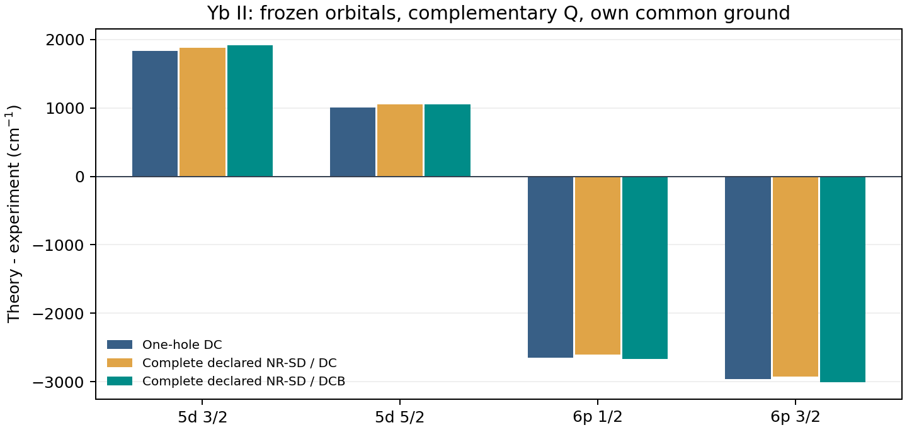

# Atomx：有限 CCSD、完整声明 SD 空间与 Breit 相关响应

2026-10-09，当前能力与本轮实算记录。依赖 `methods/ci_sd.py`、`ci_effective.py`、`coupled_cluster.py` 及共享原生 CI/角向/径向内核。完整输入、资源与门限分别见 [Yb 契约](contract.json)、[CCSD 契约](ccsd_contract.json) 和 [空间预检](preflight.json)。

**本轮补上了三个实际入口：完整声明 NR-SD 组态空间的预检与消费；有限 P/Q 内的完整静态 Breit；真正求解非线性振幅方程的有限空间 CCSD。** Yb⁺ 完整五态 DC/DCB 数值门通过，但四条激发能的最大实验偏差为 **9.904%**，1% 精度目标和 1 cm⁻¹ 空间门均未通过。小空间 CCSD 通过独立完整 CI 和非相互作用电子对的可加性检验；它为扩大原子算法提供锚，仍不是大规模原子全阶 SD 或 FS-CCSDT。

## 1. 新能力的物理范围

| 入口 | 已实现 | 边界 |
|---|---|---|
| `plan_sd_ci_space` / `build_sd_ci_effective_hamiltonian` | 多参考 NR 配置的全部单、双电子移动；保留每个配置的全部 jj 占据与耦合树；核对 N/J/宇称、冻结壳、P/Q 和资源上限 | 是声明轨道池内的 NR-CISD；不是原子线性化全阶 SD 振幅方程，也不保证径向尾部收敛 |
| `build_finite_ci_effective_hamiltonian(..., include_breit=True)` | 原生 Gaunt + 静态 retardation 进入 PP、PQ、QQ，之后统一消元和重求完整状态 | 冻结轨道，静态算符；没有频率依赖 Breit、QED 或外部自能叠加 |
| `static_breit_second_order_control` | 同 CSF、同径向/核/度量身份下，严格计算有限 Q 的 C²、C–B、B² 二阶控制 | 要求一个 P CSF 和匹配 H₀；覆盖受限 Q，不能称完整原子 B₂；不能加到已经重解的 DCB 能量 |
| `coupled_cluster.compute` | 完整固定 N 行列式表示上的非线性 CCSD，求 `⟨SD|e⁻ᵀHeᵀ|Φ₀⟩=0`，`T=T₁+T₂`；指数按幂零性精确终止，包含非连接高阶激发 | 默认≤256 行列式、≤128 振幅、≤128 MiB 生成矩阵；无原子角向压缩、FSCC、三激发、左态或 dressed observable |

SD 预检先用角向计数获得准确的 J-CSF 数和固定 M 行列式上界，再分配 CSF/哈密顿量。某些只有更高 J 的 relativistic 占据不进入目标 J 块，所以上界可略高于实际行列式数。超限会拒绝完整请求，不删弱组态。不同 NR 壳排序被规范化，避免多参考空间重复计入同一 CSF。

静态 Breit 复用已被 GRASP 开放壳矩阵和独立 retardation 控制检验的共享算符。本轮没有改 Breit 径向或角向公式；新增的是 P/Q 消费覆盖、相关响应及严格阶数控制。有关空穴有效哈密顿量的动机参见 [Berengut，PRA 94, 012502 (2016)](https://arxiv.org/abs/1605.08111)。

## 2. 有限 CCSD 已从空实现变成振幅求解

`compute` 接受同一完整固定 N 空间中的实对称 H、行列式占据 bitmask 和显式参考。保留全部单/双振幅，按预定耦合连续路径求根；返回总能量、振幅、规范化指数波函数、SD 投影残差与单独的完整本征残差。后者在有遗漏连接三/四激发时可非零，不能当作已通过 FCI 的证明。CC 能量不是变分上界。[Bartlett–Musiał，RMP 79, 291 (2007)](https://journals.aps.org/rmp/abstract/10.1103/RevModPhys.79.291)给出指数波函数与投影方程的理论背景。

原生 Be²⁺ 锚采用 Z4、点核、ns30，同一 1s/2s/2p 池、10 个磁自旋轨道、全部 45 个二电子行列式和 44 个 SD 振幅。独立比较 jj-CSF 的完整 CI：

| 检验 | 实测 |
|---|---:|
| CCSD 总能量 | −13.614111051771730 Ha |
| 完整 CSF CI 能量 | −13.614111051771733 Ha |
| 能量差 | 3.553×10⁻¹⁵ Ha |
| SD 投影残差 / 完整残差 | 1.828×10⁻¹⁵ / 1.828×10⁻¹⁵ Ha |
| 完整波函数投影矩阵差 | 2.220×10⁻¹⁶ |

另一个四电子检验使用两个互不作用的电子对：CCSD 能量等于两对各自精确能量之和，指数波函数包含非零四激发系数；同条件 CISD 不能给出该非连接四激发，能量不同。因此这是实际指数 CCSD，不能混称为有限 SD 配置的对角化。

原生稀疏 H 的两个三角在求和舍入下有 8.327×10⁻¹⁶ Ha 差；测试与探针显式核对并投影这项生产者舍入，最大改动 4.163×10⁻¹⁶ Ha。CC 消费者仍要求严格实对称输入。[数值捕获](native_ccsd_anchor.json)、[完整矩阵与振幅](native_ccsd_anchor.npz)、[测试](../../tests/test_finite_ccsd.py)保留。初次严格输入拒绝也保留在 [失败记录](ccsd_tests_first.log)。

调用需要真实对齐的 H 与完整占据空间：

```python
from atomx.methods.coupled_cluster import compute

cc = compute(H, determinant_masks, reference_mask,
             spinor_count=n_spinors, reference_identity=physical_snapshot_id)
print(cc.total_energy_Ha, cc.amplitude_residual_Ha)
```

该表示的空间随电子数指数增长，生产 Yb⁺ 不符合其上限。大规模原子 SD/FSCC 仍需角向压缩或积分驱动张量方程，不能通过提高这个小算法的内存上限解决。

## 3. Yb⁺：完整声明的一空穴→二空穴 SD 扩展

固定前序 `v68_default` 的 Z70、Fermi 核势、ns123 原生轨道和同一能量零点。[Xe] 深核冻结，外部池为 6s₁/₂、5d₃/₂、5d₅/₂、6p₁/₂、6p₃/₂。P 为全部 `[Xe]4f¹⁴v` 参考；声明 SD 包含全部 `[Xe]4f¹³v²` 和 `[Xe]4f¹²v³` 允许 jj 耦合。没有按实验筛组态，也没有叠加此前 68 核 Σ₁。

| 态 | 完整 SD CSF | 二空穴增加后的 DC 总能量响应 / cm⁻¹ | DCB 的 P 权重 |
|---|---:|---:|---:|
| 6s₁/₂ | 291 | −592.036 | 0.99078 |
| 5d₃/₂ | 526 | −550.583 | 0.99474 |
| 5d₅/₂ | 669 | −547.285 | 0.99575 |
| 6p₁/₂ | 299 | −548.765 | 0.97599 |
| 6p₃/₂ | 542 | −560.375 | 0.97930 |

五态数值最大完整残差约 1.82×10⁻¹² Ha，完整矩阵对角化能量差约 7.28×10⁻¹² Ha，波函数投影差约 2.48×10⁻¹¹，均通过原预设门。旧单空穴 DC 重放最大差约 3.64×10⁻¹² Ha。二空穴总能量降低约 547–592 cm⁻¹，大部分在跃迁中抵消，实际四条激发能响应仅约 32–45 cm⁻¹。

空间上限本轮显式提高至 CSF1000、行列式6000，地址空间8 GiB，没有改变物理空间。五态总计算时间约 507.71 s，最大 RSS 3212.87 MiB；后四态由串行子进程的600 s wall timeout约束，首态前台执行约102 s完成。这是执行测量，不是受控性能比较。

## 4. 同一模型的 Breit 阶数与相关响应

受限二阶控制使用相同原生闭芯 CI 零点和冻结 Fock 期望值建立 H₀，P 的能量零点须与原生 DC 匹配。令 `C=H_DC−H₀`、`B=H_DCB−H_DC`：

`E_CB^(2) = Σ_Q [C_PQ B_QP + B_PQ C_QP] / (E₀−E_Q⁰)`

其符号和非对角干涉由小矩阵的独立双参数本征能混合导数核对，未删图或设置任意分母偏移。完整 DCB 再解另包含有限空间内更多混合阶数。[Safronova–Safronova，PRA 79, 022512 (2009)](https://mariannasafronova.com/wp-content/uploads/2022/12/YbII-2009.pdf)区分一阶与二阶 Breit；本轮轨道和虚空间不同，不能移植其 B₂ 数值作为补丁。

| 跃迁上态 | 受限 C–B 二阶 / cm⁻¹ | 完整 DCB−DC / cm⁻¹ | 完整 DCB 相对相关 DC 一阶期望的非线性 / cm⁻¹ |
|---|---:|---:|---:|
| 5d₃/₂ | +0.190 | +35.105 | +0.082 |
| 5d₅/₂ | +0.215 | −4.981 | +0.128 |
| 6p₁/₂ | +0.111 | −59.258 | −1.015 |
| 6p₃/₂ | +0.083 | −82.642 | −0.925 |

这些是不同计算定义，不能相加，也不能把相关一阶期望与严格 B₂ 当作同一项。本轮低轨道池中的二阶交叉项不能解释文献百 cm⁻¹ 的贡献；下一步须扩大互补核—价与虚空间，检查高阶覆盖。该观察没有给全部 Breit 尾部或 QED SCF 建立误差上界。

## 5. 与实验：保留真实未通过的结果

每个理论模型都用自己的同条件 6s 基态作差。实验采用此前冻结的 ASD Yb II 行，不换电离阈值或拟合能量平移。

| 上态 | 单空穴 DC | 声明 SD/DC | 声明 SD/DCB | 实验 / cm⁻¹ |
|---|---:|---:|---:|---:|
| 5d₃/₂ | 24798.595 | 24840.049 | 24875.153 | 22960.800 |
| 5d₅/₂ | 25343.419 | 25388.171 | 25383.190 | 24332.690 |
| 6p₁/₂ | 24410.217 | 24453.489 | 24394.230 | 27061.820 |
| 6p₃/₂ | 27433.048 | 27464.709 | 27382.067 | 30392.230 |

最大偏差分别为 9.798%、9.638%、9.904%。二空穴 DC 使 P 谱位稍改善、D 稍恶化；静态 Breit 再改变两类方向。5d 劈裂为 548.122→508.037 cm⁻¹（实验1371.890），6p 为3011.220→2987.836（实验3330.410）。能力缺口已部分闭合，**谱线精度尚未修复**。



前序大虚空间矩阵 Σ₁ 的5.868%是不同模型，不能把本轮二空穴或 Breit 差直接加到它上面。接下来需要可扩展的原子全阶 SD、平衡更大互补 Q 及深核/径向通道；本轮有限 CCSD 与完整小空间 CI 提供独立算法锚。FS-CCSDT、通用两价电子 Σ₂、相关辐射顶角、QED 轨道 SCF 和物理复共振极点尚未实现于本入口。

## 6. 验证、重放与维护

[最终相关面板](final_affected_tests.log) **119 项通过**，覆盖新增 SD/CCSD/严格交叉项、已有有效算符、MBPT、开放壳 Breit、retardation、CSF 投影、生成守卫与架构边界。新代码 lint 通过，未运行全测试套件。初次测试/格式失败均保留；未放宽物理或数值门。

```bash
PYTHONPATH=src:. OPENBLAS_NUM_THREADS=1 OMP_NUM_THREADS=1 NUMBA_NUM_THREADS=1 .venv/bin/python docs/yb_sd_breit_completion_2026_10_09/run_panel.py
PYTHONPATH=src:. OPENBLAS_NUM_THREADS=1 .venv/bin/python docs/yb_sd_breit_completion_2026_10_09/analyze_results.py
PYTHONPATH=src:. OPENBLAS_NUM_THREADS=1 .venv/bin/python docs/yb_sd_breit_completion_2026_10_09/probe_ccsd.py
PYTHONPATH=src:. OPENBLAS_NUM_THREADS=1 .venv/bin/python docs/yb_sd_breit_completion_2026_10_09/replay_saved.py
```

[前序 AMBiT 同积分/单空穴证据](../ci_mbpt_matched_qspace_2026_10_09/README.md)及更早的封存材料保持原件。本轮只修改原生 P/Q 模块、替换 CC scaffold、增加 SD 计划模块及相关测试，当前能力/测试/验证/导航/洞察同步更新。先于 CC 实现采集的 Yb 源码身份与最终版本的差异单独登记；Yb 所用 P/Q、SD、角向和径向内核保持一致，CC 新模块没有参加这些 Yb 求解。保存矩阵、波函数与最终源码重放独立核对。

[最终源码保存矩阵重放](final_source_replay.json)通过，五态 DC/DCB 与 Be²⁺ CCSD 能量重放差均为0；这是消费重放，不是再次径向组装。783 个旧封存文件校验通过。

文档影响处置、旧封存校验、当前源码身份及源码包校验保存在本专题 JSON 记录。已有约定/有限空间/双重计数规则足够；新经验并入 `convention-first`，没有新增根 AGENTS 规则。
